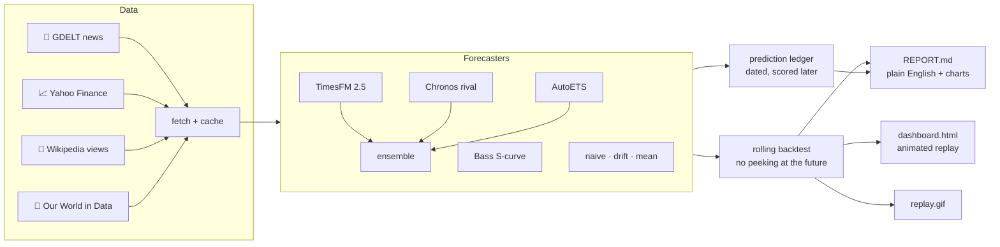

<p align="center">
  <picture>
    <source media="(prefers-color-scheme: dark)" srcset="docs/assets/banner-dark.svg">
    
  </picture>
</p>

<p align="center">
  <a href="LICENSE"></a>
  
  <a href="https://github.com/google-research/timesfm"></a>
  <a href="../../actions/workflows/tests.yml"></a>
  <a href="../../actions/workflows/predict.yml"></a>
</p>

<p align="center">
  <b><a href="#-the-idea-in-30-seconds">The idea</a></b> ·
  <b><a href="#-latest-results">Latest results</a></b> ·
  <b><a href="#-how-to-read-a-forecast">How to read it</a></b> ·
  <b><a href="#-quick-start">Quick start</a></b> ·
  <b><a href="REFERENCES.md">20 reference repos</a></b> ·
  <b><a href="CREDITS.md">Credits</a></b>
</p>

## 🔭 The idea in 30 seconds

In Isaac Asimov's *Foundation*, Hari Seldon cannot predict what any one person will do, but his
*psychohistory* can predict what billions of people will do together. This project asks a small,
honest version of that question with [**TimesFM**](https://github.com/google-research/timesfm),
Google Research's open-source forecasting model:

> **When an AI forecasts the world, how often is it actually right, how far ahead can it see,
> and is it better at crowds than at individuals?**

Every week it makes dated forecasts, waits for the future to arrive, and keeps score in public.
Nothing here is financial advice. Most of the interesting results are about *where prediction
fails*.

## 👥 Why crowds are predictable (a toy world)

<p align="center"></p>

Ten thousand simulated people each have a mood that is a little shared "tide" plus a lot of
personal noise. One person is mostly noise: only about a fifth of their movement is predictable.
Average a crowd of a thousand and the noise cancels out, so almost all of what is left is the
tide. That is Seldon's bet in one picture, and test 2 below checks whether real indices and
composites behave the same way. Run it yourself, no downloads needed: `psychohistory simulate`.

## 🌍 Three kinds of future

| | Domain | What is forecast | Data |
|:-:|---|---|---|
| 📰 | **World events in the news** | Share of world news coverage about war, elections, inflation, climate, outbreaks, protests | [GDELT Project](https://www.gdeltproject.org/) |
| 📈 | **Markets and stores of value** | S&P 500, Nasdaq-100, MSCI World, Apple, NVIDIA, Tesla, Exxon, **gold**, **silver**, oil, copper, Bitcoin | Yahoo Finance via [yfinance](https://github.com/ranaroussi/yfinance) |
| 🚀 | **New technologies** | Attention to LLMs, AI, quantum, CRISPR, EVs, fusion, humanoid robots; adoption of solar, wind, internet | [Wikimedia Pageviews](https://wikitech.wikimedia.org/wiki/Analytics/AQS/Pageviews), [Our World in Data](https://ourworldindata.org/) |

## 📊 Latest results

<picture>
  <source media="(prefers-color-scheme: dark)" srcset="results/plots/scorecard-dark.svg">
  
</picture>

**How to read the scoreboard.** The big number is how much less error the model made than the
simple guess "tomorrow looks like today" (positive is good, zero means no better). *Sees ahead*
is how far into the future that edge lasts. *Right direction* is how often it called up or down
correctly; 50% is a coin flip.

Everything in this section is redrawn by every forecast run (the weekly GitHub Action commits
it). Until the first run these are placeholders.

**The replay.** Each frame is one past forecast: the orange fan is what the model expected, the
dots are what really happened. Faint lines are its earlier guesses.

<p align="center"></p>

<table>
<tr>
<td width="50%"><b>Did it beat a simple guess?</b><br><sub>Bars above zero mean less error than "tomorrow looks like today".</sub><br></td>
<td width="50%"><b>How far ahead can it see?</b><br><sub>Where each line drops below zero, the model has run out of foresight.</sub><br></td>
</tr>
</table>

**🔮 What it expects next.** The newest sealed forecast for six headline series, from stocks,
gold and silver to world news and AI. Each panel says, in words, the chance it ends higher.

<p align="center"></p>

**🔐 The Time Vault.** The real test. Every week's predictions are sealed with a date in
`predictions/ledger.csv` before the future happens, and opened once it arrives. If the model is
honest, the left line settles near 80% and the right line stays below the coin flip.

<p align="center"></p>

Read the full write-up in [**results/REPORT.md**](results/REPORT.md), which opens with the findings
in plain English, or open [**results/dashboard.html**](results/dashboard.html) for the interactive
version with the scoreboard, a play button, hover tooltips, a fan chart for every series and a
crowd slider you can drag.

**Live dashboard:** after each weekly run the `pages` workflow publishes it to
[normansrule.github.io/world-predictions](https://normansrule.github.io/world-predictions/)
(one-time setup: Settings → Pages → Source: **GitHub Actions**).

## 🧭 How to read a forecast

<p align="center">
  <picture>
    <source media="(prefers-color-scheme: dark)" srcset="docs/assets/how-to-read-dark.svg">
    
  </picture>
</p>

A good forecaster is not one that is always right. It is one whose **80% range catches reality
about 8 times in 10**, and whose **"70% chance" calls come true about 70% of the time**. Both are
checked in every report.

## 🧪 The five Seldon tests

| | Question | How it is measured |
|:-:|---|---|
| 1 | **Can the future be predicted at all?** | *Skill*: the share of error removed compared with "tomorrow looks like today". Zero means no better. |
| 2 | **Are crowds easier than individuals?** (Seldon's law) | Series are tagged *aggregate* (an index, a composite, a world total) or *individual* (one company, one topic), and their skill is compared. |
| 3 | **How far ahead can it see?** (the Seldon horizon) | Skill at every step ahead, until it falls to zero. |
| 4 | **Are its odds honest?** | Every forecast gives a chance of ending higher; calibration and the Brier score check it. |
| 5 | **What shocked it?** (Seldon crises) | Windows where reality left the 80% range, listed in every report. |

**The honesty rule.** Backtests can flatter a model that was trained on the same history, so the
repo also keeps a **prediction ledger**: forecasts written to `predictions/ledger.csv` *before*
the future happens and scored once it arrives, like Seldon's recordings in the Time Vault.

## ⚙️ How it works



Full methods and limitations: [docs/METHODOLOGY.md](docs/METHODOLOGY.md).

## 🚀 Quick start

```bash
git clone https://github.com/Normansrule/world-predictions.git
cd world-predictions
python -m venv .venv && source .venv/bin/activate
pip install torch --index-url https://download.pytorch.org/whl/cpu   # optional: small CPU-only PyTorch
pip install -e ".[timesfm,rivals,classical,dev]"                   # TimesFM, Chronos, AutoETS

psychohistory simulate                                   # 5-second demo, no downloads
psychohistory -v run --compare chronos-bolt --ensemble   # everything in one go
```

Or step by step:

```bash
psychohistory fetch       # download all series into data/ (cached)
psychohistory backtest    # rolling backtest vs baselines -> results/REPORT.md, dashboard, replay
psychohistory predict     # record new forecasts in predictions/ledger.csv
psychohistory score       # score ledger forecasts whose dates have arrived
```

| Option | What it does |
|---|---|
| `--compare chronos-bolt` | Score a rival model on exactly the same windows (repeatable) |
| `--ensemble` | Also score the average of all models, a reliable win on forecasting leaderboards |
| `--domain markets` | Only one domain (repeatable) |
| `--series gold --series silver` | Only some series |
| `--model timesfm-3` | Use TimesFM 3.0 (non-commercial weights) |
| `--windows 24` | More backtest windows |
| `--skip-backtest` | For `run`: forecast and score only |

No GPU is needed; TimesFM 2.5 has 200M parameters and runs on CPU. To try the pipeline without
downloading any model: `psychohistory backtest --model drift`.

## 🤖 Models

| Name | Model | Weights licence |
|---|---|---|
| `timesfm-2.5` (default) | [google/timesfm-2.5-200m-pytorch](https://huggingface.co/google/timesfm-2.5-200m-pytorch) | Apache-2.0 |
| `timesfm-3` | [google/timesfm-3.0-pytorch](https://huggingface.co/google/timesfm-3.0-pytorch) | **Non-commercial only** ([licence](https://huggingface.co/google/timesfm-3.0-pytorch/blob/main/LICENSE)) |
| `chronos-bolt`, `chronos-2` | Amazon's rival foundation models, [amazon/chronos-bolt-small](https://huggingface.co/amazon/chronos-bolt-small) and [amazon/chronos-2](https://huggingface.co/amazon/chronos-2) (install the `rivals` extra) | See each model card |
| `ensemble` | Average of TimesFM, its `--compare` rivals and AutoETS (add `--ensemble`) | n/a |
| `bass` | Bass diffusion S-curve (Bass, 1969), run automatically on technology-adoption series | Apache-2.0 (this repo) |
| `auto-ets`, `auto-arima` | Classical baselines from [statsforecast](https://github.com/Nixtla/statsforecast) (install the `classical` extra) | Apache-2.0 |
| `naive`, `drift`, `mean` | Baselines in `src/psychohistory/models.py` | Apache-2.0 (this repo) |

Backtests always include the simple baselines, plus `auto-ets` when statsforecast is
installed, so TimesFM has to beat a serious classical model and not just a random walk.

TimesFM 2.5 is the default so the whole project stays usable under Apache-2.0. TimesFM 3.0 is
stronger but its downloaded weights may not be used commercially or in production.

## 🔁 Automation

`.github/workflows/predict.yml` runs every Monday: it fetches fresh data, records new TimesFM
forecasts in the ledger, scores old ones, and commits the results. On the first of each month it
also reruns the full backtest. Raw data is not committed (see Credits for each source's terms).

## ➕ Adding your own predictions

Add a `SeriesSpec` to [`src/psychohistory/catalog.py`](src/psychohistory/catalog.py), for example:

```python
_stock("platinum", "PL=F", "Platinum futures")
_news("news_ai_regulation", '"AI regulation"', "Coverage of AI regulation")
_wiki("wiki_solid_state_battery", "Solid-state_battery", "Wikipedia views: Solid-state battery")
```

## 🗂️ Project layout

```
src/psychohistory/
  catalog.py     the series to forecast, by domain, tagged aggregate / individual
  data/          loaders: gdelt.py, markets.py, wikipedia.py, owid.py (+ CSV cache)
  models.py      TimesFM, Chronos, AutoETS, Bass and baseline forecasters, plus the ensemble
  metrics.py     MAE, MASE, sMAPE, direction, 80% coverage, pinball loss, Brier score
  backtest.py    rolling-origin backtest and the Seldon summary tables
  ledger.py      record forecasts now, score them later
  story.py       plain-English headlines and the animated replay GIF
  simulate.py    toy agent-based crowd: why aggregates are predictable
  report.py      results/REPORT.md and charts
  dashboard.py   results/dashboard.html (interactive Plotly, animated replay)
  cli.py         the `psychohistory` command
tests/           offline tests (synthetic data, no downloads)
docs/            METHODOLOGY.md and the README artwork in docs/assets/
.github/         tests, weekly predict, and pages (publishes the dashboard)
scripts/         make_readme_art.py (redraws the README art), publish_to_github.sh
```

The banner and explainer are illustrations, not results. Redraw them with
`python scripts/make_readme_art.py`.

## 📚 References

[**REFERENCES.md**](REFERENCES.md) lists 20 open-source repositories this project learns from:
rival foundation models (Chronos, Moirai, Lag-Llama, MOMENT, TimeGPT), forecasting frameworks
(statsforecast, neuralforecast, Prophet, Darts, sktime, GluonTS, statsmodels, arch), benchmarks
(GIFT-Eval, fev, properscoring), simulation (Mesa) and presentation (Plotly, OWID Grapher,
Streamlit). It also lists the modelling theories behind each test, from cliodynamics to the
efficient-market hypothesis.

## 🙏 Credits

This project stands on other people's work. Full attribution, licences and terms of use are in
[**CREDITS.md**](CREDITS.md). In short:

- **TimesFM** by Google Research: [github.com/google-research/timesfm](https://github.com/google-research/timesfm),
  paper: Das, Kong, Sen, Zhou, *A decoder-only foundation model for time-series forecasting*, ICML 2024
  ([arXiv:2310.10688](https://arxiv.org/abs/2310.10688)).
- **GDELT Project** for world news coverage data.
- **Yahoo Finance** data via the **yfinance** library by Ran Aroussi.
- **Wikimedia Foundation** Pageviews API.
- **Our World in Data** (CC BY 4.0).
- **Isaac Asimov**'s *Foundation* for the idea of psychohistory.

## ⚖️ Licence

Code: [Apache License 2.0](LICENSE). Data and model weights keep their own licences; see
[CREDITS.md](CREDITS.md).
