<div align="center">

<picture>
  <source media="(prefers-color-scheme: dark)" srcset="docs/assets/banner-dark.svg">
  
</picture>

**Can a machine do Hari Seldon's psychohistory?**<br>
Google's open-source **TimesFM** forecasts world news, markets (stocks, gold, silver) and new technologies,
and every forecast is scored in public.

[](https://normansrule.github.io/world-predictor/)
[](https://normansrule.github.io/world-predictor/app/)
[](https://github.com/Normansrule/world-predictor/releases/latest)
[](results/REPORT.md)

[](https://github.com/Normansrule/world-predictor/actions/workflows/tests.yml)
[](https://github.com/Normansrule/world-predictor/actions/workflows/predict.yml)
[](https://github.com/Normansrule/world-predictor/actions/workflows/pages.yml)
[](LICENSE)

[](https://github.com/google-research/timesfm)


[The idea](#-the-idea-in-30-seconds) ·
[The app](#%EF%B8%8F-the-app) ·
[Latest results](#-latest-results) ·
[How it works](#%EF%B8%8F-how-it-works) ·
[Quick start](#-quick-start) ·
[Progress](#%EF%B8%8F-roadmap-and-progress) ·
[Design](#-design) ·
[References](#-references) ·
[Credits](#-credits)

</div>

---

## 🔭 The idea in 30 seconds

In Isaac Asimov's *Foundation*, Hari Seldon cannot predict what any one person will do, but his
*psychohistory* can predict what billions of people will do together. World Predictor asks a
small, honest version of that question with [**TimesFM**](https://github.com/google-research/timesfm),
Google Research's open-source forecasting model:

> **When an AI forecasts the world, how often is it right, how far ahead can it see, and is it
> better at crowds than at individuals?**

Every week it seals new dated forecasts, waits for the future to arrive, and keeps score in public.
Nothing here is financial advice. Most of the interesting results are about *where prediction fails*.

| | Area | What is forecast | Data |
|:-:|---|---|---|
| 📰 | **World events in the news** | Share of world news coverage about war, elections, inflation, climate, outbreaks, protests | [GDELT Project](https://www.gdeltproject.org/) |
| 📈 | **Markets and stores of value** | S&P 500, Nasdaq-100, MSCI World, Apple, NVIDIA, Tesla, Exxon, **gold**, **silver**, oil, copper, Bitcoin | Yahoo Finance via [yfinance](https://github.com/ranaroussi/yfinance) |
| 🚀 | **New technologies** | Attention to LLMs, AI, quantum, CRISPR, EVs, fusion, humanoid robots; adoption of solar, wind, internet | [Wikimedia Pageviews](https://wikitech.wikimedia.org/wiki/Analytics/AQS/Pageviews), [Our World in Data](https://ourworldindata.org/) |

---

## 🖥️ The app

One app, two ways to run it. They are the **same files** in [`site/`](site/): the web version is served
by GitHub Pages with the newest weekly forecasts, and the full version runs TimesFM on your own
computer and opens the identical app at `http://localhost:8000`.

<picture>
  <source media="(prefers-color-scheme: dark)" srcset="docs/assets/app-overview-dark.png">
  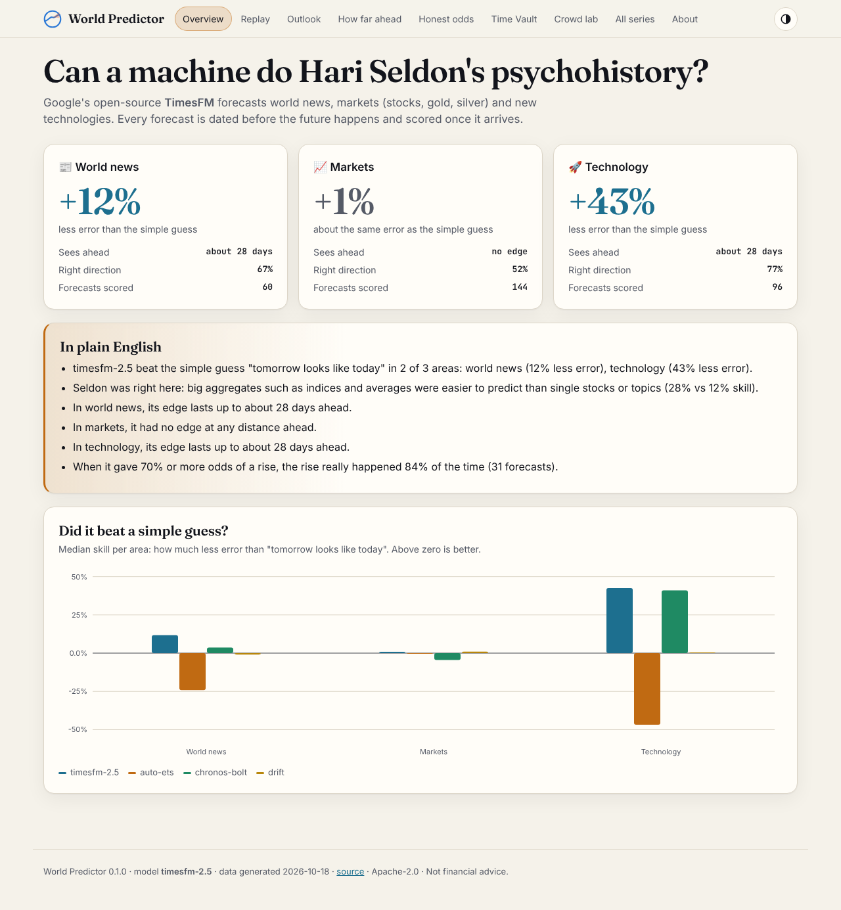
</picture>

| | 🌐 Web app | 💻 Full version |
|---|---|---|
| **Open it** | [normansrule.github.io/world-predictor](https://normansrule.github.io/world-predictor/) | `psychohistory app` (see [Quick start](#-quick-start)) |
| **Install** | Nothing. Optionally *Install app* from the browser menu | Python 3.10+, about 2 GB with PyTorch |
| **Forecasts** | The project's weekly TimesFM run | Your own runs, any series, any model |
| **Data** | Precomputed into one small script file | Downloaded fresh from GDELT, Yahoo, Wikimedia, OWID |
| **Offline** | Yes, after the first visit (service worker) | Yes |
| **Built for** | Fast first load: no chart library, under 50 KB of code | Full power: backtests, rivals, ensembles |

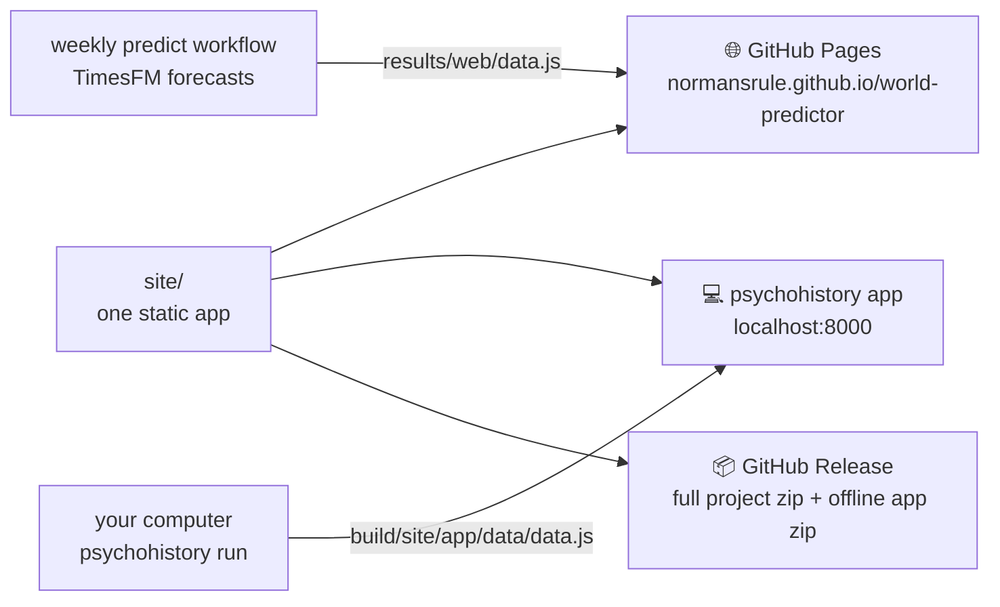

<table>
<tr>
<td width="50%"><b>⏯ Replay</b><br><sub>Press play to watch past forecasts meet what really happened.</sub><br>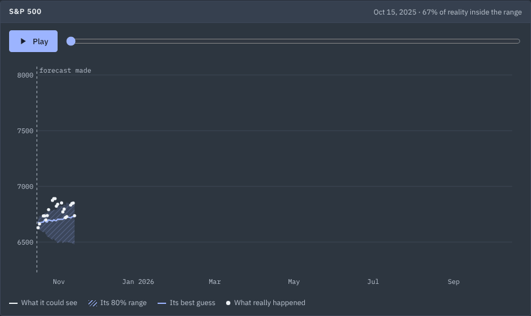</td>
<td width="50%"><b>🔮 Outlook</b><br><sub>The newest forecast for every series, with the odds in words.</sub><br>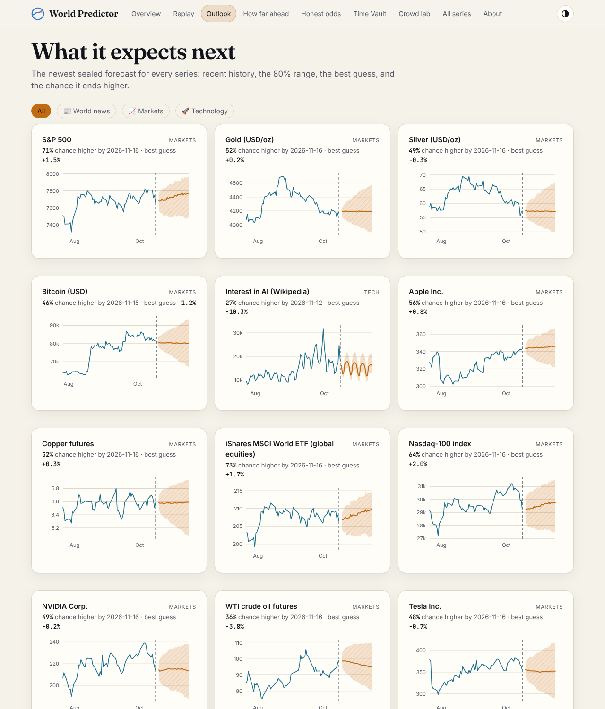</td>
</tr>
<tr>
<td width="50%"><b>👥 Crowd lab</b><br><sub>Drag a slider to grow a simulated crowd and watch it become predictable.</sub><br>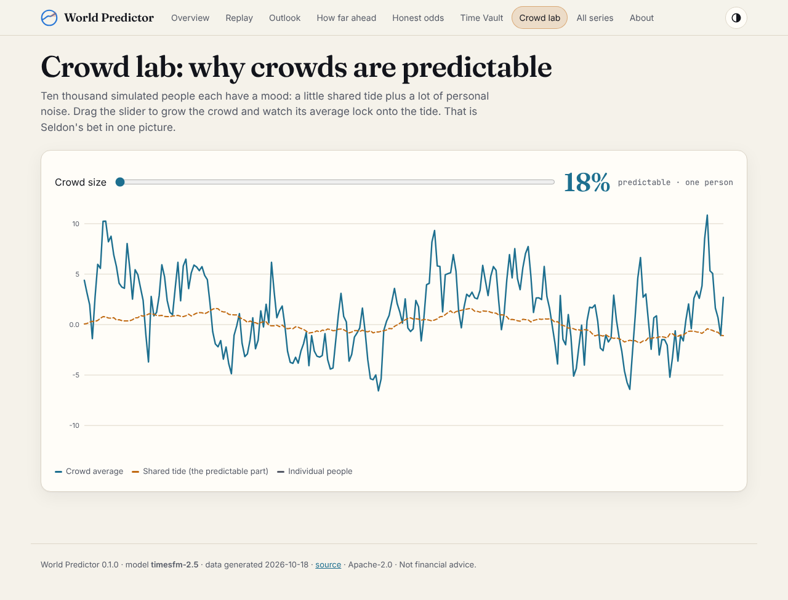</td>
<td width="50%"><b>🔐 Time Vault</b><br><sub>Sealed predictions, opened and scored as their dates arrive.</sub><br>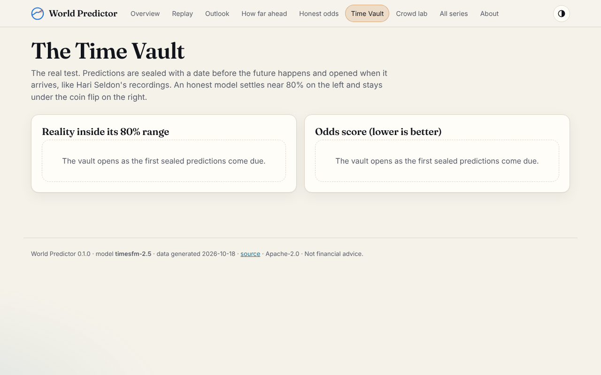</td>
</tr>
</table>

<sub>Screenshots show the app's built-in demo data (made-up series, simple models), which it uses until the first real forecast run. The app labels demo data clearly.</sub>

The app's design follows [World Monitor](https://github.com/koala73/worldmonitor) by Elie Habib and
its fork [Terra Atlas](https://github.com/Normansrule/worldmonitor): one static `site/` folder served by
GitHub Pages, the same folder in a downloadable build, and no server or API keys. No code is copied
from either (World Monitor is AGPL-3.0; World Predictor is Apache-2.0).

---

## 📊 Latest results

Everything in this section is redrawn by every forecast run and committed by the weekly GitHub
Action. **First real run: 18 October 2026**, TimesFM 2.5 on 25 live series (5 news topics, 12 markets,
8 technologies), each backtested over past windows against what really happened:

| Area | TimesFM vs "tomorrow looks like today" | Its 80% range caught reality | Edge lasts |
|---|---|---|---|
| 📰 World news | **12% less error** | 79% of the time | about 28 days |
| 📈 Markets (stocks, gold, silver, oil, Bitcoin) | about the same (+1%) | 83% of the time | no steady edge |
| 🚀 Technology | **43% less error** | 76% of the time | about 28 days |

When it gave 70% or better odds of a rise, the rise happened 84% of the time (31 forecasts).
Big aggregates such as indices beat single stocks (10% vs −1% skill in markets), as Seldon would
predict. Markets staying close to a random walk is the honest, expected result. Full tables are in
[results/REPORT.md](results/REPORT.md). The Time Vault fills in as the sealed predictions come due.

<picture>
  <source media="(prefers-color-scheme: dark)" srcset="results/plots/scorecard-dark.svg">
  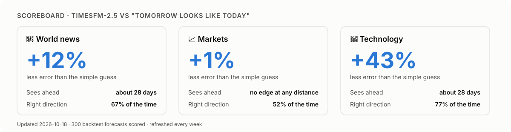
</picture>

**How to read the scoreboard.** The big number is how much less error the model made than the
simple guess "tomorrow looks like today" (positive is good, zero means no better). *Sees ahead* is
how far into the future that edge lasts. *Right direction* is how often it called up or down
correctly; 50% is a coin flip.

**⏯ The replay.** Each frame is one past forecast: the orange fan is what the model expected, the
dots are what really happened.

<p align="center"></p>

<table>
<tr>
<td width="50%"><b>Did it beat a simple guess?</b><br><sub>Bars above zero mean less error than "tomorrow looks like today".</sub><br></td>
<td width="50%"><b>How far ahead can it see?</b><br><sub>Where each line drops below zero, the model has run out of foresight.</sub><br></td>
</tr>
</table>

**🔮 What it expects next.** The newest sealed forecast for six headline series, from stocks, gold
and silver to world news and AI. Each panel says, in words, the chance it ends higher.

<p align="center"></p>

**🔐 The Time Vault.** The real test. Every week's predictions are sealed with a date in
`predictions/ledger.csv` before the future happens, and opened once it arrives. If the model is
honest, the left line settles near 80% and the right line stays below the coin flip.

<p align="center"></p>

The full write-up is in [**results/REPORT.md**](results/REPORT.md), which opens with the findings in
plain English.

---

## 👥 Why crowds are predictable (a toy world)

<p align="center">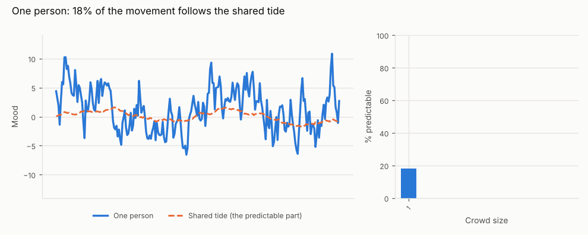</p>

Ten thousand simulated people each have a mood that is a little shared "tide" plus a lot of personal
noise. One person is mostly noise: only about a fifth of their movement is predictable. Average a
crowd of a thousand and the noise cancels out, so almost all of what is left is the tide. That is
Seldon's bet in one picture, and test 2 below checks whether real indices and composites behave the
same way. Run it yourself, no downloads needed: `psychohistory simulate`.

## 🧭 How to read a forecast

<p align="center">
  <picture>
    <source media="(prefers-color-scheme: dark)" srcset="docs/assets/how-to-read-dark.svg">
    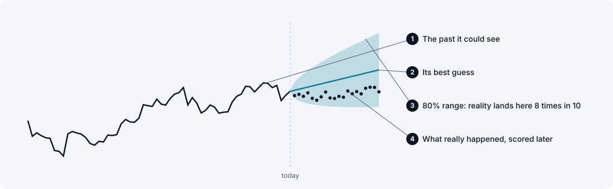
  </picture>
</p>

A good forecaster is not one that is always right. It is one whose **80% range catches reality about
8 times in 10**, and whose **"70% chance" calls come true about 70% of the time**. Both are checked in
every report and in the app.

## 🧪 The five Seldon tests

| | Question | How it is measured |
|:-:|---|---|
| 1 | **Can the future be predicted at all?** | *Skill*: the share of error removed compared with "tomorrow looks like today". Zero means no better. |
| 2 | **Are crowds easier than individuals?** (Seldon's law) | Series are tagged *aggregate* (an index, a composite, a world total) or *individual* (one company, one topic), and their skill is compared. |
| 3 | **How far ahead can it see?** (the Seldon horizon) | Skill at every step ahead, until it falls to zero. |
| 4 | **Are its odds honest?** | Every forecast gives a chance of ending higher; calibration and the Brier score check it. |
| 5 | **What shocked it?** (Seldon crises) | Windows where reality left the 80% range, listed in every report. |

**The honesty rule.** Backtests can flatter a model that was trained on the same history, so the
project also keeps a **prediction ledger**: forecasts written to `predictions/ledger.csv` *before*
the future happens and scored once it arrives, like Seldon's recordings in the Time Vault.

---

## ⚙️ How it works

**One forecast, taken apart.** Every forecast is built from the same six layers. On the
[website](https://normansrule.github.io/world-predictor/#engine) they come apart and click back
together as you scroll; here they are pulled apart and labelled.

<picture>
  <source media="(prefers-color-scheme: dark)" srcset="docs/assets/engine-dark.svg">
  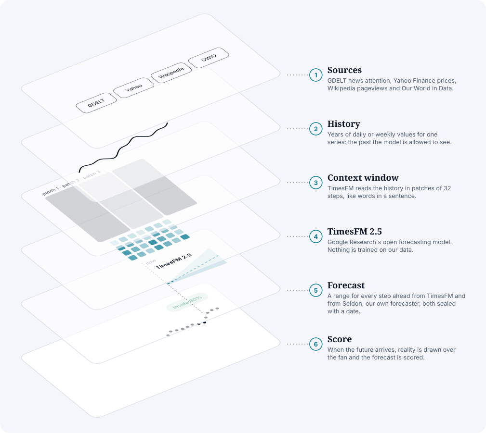
</picture>

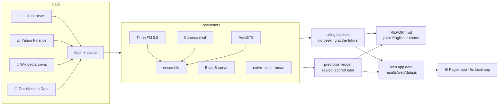

Full methods and limitations: [docs/METHODOLOGY.md](docs/METHODOLOGY.md).

| Workflow | When | What it does |
|---|---|---|
| [`predict`](.github/workflows/predict.yml) | Every Monday (backtest on the 1st) | Fetches data, seals new TimesFM forecasts, scores old ones, redraws charts and the app data, commits them |
| [`pages`](.github/workflows/pages.yml) | After each forecast run | Publishes the web app to GitHub Pages |
| [`release`](.github/workflows/release.yml) | When a `v*` tag is pushed | Attaches the full project zip and an offline app zip to a GitHub Release |
| [`tests`](.github/workflows/tests.yml) | Every push | Runs the offline test suite on Python 3.10 and 3.12 |

---

## 🚀 Quick start

**On the web:** open [normansrule.github.io/world-predictor](https://normansrule.github.io/world-predictor/).

**On your computer (Ubuntu, from any folder):**

```bash
sudo apt update && sudo apt install -y git python3-venv python3-pip
git clone https://github.com/Normansrule/world-predictor.git "$HOME/world-predictor"
cd "$HOME/world-predictor"
python3 -m venv .venv && source .venv/bin/activate
pip install torch --index-url https://download.pytorch.org/whl/cpu   # small CPU-only PyTorch
pip install -e ".[timesfm,rivals,classical,dev]"                   # TimesFM, Chronos, AutoETS

psychohistory app --demo                                 # the app with demo data, in seconds
psychohistory -v run --compare chronos-bolt --ensemble   # real forecasts (downloads TimesFM and data)
psychohistory app                                        # the app with your own results
```

Or step by step:

```bash
psychohistory fetch       # download all series into data/ (cached)
psychohistory backtest    # rolling backtest vs baselines -> results/REPORT.md and charts
psychohistory predict     # seal new forecasts in predictions/ledger.csv
psychohistory score       # score sealed forecasts whose dates have arrived
psychohistory export      # write the app's data file, results/web/data.js
psychohistory site        # build the static app into build/site (what Pages serves)
psychohistory simulate    # the toy crowd, no downloads
```

| Option | What it does |
|---|---|
| `--compare chronos-bolt` | Score a rival model on exactly the same windows (repeatable) |
| `--ensemble` | Also score the average of all models, a reliable win on forecasting leaderboards |
| `--domain markets` | Only one area (repeatable) |
| `--series gold --series silver` | Only some series |
| `--model timesfm-3` | Use TimesFM 3.0 (non-commercial weights) |
| `--windows 24` | More backtest windows |
| `--skip-backtest` | For `run`: forecast and score only |
| `--port 8080`, `--no-browser` | For `app`: where to serve it, and whether to open a browser |

No GPU is needed; TimesFM 2.5 has 200M parameters and runs on CPU. `world-predictor` works as
another name for the `psychohistory` command.

## 🤖 Models

| Name | Model | Weights licence |
|---|---|---|
| `timesfm-2.5` (default) | [google/timesfm-2.5-200m-pytorch](https://huggingface.co/google/timesfm-2.5-200m-pytorch) | Apache-2.0 |
| `timesfm-3` | [google/timesfm-3.0-pytorch](https://huggingface.co/google/timesfm-3.0-pytorch) | **Non-commercial only** ([licence](https://huggingface.co/google/timesfm-3.0-pytorch/blob/main/LICENSE)) |
| `chronos-bolt`, `chronos-2` | Amazon's rival foundation models, [amazon/chronos-bolt-small](https://huggingface.co/amazon/chronos-bolt-small) and [amazon/chronos-2](https://huggingface.co/amazon/chronos-2) (install the `rivals` extra) | See each model card |
| `ensemble` | Average of TimesFM, its `--compare` rivals and AutoETS (add `--ensemble`) | n/a |
| `bass` | Bass diffusion S-curve (Bass, 1969), run automatically on technology-adoption series | Apache-2.0 (this repo) |
| `auto-ets`, `auto-arima` | Classical baselines from [statsforecast](https://github.com/Nixtla/statsforecast) (install the `classical` extra) | Apache-2.0 |
| `naive`, `drift`, `mean` | Baselines in `src/psychohistory/models.py` | Apache-2.0 (this repo) |

Backtests always include the simple baselines, plus `auto-ets` when statsforecast is installed, so
TimesFM has to beat a serious classical model and not just a random walk. TimesFM 2.5 is the default
so the whole project stays usable under Apache-2.0.

## ➕ Adding your own predictions

Add a `SeriesSpec` to [`src/psychohistory/catalog.py`](src/psychohistory/catalog.py), for example:

```python
_stock("platinum", "PL=F", "Platinum futures")
_news("news_ai_regulation", '"AI regulation"', "Coverage of AI regulation")
_wiki("wiki_solid_state_battery", "Solid-state_battery", "Wikipedia views: Solid-state battery")
```

---

## 🗺️ Roadmap and progress

<picture>
  <source media="(prefers-color-scheme: dark)" srcset="docs/assets/progress-dark.svg">
  
</picture>

<!-- progress:start -->

**21 of 28 milestones done (75%).** Drawn from [`docs/progress.json`](docs/progress.json); tests check every ticked item against the repository.

<details open><summary><b>📰 World news</b> · 5/6</summary>

- [x] GDELT news-attention loader
- [x] Six news topics plus a news composite
- [x] Rolling backtest against naive, drift, mean and AutoETS
- [x] Weekly sealed forecasts in the prediction ledger
- [x] First real TimesFM results published
- [ ] Event-level odds (for example, escalation of a named conflict)

</details>

<details open><summary><b>📈 Markets, gold and silver</b> · 5/6</summary>

- [x] Yahoo Finance loader (stocks, indices, gold, silver, oil, copper, Bitcoin)
- [x] Chronos rival models and a quantile-averaged ensemble
- [x] Chance-of-rising odds scored with the Brier score
- [x] Outlook grid for stocks, gold, silver and Bitcoin
- [x] First real TimesFM results published
- [ ] Volatility forecasts (GARCH from the arch library)

</details>

<details open><summary><b>🚀 New technologies</b> · 4/5</summary>

- [x] Wikipedia attention for LLMs, AI, quantum, CRISPR, EVs, fusion, robots
- [x] Adoption curves from Our World in Data
- [x] Bass diffusion S-curve as a theory-driven rival
- [x] First real TimesFM results published
- [ ] Hype-cycle detection (attention peaks while adoption keeps rising)

</details>

<details open><summary><b>🌐 Web app (GitHub Pages)</b> · 5/7</summary>

- [x] Static app: scoreboard, replay, outlook, horizon, odds, Time Vault, crowd lab
- [x] No chart library: hand-written SVG charts, under 50 KB of code in total
- [x] Light and dark themes, phone layout, installable, works offline
- [x] Pages deployment after every weekly run
- [x] Landing page that tells the story on scroll, with the exploded forecast engine
- [ ] Live at normansrule.github.io/world-predictor
- [ ] A detail page for every series

</details>

<details open><summary><b>💻 Downloadable full version</b> · 2/4</summary>

- [x] `psychohistory app`: run TimesFM locally and open the same app
- [x] Release workflow: full project zip and offline app zip
- [ ] First tagged release
- [ ] Desktop installer (Tauri, as World Monitor does)

</details>

<!-- progress:end -->

## 🗂️ Project layout

```
site/                 the app: one static folder for Pages, download and local use
  index.html          landing page
  app/                the app (index.html, js/app.js, js/charts.js, css/app.css, data/data.js)
  sw.js               offline support; manifest.webmanifest makes it installable
src/psychohistory/
  catalog.py          the series to forecast, by area, tagged aggregate / individual
  data/               loaders: gdelt.py, markets.py, wikipedia.py, owid.py (+ CSV cache)
  models.py           TimesFM, Chronos, AutoETS, Bass and baseline forecasters, plus the ensemble
  metrics.py          MAE, MASE, sMAPE, direction, 80% coverage, pinball loss, Brier score
  backtest.py         rolling-origin backtest and the Seldon summary tables
  ledger.py           seal forecasts now, score them later
  story.py            plain-English findings, scoreboard, replay, outlook, Time Vault
  simulate.py         toy agent-based crowd: why aggregates are predictable
  web.py              the app's data file, the demo data, and building the site
  progress.py         this README's progress tracker, from docs/progress.json
  report.py           results/REPORT.md and charts
  dashboard.py        results/dashboard.html (Plotly version of the dashboard)
  cli.py              the `psychohistory` command
tests/                offline tests (synthetic data, no downloads)
docs/                 METHODOLOGY.md, progress.json and the README artwork in docs/assets/
.github/workflows/    tests, predict (weekly), pages (web app), release (downloads)
scripts/              make_readme_art.py, make_app_screenshots.py, publish_to_github.sh
```

The banner, explainer and progress bars are drawn by `python scripts/make_readme_art.py`; the app
screenshots by `python scripts/make_app_screenshots.py`.

---

## 🎨 Design

The website and app share one look, "the vault": deep ink, brass gold for forecasts and cyan for
what really happened, with a literary serif for headings. The landing page tells the story as you
scroll, ending with a forecast that comes apart into its six layers and reassembles, and every chart
draws itself in, with the future hatched so it never looks like the past.

It was shaped by fifty sites and READMEs, from Apple's exploded product pages and Bartosz
Ciechanowski's *Mechanical Watch* to Stripe, Linear, The Pudding and Our World in Data. Each one, and
the idea taken from it, is listed in [**docs/DESIGN.md**](docs/DESIGN.md). No code was copied from any
of them: there is no chart or animation library, motion runs on CSS scroll-driven animations with a
tiny fallback, and everything stops for readers who prefer reduced motion.

## 📚 References

| Project | How World Predictor uses it |
|---|---|
| [google-research/timesfm](https://github.com/google-research/timesfm) · Apache-2.0 | The forecasting model under test |
| [koala73/worldmonitor](https://github.com/koala73/worldmonitor) · AGPL-3.0 | Inspiration for the web-app and download design: one static site for Pages and a desktop build. Ideas only, no code |
| [Normansrule/worldmonitor](https://github.com/Normansrule/worldmonitor) (Terra Atlas) | The fork whose README layout and Pages-plus-release setup this project follows |
| [amazon-science/chronos-forecasting](https://github.com/amazon-science/chronos-forecasting) · Apache-2.0 | Rival foundation models (`--compare`) |
| [Nixtla/statsforecast](https://github.com/Nixtla/statsforecast) · Apache-2.0 | AutoETS and AutoARIMA baselines |
| [projectmesa/mesa](https://github.com/projectmesa/mesa) · Apache-2.0 | Inspiration for the toy crowd |
| [owid/owid-grapher](https://github.com/owid/owid-grapher) · MIT | One clear question per chart, plain captions, source lines |
| [plotly/plotly.py](https://github.com/plotly/plotly.py) · MIT | The Plotly version of the dashboard |
| [docs/DESIGN.md](docs/DESIGN.md) | Fifty sites and READMEs behind the look and motion, each with the idea taken |

[**REFERENCES.md**](REFERENCES.md) lists all 20 reference repositories (foundation models,
forecasting frameworks, benchmarks, simulation and presentation) and the modelling theories behind
each test, from cliodynamics to the efficient-market hypothesis.

## 🙏 Credits

This project stands on other people's work. Full attribution, licences and terms of use are in
[**CREDITS.md**](CREDITS.md). In short:

- **TimesFM** by Google Research: Das, Kong, Sen, Zhou, *A decoder-only foundation model for
  time-series forecasting*, ICML 2024 ([arXiv:2310.10688](https://arxiv.org/abs/2310.10688)).
- **World Monitor** by Elie Habib, for the web-app and download design.
- **Fifty design references** for the look and motion, listed in [docs/DESIGN.md](docs/DESIGN.md).
- **GDELT Project** for world news coverage data.
- **Yahoo Finance** data via the **yfinance** library by Ran Aroussi.
- **Wikimedia Foundation** Pageviews API.
- **Our World in Data** (CC BY 4.0).
- **Isaac Asimov**'s *Foundation* for the idea of psychohistory.

If you use World Predictor in your work, please cite it with [CITATION.cff](CITATION.cff) and cite
TimesFM as shown in CREDITS.md.

## ⚖️ Licence

Code: [Apache License 2.0](LICENSE). Data and model weights keep their own licences; see
[CREDITS.md](CREDITS.md). Nothing here is financial advice.
