<div align="center">

<picture>
  <source media="(prefers-color-scheme: dark)" srcset="docs/assets/banner-dark.svg">
  
</picture>

**A forecasting terminal that keeps score.**<br>
Google's open-source **TimesFM** against **Seldon**, our own psychohistory forecaster, a council of crowd laws and behavioural signals that leaves TimesFM out on purpose so it gives a second opinion, on world news, politics, markets, new technologies and the weather.
Every forecast is sealed before the future happens and scored when it arrives. Then it's your turn, in the Lab.

[](https://normansrule.github.io/world-predictor/app/#lab)
[](https://normansrule.github.io/world-predictor/app/#studio)
[](https://normansrule.github.io/world-predictor/app/)
[](https://github.com/Normansrule/world-predictor/releases/latest)
[](results/REPORT.md)

[](https://github.com/Normansrule/world-predictor/actions/workflows/tests.yml)
[](https://github.com/Normansrule/world-predictor/actions/workflows/predict.yml)
[](https://github.com/Normansrule/world-predictor/actions/workflows/pages.yml)
[](LICENSE)

[](https://github.com/google-research/timesfm)
[](src/psychohistory/radiant.py)
[](src/psychohistory/seldon.py)


[Overview](#overview) ·
[Features](#key-features) ·
[Screenshots](#screenshots) ·
[Results](#latest-results) ·
[Today](#today-alerts-time-frames-and-the-70-club) ·
[Radiant](#radiant-market-psychology-and-statistics-against-timesfm) ·
[Weather and politics](#weather-politics-and-the-next-technologies) ·
[Seldon vs TimesFM](#seldon-vs-timesfm) ·
[Setup](#setup-and-usage) ·
[How it works](#how-it-works) ·
[Structure](#project-structure) ·
[Design](#design) ·
[Progress](#roadmap-and-progress) ·
[Credits](#credits)

<sub>Maintained by <a href="https://github.com/Normansrule">@Normansrule</a></sub>

</div>

---

## Overview

In Isaac Asimov's *Foundation*, Hari Seldon can't predict what any one person will do, but his
*psychohistory* can predict what billions of people will do together. World Predictor runs a small,
honest version of that bet: every week it asks [**TimesFM**](https://github.com/google-research/timesfm)
(Time Series Foundation Model, Google Research's open-source forecaster) what happens next in world
news, politics, markets, new technology and the weather, seals each forecast with a date, and scores it in public once the
future shows up. Against it runs **Seldon**, this project's own forecaster: a council of simple laws of
crowd behaviour, a behavioural core, "no change" and Amazon's Chronos-Bolt, each voter's share earned on
forecasts that already came true. TimesFM has no seat in it, so Seldon is a real second opinion rather
than a copy. Its laws-only twin, **Seldon laws**, has no neural network at all. And **Radiant**, named after the
Prime Radiant, mixes TimesFM, Amazon's Chronos-Bolt, the crowd laws and a core of behavioural-finance
signals by weights each area has to earn on finished forecasts; in the full backtest of 4 November 2026
it beat TimesFM (9.56% average miss against 10.07%). All of them are scored by the same code on the
same windows, so the question "can psychohistory rules match or beat a 200-million-parameter
foundation model?" gets a real answer. In the
**Lab** you can make your own blind call on a real past window and see whether you'd have beaten them both. It's for anyone curious how far AI (artificial intelligence) forecasting really
reaches: people who follow markets or the news, data-science learners who want a worked, open example
of backtesting and calibration, and forecasting nerds who'd rather see the misses than a highlight reel.
Nothing here is financial advice, and most of the interesting results are about *where prediction fails*.

| Area | What gets forecast | Data |
|---|---|---|
| **World events in the news** | Share of world news coverage about war, elections, inflation, climate, disease outbreaks and protests | [GDELT](https://www.gdeltproject.org/) (Global Database of Events, Language and Tone) |
| **Markets and stores of value** | S&P 500 (Standard & Poor's 500), Nasdaq-100, MSCI World (Morgan Stanley Capital International), Apple, NVIDIA, Tesla, Exxon, **gold**, **silver**, **bonds** (US 10-year Treasury yield, TLT), oil, copper, Bitcoin | Yahoo Finance via [yfinance](https://github.com/ranaroussi/yfinance) |
| **Political events** | Share of world news coverage about sanctions, tariffs, ceasefires and peace talks, coups and martial law, impeachments and no-confidence votes, and referendums | [GDELT](https://www.gdeltproject.org/) |
| **New technologies** | Attention to large language models, AI, quantum computing, CRISPR (clustered regularly interspaced short palindromic repeats) gene editing, electric vehicles, fusion, humanoid robots, solid-state batteries, gene therapy, self-driving cars and SpaceX's Starship; adoption of solar, wind, the internet and electric cars; objects launched into space each year | [Wikimedia Pageviews](https://wikitech.wikimedia.org/wiki/Analytics/AQS/Pageviews), [Our World in Data](https://ourworldindata.org/) (with the IEA and UNOOSA) |
| **Weather and the planet** | The world's mean air temperature and sea surface temperature, Arctic sea ice extent, the daily high in London, New Delhi, Tokyo, Sydney and Los Angeles, and earthquakes of magnitude 4.5 or more | [Open-Meteo](https://open-meteo.com/), [Climate Reanalyzer](https://climatereanalyzer.org/) (ERA5, NOAA OISST), [NSIDC Sea Ice Index](https://nsidc.org/data/g02135), [USGS](https://earthquake.usgs.gov/) |

## Key features

- **Today: one screen that says what happens next, and how sure.** Rise alerts in three tiers (75%,
  85% and 95% or more chance of going higher), each carrying its own record of how often calls like it
  came true; every series read at six time frames, from tomorrow to ten years out; a history chart of
  every past forecast laid over what really happened; and a "who to trust" board with the 70% club.
  [Open it](https://normansrule.github.io/world-predictor/app/).
- **Five kinds of prediction, one scoreboard.** World news, politics, markets, new technologies, and
  the weather and the planet: 55 series, every one fetched from free open data, forecast by the same
  models, sealed the same way and scored against what really happened. Weather is forecast two weeks
  ahead and settled against thermometers and satellites; earthquakes are the honest control, a series
  nobody should be able to predict. [What's new](#weather-politics-and-the-next-technologies).
- **Coming up, and share any forecast.** A calendar of every sealed call by the day reality answers it,
  your own included, that drops into Google, Apple or Outlook calendars as an `.ics` file; and a one-click
  picture of any forecast to post or send. [Coming up](#coming-up-the-days-reality-answers).
- **Compare, and which model wins where.** Up to four series' forecasts on one chart, and on every
  series page each model's record there, with an honest test of whether that record predicts the next
  winner (it mostly does not). [Compare](#compare-series-side-by-side).
- **Follow it from anywhere.** A news feed for any feed reader, a free JSON API for spreadsheets and
  scripts, and a live forecast card you can embed on your own web page, all rebuilt after every run.
  [How](#follow-it-from-anywhere-news-feed-json-api-and-embeds).
- **World events, and what people are betting will happen.** For every news, politics and technology topic,
  the chance its coverage flares up, fades or grows next week and in four weeks, with the headlines; and
  beside it, the most-traded questions on Polymarket, sealed every day and scored when they settle, so
  the bettors get a track record too. [How it works](#betting-odds-what-people-expect-to-actually-happen).
- **Radiant, our forecaster that beat TimesFM.** TimesFM, Chronos-Bolt, Seldon's crowd laws, a
  behavioural core (momentum, overreaction, reversal, momentum crashes, attention spikes) and "no change",
  mixed by exponential weights that each area (markets, news, technology, yearly adoption) earns on
  forecasts that already came true. Sealed every week beside TimesFM, shown on a leaderboard of every
  model in the app, and replayed by its own lab (`scripts/radiant_replay.py`) on every full backtest so a
  change only ships if it holds up on windows it was not tuned on. [How it works](#radiant-market-psychology-and-statistics-against-timesfm).
- **The World terminal, the whole world on one screen.** A command line (`GOLD`, `SPX`, `N:WAR`,
  `WATCH`, `BOOK`), and every series in one dense board: last value, the week's move, how unusual it was
  in σ, the sealed forecast and its 80% range, the chance of rising, TimesFM's backtest record and its
  live hit rate, and the newest headlines from the GDELT world wire. Beside it: the week's movers, the
  sealed forecasts that just opened against what happened, a focus panel with the chart, both models'
  forecasts and volatility, and a live scoreboard. [Open it](https://normansrule.github.io/world-predictor/app/#terminal).
- **A year ledger, Jan 1 to Dec 31.** One table per tracked group (gold, silver, bonds, indices, stocks,
  oil and copper, Bitcoin, news, politics, technology, world climate, city weather, earthquakes), a row for every day: the real value against the most
  likely value of TimesFM, Radiant, Seldon and the crowd laws, each one's miss in percent, dashes where nothing
  was tracked, and a leaderboard of who is closest. Refreshed every weekday. [Open it](https://normansrule.github.io/world-predictor/app/#year).
- **Event odds for world news, politics and technology.** "The chance election coverage, four weeks from now,
  is at a level it reaches only one day in ten": a spike or a lull, for every news and technology
  series, read off TimesFM's and Seldon's sealed ranges, scored with the Brier score against
  climatology ("10%, as usual") and persistence ("what followed days like this one"), and sealed every
  week so the odds build a record of their own.
- **Your own book of predictions, kept for years.** Seal a call from the terminal on any series and
  date. When its day comes it is settled against the real value and against TimesFM and Seldon, and the
  result is kept in the call itself, so the record outlives the data. Your running skill against
  TimesFM, how often reality lands in your range, and an export/import that checks every seal.
- **The Lab.** A real past window with the ending hidden. Drag your forecast and your range, hold to
  seal it, hold again to break the seal, and watch reality, TimesFM and Seldon draw in. You're scored on
  the same terms they are (average miss, whether reality stayed in your range, direction), and your
  record is kept in your browser.
- **Forecast Studio: ask TimesFM, then go on the record.** Pick any series, date and level and read
  the chance TimesFM and Seldon give it, straight from their newest sealed forecast, with the
  percentiles beside it and a CSV (comma-separated values) download. Then seal your own call on the
  real future: it's fingerprinted, kept in your browser and scored against both models once the real
  value is in the data.
- **A Markets desk, built like an analyst's terminal.** Every market's sealed forecast on one
  screen at the horizon you pick (one day, one week, two weeks, a month): expected move, 80% range,
  chance of rising, TimesFM and Seldon side by side with a flag where they disagree, the volatility each
  forecast implies against what the market has really shown, and which model has had the least error
  on that very asset. Click a market for its fan chart, a price ladder (10th to 90th percentile), an
  odds calculator for any price level, every model's record there and its recent calls. Tick up to four
  to compare them rebased to 100, and export the lot as CSV or JSON. [Open it](https://normansrule.github.io/world-predictor/app/#markets).
- **A forecast desk note for any ticker.** `psychohistory desk MSFT ETH-USD ^FTSE` runs TimesFM and
  Seldon live on any Yahoo Finance symbol (or your own CSV), backtests every model on that asset's own
  past first, and writes a note with the outlook, odds for price levels, forecast against realized
  volatility and whom to trust there, plus the numbers as CSV and JSON.
- **A monitor built to run for years.** Every sealed forecast that comes due is scored against what
  really happened and kept: skill against "no change", 80% coverage, direction and Brier score, month
  by month or week by week, per area, per series and per model, with the running total beside it and
  the backtest's promise drawn as a line. A Diebold-Mariano test says whether TimesFM is *really*
  better than "no change" or just lucky so far, and drift alarms flag any series whose ranges have
  become too narrow or whose edge has gone. Every weekly batch of the ledger carries a SHA-256
  fingerprint, so an edited forecast can't hide. [Open it](https://normansrule.github.io/world-predictor/app/#monitor).
- **Volatility forecasts, where markets really can be forecast.** Prices are close to a random walk,
  but the size of the moves clusters. Every market's volatility over the next week and month is
  forecast by GARCH(1,1), EWMA and the range TimesFM and Seldon sealed, backtested every week against
  last month's volatility with QLIKE and a significance test, then sealed in its own fingerprinted
  ledger and scored as the windows pass. `psychohistory vol`, the Markets desk and the Monitor show it.
- **TimesFM on your own data.** `psychohistory ask` runs TimesFM live on any series in the catalog or on
  your own CSV, prints the middle and the 80% range for every step, puts Seldon's own forecast beside
  it with the votes behind it, answers "what's the chance it ends above X?", and can seal the forecast in the
  ledger to be scored later.
- **A page for every series.** Every past window TimesFM was tested on, drawn over what really
  happened, with a slider and a table that say for each one what the middle guess said, how far reality
  went, how much of it stayed inside the 80% range and whether the direction was right. Below that sit
  the newest sealed forecast and every sealed forecast whose date has already come.
- **Receipts, not just averages.** The Time Vault lists every opened forecast with its range, the
  real value and the verdict. A value that was sealed after its date but before the source published it
  (Wikipedia and GDELT run a day or two behind) is marked as such, not passed off as a forecast of the
  future. `psychohistory record gold` prints the same record in the terminal.
- **Seldon, our own algorithm, against TimesFM.** Four laws of crowd behaviour (inertia, long-run drift,
  fading momentum, reversion to normal) on top of the weekly rhythm of news and attention, each voting
  by how well it predicted the series' own past. Since 10 November 2026 those laws sit in Seldon's own
  council with a behavioural core, "no change" and Chronos-Bolt, and **no TimesFM**, each voter's share
  earned on its area's finished windows, so Seldon disagrees with TimesFM where it has reason to. It runs beside TimesFM in the backtest, the weekly sealed forecasts, `ask` and the
  app, and every scoreboard says who won. [How it works](#seldon-vs-timesfm).
- **A landing page that moves like a product launch.** A living field of possible futures behind the
  headline, the headline arriving word by word, a pinned scroll story of one real forecast, the record
  counted up in big numbers, a tape that glides, and light that follows the pointer across panels.
  Every effect is plain CSS and JavaScript (no libraries), uses transform and opacity only, pauses when
  off screen, and turns into a still page under reduced motion.
- **A terminal, not a brochure.** A status bar with the run's vital signs, a ticker of every sealed
  forecast, a command bar (<kbd>/</kbd>) that jumps to any series, and number keys for every view.
  A calm slate theme by default, with a soft light theme one key (<kbd>T</kbd>) away, and each area
  (world news, markets, technology) in its own colour.
- **Forecasts that can't be quietly edited.** Every week's predictions go into
  [`predictions/ledger.csv`](predictions/ledger.csv) *before* the future happens and get scored when it
  arrives. The Time Vault in the app opens them on their due dates.
- **A fair fight.** TimesFM has to beat "tomorrow looks like today", a drift line, a seasonal mean and a
  serious classical model (AutoETS, which fits error, trend and seasonality automatically), in rolling backtests that never let it peek at the future.
  Amazon's Chronos can join as a rival, and an ensemble averages them all.
- **Follow one result.** Pick any forecast and trace it back through all nine pipeline stages, Seldon
  included, to the public record it came from, with links to the exact code and tests behind each stage.
- **One app, two ways.** The same static `site/` folder runs on GitHub Pages with nothing to install,
  or on your own computer with `psychohistory app`. No server, no API (application programming
  interface) keys, no chart library, and it works offline after the first visit.
- **Honest about gaps.** Series that failed to download or forecast stay visible as gaps with the
  reason, demo data is labelled as demo everywhere, and the crowd simulation is marked as a simulation.
- **Runs itself.** A weekly GitHub Actions workflow fetches data, seals new forecasts, scores old ones,
  redraws every chart and republishes the site.

## Screenshots

**Today.** The home screen: how many calls reach each alert tier, then the alerts themselves, each with
its chance, its range, the model that made it and the tier's own record.

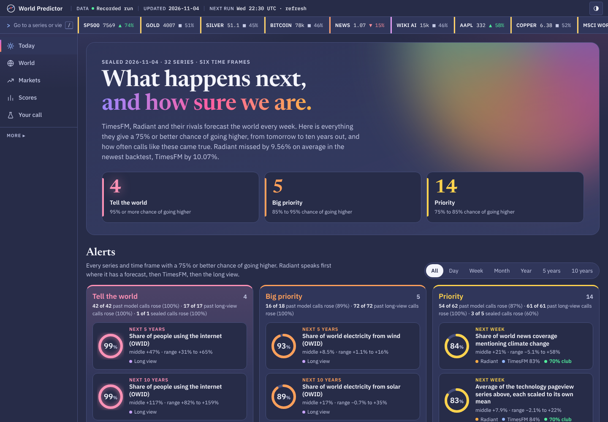

**How right were they?** Every past TimesFM forecast of the S&P 500 over what really happened, its
most certain quarter in pink, and Radiant's paths dashed, with the average miss, range coverage and
direction record above.

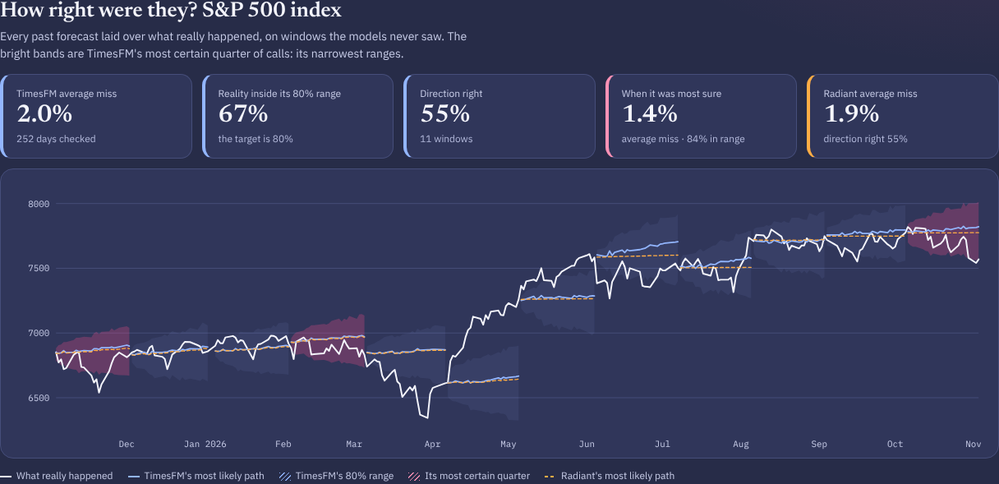

**Every model on one board.** The desk ranks every forecaster of the newest full backtest by its
average miss, overall and per area, with how often each one beat TimesFM, and puts Radiant's head-to-head
against TimesFM above Seldon's.

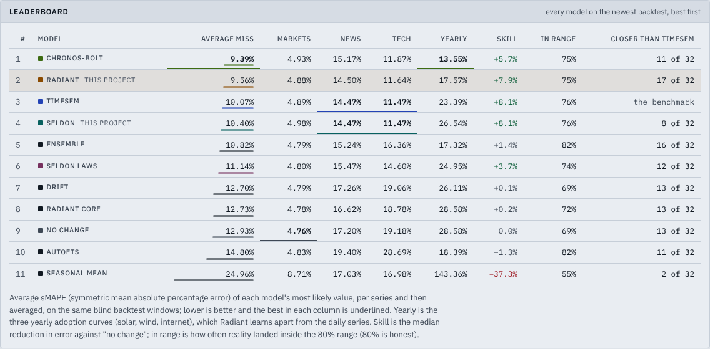

**One real forecast, sealed and scored as you scroll.** The landing page pins a single real S&P 500
forecast (the newest finished window, not a hand-picked one) and plays it out with the scroll: what
TimesFM could see, the range it sealed, reality arriving day by day, and the score.

<p align="center">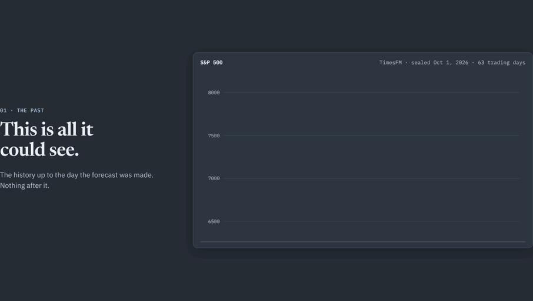</p>

**The Lab.** One S&P 500 round: make the call, seal it, break the seal, see who was closest.

<p align="center">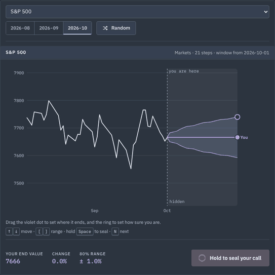</p>

The landing page, slate and light. The Lab is the first thing you see, already loaded with a real round.

<picture>
  <source media="(prefers-color-scheme: dark)" srcset="docs/assets/landing-dark.png">
  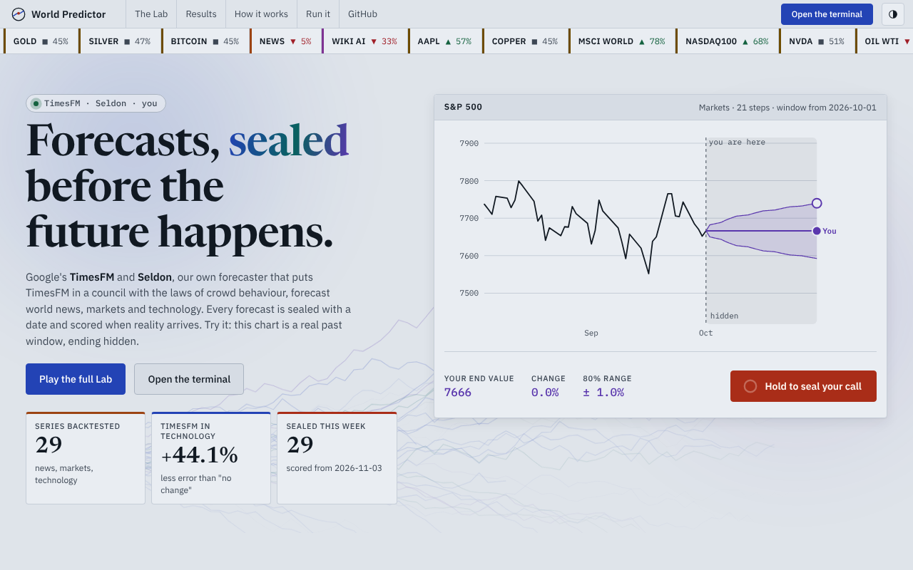
</picture>

**The Desk.** TimesFM against Seldon against "no change", by area, with the week's sealed forecasts below.

<picture>
  <source media="(prefers-color-scheme: dark)" srcset="docs/assets/app-desk-dark.png">
  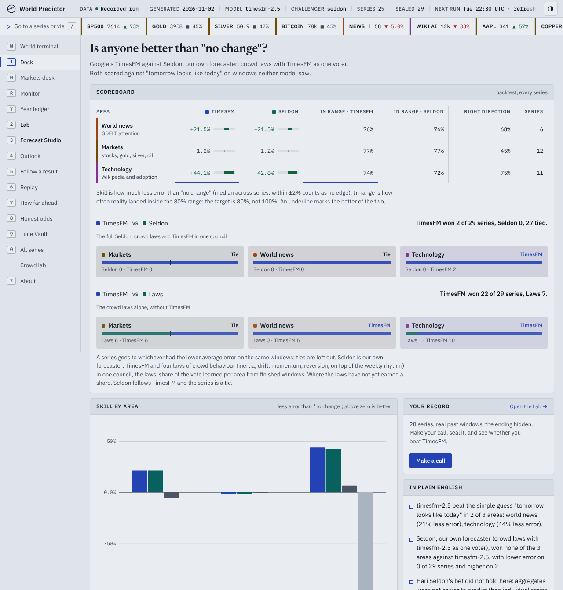
</picture>

**Forecast Studio.** Ask the chance of any level on any date, then seal your own call beside TimesFM's and Seldon's.

<picture>
  <source media="(prefers-color-scheme: dark)" srcset="docs/assets/app-studio-dark.png">
  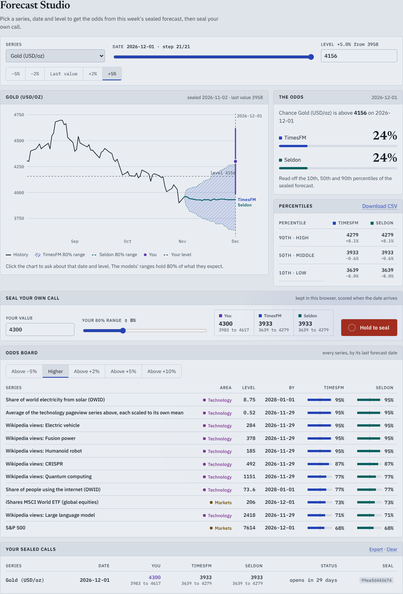
</picture>

**A series page.** Gold: twelve past forecasts over what really happened (the chosen one hatched), each scored in the table, then this week's sealed forecast and the ones already opened.

<picture>
  <source media="(prefers-color-scheme: dark)" srcset="docs/assets/app-series-dark.png">
  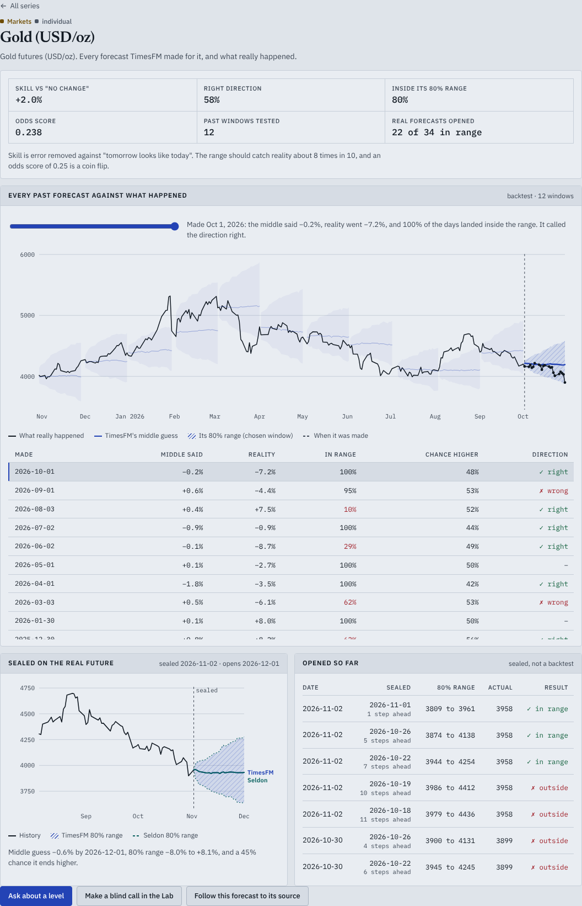
</picture>

**Follow one result.** One S&P 500 forecast walking through the pipeline, stage by stage.

<p align="center">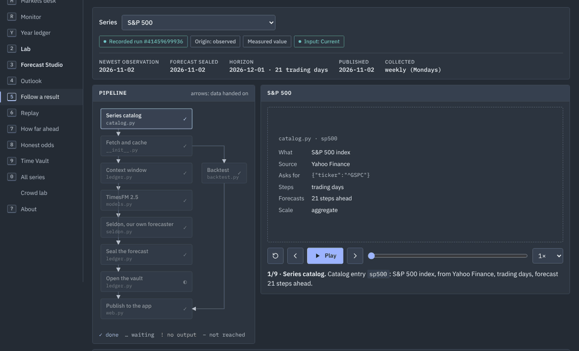</p>

<table>
<tr>
<td width="50%"><b>Outlook</b><br><sub>Every sealed forecast in a list, with TimesFM's range and Seldon's beside it.</sub><br>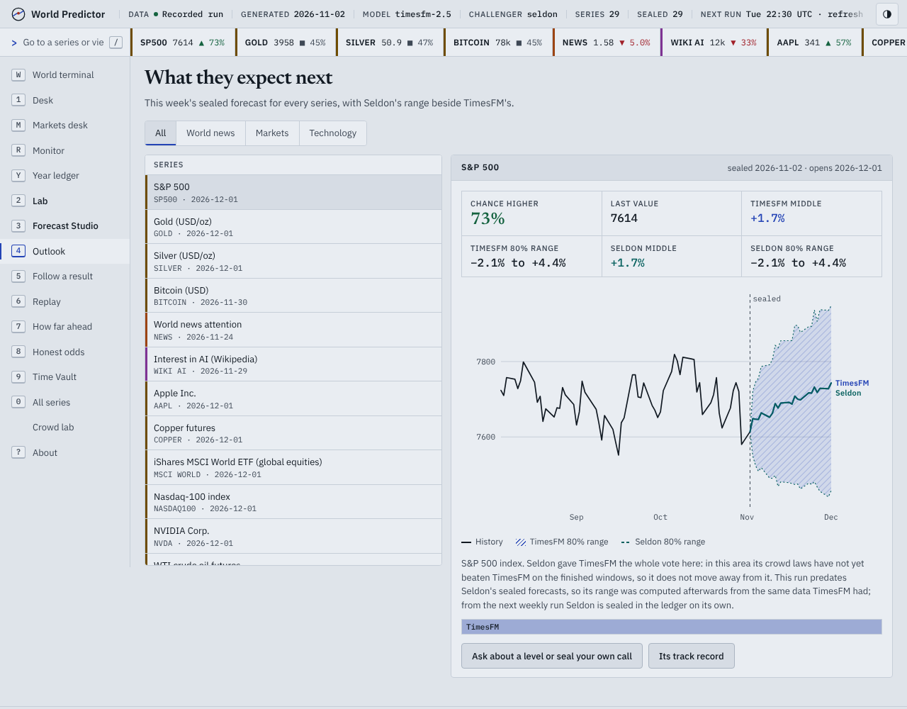</td>
<td width="50%"><b>Replay</b><br><sub>Press play to watch past forecasts meet what really happened.</sub><br>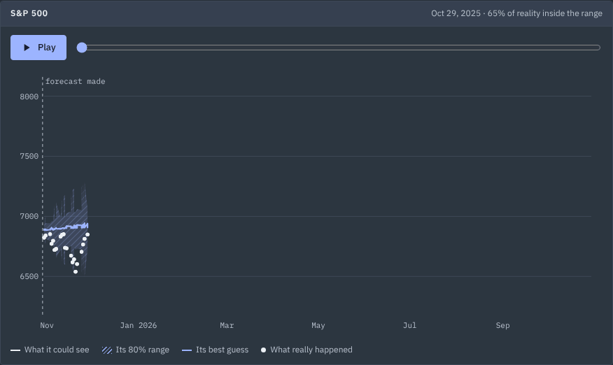</td>
</tr>
<tr>
<td width="50%"><b>Crowd lab</b><br><sub>Grow a simulated crowd and watch it become predictable.</sub><br>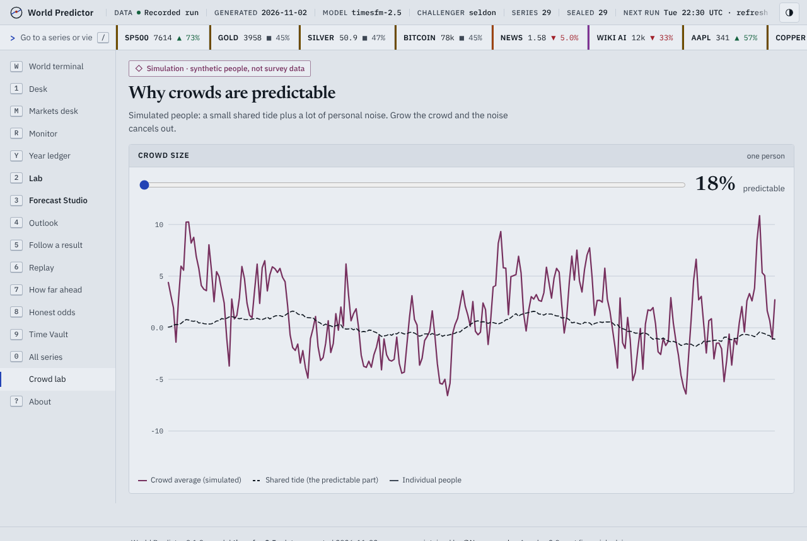</td>
<td width="50%"><b>Time Vault</b><br><sub>Sealed predictions, opened and scored as their dates arrive, with every receipt listed.</sub><br>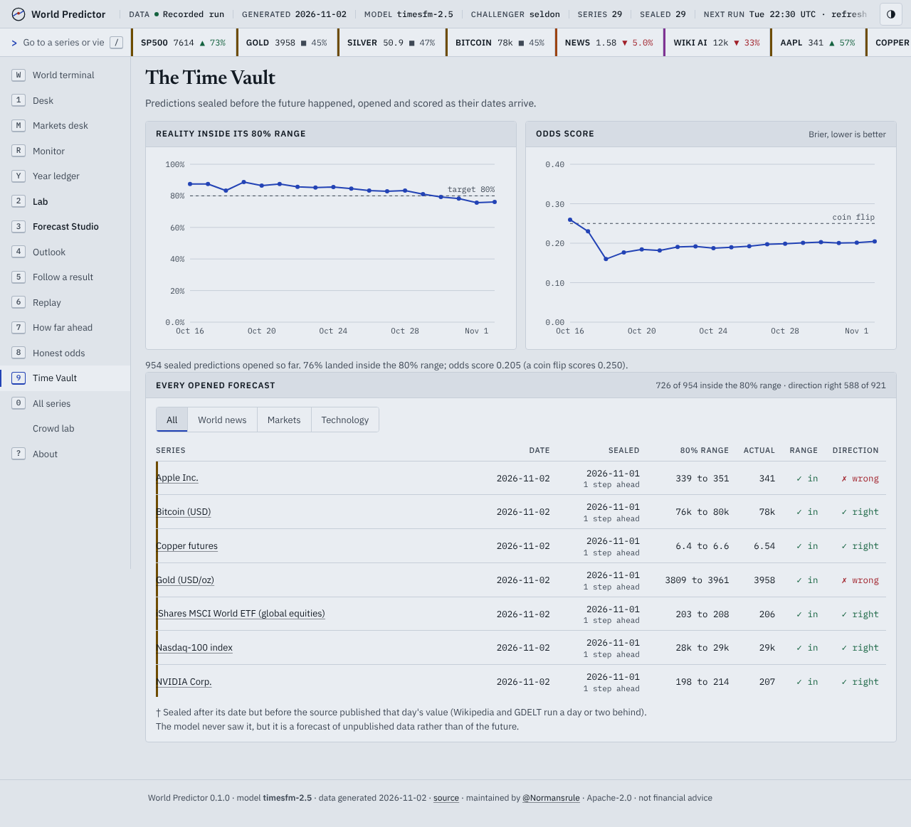</td>
</tr>
</table>

<sub>Screenshots show the recorded forecast run of 2026-10-22 (TimesFM 2.5 and Seldon's crowd laws, with the full Seldon rebuilt from them by <code>scripts/rebuild_app_data.py</code>). Before a first run the app uses demo data and says so on every screen. Regenerate them with <code>python scripts/make_app_screenshots.py --site build/site</code>.</sub>

---

## Latest results

**Newest full backtest: 4 November 2026**, 32 series, every forecast made blind at its origin and
scored against what happened (average sMAPE, lower is better). Radiant, the project's own forecaster,
beat TimesFM for the first time. [How Radiant works](#radiant-market-psychology-and-statistics-against-timesfm).

| Forecaster | All | Markets | News | Technology (daily) | Yearly adoption |
|---|---|---|---|---|---|
| Chronos-Bolt (Amazon) | **9.39%** | 4.93% | 15.17% | 11.87% | **13.55%** |
| **Radiant** (this repo) | 9.56% | 4.88% | 14.50% | 11.65% | 17.57% |
| TimesFM 2.5 (Google) | 10.07% | 4.89% | **14.47%** | **11.47%** | 23.39% |
| Seldon (this repo) | 10.40% | 4.98% | **14.47%** | **11.47%** | 26.54% |
| Ensemble of all models | 10.82% | **4.79%** | 15.24% | 16.36% | 17.33% |

The table and the duel just below are the project's **first full run (22 October 2026)**, kept as the
record it set; the charts further down are redrawn by every forecast run. That run had TimesFM 2.5 on 29 live series (6 news topics, 12
markets, 11 technologies), each backtested over 12 past windows against what really happened:

| Area | TimesFM vs "tomorrow looks like today" | Its 80% range caught reality | Edge lasts |
|---|---|---|---|
| World news | **8% less error** | 78% of the time | about 28 days |
| Markets (stocks, gold, silver, oil, Bitcoin) | about the same (−2%) | 82% of the time | no steady edge |
| Technology | **45% less error** | 75% of the time | about 28 days |

**The official duel: TimesFM against Seldon.** That run put Seldon's crowd laws on exactly the same
337 windows as TimesFM, from only what was known before each one, and scored them with the same
code. The full Seldon (the laws with TimesFM as one more voter) is rebuilt exactly from the two
recorded forecasts, its share of the vote learned per area from windows that had already finished:

| Area | Series | Crowd laws alone: won / lost | Full Seldon: won / lost / tied | Error vs TimesFM: laws / full Seldon |
|---|---|---|---|---|
| Markets | 12 | **9 / 3** | 0 / 0 / 12 | **−1.7%** / 0.0% |
| World news | 6 | 1 / 5 | 0 / 0 / 6 | +2.4% / 0.0% |
| Technology | 11 | 1 / 10 | 0 / 2 / 9 | +31% / +3.2% |
| **All** | 29 | 11 / 18 | 0 / 2 / 27 | +11.6% / +1.2% |

**The honest verdict: a split decision.** For the first time something here beat TimesFM on most
series in an area: **in markets, the four crowd laws alone had lower error than TimesFM on 9 of 12
series**: gold, silver, oil, copper, Bitcoin and four single stocks (Apple, NVIDIA, Tesla, Exxon),
in the area where TimesFM itself does no better than "no change". TimesFM kept the three big indices
(S&P 500, Nasdaq 100, MSCI World). Technology stays TimesFM's: its trends are what a foundation model
reads best. The full Seldon now mostly stands aside: since November 2026 it learns the laws' share from
the average percentage miss over at least ten finished windows, and in no area did a share beat
TimesFM alone by the 2% it asks for, except on the two yearly adoption series (solar, wind), where the
laws still cost it. The earlier rule (five windows, error against "no change") had won world news 5
to 1 here but, replayed on every recorded daily window, missed by 8.97% on an average day against
TimesFM's 8.83%, so it was replaced; the new rule ties TimesFM on the same replay
(`python scripts/seldon_bakeoff.py`). Read the full Seldon's numbers as a replay: this run recorded TimesFM's and the laws'
forecasts but not their blend, so it was rebuilt from them (`backtest.replay_seldon`); errors, wins
and the 80% range are exact, range skill is close. The next full backtest scores it directly. Every
table is in [results/REPORT.md](results/REPORT.md); rebuild the app's copy with
`python scripts/rebuild_app_data.py`. Since 10 November 2026 Seldon no longer seats TimesFM at all and has
become a real second opinion: [Seldon's own view](#seldons-own-view-a-second-opinion-not-a-copy).

On public data neither model was tuned on, the 1,500 held-out daily series of the M4 competition,
Seldon laws had the best range score of the four methods tried (pinball loss 1.144, against 1.146 for a
drift line, 1.167 for "no change" and 1.170 for AutoETS) and beat "no change" on 62% of series
(`python scripts/seldon_m4_check.py`). TimesFM was not run on M4 here.

In the 22 October run, when it gave 70% or better odds of a rise, the rise happened 87% of the time
(53 forecasts); in the 4 November backtest it was 45 of 56 (80%). In markets the 4 November backtest
has no edge at all: no market beat "no change" by more than about 1% (gold, +1.1%), and the big
indices were furthest behind (S&P 500 −8.6%, Nasdaq-100 −6.9%, MSCI World −9.3%), so the earlier
finding that indices beat single stocks did not hold up. Markets staying close to a random walk is the
honest, expected result. Full tables are in
[results/REPORT.md](results/REPORT.md), and the Time Vault fills in as sealed predictions come due.

<picture>
  <source media="(prefers-color-scheme: dark)" srcset="results/plots/scorecard-dark.svg">
  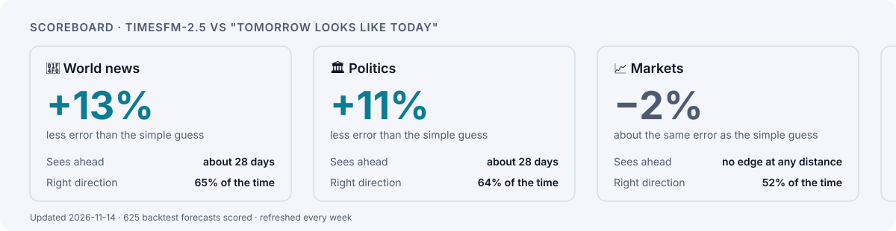
</picture>

**Reading the scoreboard.** The big number is how much less error the model made than the simple
guess "tomorrow looks like today" (positive is good, zero means no better). *Sees ahead* is how far
into the future that edge lasts. *Right direction* is how often it called up or down correctly; 50% is
a coin flip.

<table>
<tr>
<td width="50%"><b>Did it beat a simple guess?</b><br><sub>Bars above zero mean less error than "tomorrow looks like today".</sub><br>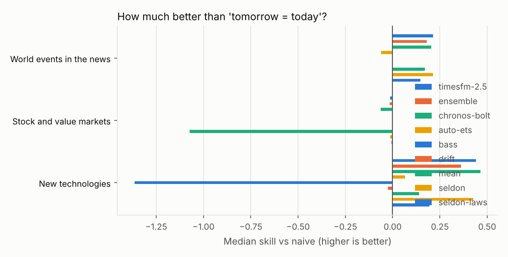</td>
<td width="50%"><b>How far ahead can it see?</b><br><sub>Where each line drops below zero, the model has run out of foresight.</sub><br>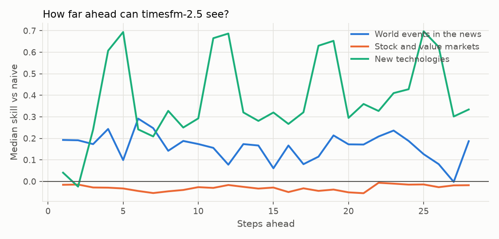</td>
</tr>
</table>

**What it expects next.** The newest sealed forecast for six headline series, from stocks, gold and
silver to world news and AI. Each panel says, in words, the chance it ends higher.

<p align="center">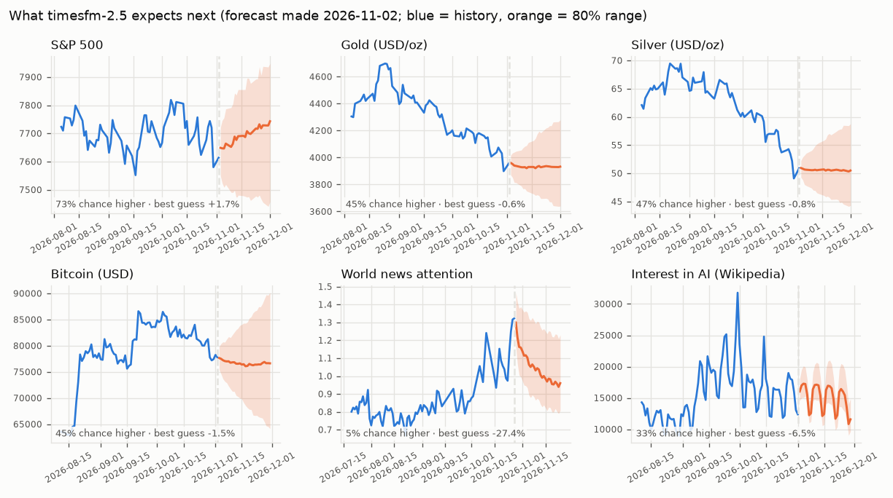</p>

**The Time Vault.** The real test. If the model is honest, the left line settles near 80% and the
right line stays below the coin flip. In the recorded run of 4 November 2026, 1,226 sealed TimesFM
forecasts had opened: 72% landed inside their 80% range, short of the 80% an honest range should
reach, so the ranges are still somewhat too narrow; the odds score was 0.204 (a coin flip scores
0.250). The first 32, opened by 19 October, had looked better (84% inside), a reminder that small early
samples flatter. Values sealed after their date but before the source published them (Wikipedia and
GDELT run a day or two behind) are marked in the app, since the model never saw them but they are not
forecasts of the future in the strict sense.

<p align="center">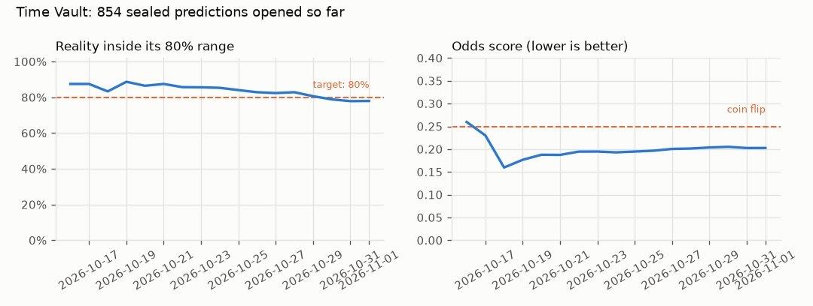</p>

---

## Setup and usage

### On the web

Open [normansrule.github.io/world-predictor](https://normansrule.github.io/world-predictor/). That's it.
You can also choose *Install app* from your browser menu to keep it on your desktop.

### The Lab

Open the [Lab](https://normansrule.github.io/world-predictor/app/#lab) (or press <kbd>2</kbd> in the
terminal). Each round is a real backtest window: you see the history up to the cut, the rest is hidden.

1. Drag the violet dot to where you think the series ends, and the ring to set how sure you are (your
   80% range).
2. Press and hold **Seal your call**. A red seal stamps it with the date of the cut.
3. Hold again to **break the seal**. Reality draws in, then TimesFM (periwinkle, hatched range), then Seldon
   (teal, dotted range), and the scores appear.
4. Press <kbd>N</kbd> for the next round, or pick another series or window.

With the keyboard: <kbd>↑</kbd> <kbd>↓</kbd> move your call (<kbd>Shift</kbd> for bigger steps),
<kbd>[</kbd> <kbd>]</kbd> narrow or widen your range, and hold <kbd>Space</kbd> to seal and to break the
seal. Elsewhere in the terminal, <kbd>1</kbd>…<kbd>0</kbd> switch views, <kbd>/</kbd> finds a series and
<kbd>T</kbd> switches between the slate and light themes.

### Forecast Studio

Open the [Forecast Studio](https://normansrule.github.io/world-predictor/app/#studio) (or press
<kbd>3</kbd>). It works on the real future, using the forecasts sealed in this week's run.

1. Pick a series, slide to a date, and type a level (or click a preset such as +2%, or click straight
   on the chart). **The odds** panel shows the chance TimesFM and Seldon give it of ending above that
   level, and **Percentiles** lists their 10th, 50th and 90th percentiles for that date.
2. Set your own value and range under **Seal your own call** and hold the seal button. Your call is
   stored in this browser with a short fingerprint of exactly what you sealed.
3. **Your sealed calls** counts down to each date. Once the weekly run brings in the real value, it
   shows the outcome and who was closest: you, TimesFM or Seldon. **Export** saves your calls as JSON
   (JavaScript Object Notation).
4. **Odds board** ranks every series by the chance of ending above a move you pick (higher, +2%, +5%
   and so on) by its last forecast date, TimesFM beside Seldon. Click a row to open it above.

The odds are read off the 10th, 50th and 90th percentiles by straight-line interpolation, and capped at
5% and 95% outside that range, because the forecast says nothing sharper out there. The command line
uses the same rule.

### Series pages and receipts

Press <kbd>0</kbd> for **All series** and click any name, or type it in the command bar (<kbd>/</kbd>).
Each series page has:

1. **Its numbers**: skill against "no change", right direction, how often reality stayed inside the 80%
   range, the odds score, and how many real sealed forecasts have opened.
2. **Every past forecast against what happened.** All of its backtest windows over the real values.
   Drag the slider (or pick a row) to pick one window; the readout says what its middle guess said,
   where reality went, and whether it called the direction.
3. **Sealed on the real future**: the newest sealed forecast, TimesFM and Seldon.
4. **Opened so far**: every sealed forecast whose date has arrived, with its range, the actual value
   and the verdict.

The [Time Vault](https://normansrule.github.io/world-predictor/app/#vault) lists every opened
forecast across all series, filterable by area. In the terminal:

```bash
psychohistory record gold    # every backtest window and every opened sealed forecast for gold
```

### Ask TimesFM from the command line

The full version runs TimesFM live, on the catalog's series or on your own data:

```bash
psychohistory ask sp500 --above 7800                 # S&P 500, next 21 trading days, chance above 7,800
psychohistory ask gold --horizon 10 --save gold.csv  # every step to a CSV
psychohistory ask --csv my_series.csv --above 120    # your own date,value CSV
psychohistory ask sp500 --seal                       # also seal it in the ledger, scored by `score`
```

It prints the middle and 80% range for every step, Seldon's own forecast beside it, and how
Seldon's laws split their votes for that series.

### The Markets desk, and a desk note for any ticker

<picture>
  <source media="(prefers-color-scheme: dark)" srcset="docs/assets/app-markets-dark.png">
  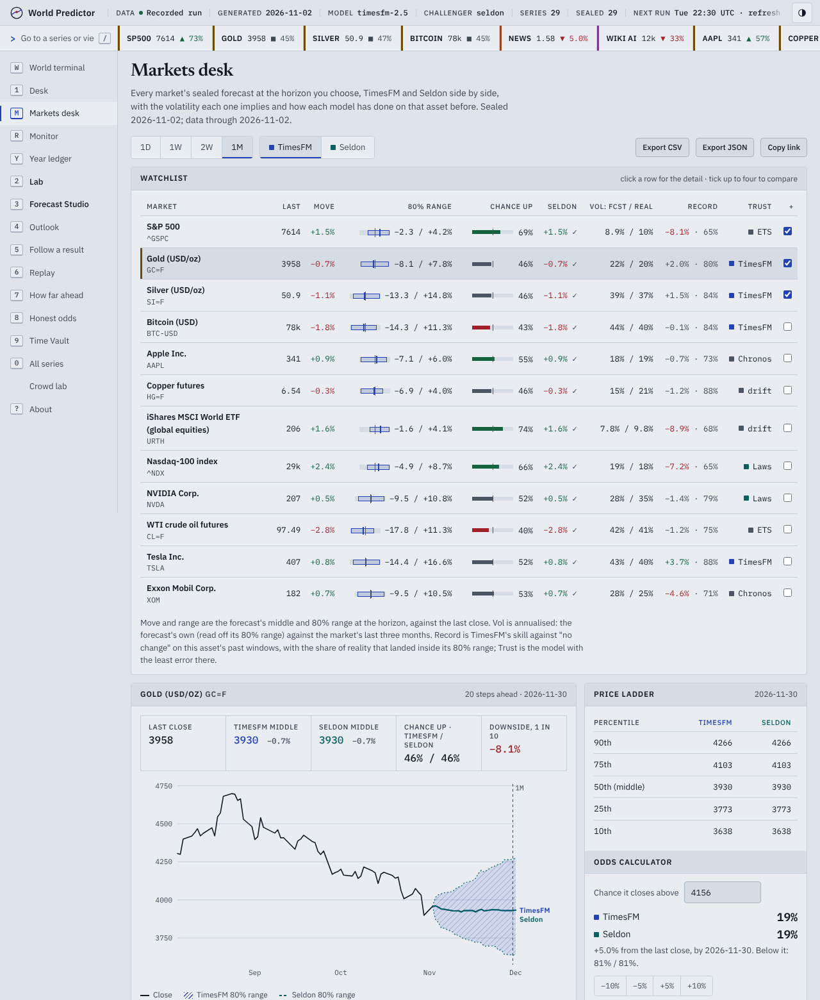
</picture>

In the app, press <kbd>M</kbd>. From the command line, the full version does the same for any
market Yahoo Finance lists, live:

```bash
psychohistory desk gold MSFT ETH-USD               # catalog ids or any Yahoo tickers
psychohistory desk ^FTSE --horizon 10 --level 9000 # 10 trading days, chance of closing above 9,000
psychohistory desk --csv my_prices.csv             # your own date,value history
```

Each note (in `results/desk/`, as Markdown, CSV and JSON) has the outlook at 1, 5, 10 and 20 steps,
the chance of ending above round levels around the last price, the volatility the forecast implies
against the last three months', and a backtest of TimesFM, Seldon, its crowd laws, drift and "no
change" on that asset's own past windows, ending with which of them to trust there. Markets are close
to a random walk, so the note says so when nothing has beaten "no change".

### The World terminal and your book

<picture>
  <source media="(prefers-color-scheme: dark)" srcset="docs/assets/app-terminal-dark.png">
  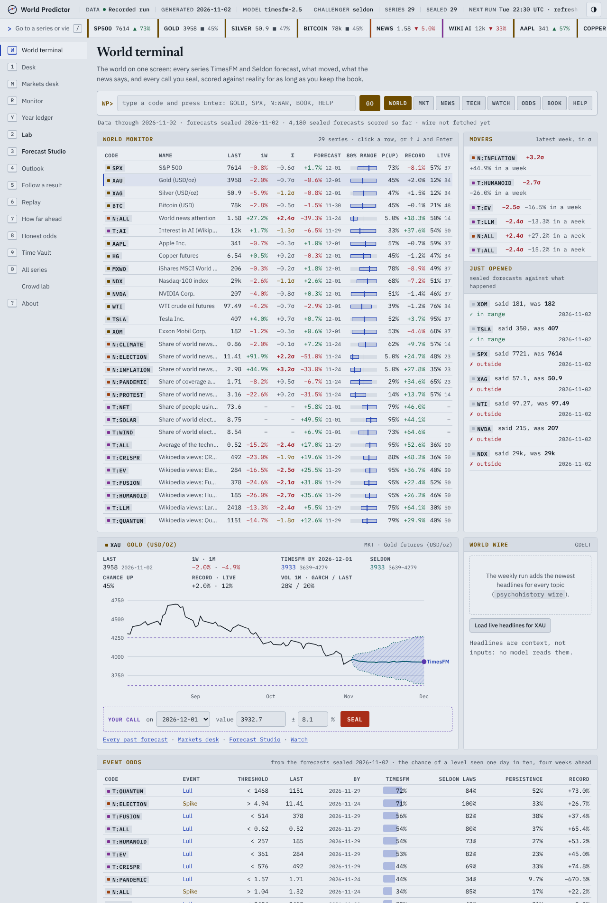
</picture>

Press <kbd>W</kbd> in the app. Type a code and press Enter: `SPX`, `NDX`, `AAPL`, `XAU`, `WTI`, `BTC`,
`N:WAR`, `N:ELECTION`, `T:AI`, `T:LLM` and so on; `MKT`, `NEWS`, `TECH` and `WORLD` switch the board;
`WATCH` and `UNWATCH` keep a watchlist; `CALL 4200` fills your call; `HELP` lists the rest.

- **σ** says how unusual the latest week was: a market's weekly return against its own usual week, or
  a news or attention series against its previous four weeks. The movers panel lists the largest.
- **Just opened** shows the newest sealed forecasts whose day has come: what TimesFM said, what
  happened, and whether reality landed inside its range.
- **The world wire** carries the newest English-language headlines for every topic, from the GDELT
  Project's article list (`psychohistory wire`, run every week); a button fetches live ones for the
  series in focus. Headlines are context: no model reads them.
- **Your book.** Seal a value and a range for any date the models forecast. The call is fingerprinted
  when sealed and settled against the real value when its day is in the data, then kept with its result
  in this browser. Export the book as JSON to keep it for years and import it on any device; every
  imported call is checked against its seal. The book is shared with the Forecast Studio.

### The long-term monitor: predictions against reality, over years

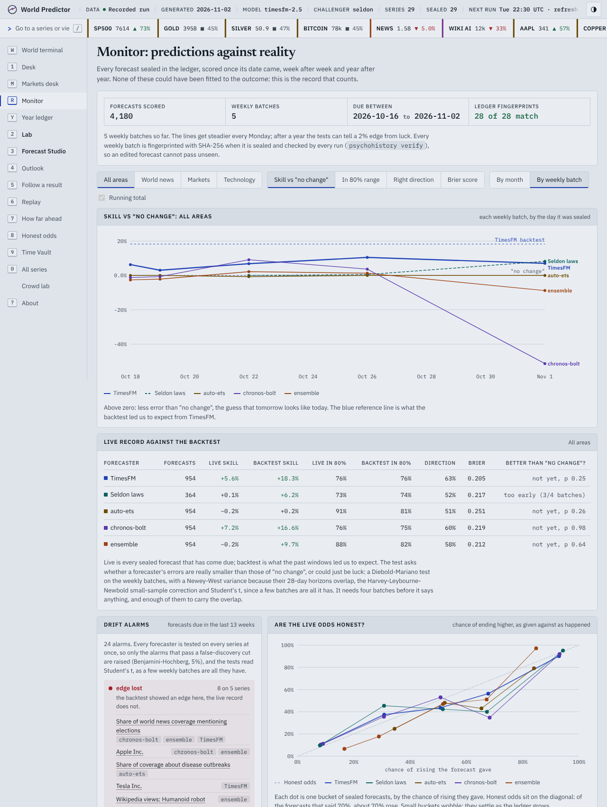

A backtest says how a model *would* have done. The monitor says how it *is* doing, on forecasts that
were sealed before the outcome existed. In the app, press <kbd>R</kbd>. From the command line:

```bash
psychohistory monitor                          # live record by area and model, the test, the alarms
psychohistory monitor --save results/monitor.csv   # month-by-month table, kept by the weekly run
psychohistory verify                           # check every sealed batch against its fingerprint
```

- **Skill, coverage, direction and Brier over time,** per month (or per week until three months
  exist), for all areas or one, with the cumulative record so a lucky month doesn't read as a trend.
- **Is it really better than "no change"?** A Diebold-Mariano test on the weekly batches' scaled
  errors, with Newey-West variance because a 4-week forecast made each week overlaps the next three,
  and the Harvey-Leybourne-Newbold correction with Student's t, because a few batches are all it has
  (the normal curve would cry wolf on four data points). Until there are enough batches to carry the
  overlap it says "too early" rather than guess.
- **Drift alarms** for forecasts due in the last 13 weeks: a range too narrow or too wide (80%
  coverage tested against 80%), an edge lost (live skill well below the backtest's), or a model worse
  than no change. Every forecaster is tested on every series at once, hundreds of tests, so 5% of
  them would ring by chance alone; an alarm is raised only if it passes a Benjamini-Hochberg
  false-discovery cut. On the 2026-11-01 data that took the list from 67 alarms to 23, grouped by
  kind and series in the app.
- **A tamper-evident ledger.** `predictions/seals.csv` holds a SHA-256 fingerprint of every weekly
  batch. The weekly run refuses to continue if a sealed forecast was edited, and each full backtest
  is kept by date in `results/history/` so the expected skill can be compared over the years too.

Four weekly batches of sealed forecasts have come due so far (2026-11-01), so every verdict still
reads "too early" or "not distinguishable from no change". The point is the years to come: the
record builds itself every Monday.

### Volatility: how far markets swing

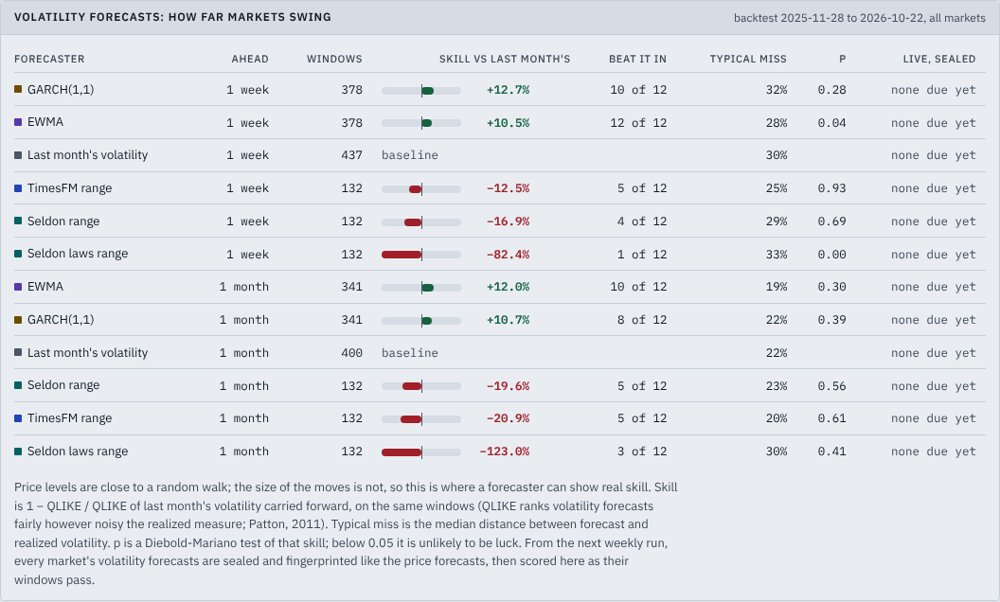

A price forecast that beats "no change" is rare; a volatility forecast that beats last month's
volatility is not, because calm follows calm and storms follow storms (Mandelbrot, 1963). So every
market gets four volatility forecasts for the next week and month: GARCH(1,1) (Bollerslev, 1986),
fitted by maximum likelihood with no extra library; RiskMetrics' EWMA; and the volatility TimesFM's
and Seldon's 80% ranges imply. Each is scored against the volatility that followed with QLIKE (Patton,
2011), as skill against last month's volatility carried forward on the same windows.

```bash
psychohistory vol              # the volatility backtest across markets and the sealed record so far
psychohistory vol --backtest   # rerun it from the data and the saved backtest paths (the weekly run does)
```

On the first year of recorded data (origins from November 2025 to October 2026, rebuilt on
2026-11-02), EWMA and GARCH beat last month's volatility by 10% to 13% at both spans; EWMA a week
ahead won in all 12 markets (p 0.04), the only result under 0.05 so far, and with a dozen tests
running, one that low is still within reach of luck. TimesFM's range trailed last month's volatility
at both spans (−12% a week ahead, −21% a month ahead); an earlier cut of the same year had it ahead a
week out (+16%), so that question is open. The weekly run reruns the test on the
full history and seals new volatility forecasts every week in `predictions/vol_ledger.csv`, so the
Monitor's volatility board grows a live record beside the backtest. In the Markets desk, each market
has a volatility outlook with every forecaster's record on that asset.

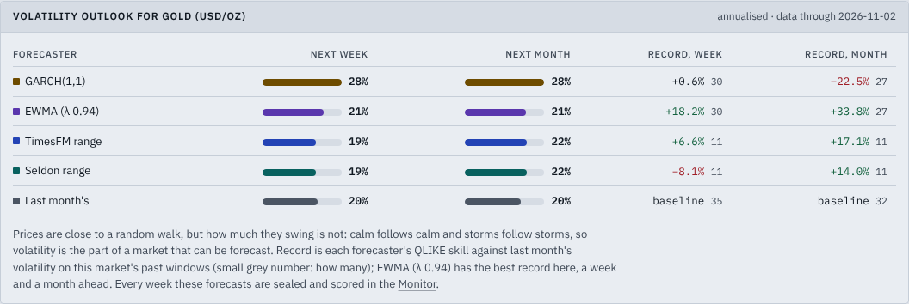

### Event odds: spikes and lulls in world news and technology

A forecast of "5.8% of world news coverage" is hard to act on. The odds of something unusual are not:
for every news and technology series, the World terminal's **ODDS** pane gives the chance that, on the
forecast's target date four weeks ahead, the series is

- in a **spike**: above the 90th percentile of its last two years, a level it reaches one day in ten;
- in a **lull**: below the 10th percentile, a low it falls to one day in ten.

The thresholds come from the history up to the forecast's last day, so they are sealed with it. Each
model's odds are read off its sealed 10%, 50% and 90% quantiles as a split normal (in logs for positive
series), so the tails, where events live, are not cut off at the 10% and 90% levels. Two baselines keep
them honest: **climatology** says 10% for both, and **persistence** says how often the series was past
the line four weeks after a day in the same state as today. Attention is sticky, so persistence is the
hard one to beat. Every forecaster's odds are scored with the Brier score (Brier, 1950), as skill
against each baseline on the same forecasts, with a Diebold-Mariano test of the edge over climatology.

```bash
psychohistory events             # today's odds, the backtest and the sealed record so far
psychohistory events --backtest  # rerun the backtest from the data and the saved paths (the weekly run does)
```

A first look, from the recorded actuals of the last year (the 14 news and technology series, 10 monthly
origins each after the half-year of history the thresholds need): TimesFM's lull odds beat
climatology by 48% and persistence by 40% (p 0.06), mostly on technology: Wikipedia attention to most
of these technologies kept sliding, a lull came true in 63% of the technology forecasts against the
10% climatology expects, and TimesFM's ranges followed the slide. Its spike odds beat climatology by 11%
(p 0.42, so possibly luck). Seldon's crowd laws alone added nothing on spikes. The full rerun in CI
replaces these numbers, and from the next weekly run every batch of odds is sealed in
`predictions/event_ledger.csv`, fingerprinted in `predictions/event_seals.csv` and scored in the Monitor
as its day passes. Odds, not advice.

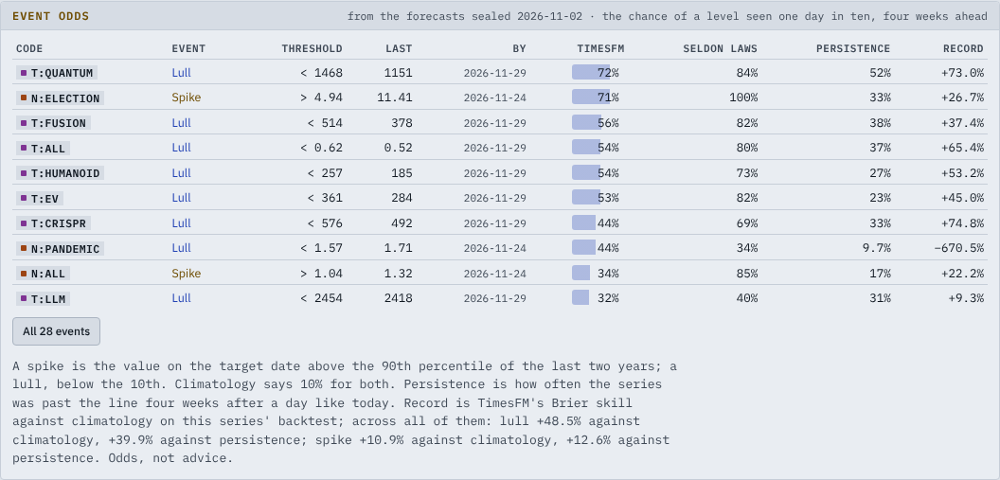

### The year ledger: every day of the year, four forecasters against reality

The **Year ledger** ([open it](https://normansrule.github.io/world-predictor/app/#year), key `Y`) is
the books for the year: one table for each tracked part of the world (gold, silver, bonds, the VIX
fear gauge, stock indices, single stocks, oil and copper, Bitcoin, world news, technology), with a row
for every day from 1 January to 31 December. Each row has the real value, the real move since the
forecast was made, and for TimesFM, Radiant, Seldon and Seldon's crowd laws alone the most likely value
(the median), the change it expected and how far off it was in percent. The closest is marked. Days
nobody forecast, and days that have not happened yet, are dashes. Rows can be daily, weekly or monthly,
and a strip above each table colours every day of the year by whoever came closest; click a day to
jump to it.

A forecast for a day comes from the sealed ledger when one was sealed before that day (marked
**sealed**), and otherwise from the rolling-origin backtest, made from the data up to its origin but
replayed afterwards (marked **backtest**). The models are compared only on days where all of them
forecast from the same kind of record (sealed against sealed, backtest against backtest) and the real
value is in, so none is helped by skipping hard days or by a forecast made closer to the day. Bonds and
the VIX are new: their rows stay dashes until the first run fetches them. A weekday refresh at
22:30 UTC, after the US close, fetches the day's real values, rescores and republishes, so the ledger
fills in day by day; new forecasts are still sealed once a week.

The 2026 ledger in the recorded run of 4 November (7,077 like-for-like days over 29 series): TimesFM
missed by **8.94%** on an average day, Radiant by 8.95%, Seldon by 9.00% (9.22% with its own
council since 10 November, replayed; see [Seldon's own view](#seldons-own-view-a-second-opinion-not-a-copy)) and the crowd laws by 10.72%.
Radiant was closer than TimesFM on 21 of the 29 series, by margins too small to matter overall.

**Close is not the same as right.** Most days in the ledger are forecasts made only a day or a few
before, so every model's most likely value sits near the real one, and a row where TimesFM is off by
0.01% does not mean it knew the future. The ledger now carries the yardstick that settles it: **no
change**, the value each forecast started from. On the same 7,409 days, assuming nothing changed missed
by 13.68% and TimesFM by 8.86%, so TimesFM is better overall, but almost all of that lead is in world
news and Wikipedia attention. Series by series, TimesFM beat "no change" on 17 of 29: every news and
attention series, but on markets only gold and the long-bond ETF (by two hundredths of a point) and
the VIX (by 0.7); on the other 12 markets, copying the last price came closer. Each series card shows the "no
change" miss beside the models, and each table has a No change column. A **race chart** above the tables draws each
challenger's average miss so far, day by day, as its gap to TimesFM: below the line is beating it.

**Real or luck?** A lead over 200 days can still be luck, so every challenger's gap on every series is
put to a Diebold-Mariano test (Diebold & Mariano, 1995) of its daily misses against TimesFM's. Forecasts
made up to four weeks ahead overlap, so the test's variance allows for errors that run together for up
to a horizon (Newey & West, 1987) and is corrected for short records (Harvey et al., 1997). With 26
series tested at once, the Benjamini-Hochberg cut keeps false calls to about one in twenty (Benjamini &
Hochberg, 1995). Each series card says **real** or **could be luck**, the leaderboard counts the series
where a challenger is clearly better or clearly worse, and each table downloads as a CSV for your own
books. In the 4 November run only one challenger lead passes (Radiant, on one series); every other lead could
be luck, and the crowd laws are clearly worse on one series.

**The bake-off: can anything here beat TimesFM?** Eighteen forecasters built from TimesFM, the crowd
laws, "no change" and two classical methods were replayed on all 319 daily windows of the official backtest of 3 November 2026,
each learning only from the windows of its area that had finished before its forecast
(`python scripts/seldon_bakeoff.py`; Radiant's rows are the ones that run recorded, not a replay).
Average miss per day of the most likely value:

| Forecaster | All | To March | April on | Markets | News | Tech |
|---|---|---|---|---|---|---|
| **TimesFM** | **8.64%** | 9.23% | **8.28%** | 5.25% | **13.93%** | **11.05%** |
| **Radiant** | **8.64%** | **9.15%** | 8.33% | 5.25% | **13.93%** | **11.05%** |
| **Best of four per area, 3% margin** | **8.64%** | 9.18% | 8.30% | 5.24% | **13.93%** | **11.05%** |
| Seldon, new share rule (now in use) | 8.65% | 9.19% | 8.32% | 5.26% | **13.93%** | **11.05%** |
| Log-space blend | 8.65% | 9.19% | 8.32% | 5.27% | **13.93%** | **11.05%** |
| Exponentiated-gradient mix (TimesFM, laws, no change) | 8.66% | 9.22% | 8.31% | 5.20% | 14.03% | 11.12% |
| TimesFM with its median bias halved | 8.75% | 9.44% | 8.32% | 5.27% | 14.02% | 11.33% |
| Per-series share, shrunk to the area's | 8.82% | 9.59% | 8.33% | 5.24% | 14.26% | 11.44% |
| Shrink TimesFM's predicted move | 8.85% | 9.67% | 8.34% | 5.29% | 14.22% | 11.51% |
| Seldon, old share rule | 8.87% | 9.68% | 8.37% | 5.24% | 14.60% | 11.39% |
| TimesFM and the laws, half each | 8.91% | 9.40% | 8.61% | **5.17%** | 14.31% | 11.89% |
| Median of the three | 9.12% | 9.80% | 8.70% | 5.19% | 15.15% | 11.96% |
| Inverse-MSE weights (no change, TimesFM, laws) | 9.15% | 9.96% | 8.65% | 5.21% | 15.01% | 12.15% |
| Crowd laws alone | 9.71% | 10.20% | 9.41% | 5.20% | 15.62% | 13.72% |
| Theta method | 11.19% | 11.83% | 10.80% | 5.34% | 16.74% | 18.00% |
| Damped trend | 11.29% | 11.75% | 11.00% | 5.31% | 17.23% | 18.04% |
| Radiant's behavioural core alone | 11.64% | 12.69% | 10.99% | 5.42% | 18.07% | 18.49% |
| "No change" | 11.73% | 12.77% | 11.09% | 5.25% | 18.38% | 18.90% |

Nothing beat TimesFM on these daily windows; the best three finished level. That is the "forecast
combination puzzle" seen many times before: weights learned from a short record tend to lose to the
best single forecast or a plain average, because estimating them adds more noise than they remove
(Stock & Watson, 2004; Smith & Wallis, 2009; Timmermann, 2006). The old Seldon rule handed the laws a
share of the news vote too early and lost 0.67 points there, so it was replaced: Seldon now needs ten
finished windows and a 2% lower average miss before the laws get any say. Radiant's lead in the first,
replayed version of this table (8.77% against 8.83%, on 286 windows and a year of history) did not
survive fresh windows, and neither did a further sweep of its mixing rule (four learning rates, and
"fixed share" forgetting; Herbster & Warmuth, 1998), which moved the total by 0.04 points at most.
Two more ideas were tried on 3 November and also failed. An exponentiated-gradient mix (Kivinen &
Warmuth, 1997), which learns the best *blend* of experts rather than the best single one, gained on
markets (5.20% against 5.25%) but only in the first half of the year; from April on it was behind
there too, and it lost on news. And two classical statistical forecasters, the Theta method that won
the M3 competition (Assimakopoulos & Nikolopoulos, 2000; Hyndman & Billah, 2003) and a damped trend
(Gardner & McKenzie, 1985), were far behind on news and technology, where TimesFM reads the weekly
rhythm of attention data that they cannot. The mix is at its ceiling with these experts: to win it
needs one that knows something TimesFM does not. (An earlier version of this table took Seldon's blend for the crowd laws, which hid how far apart
they are; it now uses the laws alone. Research, not investment advice.)

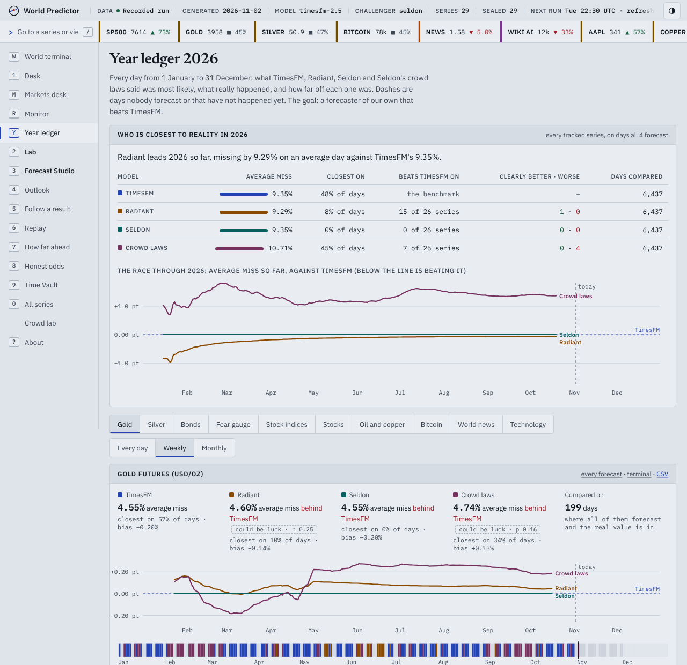

### Seldon's own view: a second opinion, not a copy

<p align="center">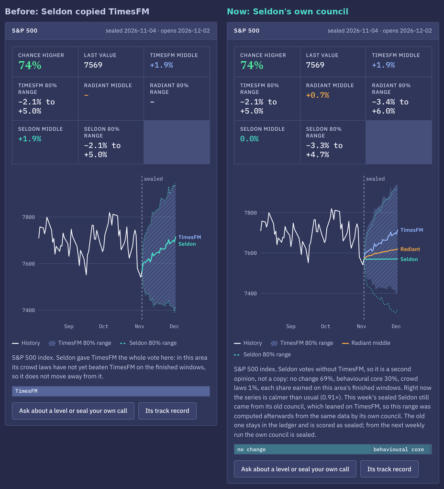</p>

Until 10 November 2026 Seldon was a council of crowd laws with TimesFM as one more voter, and the laws
only got a share of the vote once they beat TimesFM by 2% in an area. They almost never did, so on 15
of 32 series Seldon *was* TimesFM, line for line (left above). Now Seldon leaves TimesFM out: its
council is the crowd laws, Radiant's behavioural core, "no change" and Chronos-Bolt, each with a share
earned on its area's finished windows. On the S&P 500 it now says "flat, 0.0%" (no change 69%, the
behavioural core 30%) where TimesFM says +1.9%: a second opinion you can weigh, not an echo.

Is the new view any good? Replayed on all 319 daily windows of the official backtest, every weight
learned only from windows that had finished before the forecast (`python scripts/seldon_perspective.py`):

| Forecaster | All | Markets | News | Tech | Away from TimesFM | Points the other way |
|---|---|---|---|---|---|---|
| **TimesFM** | **8.46%** | 4.97% | **13.99%** | **10.87%** | – | – |
| Radiant (TimesFM in its council) | 8.47% | 4.98% | 14.00% | **10.87%** | 0.31% | 5% |
| **Seldon, its own council (now)** | 8.77% | **4.91%** | 15.00% | 11.33% | 2.36% | 25% |
| Chronos-Bolt alone | 8.79% | 5.05% | 14.91% | 11.23% | 2.33% | 30% |
| Crowd laws alone | 9.83% | **4.91%** | 15.55% | 14.76% | 4.69% | 33% |
| Laws, core and no change, inverse-error weights | 10.69% | 4.88% | 16.19% | 17.46% | 5.66% | 31% |
| "No change" | 12.41% | 4.87% | 17.55% | 22.68% | 7.82% | 0% |

*Average miss of the most likely value per day. Away from TimesFM: the average gap between the two
middle lines, as a share of the real value. Points the other way: windows whose expected move has the
opposite sign to TimesFM's. The script prints six more councils that were tried; this one was the best.*

**The honest verdict: different, and better only in markets.** Seldon now disagrees with TimesFM on the
direction of one window in four and sits 2.4% away from it on an average day, so it is a genuine second
opinion. In **markets** it is closer than TimesFM (4.91% against 4.97%), and in the scoreboard's duel it
**wins 12 of 15 markets** (the old Seldon won 9, by hair-thin margins). On news and technology it is
behind, because TimesFM reads the weekly rhythm of attention data better than any voter here; overall
it misses by 8.77% against TimesFM's 8.46%, a gap unlikely to be luck (paired t +2.6 over the windows,
read loosely because windows overlap). Its 80% range is as honest as TimesFM's (76.6% of real values
inside, against 76.4%). In the 2026 year ledger it is closer than TimesFM on 16 of 29 series, but its
misses on news are bigger, so its average is 9.22% against 8.94%. Re-scored the same way, its range
reads volatility a week ahead better than TimesFM's (+3.9% skill against last month's volatility, TimesFM
−4.5%) but a month ahead worse (−100% against −50%), and its odds of a lull are weaker (+14% Brier skill
against +26%). So read Seldon as the sceptic's view of a market and TimesFM as the better guide to news
and technology. Research, not investment advice.

How these numbers were made: the recorded run of 4 November 2026 kept every voter's 10th, 50th and 90th
percentile paths, so `scripts/rebuild_app_data.py` replays Seldon's own council from them
(`backtest.replay_own_seldon`), learning its weights only from windows that had finished before each
forecast. The middle line and the 80% range are exact; range skill and the odds of a rise are read off
a normal-shaped spread through those three. The next full backtest scores it directly. Forecasts sealed
before 10 November came from the old council and stay in the ledger as sealed; until the next weekly
run seals the own council's, the outlook shows its range computed from the same data and says so.

### Today: alerts, time frames and the 70% club

The app now opens on **Today**, built to answer three questions in a few seconds: what is likely to
go up, over what time frame, and should I believe it?

**Alerts in three tiers.** Every series and time frame where a forecaster gives a 75% or better chance
of going higher becomes an alert: **Priority** from 75%, **Big priority** from 85%, and **Tell the
world** from 95%. Radiant speaks first where it has a forecast, then TimesFM, then the long view, and
the others' chances sit beside it. Every tier shows its own record, kept apart by source so one easy
case cannot flatter the rest. In the 4 November backtest:

| Tier | Past calls by the models (Radiant, TimesFM) that rose | Long-view calls that rose |
|---|---|---|
| Tell the world, 95%+ | 42 of 42 | 17 of 17 |
| Big priority, 85% to 95% | 16 of 18 (89%) | 72 of 72 |
| Priority, 75% to 85% | 54 of 62 (87%) | 61 of 61 |

The long view's perfect record comes from the yearly adoption curves (solar, wind, the internet),
which have only ever gone up. It says little about anything else until weather, markets and attention
have six full years of their own in it. Sealed forecasts opened so far: 1 of 1 in the top tier rose
and 3 of 5 in Priority, too few to judge yet.

**Six time frames.** Pick any series and read it at a day, a week, a month, a year, 5 years and 10
years. Day, week and month come straight from the weekly sealed forecasts. Year, 5 and 10 years come
from the **long view** (`src/psychohistory/frames.py`): a random walk with drift on each series'
yearly averages (in logs when it is always positive). Its range adds the doubt about the drift
itself to the year-to-year swings and uses Student's t, so ten years ahead it is honestly wide. It
needs six complete years of a series before it says anything, and it never claims more than 99%. No
foundation model is asked for ten years of daily values; that would be a number, not a forecast.

**How right were they?** For the chosen series, every past backtest forecast is drawn over what
really happened: TimesFM's most likely path and 80% range, its most certain quarter (its narrowest
ranges) highlighted, and Radiant's paths dashed. Above the chart: TimesFM's average miss, how often
reality stayed in its range, how often it called the direction, how it did when it was most sure,
and Radiant's average miss beside it.

**The 70% club.** Each forecaster was tuned to be right on the direction at least 70% of the time.
It learns, on the earlier half of the backtest, how far from 50% its chance has to lean before its up
or down calls reach 70%, and it stays quiet below that. The table is the later half, which it never
saw (share of windows that got a call in brackets):

| Later windows | Markets | World news | Technology (daily) |
|---|---|---|---|
| TimesFM | 47% (no lean reached 70%) | **77%** (80% called) | 69% (61% called) |
| Radiant | 49% (no lean reached 70%) | **77%** (80% called) | 69% (61% called) |
| Chronos-Bolt | 63% (no lean reached 70%) | **81%** (34% called) | 66% (67% called) |
| Seldon | 46% (no lean reached 70%) | **77%** (80% called) | 69% (61% called) |

World news clears 70% on fresh windows for every model. Technology reached it on the early windows
and slipped just under on the later ones. Markets never got there, for any model, at any lean:
whether a market is up or down in a day, a week or a month stayed close to a coin toss, which is
what the efficient-market hypothesis (Fama, 1970) says it should be. Radiant, TimesFM and Seldon
share their numbers in news and technology because Radiant's weights there went fully to TimesFM.
Politics and weather join the table after their first full backtest. The tuning runs again on every
export, so the lean each model needs is always learned from its own past.

**Simpler to use.** Five buttons instead of sixteen: Today, World, Markets, Scores and Your call. The
other views are one tap away under More, and every keyboard shortcut still works. The status bar
shows only what matters (live or demo, when it was updated, the next run).

**Easier every day.** A handful of small things that make the app nicer to live with:

| What | How |
|---|---|
| Your watchlist | Press **☆ Watch** on any series in the time-frame board. Starred series sit at the top of Today with their ring gauge for the frame you picked, and the World terminal shares the same list. Nothing leaves your browser. |
| Links that open the exact view | **Copy link** gives a URL such as `#today/gold:week` that opens Today on gold's one-week call. Search (`/`) also finds "<series>: every time frame". |
| Take the numbers with you | **CSV** downloads every series and time frame on screen: chance up, range, tier and model. |
| Help on one key | Press **?** (or the ? button) for every shortcut. First-time visitors get three short tips, shown once. |
| Phones | A bottom tab bar with the five main views and a **More** sheet, sized for thumbs. |
| Never an empty screen | Until the first run with this version, Today builds its alerts and time frames from the forecasts already published, and says so. |

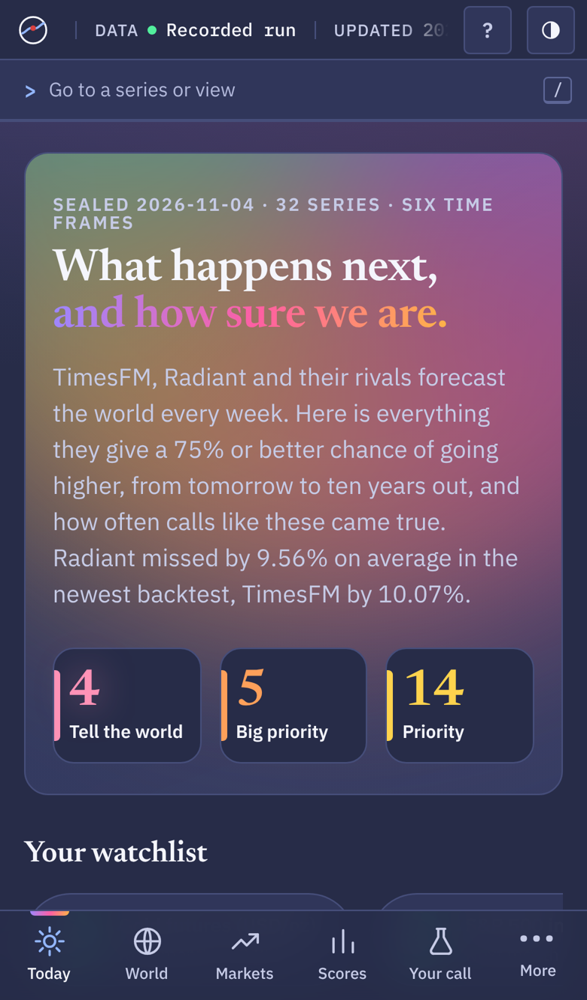

### World events: what is likely to happen next

The **World events** view (More, or key **E**) turns every news, politics and technology forecast into
plain statements with probabilities, a week and four weeks ahead, and puts the week's headlines beside
them. For each topic (elections, war, inflation, protests, climate, pandemics, sanctions, tariffs,
ceasefires, coups, impeachment, referendums, AI, quantum computing and the rest):

| Question | What it means |
|---|---|
| **Flares up** | Coverage reaches a level it reaches only one day in ten (the 90th percentile of its last two years). On a normal day the chance is 10%. |
| **Fades** | Coverage falls to a low it reaches only one day in ten. |
| **Grows** | Coverage is higher than today. |

The odds come from the sealed forecasts, read as in [Event odds](#event-odds-spikes-and-lulls-in-world-news-and-technology):
the four-week odds are sealed in the event ledger, and the one-week odds are read from the same sealed
forecasts (their 7th day), so neither can change after the fact. The forecaster that speaks for each
event is the one with the lowest Brier score on every past backtest window (Seldon, by a hair, on the
7 November run). Its record is shown with the odds; replayed on the backtest's 300 windows per event:

| Seldon's odds against "one day in ten" | 1 day | 1 week | 2 weeks | 4 weeks |
|---|---:|---:|---:|---:|
| Flares up (Brier skill) | +34% | +7% | +12% | +22% |
| Fades (Brier skill) | +53% | +36% | +30% | +27% |

Flare-ups a week ahead are the hardest (+7%): sudden news is sudden. Each card shows the topic's last
three months with the flare-up and fade lines, whether it is heating up or cooling (the last week
against the four before), and the headlines. Today shows the three likeliest flare-ups next week.
These are odds about **coverage**, how much of the world's news mentions a topic or how many people
read about it, not about the events themselves; headlines are context, and no model reads them. The
World wire now asks GDELT for the topics with the oldest headlines first, so every topic is refreshed
within a few runs even when GDELT throttles.

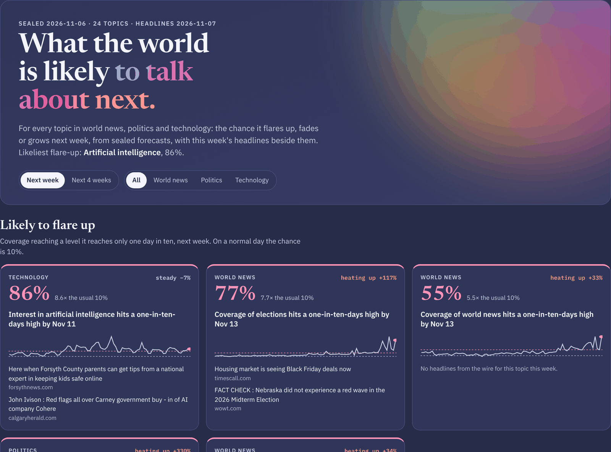

### Would following the forecasts have made money?

The bottom of the Markets desk (and `psychohistory follow`) answers the question every reader of a
market forecast asks. It replays the backtest's market windows as trades: at every origin, each
forecaster **holds** a market when it gives better than even odds of a rise and stays in cash
otherwise, paying 0.1% each way; **long/short** also bets against the markets it calls lower. The
yardstick is holding every market the whole time. Nothing here was tuned on the windows it is judged
on, and the odds needed to buy are also tested out of sample: picked on the first half of the backtest
from 50%, 55% or 60%, then traded on the second half (Bailey et al., 2014).

On the 7 November backtest (15 markets, 165 windows per forecaster):

| Holding a month | Called the direction | Return per window | Long/short | Against holding (t) |
|---|---:|---:|---:|---:|
| Hold every market | – | **+1.3%** | – | yardstick |
| Follow Chronos-Bolt | 51% | +0.6% | +0.1% | −0.7 |
| Follow TimesFM | 47% | +0.6% | −0.1% | −0.8 |
| Follow Radiant | 45% | +0.4% | −0.5% | −0.8 |
| Follow Seldon | 42% | +0.2% | −0.9% | −1.4 |

Following the forecasts trailed simply holding for every forecaster, a week and a month ahead, and
no gap was large enough to be more than luck. In the second half alone, Chronos-Bolt and TimesFM came
out ahead (+0.7% a window against +0.3%), too few windows yet to tell from luck; the card will say
when that changes. The reason is plain: markets mostly rise, so staying out on a "lower" call costs
the rise, and the forecasts call the direction about as often as a coin (Fama, 1970). The forecasts'
use is the range and the odds, not a trading signal. Testing a rule with costs and choosing its
settings on training windows only follows Vibe-Trading's research lab (HKUDS, MIT licence); the code
is our own. Research, not investment advice.

### Betting odds: what people expect to actually happen

The World events odds are about **coverage**. The section under them, **What people are betting will
happen**, is about the events themselves: the most-traded open yes/no questions on
[Polymarket](https://polymarket.com), a prediction market, where the price of "yes" is the crowd's
chance (Wolfers & Zitzewitz, 2004). Every forecast run (`psychohistory bets`) reads them from
Polymarket's public Gamma API, no key needed, and seals them like the project's own forecasts:

| Step | What happens |
|---|---|
| Pick | Open yes/no questions settling in 3 to 400 days, with at least $50,000 traded, most traded first (40 a day). Sports games and short price bets are left out. Each is filed under politics, markets, technology, weather or world news. |
| Seal | The day's prices go into `predictions/bet_ledger.csv`, with a SHA-256 fingerprint per day in `bet_seals.csv`. `psychohistory verify` checks them with the other ledgers. |
| Score | When a question settles, every sealed price for it is opened and scored with the Brier score in `bet_scored.csv`. Each question counts twice at most: the first price sealed, and the last one sealed at least a week before it settled, so a question watched for months does not outweigh one watched for a week. |

The app shows each question's chance, how it moved this week and since it was first sealed, when it
settles and how much money is behind it, with a link to the market. Once questions settle, the
section shows how often the favourite won and the bettors' Brier score against a coin flip, and the
calibration table (said 70%, happened how often?) builds up in the data. A market price is a crowd's
belief, not a chance anyone has checked (Manski, 2006), which is why it is sealed and scored like
everything else. No model here reads these prices; they sit beside the forecasts for context.
`psychohistory bets --show` prints the sealed odds and record without a connection.

The idea of ranking Polymarket's open, forward-looking markets by volume comes from TradingAgents
(Xiao et al., 2024; Apache-2.0); the code here is our own.

### Coming up: the days reality answers

**Coming up** (More, or key **C**) is a calendar of every sealed call by the day it is settled
against what really happened: each series' forecast for the next week, month and year, the World
events flare-ups at 15% or more, the betting questions, and the calls you sealed yourself in the
Forecast Studio (kept in your browser only). Each day lists your calls and bets first, then the
boldest forecasts, five at a time. Filter by kind or by the next two weeks, three months or year,
then **Add to calendar** downloads the list as an `.ics` file (RFC 5545) that Google Calendar,
Apple Calendar and Outlook open, each entry linking back to its forecast. Re-importing updates the
same entries instead of duplicating them. Today shows the next three.

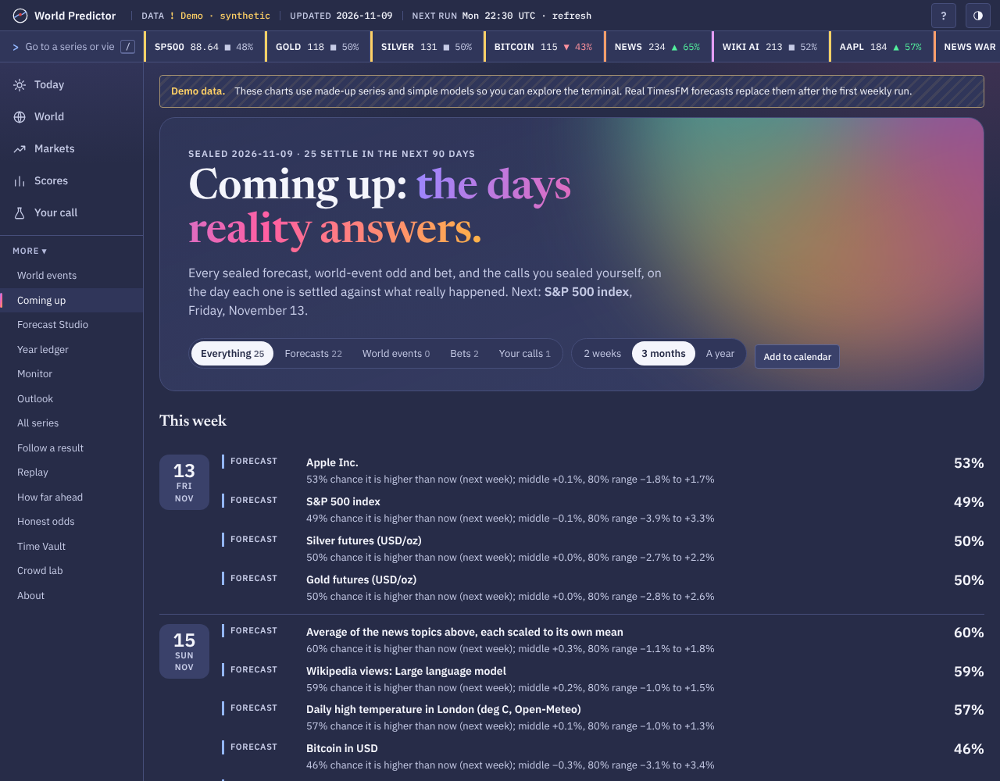

### Share a forecast as an image

Every series page has **Share as image**: a 1200 × 630 picture (the size social sites preview) of
the sealed forecast, with the chance it ends higher, the middle forecast and its 80% range, three
months of history with the range ahead, the day it was sealed and the address where anyone can check
how it turned out. It is drawn in the browser in the theme you are using, works offline and sends
nothing anywhere; on a phone that can share files it opens the share sheet.

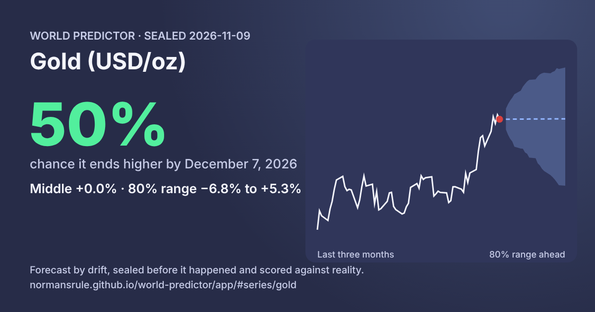

### Compare series side by side

**Compare** (key <kbd>X</kbd>, or *Compare with others* on any series page) puts up to four series'
newest sealed forecasts on one chart. Each is drawn as the change from the day it was sealed, so gold,
Bitcoin and a news index on very different scales line up, with three months of history, the middle
forecast and the 80% range ahead; a table gives the chance each ends higher, the middle, the range and
the day it is judged. The picks live in the address (`#compare/gold,bitcoin,news_war`), so a comparison
is a link you can send.

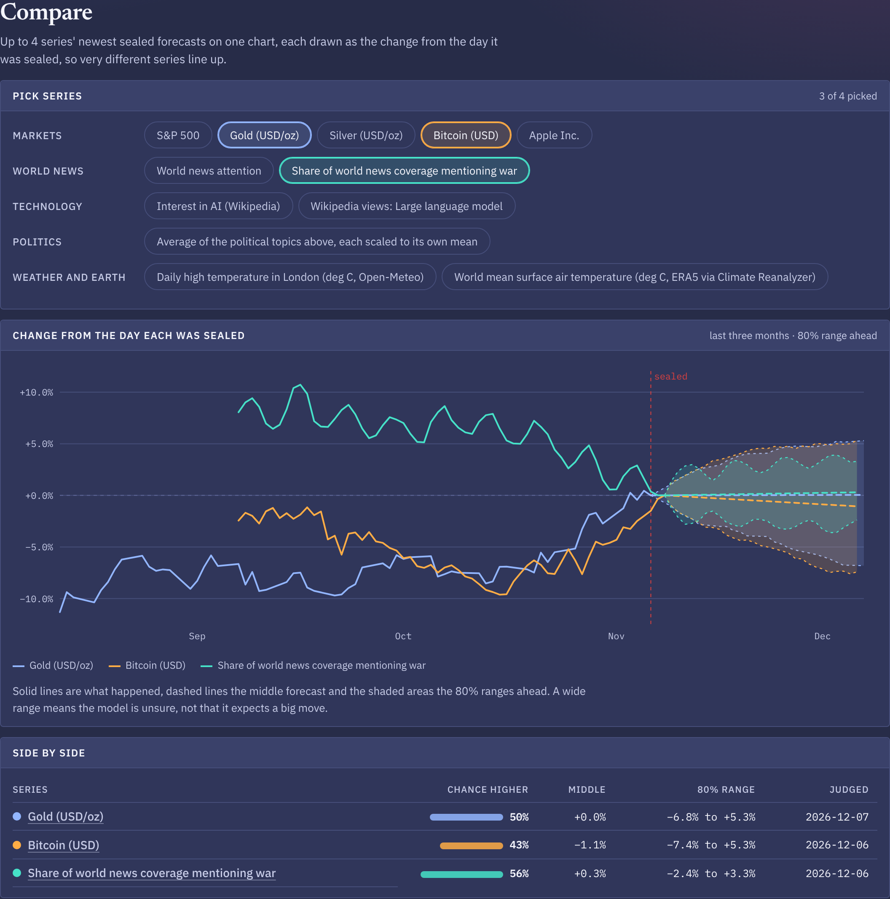

### Which model has been best on each series, and why that is not a tip

Every series page ranks all the forecasters on that series' backtest by average error (sMAPE of the
middle forecast), with how often each one's 80% range caught reality. The obvious next step would be to
use each series' winner. We tested that on the official backtest before showing it
([`champions.py`](src/psychohistory/champions.py)): pick each series' best model on the first half of
its windows, then score that pick on the second half against using Radiant everywhere.

| Hold-out test (31 series) | Result |
|---|---|
| Average error of the per-series pick | 9.45% |
| Average error of Radiant everywhere | 9.37% |
| Series where the pick did better / worse | 8 / 20 |
| Series where the early winner was still the winner | 8 of 31 |

So the pick is not shipped, and the card says so on every page: a lead on one series rarely lasts,
which is also why Radiant learns its weights by area rather than by series. The numbers are recomputed
after every run, and the card's wording follows them if that ever changes.

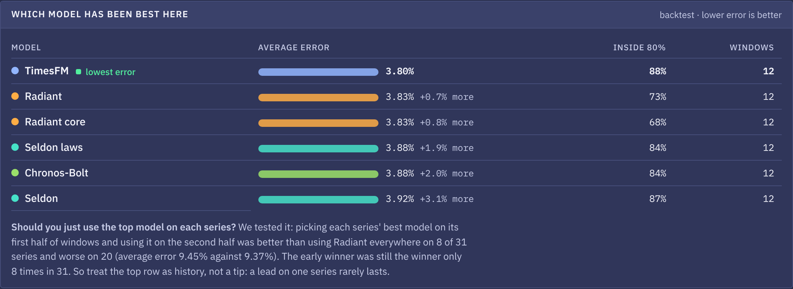

### Forecasts next to what really happened

Every chart of a sealed forecast can now show it against reality. **Compare** (key <kbd>X</kbd>) opens
on the earlier week whose forecasts have the most due days for the series you picked: the solid lines
are the real values before and after the sealing day, the dashed lines the middle forecast and the
shaded areas its 80% range, and every due day gets a dot, green when reality landed inside the range
and red when it missed. A row of weeks switches between any sealed week and the newest one (not due
yet), and a second row switches between TimesFM and Seldon. The table below says, per series, what the
middle forecast said, what really happened, how many due days were inside the range and whether the
direction matched. The same week picker sits on every series page above the sealed forecast chart.

In the recorded run, TimesFM's forecasts sealed on 18 October for gold, silver, the S&P 500 and Bitcoin
had 43 of 54 due days inside their ranges (80%), but the middle forecast got the direction wrong on
three of the four: it said gold +0.4% and silver +0.4% by 4 November, and gold really went −4.2% and
silver −10.3%.

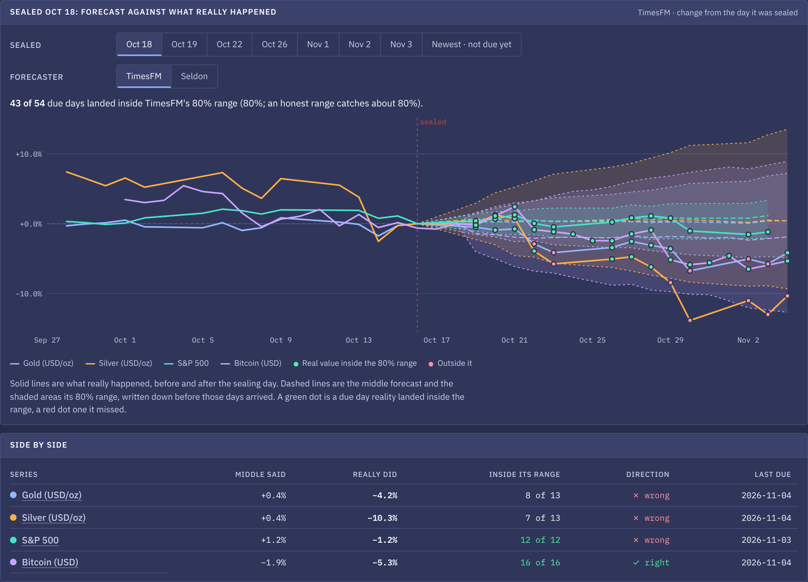

### What the odds suggest, checked against the record

Every market's page now turns its newest chance of rising into a lean: 60% or more leans **buy or
keep holding**, 40% or less leans **sell now and buy back lower later**, anything between is no lean.
That lean is only passed on as advice if it has worked: every TimesFM backtest window on every market
where the forecast leaned the same way is counted, and the lean must have gone the right way clearly
more often than a coin flip (at least 20 windows, one-sided binomial test, p < 0.05). Otherwise the
card says **hold** and shows why.

In the 4 November backtest neither lean passes. When TimesFM gave 60% or more, the market rose 14 of
29 times (48%); when it gave 40% or less, the market fell only 4 of 13 times (31%). So every market
currently says hold, which matches the earlier finding that following the forecasts trailed simply
holding. This is a research tool, not financial advice.

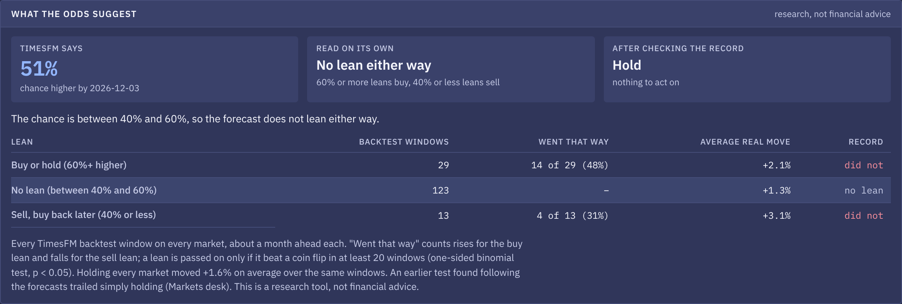

### The track record grid: every sealed forecast at a glance

The Time Vault opens with a grid: every series down the side, every day a sealed forecast came due
across the top. A square is green when reality landed inside the forecast's 80% range, red when it
landed outside, and amber when only some of that day's forecasts did (each weekly batch reaches the
same day from a different distance). The bottom row is the share of all series inside on each day, so
a red column is a day the whole world surprised the model, and a red row is a series it does not
understand yet. Rows are ranked by (hits + 1) / (forecasts + 2), so one lucky forecast cannot outrank
sixty good ones, and series with fewer than five judged forecasts are greyed. Hover a square for the
counts; click a row to open the series.

In the recorded run of 4 November 2026 (17 days of real sealed TimesFM forecasts, 1,241 judged), 72%
landed inside their 80% ranges, short of the 80% an honest range should reach. Bitcoin, the big stock
indexes and oil sit near or above 80%; gold (67%), silver (50%) and Tesla (56%) less so; Wikipedia
attention and news shares are where most misses cluster, with large language model pageviews the
weakest at 38%.

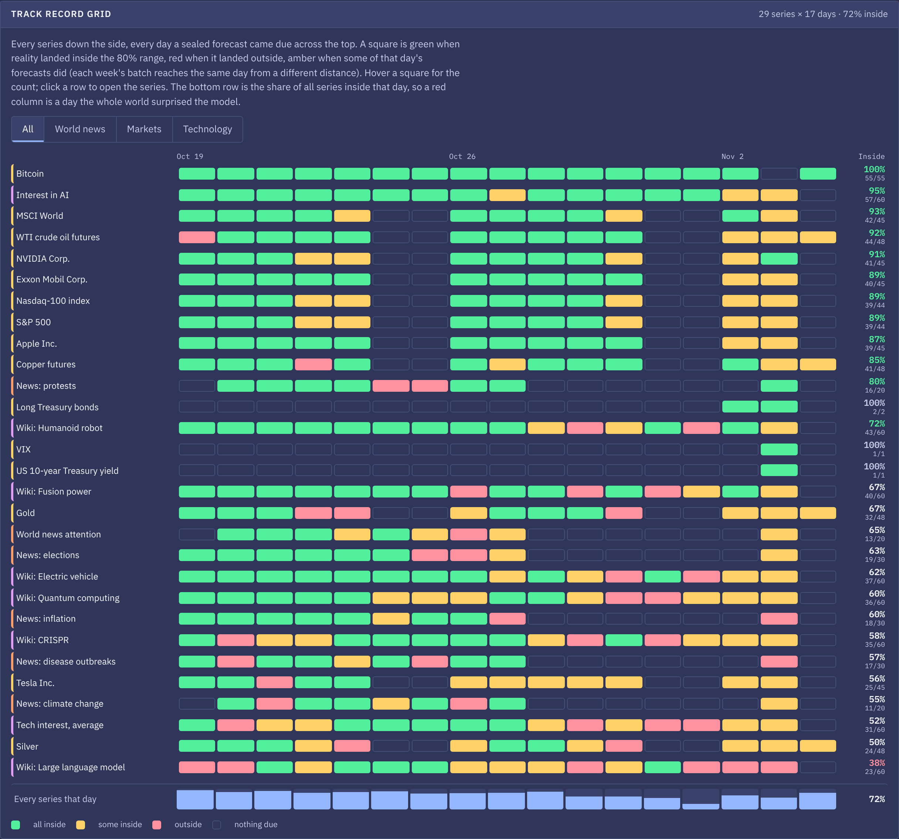

### Follow it from anywhere: news feed, JSON API and embeds

You do not have to open the app to keep up. Every forecast run publishes three things beside it on
GitHub Pages, built from the same data the app shows, so they always say exactly what the app says:

| What | Address | For |
|---|---|---|
| **News feed** (Atom) | [`feed.xml`](https://normansrule.github.io/world-predictor/feed.xml) | Any feed reader. One entry for each newly sealed batch (its boldest calls), one for each week of forecasts that came due (how every model did, the closest calls, the biggest surprises) and one when the lead model changes its mind. Entry ids never change, so a reader shows each one once. |
| **JSON API** | [`api/index.json`](https://normansrule.github.io/world-predictor/api/index.json) and `api/series/<id>.json` | Spreadsheets and scripts. Every series' newest sealed forecast (chance it ends higher, middle change, 80% range, sealing and judging dates) plus the record so far; each series file adds its recent history and the full forecast fan. |
| **Embed** | `app/embed.html#<id>` | Your own web page. **Embed** on any series page copies an `<iframe>` that shows the forecast as a small live card, which updates by itself after every run. Add `?theme=light` or `?theme=dark` to fix its colours. |

They are plain static files: nothing runs on a server, nothing is tracked, and there is no key to ask
for. The feed and API are written by [`feeds.py`](src/psychohistory/feeds.py), which uses only the
standard library so the Pages workflow runs it as a script; `psychohistory site` and `psychohistory app`
write them into your local copy too. The feed follows the Atom format (Nottingham & Sayre, 2005).

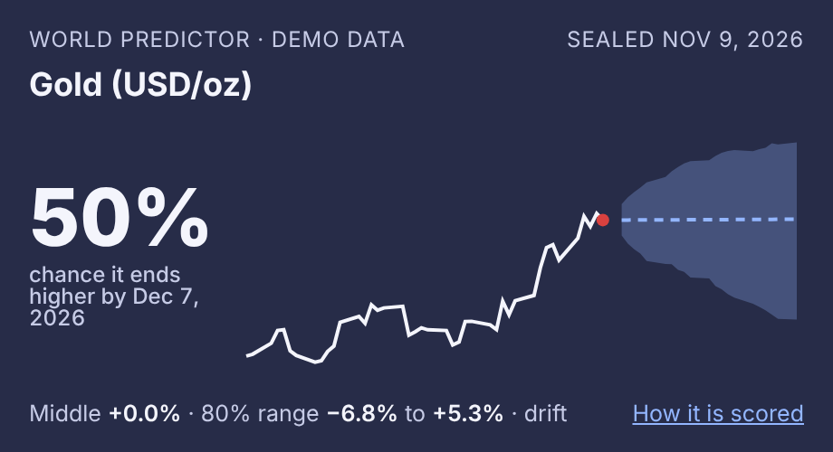

```html
<iframe src="https://normansrule.github.io/world-predictor/app/embed.html#gold" width="460" height="250"
  style="border:0;border-radius:12px;max-width:100%" loading="lazy" title="Gold (USD/oz): World Predictor forecast"></iframe>
```

### Offline mode

World Predictor works without a connection, three ways:

| Where | How it works offline |
|---|---|
| The web app | After one visit, the browser keeps every app file and the newest forecasts (a service worker). With no connection it opens as usual, an **Offline** pill in the top bar says so, and the ? sheet says which day's forecasts are on screen. When a newer version arrives, a **Reload** button offers it. |
| The offline copy | **Save the offline copy** in the ? sheet downloads `world-predictor-offline.html`: the whole app and its data in one file (about 2 MB). Double-click it on any computer, no internet, no install. GitHub Pages rebuilds it after every forecast run. |
| Your own results | `psychohistory offline` writes the same file from your own runs (`build/world-predictor-offline.html`), and `psychohistory app` serves one beside the app. |

Every view works offline; only the World terminal's live headlines need the network, and it says so.
Your watchlist, sealed calls and theme stay in your browser as before.

### Since the last run: the brief

Every forecast run now ends with a brief, the morning paper of the ledger. It answers three questions
from sealed forecasts only, and the same text is saved as [`results/BRIEF.md`](results/BRIEF.md), printed by
`psychohistory brief` and shown on Today (with a **Copy as text** button):

| Question | How it is answered |
|---|---|
| What came due? | Every sealed forecast whose date fell in the last week, per model: share inside the 80% range, share with the right direction, skill against "no change". The lead model's closest calls and its biggest surprises, measured in range widths outside the 80% range, each drawn as a strip: range, middle and what happened. |
| Where did a model change its mind? | Its two newest sealed batches asked the *same* question: the chance of ending above today's level on the farthest date both cover. Holding the level fixed separates a change of mind from a change of starting point. A flip crosses 50% and lands at least 2 points past it. |
| Who is on a streak? | TimesFM's next-step calls, one per sealed batch, so overlapping days never count twice; runs of three or more right or wrong. A short streak is weak evidence, which the brief says beside it. |

On the first real week (30 October to 5 November 2026) Radiant had 70% of its directions right on 72 forecasts
against TimesFM's 60% on 577, and Seldon the best skill (+12%); Apple, Exxon and gold were the biggest surprises.

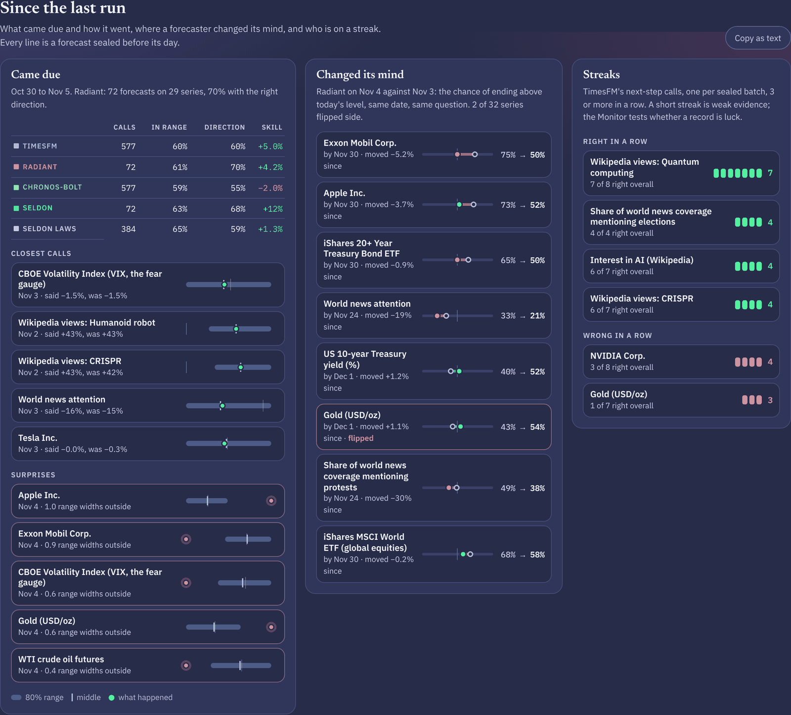

### Weather, politics and the next technologies

Three more kinds of prediction, added on 4 November 2026 and built exactly like the first three: free
open data, no API keys, the same forecasters (TimesFM, Chronos-Bolt, Seldon, Radiant and the
baselines), the same rolling backtest and the same sealed weekly ledger. Each area learns its own
Radiant weights, so a model that is good at weather earns its vote there without changing a market
forecast.

| Area | Series | Ahead | Settled against |
|---|---|---|---|
| **Weather and the planet** | World mean surface air temperature (ERA5), world sea surface temperature 60°S to 60°N (NOAA OISST v2.1), Arctic sea ice extent | 14 days | Climate Reanalyzer's daily files and the NSIDC Sea Ice Index |
| | Daily high in London, New Delhi, Tokyo, Sydney and Los Angeles | 14 days | Open-Meteo's historical archive (ERA5 and national weather services) |
| | Earthquakes of magnitude 4.5 or more per day, worldwide | 14 days | The USGS ComCat catalogue |
| **Political events** | Coverage of sanctions, tariffs, ceasefires and peace talks, coups and martial law, impeachments and no-confidence votes, referendums, and their average | 28 days | GDELT, the same way as world news |
| **Technological advances** | Wikipedia attention to solid-state batteries, gene therapy, self-driving cars and SpaceX's Starship | 28 days | Wikimedia Pageviews |
| | Share of new cars sold that are electric; objects launched into space each year | 3 years | Our World in Data (IEA, UNOOSA) |

Why these choices:

- **Two weeks for weather.** Past about ten days the atmosphere forgets where it started
  (Lorenz, 1963), so a longer forecast would only test who knows the calendar. Two weeks keeps a
  little real weather in the test and lets the seasons show whether a model reads the annual cycle.
  Weather is scored on MASE (mean absolute scaled error) as well as sMAPE: a London high near 0 °C
  makes a percentage miss look huge when the forecast was off by a degree.
- **Earthquakes as the control.** Single quakes have resisted every attempt at prediction
  (Geller, 1997). The daily count should only reveal its average and its aftershock clusters, so a
  forecaster that seems to beat "no change" there by a wide margin is a warning about the test, not a
  discovery.
- **Political events as attention, with odds.** GDELT measures how much of the world's news a topic
  takes up, so "a coup somewhere" shows up as a spike in coverage. Political series get the same
  spike-and-lull odds as world news ("the chance coverage of sanctions, four weeks from now, is at a
  level it reaches only one day in ten"), scored with the Brier score against climatology and
  persistence. Weather is left out of the odds on purpose: a fixed "one day in ten" heat line is
  crossed every day of a hot summer, which would measure the calendar rather than the forecaster.
- **Technology twice over.** Pageviews say when a technology is in the news; the yearly series say
  whether it is actually spreading. Electric car sales only start in 2010, so their first backtest
  has few windows; the space launch count runs from 1957.

There are no results for these areas yet. They join the next weekly run, which seals their first
forecasts, and the next full backtest, which scores them against the past. The tables here will be
filled from those runs, whichever way they come out.

### Radiant: market psychology and statistics against TimesFM

Radiant ([`radiant.py`](src/psychohistory/radiant.py)) is named after the Prime Radiant, the device
in Asimov's *Second Foundation* (1953) that holds the Seldon Plan and shows where it is going wrong.
It has two parts.

**The core (`radiant-core`)** turns five well-documented patterns of crowd behaviour into numbers,
measured from each series' own past:

| Signal | The behaviour | Source |
|---|---|---|
| Momentum | A crowd that has been moving one way keeps moving as late arrivals follow the early ones (herding) | Jegadeesh & Titman (1993); Moskowitz et al. (2012); Bikhchandani et al. (1992) |
| Overreaction | After an extreme run, measured in the series' own volatility, some of it is given back | De Bondt & Thaler (1985) |
| Short-term reversal | Last week's move partly undoes itself | Lehmann (1990) |
| Momentum crashes | When markets turn wild, momentum stops working, so it is scaled by this month's volatility against the year's | Daniel & Moskowitz (2016) |
| Attention spikes | A series far above its recent normal, a burst of news or interest, fades back | Barber & Odean (2008); Da et al. (2011) |

At many earlier dates the core measures the signals and sets them against what followed, and a ridge
regression (Hoerl & Kennard, 1970) shrunk hard toward "no change" turns them into a forecast of the
change. Nothing after the forecast date is used. On its own the core loses, even to "no change", on
the year of history this sandbox has: the signals are real in the literature but weak, and they need
long histories to estimate. In GitHub Actions it sees decades.

**The full Radiant (`radiant`)** mixes TimesFM, the crowd laws, the core, "no change" and, since
3 November 2026, a rival model (Chronos-Bolt; Ansari et al., 2024) decile by decile, with exponential weights (Freund & Schapire, 1997; Cesa-Bianchi & Lugosi, 2006): every
finished forecast window of an area charges each one its miss relative to TimesFM's, and its weight
shrinks by e^(−2 × charge). It starts with TimesFM and Chronos-Bolt level (35% each; 70% on TimesFM when
Chronos does not run), so a signal only gains a say by
being right on forecasts it never saw while learning. Both are backtested on the same windows as
TimesFM, sealed every week beside it, and scored in the year ledger, the bake-off and the real-or-luck
verdicts. The VIX, the market's own fear gauge (Whaley, 2000), is now tracked too; feeding it to the
core as a signal for other markets is the next step.

**Its first official backtest** (the full CI run of 3 November 2026, 32 series, forecasts made blind
at each origin): Radiant and TimesFM finished level. Average sMAPE was 10.24% for Radiant and 10.23%
for TimesFM, and Radiant was closer on 17 of the 32 series (9 of 15 markets, 4 of 6 news topics,
4 of 11 technology series). Its skill against "no change" was slightly higher (0.185 against 0.177).
The behavioural core alone barely beat "no change" (skill 0.017). The best single model in that run
was Chronos-Bolt (9.45%), which beat both on the slow technology series. So Radiant's small edge on
the replayed year did not turn into a clear win on fresh windows. It is a tie, not a victory.

**So Chronos-Bolt joined the mix.** It was the best model in that run, and it won where TimesFM is
weakest (the slow technology series), so it is the expert most likely to add something TimesFM lacks.
It starts with 10% of the weight and, like every other expert, only gains more by being right on
finished windows. Where Chronos did not run (it is optional, and recorded backtest paths from before
this change lack it), it is neither charged nor credited and drops out of the mix; without it Radiant
is exactly the model it was before (checked on all 7,854 replayed forecasts). Its first scored test is
the next full backtest.

**Where Chronos's lead really was.** Broken down by series, almost all of Chronos-Bolt's technology
lead in that run came from the three yearly adoption series (solar 24.7% against TimesFM's 42.1%, wind
14.5% against 24.9%, internet 1.5% against 3.2%). On the eight daily technology series it was slightly
behind on six, on news it was behind on five of six topics, and on markets it led on 8 of 15. But
Radiant left the yearly series out of its learning and mixed them with the weights the daily
technology series had earned, so Chronos could never have gained weight where it was good. Since this
update the yearly series learn in an area of their own. Run on the per-window scores of that backtest,
the same rule would have handed Chronos 75% of the yearly weight after four finished windows and
over 95% after eight, which would have cut Radiant's yearly misses roughly to Chronos's. That is an
estimate from window scores, not a scored forecast: the next full backtest, which records Chronos's
paths, is the test. Without Chronos the change is neutral (solar better, wind slightly worse).

**Its second official backtest** (the full CI run of 4 November 2026, the first with Chronos-Bolt in
the mix and the yearly series learning apart): **Radiant beat TimesFM**, 9.56% average sMAPE against
10.07%, and was closer on 17 of the 32 series (10 of 15 markets, 3 of 6 news topics, 1 of 8 daily
technology series and all 3 yearly ones). Most of the gap is the yearly adoption series (17.6%
against 23.4%), where Chronos earned the vote as predicted. Chronos-Bolt alone was still best
(9.39%), because Radiant needed a few yearly windows to find it: on the first ones it still followed
TimesFM's 63%. On markets, news and the daily technology series Radiant and TimesFM stayed within two
tenths of a point (4.88% against 4.89% on markets).

**So the two foundation models now start level.** Each has an official record, so neither should be
favoured before an area's windows have spoken: with Chronos running, Radiant now starts at 35% TimesFM,
35% Chronos and 10% for each of the others (without Chronos it starts exactly as before). Replayed on
the 4 November run's recorded paths, with weights learned only from finished windows, that took Radiant
from 9.51% to 9.33%, ahead of both Chronos (9.39%) and TimesFM (10.11%) on the same windows. Read it
with care: the start was chosen after seeing this run. Split in time, it helps only on the early
windows (10.07% against 10.41%), before the weights have learned, and changes nothing on the later
ones (8.78% both, against Chronos's 8.82% and TimesFM's 9.11%). Faster forgetting ("fixed share") and
other learning rates were tried on the same split and did not help. The next full backtest is its test.

**Radiant's lab** ([`scripts/radiant_replay.py`](scripts/radiant_replay.py)) rebuilds the whole mix
from a recorded full backtest, each window learning only from its area's finished windows, and
scores every change on the same 344 windows, split into an early half (little to learn from yet) and
a late half (weights learned). A change ships only if it holds up on the late half. On the
4 November run:

| Variant | All | Early | Late | Markets | News | Tech | Yearly |
|---|---|---|---|---|---|---|---|
| **Radiant as shipped** (level start) | 9.33% | 10.07% | 8.78% | 4.93% | 14.79% | 11.16% | 15.55% |
| Old start (63% TimesFM, 10% Chronos) | 9.51% | 10.41% | 8.78% | 4.94% | **14.75%** | **11.15%** | 17.57% |
| Learning rate 4 instead of 2 | **9.31%** | **10.03%** | 8.78% | 4.91% | 14.78% | 11.16% | **15.41%** |
| Learning rate 1 | 9.37% | 10.15% | 8.79% | 4.93% | 14.81% | 11.16% | 15.91% |
| Fixed share 3%: forget old windows (Herbster & Warmuth, 1998) | 9.35% | 10.15% | 8.78% | 4.92% | 14.78% | 11.22% | 15.60% |
| 25% always on TimesFM and Chronos | 9.34% | 10.16% | **8.76%** | 4.91% | 14.79% | 11.18% | 15.74% |
| 50% always on TimesFM and Chronos | 9.39% | 10.27% | 8.77% | **4.90%** | 14.81% | 11.20% | 16.10% |
| Chronos-Bolt alone | 9.39% | 10.32% | 8.82% | 5.03% | 15.31% | 11.55% | 13.55% |
| TimesFM alone | 10.11% | 11.25% | 9.11% | 5.00% | 14.72% | 11.25% | 23.39% |

None of these is worth shipping: on the late windows every variant is within 0.03 points of the
shipped mix. Keeping half the vote on the two foundation models would fix the markets drift on the
late windows (4.87% against 5.01%), but it costs as much on the yearly series and on the early
windows. The lab also checks Radiant's 80% range. On the late windows it caught reality 74% of the
time, a little short. A band width learned per area from the finished windows' misses (adaptive
conformal inference; Gibbs & Candès, 2021) brings that to 79%, but its pinball loss is no better
(2.91% of the level against 2.89%) and it overshoots on the few yearly windows. So the ranges stay as
they are; like the volatility round's range test, it makes the range more honest without making the
forecast better. Every future full backtest can be put through the lab the same way.

**Third lab round (7 November 2026 backtest, 576 windows).** Five more ways to mix were tried on the
same windows: weights learned separately for the first, middle and last third of each forecast, or
for its two halves; weights that also learn per series on top of the area; and the median of TimesFM,
Chronos-Bolt and Radiant. All landed within 0.02 points of the shipped mix (12.89% average miss,
against TimesFM's 13.36% and Chronos-Bolt's 13.06%), so none was shipped: on these windows the middle
forecast has no more to give from mixing.

The ranges did. Radiant's 80% range caught reality 76% of the time on the late windows, and only 58%
on the yearly adoption curves. The shipped rule (`radiant.band_scale`) widens Radiant's range in an
area only when TimesFM's own ranges there caught reality less than 70% of the time on finished
windows, by the factor that would have made 80% of those misses fit (split conformal; Gibbs & Candès,
2021). Learned from TimesFM's ranges, which Radiant never changes, it works the same in the backtest
and live. Only the yearly curves qualify today:

| Late windows | Inside the 80% range, before | After | Pinball loss, before | After |
|---|---:|---:|---:|---:|
| Yearly adoption curves | 58% | **81%** | 7.59% | **7.17%** |
| Every area | 76% | **77%** | 4.017% | **4.000%** |

Every other area is left exactly as it was. `python scripts/radiant_replay.py` prints both tables from
any full backtest.

**Fifth lab round: sharper chances of a rise? (9 November 2026).** The follow-the-forecasts replay
showed every forecaster calls a market's direction about as often as a coin, so four ways to sharpen
the chance of a rise were tried on all 14,168 market windows of the 7 November backtest. Each was
fitted on the first half of the origins and judged on the second (Brier score, lower is better):

| Late windows, markets | Brier |
|---|---:|
| Always the usual share of rises (from the early half) | 0.2539 |
| Radiant, as shipped | 0.2520 |
| Chronos-Bolt | 0.2477 |
| Radiant pulled toward the usual share (weight fitted early) | 0.2539 |
| Re-centred on the usual share, then pulled | 0.2539 |
| Average of all four forecasters | 0.2521 |
| **Average of Radiant and Chronos-Bolt** | **0.2458** |

The pull toward the usual share chose to throw the forecast away (weight 0): markets rose in 55% of
the early windows but only 49% of the late ones, so the "usual share" itself moved. The average of
Radiant and Chronos-Bolt looked best, but per origin its gain over Radiant had t = 0.5 (and 1.1
over Chronos-Bolt), and it helped only 7 of the 15 markets: luck-sized, so nothing was shipped. In
world news the same ideas changed the Brier score in the fourth decimal. Averaging forecasts usually
helps (Bates & Granger, 1969); here the forecasts have too little to average.

**Fourth lab round: Buy, Hold and Sell ratings (9 November 2026).** TradingAgents (Xiao et al., 2024)
ends each analysis with a five-tier rating: Buy, Overweight, Hold, Underweight, Sell. The same tiers
were cut from each model's chance of a market ending higher (below 40%, 40–47%, 47–53%, 53–60%, above
60%) and checked against what the 15 markets did next on the 7 November backtest. The tiers did not
separate winners from losers. Four weeks ahead, the markets Radiant rated **Buy** rose after 2 of 6
windows, and those it rated **Underweight** rose after 16 of 21; TimesFM and Seldon were no better.
A rating that points the wrong way would mislead, so none was shipped: the Markets desk keeps showing
the chance and the range, and says how often each was right.

**Watch it decide.** The Year ledger shows how Radiant splits its vote in each area: the split in use
now, which this week's sealed Radiant forecasts were mixed with, and how it moved after every finished
window. After the 4 November run it gives the yearly adoption series entirely to Chronos-Bolt and news
and the daily technology series entirely to TimesFM. On markets, where every expert misses by about
5% and the differences are small, it has drifted to "no change" (59%) and the behavioural core (40%);
on the later markets windows that left it slightly behind both foundation models (5.01% against
TimesFM's 4.97% and Chronos's 4.78%), the weakest spot to work on next.

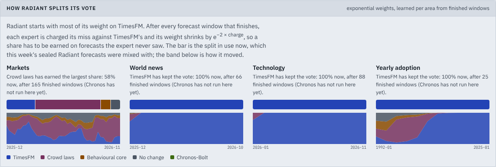

### Quick start

On your own computer (Ubuntu shown, from any folder). No GPU (graphics processing unit) needed:
TimesFM 2.5 has 200 million parameters and runs fine on an ordinary CPU (central processing unit).

```bash
sudo apt update && sudo apt install -y git python3-venv python3-pip
git clone https://github.com/Normansrule/world-predictor.git "$HOME/world-predictor"
cd "$HOME/world-predictor"
python3 -m venv .venv && source .venv/bin/activate
pip install torch --index-url https://download.pytorch.org/whl/cpu   # small CPU-only PyTorch
pip install -e ".[timesfm,rivals,classical,dev]"                   # TimesFM, Chronos, AutoETS

psychohistory app --demo                                 # the app with demo data, in seconds
psychohistory -v run --compare chronos-bolt --ensemble   # real forecasts (downloads TimesFM and data)
psychohistory app                                        # the app with your own results
```

`psychohistory app` serves the app at `http://localhost:8000` and opens your browser.
`world-predictor` works as another name for the `psychohistory` command.

### Step by step

```bash
psychohistory fetch       # download all series into data/ (cached)
psychohistory backtest    # rolling backtest vs baselines -> results/REPORT.md and charts
psychohistory predict     # seal new forecasts in predictions/ledger.csv
psychohistory ask gold    # run TimesFM live on one series (or --csv yours) and print its forecast
psychohistory desk MSFT   # a forecast desk note for any Yahoo ticker, with a track record on it
psychohistory score       # score sealed forecasts whose dates have arrived
psychohistory record gold # one series' track record: past windows and opened sealed forecasts
psychohistory monitor     # the live record over time, the significance test and drift alarms
psychohistory verify      # check no sealed forecast was edited (SHA-256 per weekly batch)
psychohistory vol         # volatility forecasts: GARCH, EWMA and TimesFM's range against last month's
psychohistory events      # event odds: the chance of a spike or a lull in news and tech attention
psychohistory offline     # the whole app and your results in one HTML file that opens without internet
psychohistory brief       # since the last run: what came due, changes of mind, streaks (--write saves results/BRIEF.md)
psychohistory wire        # the newest headlines per topic from GDELT, for the World terminal
psychohistory export      # write the app's data file, results/web/data.js
psychohistory site        # build the static app into build/site (what Pages serves)
psychohistory simulate    # the toy crowd, no downloads
```

| Option | What it does |
|---|---|
| `--compare chronos-bolt` | Score a rival model on exactly the same windows (repeatable) |
| `--ensemble` | Also score the average of all models, a reliable win on forecasting leaderboards |
| `--domain markets` | Only one area (repeatable) |
| `--series gold --series silver` | Only some series |
| `--model timesfm-3` | Use TimesFM 3.0 (non-commercial weights) |
| `--windows 24` | More backtest windows |
| `--skip-backtest` | For `run`: forecast and score only |
| `--port 8080`, `--no-browser` | For `app`: where to serve it, and whether to open a browser |

### Web app or full version?

| | Web app | Full version |
|---|---|---|
| **Open it** | [normansrule.github.io/world-predictor](https://normansrule.github.io/world-predictor/) | `psychohistory app` |
| **Install** | Nothing | Python 3.10+, about 2 GB with PyTorch |
| **Forecasts** | The project's weekly TimesFM run | Your own runs, any series, any model |
| **Data** | Precomputed into one small script file | Downloaded fresh from GDELT, Yahoo, Wikimedia and Our World in Data |
| **Offline** | Yes, after the first visit (service worker) | Yes |

### Models

| Name | Model | Weights licence |
|---|---|---|
| `timesfm-2.5` (default) | [google/timesfm-2.5-200m-pytorch](https://huggingface.co/google/timesfm-2.5-200m-pytorch) | Apache-2.0 |
| `timesfm-3` | [google/timesfm-3.0-pytorch](https://huggingface.co/google/timesfm-3.0-pytorch) | **Non-commercial only** ([licence](https://huggingface.co/google/timesfm-3.0-pytorch/blob/main/LICENSE)) |
| `chronos-bolt`, `chronos-2` | Amazon's rival foundation models, [amazon/chronos-bolt-small](https://huggingface.co/amazon/chronos-bolt-small) and [amazon/chronos-2](https://huggingface.co/amazon/chronos-2) (install the `rivals` extra) | See each model card |
| `seldon` | Our own psychohistory forecaster: the crowd laws below plus the model under test in one council, the laws' share learned per area from finished windows ([`seldon.py`](src/psychohistory/seldon.py)); always run alongside the main model | Apache-2.0 (this repo) |
| `seldon-laws` | The crowd laws alone: four laws and a weekly rhythm, weighted by their record on each series; numpy only, no neural network | Apache-2.0 (this repo) |
| `radiant` | Our attempt to beat TimesFM: TimesFM, the crowd laws, the behavioural core, "no change" and Chronos-Bolt mixed by exponential weights learned per area from finished windows ([`radiant.py`](src/psychohistory/radiant.py)); always run alongside the main model | Apache-2.0 (this repo) |
| `radiant-core` | Market psychology as statistics: momentum, overreaction, short-term reversal, momentum crashes and attention spikes, weighted by a ridge regression on each series' own past | Apache-2.0 (this repo) |
| `ensemble` | Average of TimesFM, its `--compare` rivals and AutoETS (add `--ensemble`) | n/a |
| `bass` | Bass diffusion S-curve (Bass, 1969), run automatically on technology-adoption series | Apache-2.0 (this repo) |
| `auto-ets`, `auto-arima` | Classical baselines (ARIMA is autoregressive integrated moving average) from [statsforecast](https://github.com/Nixtla/statsforecast) (install the `classical` extra) | Apache-2.0 |
| `naive`, `drift`, `mean` | Baselines in `src/psychohistory/models.py` | Apache-2.0 (this repo) |

Backtests always include the simple baselines, plus `auto-ets` when statsforecast is installed, so
TimesFM has to beat a serious classical model and not just a random walk. TimesFM 2.5 is the default
so the whole project stays usable under Apache-2.0.

### Adding your own predictions

Add a `SeriesSpec` to [`src/psychohistory/catalog.py`](src/psychohistory/catalog.py), for example:

```python
_stock("platinum", "PL=F", "Platinum futures")
_news("news_ai_regulation", '"AI regulation"', "Coverage of AI regulation")
_wiki("wiki_solid_state_battery", "Solid-state_battery", "Wikipedia views: Solid-state battery")
```

---

## How it works

**One forecast, taken apart.** Every forecast is built from the same six layers. On the
[website](https://normansrule.github.io/world-predictor/#engine) they come apart and click back
together as you scroll; here they are pulled apart and labelled.

<picture>
  <source media="(prefers-color-scheme: dark)" srcset="docs/assets/engine-dark.svg">
  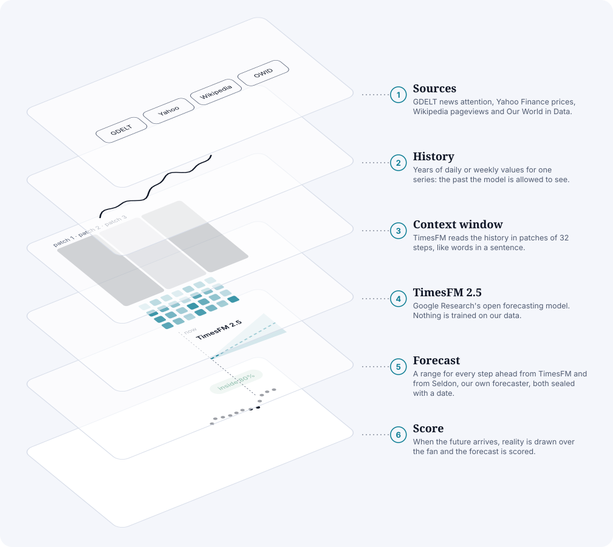
</picture>

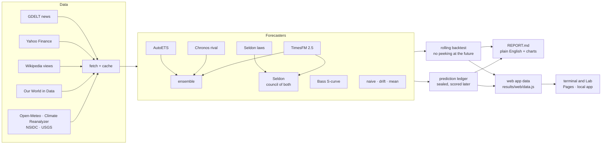

### The five Seldon tests

| | Question | How it's measured |
|:-:|---|---|
| 1 | **Can the future be predicted at all?** | *Skill*: the share of error removed compared with "tomorrow looks like today". Zero means no better. |
| 2 | **Are crowds easier than individuals?** (Seldon's law) | Series are tagged *aggregate* (an index, a composite, a world total) or *individual* (one company, one topic), and their skill is compared. |
| 3 | **How far ahead can it see?** (the Seldon horizon) | Skill at every step ahead, until it falls to zero. |
| 4 | **Are its odds honest?** | Every forecast gives a chance of ending higher; calibration and the Brier score check it. |
| 5 | **What shocked it?** (Seldon crises) | Windows where reality left the 80% range, listed in every report. |

### Seldon vs TimesFM

TimesFM is a 200-million-parameter neural network pretrained on billions of time points. **Seldon**
([`seldon.py`](src/psychohistory/seldon.py)) starts from the opposite bet, the one Hari Seldon made: a
crowd follows a few simple laws, and the trick is knowing which law rules which crowd. It deliberately
does not let TimesFM vote: a second forecaster is only useful if it can disagree.

| Law | The crowd behaviour | Forecast |
|---|---|---|
| **Inertia** | Tomorrow looks like today | The last value |
| **Drift** | The long arc holds | The whole history's average step, carried on |
| **Momentum** | A move keeps going, then fades | The recent trend, damped 10% per step (Gardner & McKenzie, 1985) |
| **Reversion** | Excitement wears off | A pull back to the recent normal (Ornstein-Uhlenbeck) |
| **Rhythm** | Crowds keep calendars | The weekly pattern, taken out first and laid back on top |

1. **Replay the past.** Before every forecast Seldon stands at 16 earlier dates of the same series,
   lets each law forecast the same number of steps ahead, and checks what really happened.
2. **Vote.** Each law's vote is 1 ÷ (its past error)⁴, a sharpened version of the Bates-Granger
   combination (Bates & Granger, 1969), with a fifth of every vote kept equal so a lucky streak can't
   take over.
3. **Set the range.** The 80% range is the council's own past misses, growing with the steps ahead at
   the rate the replays show, and stretched or narrowed by how volatile the series is right now.
4. **Never peek.** Every replay ends before the forecast date; a test changes a later window and checks
   no earlier Seldon forecast moves. Prices and attention are forecast on a log scale.
5. **Hold its own council, without TimesFM.** That council of laws is `seldon-laws`. The full `seldon`
   puts it beside three more voters that do not lean on TimesFM: Radiant's behavioural core, "no
   change" and Chronos-Bolt. Each area (news, markets, technology, yearly adoption) learns their shares
   with exponential weights (Littlestone & Warmuth, 1994): equal at first, and every finished window
   of every series there charges each voter its miss relative to the council's average. Pooling a whole
   area is Seldon's law of large numbers turned on itself: one series' dozen windows are too few to
   learn from, a whole area's are not. Until 10 November 2026 TimesFM had a seat too, and under the
   rule that gave the laws a share only when they beat it by 2%, it kept nearly the whole vote, so
   Seldon had become a copy of TimesFM. That rule (`learn_share`) is kept for the old runs it scored.

Seldon is scored by exactly the same code as TimesFM, on the same windows, sealed in the same ledger,
and the app's scoreboard, the Lab and every outlook show both. It is allowed to lose.

**The honesty rule.** Backtests can flatter a model that was trained on the same history, so the
project also keeps the **prediction ledger**: forecasts written down *before* the future happens and
scored once it arrives, like Seldon's recordings in the Time Vault.

<p align="center">
  <picture>
    <source media="(prefers-color-scheme: dark)" srcset="docs/assets/how-to-read-dark.svg">
    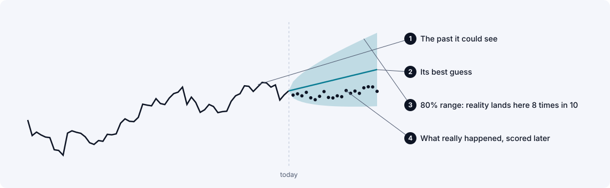
  </picture>
</p>

A good forecaster isn't one that's always right. It's one whose **80% range catches reality about
8 times in 10**, and whose **"70% chance" calls come true about 70% of the time**.

**Why crowds are predictable (a toy world).** Ten thousand simulated people each have a mood that is a
little shared "tide" plus a lot of personal noise. One person is mostly noise; average a thousand of
them and the noise cancels out, leaving the tide. That's Seldon's bet in one picture, and test 2 checks
whether real indices and composites behave the same way. Try it with `psychohistory simulate`.

<p align="center">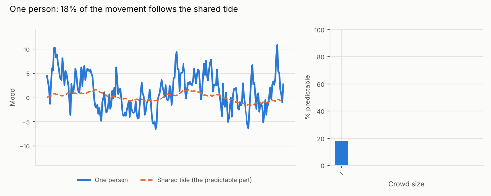</p>

Full methods and limitations: [docs/METHODOLOGY.md](docs/METHODOLOGY.md). Every stage, its code, its
tests and what it does when it fails: [docs/ARCHITECTURE.md](docs/ARCHITECTURE.md).

| Workflow | When | What it does |
|---|---|---|
| [`predict`](.github/workflows/predict.yml) | Every Monday (backtest on the 1st) | Fetches data, seals new TimesFM forecasts, scores old ones, redraws charts and the app data, commits them |
| [`pages`](.github/workflows/pages.yml) | After each forecast run | Publishes the web app to GitHub Pages |
| [`release`](.github/workflows/release.yml) | When a `v*` tag is pushed | Attaches the full project zip and an offline app zip to a GitHub Release |
| [`tests`](.github/workflows/tests.yml) | Every push | Runs the offline test suite on Python 3.10 and 3.12 |

---

## Project structure

```
site/                    the app: one static folder for Pages, the download and local use
  index.html             landing page with the Lab as its hero (assets/site.css, assets/site.js)
  app/                   the terminal (index.html, css/app.css, js/app.js, js/charts.js, js/trace.js)
  app/js/lab.js          the Lab, shared by the terminal and the landing page
  app/js/studio.js       the Forecast Studio: odds for any level, and your own sealed calls
  app/js/series.js       series pages: every past forecast against what happened, and the opened ones
  app/embed.html         one forecast as a small card for any web page (an <iframe>)
  app/js/compare.js      Compare: up to four series' sealed forecasts on one chart
  app/data/              data.js (this run's numbers) and pipeline.js (the stage inventory)
  sw.js                  offline support; manifest.webmanifest makes it installable
src/psychohistory/
  catalog.py             the series to forecast, by area, tagged aggregate or individual
  data/                  loaders: gdelt.py, markets.py, wikipedia.py, owid.py (a CSV, comma-separated values, cache)
  models.py              TimesFM, Chronos, AutoETS, Bass and baseline forecasters, plus the ensemble
  metrics.py             error and calibration scores: MAE, MASE, sMAPE, direction, 80% coverage, Brier
  seldon.py              Seldon: our own forecaster, crowd laws weighted by their record, no neural network
  radiant.py             Radiant: behavioural signals plus an exponential-weights mix of TimesFM, the laws and no change
  backtest.py            rolling-origin backtest, the Seldon summary tables and the TimesFM-vs-Seldon duel
  ledger.py              seal forecasts now, score them later, fingerprint every weekly batch
  monitor.py             `psychohistory monitor`: the live record over time, Diebold-Mariano, drift alarms
  volatility.py          `psychohistory vol`: GARCH(1,1), EWMA and implied volatility, QLIKE, a sealed volatility ledger
  yearbook.py            the year ledger: every day of the year, each model's median against reality, sealed over backtest
  events.py              `psychohistory events`: odds of a spike or a lull, Brier skill vs climatology and persistence, a sealed event ledger
  offline.py             `psychohistory offline`: the one-file offline copy (stdlib only, also run by the Pages workflow)
  champions.py           each series' backtest ranking of every model, and the hold-out test of picking the winner
  feeds.py               feed.xml (Atom) and api/ (JSON) next to the app (stdlib only, also run by the Pages workflow)
  worldevents.py         the World events view: flare-up, fade and growth odds a week and four weeks ahead, with the wire's headlines
  bets.py                betting odds: Polymarket's prices on real-world questions, sealed daily and scored when they settle
  follow.py              would following the forecasts have made money? backtest windows as trades, with costs, against holding
  brief.py               `psychohistory brief`: what came due, changes of mind at a fixed level, streaks; results/BRIEF.md
  wire.py                `psychohistory wire`: the newest GDELT headlines per topic, for the World terminal
  ask.py                 `psychohistory ask`: TimesFM live on one series or your own CSV
  desk.py                `psychohistory desk`: a forecast desk note for any ticker, with odds, volatility and a per-asset track record
  story.py               plain-English findings, scoreboard, replay, outlook, Time Vault, `record`
  simulate.py            toy agent-based crowd: why aggregates are predictable
  inventory.py           what each pipeline stage does: feeds the app's explorer and ARCHITECTURE.md
  engine_art.py          the exploded-engine drawing, shared by the landing page and this README
  web.py                 the app's data file (Lab rounds, series windows, opened forecasts), the demo data, and building the site
  progress.py            this README's progress tracker, from docs/progress.json
  report.py              results/REPORT.md and charts
  dashboard.py           results/dashboard.html (Plotly version of the dashboard)
  cli.py                 the `psychohistory` command
tests/                   offline tests (synthetic data, no downloads)
docs/                    METHODOLOGY.md, ARCHITECTURE.md, DESIGN.md, progress.json, artwork in docs/assets/
predictions/             ledger.csv (sealed forecasts) and scored.csv
results/                 REPORT.md, charts, and run_status.json (which series got through each stage)
.github/workflows/       tests, predict (weekly), pages (web app), release (downloads)
scripts/                 make_readme_art.py, make_app_screenshots.py, rebuild_app_data.py, seldon_m4_check.py, publish_to_github.sh
```

The metric names, in full: MAE is mean absolute error, MASE is mean absolute scaled error, and sMAPE is
symmetric mean absolute percentage error. The banner, explainer and progress bars are drawn by
`python scripts/make_readme_art.py`; the screenshots by `python scripts/make_app_screenshots.py --site build/site`
after `psychohistory site`.

---

## Design

**The concept: the Sealed Ledger.** World Predictor's whole idea is a promise: write the forecast down
*before* the future happens, then open it and keep score. So the design is a forecasting terminal built
around that promise, in the spirit of a professional market terminal: dense, fast, keyboard-first, and
honest about what it doesn't know. Its one big moment is the seal itself, in the Lab.

**Accessibility floor, measured (round 6).** Every view was opened in both themes on a desktop and
a 390 px phone, and every text element and control measured in the browser: text contrast against
WCAG 2.2's 4.5:1 (3:1 for large text), control size against its 24 px minimum target (2.5.8),
controls without a name, sideways scrolling and script errors. Fixed: the red seal buttons (4.1:1,
now 5.1:1 with a deeper fill, while the red seal mark on charts keeps its colour), table sort
headers (13 px tall, now 24), the compare boxes, movers, Export, Clear and Watch buttons, the
footer links and the logo on phones. What remains under 24 px is text links inside sentences, which
WCAG exempts. No view scrolls sideways, and none logs an error. The floor follows Hallmark's "never
ship" gates and the earlier audit's skills (taste-skill, Apple's Human Interface Guidelines).

**Colour means something, and only one thing.**

| Colour | Means | Always backed by |
|---|---|---|
| Soft white ink (dusk) / near-black ink (light) | What really happened | A solid line |
| Periwinkle | TimesFM, the model under test | A hatched range |
| Teal | Seldon, the challenger | A dotted range |
| Violet | You, in the Lab and the Forecast Studio | Your name on the line |
| Seal red | A forecast sealed before the future | The seal and its date |
| Green / coral red | Better / worse than "no change" | A sign (+ or −) |
| Orange, rose, gold, orchid, sky blue | World news, politics, markets, technology, weather | The area's name beside it |
| Gold | Warnings and gaps | Hatching and a "!" |
| Yellow, orange, hot pink | Alert tiers: 75%, 85%, 95%+ chance of going higher | The tier's name and the percentage |

Every text colour passes WCAG (Web Content Accessibility Guidelines) AA contrast, 4.5:1, on every
surface in both themes. Dusk (`#272c48`, panels `#30365a`), a mid-tone indigo with a soft violet and
pink aura, is the default. The choice follows colour psychology: blue reads as trust and competence,
so it carries the base and TimesFM, while saturated warm colours raise attention and arousal, so they
are kept for what should get attention (the alert tiers, Radiant and the headline gradient). Green and
red keep their usual meaning of gain and loss (Elliot & Maier, 2014). The soft light theme uses
lavender-grey paper (`#e6e8f6`) rather than white.
Spacing is kept tight, terminal-style: 12-pixel gaps between panels and short, one-line introductions.

**Type with jobs.** Newsreader, a newspaper serif, for headlines and the Lab's verdict; IBM Plex Sans
for the interface; IBM Plex Mono only where characters must line up: numbers, dates, tickers and code.
Sizes follow one scale (11, 12, 13, 14, 16, 20, 28, 40, 54) and spacing another (4, 8, 12, 16, 24,
32, 48).

**Motion that carries information.** Things arrive with a strong ease-out in under 300 milliseconds;
buttons press in slightly; reality *draws* in after the seal breaks, followed by TimesFM and then Seldon,
so the order you see them in is the order that matters. Sealing is press-and-hold, so nothing is ever
sealed by accident. With reduced motion turned on, every state change still happens, as a fade.

**Two speeds: a showroom and a workbench.** The landing page is the showroom, in the spirit of
[Apple](https://www.apple.com/), the [AirPods Pro](https://www.apple.com/airpods-pro/) page,
[Igloo](https://www.igloo.inc/), [Rive](https://rive.app/), [1minus1](https://1minus1.com/),
[Bruno Simon](https://bruno-simon.com/) and [Dogstudio](https://dogstudio.co/):

- a canvas of sample paths fanning out of one point behind the headline (possible futures, which is what
  a forecast is);
- two slow colour glows;
- a pinned, scroll-scrubbed story of one real forecast;
- big counted-up numbers;
- a pointer spotlight on panels and buttons that lean slightly towards the pointer.

Every figure in it comes from the data file. The terminal is the workbench: panels settle in when a view
opens and a faint light follows the pointer, but nothing in it moves unless it carries information.

**What was cut from the terminal.** Gradient fills and glows, a wall of identical cards (the Outlook is a
list and a detail panel), emoji used as icons, pinging "live" dots, and monospace used as decoration. On
the landing page, reveals never hide content without JavaScript or under reduced motion.

**Accessible by default.** Every view works from the keyboard, including dragging your call in the Lab
(its handles are sliders to screen readers); focus is always visible; nothing depends on colour alone;
and the layout works from a 390-pixel phone up.

The redesign followed [Impeccable](https://github.com/pbakaus/impeccable),
[taste-skill](https://github.com/Leonxlnx/taste-skill) and
[Emil Kowalski's design-engineering skills](https://github.com/emilkowalski/skills) as checklists, and
was audited against them afterwards (contrast, overflow at three widths, keyboard-only play, reduced
motion). The product idea comes from [World Monitor](https://github.com/koala73/worldmonitor) by Elie
Habib and its fork [Terra Atlas](https://github.com/Normansrule/worldmonitor): one static `site/` folder
served by GitHub Pages and shipped as a download, with no server or API keys. The full design notes,
and the fifty sites and READMEs that shaped earlier versions, are in [**docs/DESIGN.md**](docs/DESIGN.md).
No code was copied from any of them (World Monitor is AGPL-3.0, the GNU Affero General Public License;
World Predictor is Apache-2.0).

---

## Roadmap and progress

<picture>
  <source media="(prefers-color-scheme: dark)" srcset="docs/assets/progress-dark.svg">
  
</picture>

<!-- progress:start -->

**60 of 64 milestones done (94%).** Drawn from [`docs/progress.json`](docs/progress.json); tests check every ticked item against the repository.

<details><summary><b>📰 World news</b> · 17/17</summary>

- [x] GDELT news-attention loader
- [x] Six news topics plus a news composite
- [x] Rolling backtest against naive, drift, mean and AutoETS
- [x] Weekly sealed forecasts in the prediction ledger
- [x] First real TimesFM results published
- [x] Chronos-Bolt joins Radiant's mix as an optional fifth expert that earns its weight
- [x] Yearly adoption series learn Radiant's weights in an area of their own, where Chronos-Bolt led
- [x] The Year ledger shows how Radiant splits its vote per area and how the split moved
- [x] Radiant beats TimesFM in an official backtest (9.56% against 10.07% sMAPE, 4 November 2026)
- [x] Radiant's lab replays its mix on every recorded backtest and tests changes on early and late windows
- [x] A leaderboard of every model, Radiant's duel and its sealed forecasts on the desk and outlook; the lab runs after every full backtest
- [x] Radiant: behavioural finance signals and an exponential-weights mix, scored against TimesFM in the bake-off, the year ledger and the weekly sealed ledger
- [x] Year ledger verdicts: a Diebold-Mariano test per series against TimesFM, cut with Benjamini-Hochberg, and a CSV of every table
- [x] Bake-off: ten ways of combining TimesFM and the crowd laws replayed without peeking; Seldon's share rule replaced by the one that came closest
- [x] Year ledger: every day of the year, TimesFM, Seldon and the crowd laws against reality, refreshed every weekday
- [x] Event-level odds: spikes and lulls in world news and tech attention, scored against climatology and persistence
- [x] World wire: the newest GDELT headlines for every topic, weekly

</details>

<details><summary><b>📈 Markets, gold and silver</b> · 10/10</summary>

- [x] Yahoo Finance loader (stocks, indices, gold, silver, oil, copper, Bitcoin)
- [x] Chronos rival models and a quantile-averaged ensemble
- [x] Seldon: our own psychohistory forecaster, run head to head with TimesFM
- [x] Official Seldon vs TimesFM duel from a full backtest
- [x] Chance-of-rising odds scored with the Brier score
- [x] Outlook grid for stocks, gold, silver and Bitcoin
- [x] Markets desk: watchlist, odds calculator, who to trust per asset, compare and export
- [x] Forecast desk note for any Yahoo ticker (psychohistory desk)
- [x] First real TimesFM results published
- [x] Volatility forecasts: GARCH(1,1), EWMA and TimesFM's range, sealed weekly and scored with QLIKE

</details>

<details open><summary><b>🚀 New technologies</b> · 4/5</summary>

- [x] Wikipedia attention for LLMs, AI, quantum, CRISPR, EVs, fusion, robots
- [x] Adoption curves from Our World in Data
- [x] Bass diffusion S-curve as a theory-driven rival
- [x] First real TimesFM results published
- [ ] Hype-cycle detection (attention peaks while adoption keeps rising)

</details>

<details open><summary><b>🌐 Web app (GitHub Pages)</b> · 23/24</summary>

- [x] World terminal: command line, world board, movers, just-opened forecasts, focus and scoreboard
- [x] Your book: sealed calls settled for good, running skill against TimesFM, export and import
- [x] Static app: scoreboard, replay, outlook, horizon, odds, Time Vault, crowd lab
- [x] No chart library: hand-written SVG charts, about 45 KB of code once compressed
- [x] Light and dark themes, phone layout, installable, works offline
- [x] Pages deployment after every weekly run
- [x] Landing page that tells the story on scroll, with the exploded forecast engine
- [x] Follow one result: trace any forecast back through the pipeline to its source
- [x] Architecture page and pipeline explorer generated from the code
- [x] The Lab: blind calls on real past windows, scored against TimesFM and Seldon
- [x] Sealed Ledger terminal design: slate and light themes, keyboard-first
- [x] Forecast Studio: odds for any level, an odds board, and your own sealed calls
- [x] `psychohistory ask`: TimesFM live on any series or your own CSV
- [x] Full bibliography in APA style
- [x] A page for every series: every past forecast against what happened
- [x] Time Vault lists every opened forecast, flagged when sealed before the value was published
- [x] Cinematic landing page: a scroll story of one real forecast, sealed then scored
- [ ] Live at normansrule.github.io/world-predictor
- [x] Long-term monitor: live skill, coverage and calibration by month, with drift alarms
- [x] Design audit: WCAG 2.2 contrast in both themes, an 11px type floor, 40px touch targets, keyboard-instant views
- [x] Today home screen: rise alerts in three tiers (75%, 85%, 95%+), each with its own record
- [x] Six time frames per series (day to ten years) with a long view for years
- [x] The 70% club: direction calls tuned on early windows, checked on later ones
- [x] Five-button navigation and the Dusk palette

</details>

<details open><summary><b>💻 Downloadable full version</b> · 6/8</summary>

- [x] `psychohistory app`: run TimesFM locally and open the same app
- [x] `psychohistory record`: one series' full track record in the terminal
- [x] Release workflow: full project zip and offline app zip
- [ ] First tagged release
- [ ] Desktop installer (Tauri, as World Monitor does)
- [x] psychohistory monitor: is the live record better than no change, with a significance test
- [x] Tamper-evident ledger: a SHA-256 fingerprint per weekly batch (psychohistory verify)
- [x] Small-sample statistics: Student's t, Harvey-Leybourne-Newbold, Benjamini-Hochberg false-discovery cut on alarms

</details>

<!-- progress:end -->
## References

The key sources, in APA style (American Psychological Association, 7th edition). The full
bibliography, with every model, data source, theory and design reference, is in
[REFERENCES.md](REFERENCES.md#bibliography-apa-7th-edition).

- Ansari, A. F., Stella, L., Turkmen, C., Zhang, X., Mercado, P., Shen, H., Shchur, O., Rangapuram, S. S., Pineda Arango, S., Kapoor, S., Zschiegner, J., Maddix, D. C., Wang, H., Mahoney, M. W., Torkkola, K., Wilson, A. G., Bohlke-Schneider, M., & Wang, Y. (2024). Chronos: Learning the language of time series. *Transactions on Machine Learning Research*. https://arxiv.org/abs/2403.07815
- Asimov, I. (1951). *Foundation*. Gnome Press.
- Asimov, I. (1953). *Second Foundation*. Gnome Press.
- Assimakopoulos, V., & Nikolopoulos, K. (2000). The theta model: A decomposition approach to forecasting. *International Journal of Forecasting, 16*(4), 521–530. https://doi.org/10.1016/S0169-2070(00)00066-2
- Bailey, D. H., Borwein, J. M., López de Prado, M., & Zhu, Q. J. (2014). Pseudo-mathematics and financial charlatanism: The effects of backtest overfitting on out-of-sample performance. *Notices of the American Mathematical Society, 61*(5), 458–471. https://doi.org/10.1090/noti1105
- Barber, B. M., & Odean, T. (2008). All that glitters: The effect of attention and news on the buying behavior of individual and institutional investors. *The Review of Financial Studies, 21*(2), 785–818. https://doi.org/10.1093/rfs/hhm079
- Bates, J. M., & Granger, C. W. J. (1969). The combination of forecasts. *Operational Research Quarterly, 20*(4), 451–468. https://doi.org/10.1057/jors.1969.103
- Benjamini, Y., & Hochberg, Y. (1995). Controlling the false discovery rate: A practical and powerful approach to multiple testing. *Journal of the Royal Statistical Society: Series B (Methodological), 57*(1), 289–300. https://doi.org/10.1111/j.2517-6161.1995.tb02031.x
- Bikhchandani, S., Hirshleifer, D., & Welch, I. (1992). A theory of fads, fashion, custom, and cultural change as informational cascades. *Journal of Political Economy, 100*(5), 992–1026. https://doi.org/10.1086/261849
- BlackRock. (n.d.). *iShares 20+ Year Treasury Bond ETF (TLT)* [Data set]. Retrieved November 2, 2026, from https://www.ishares.com/us/products/239454/
- Bollerslev, T. (1986). Generalized autoregressive conditional heteroskedasticity. *Journal of Econometrics, 31*(3), 307–327. https://doi.org/10.1016/0304-4076(86)90063-1
- Brier, G. W. (1950). Verification of forecasts expressed in terms of probability. *Monthly Weather Review, 78*(1), 1–3. https://doi.org/10.1175/1520-0493(1950)078<0001:VOFEIT>2.0.CO;2
- Cboe Global Markets. (n.d.-a). *Cboe 10-Year U.S. Treasury Note Yield Index (TNX)* [Data set]. Retrieved November 2, 2026, from https://www.cboe.com/
- Cboe Global Markets. (n.d.-b). *Cboe Volatility Index (VIX)* [Data set]. Retrieved November 2, 2026, from https://www.cboe.com/tradable_products/vix/
- Cesa-Bianchi, N., & Lugosi, G. (2006). *Prediction, learning, and games*. Cambridge University Press. https://doi.org/10.1017/CBO9780511546921
- Climate Change Institute, University of Maine. (n.d.). *Climate Reanalyzer: Daily surface air and sea surface temperature* [Data set]. Retrieved November 4, 2026, from https://climatereanalyzer.org/
- Da, Z., Engelberg, J., & Gao, P. (2011). In search of attention. *The Journal of Finance, 66*(5), 1461–1499. https://doi.org/10.1111/j.1540-6261.2011.01679.x
- Daniel, K., & Moskowitz, T. J. (2016). Momentum crashes. *Journal of Financial Economics, 122*(2), 221–247. https://doi.org/10.1016/j.jfineco.2015.12.002
- Das, A., Kong, W., Sen, R., & Zhou, Y. (2024). A decoder-only foundation model for time-series forecasting. In *Proceedings of the 41st International Conference on Machine Learning* (Proceedings of Machine Learning Research, Vol. 235). PMLR. https://arxiv.org/abs/2310.10688
- De Bondt, W. F. M., & Thaler, R. (1985). Does the stock market overreact? *The Journal of Finance, 40*(3), 793–805. https://doi.org/10.1111/j.1540-6261.1985.tb05004.x
- Desruisseaux, B. (Ed.). (2009). *Internet calendaring and scheduling core object specification (iCalendar)* (RFC 5545). Internet Engineering Task Force. https://doi.org/10.17487/RFC5545
- Diebold, F. X., & Mariano, R. S. (1995). Comparing predictive accuracy. *Journal of Business & Economic Statistics, 13*(3), 253–263. https://doi.org/10.1080/07350015.1995.10524599
- Elliot, A. J., & Maier, M. A. (2014). Color psychology: Effects of perceiving color on psychological functioning in humans. *Annual Review of Psychology, 65*, 95–120. https://doi.org/10.1146/annurev-psych-010213-115035
- Engle, R. F. (1982). Autoregressive conditional heteroscedasticity with estimates of the variance of United Kingdom inflation. *Econometrica, 50*(4), 987–1007. https://doi.org/10.2307/1912773
- Fama, E. F. (1970). Efficient capital markets: A review of theory and empirical work. *The Journal of Finance, 25*(2), 383–417. https://doi.org/10.2307/2325486
- Fetterer, F., Knowles, K., Meier, W. N., Savoie, M., & Windnagel, A. K. (2017). *Sea Ice Index* (Version 3) [Data set]. National Snow and Ice Data Center. https://doi.org/10.7265/N5K072F8
- Freund, Y., & Schapire, R. E. (1997). A decision-theoretic generalization of on-line learning and an application to boosting. *Journal of Computer and System Sciences, 55*(1), 119–139. https://doi.org/10.1006/jcss.1997.1504
- Gardner, E. S., Jr., & McKenzie, E. (1985). Forecasting trends in time series. *Management Science, 31*(10), 1237–1246. https://doi.org/10.1287/mnsc.31.10.1237
- Garza, A., Mergenthaler Canseco, M., Challú, C., & Olivares, K. G. (2022). *StatsForecast: Lightning fast forecasting with statistical and econometric models* [Computer software]. GitHub. https://github.com/Nixtla/statsforecast
- Geller, R. J. (1997). Earthquake prediction: A critical review. *Geophysical Journal International, 131*(3), 425–450. https://doi.org/10.1111/j.1365-246X.1997.tb06588.x
- Gibbs, I., & Candès, E. (2021). Adaptive conformal inference under distribution shift. In *Advances in Neural Information Processing Systems 34* (pp. 1660–1672). https://arxiv.org/abs/2106.00170
- Gneiting, T., & Raftery, A. E. (2007). Strictly proper scoring rules, prediction, and estimation. *Journal of the American Statistical Association, 102*(477), 359–378. https://doi.org/10.1198/016214506000001437
- Google Research. (n.d.). *timesfm* [Computer software]. GitHub. https://github.com/google-research/timesfm
- Harvey, D., Leybourne, S., & Newbold, P. (1997). Testing the equality of prediction mean squared errors. *International Journal of Forecasting, 13*(2), 281–291. https://doi.org/10.1016/S0169-2070(96)00719-4
- Herbster, M., & Warmuth, M. K. (1998). Tracking the best expert. *Machine Learning, 32*(2), 151–178. https://doi.org/10.1023/A:1007424614876
- Hersbach, H., Bell, B., Berrisford, P., Hirahara, S., Horányi, A., Muñoz-Sabater, J., Nicolas, J., Peubey, C., Radu, R., Schepers, D., Simmons, A., Soci, C., Abdalla, S., Abellan, X., Balsamo, G., Bechtold, P., Biavati, G., Bidlot, J., Bonavita, M., … Thépaut, J.-N. (2020). The ERA5 global reanalysis. *Quarterly Journal of the Royal Meteorological Society, 146*(730), 1999–2049. https://doi.org/10.1002/qj.3803
- Hoerl, A. E., & Kennard, R. W. (1970). Ridge regression: Biased estimation for nonorthogonal problems. *Technometrics, 12*(1), 55–67. https://doi.org/10.1080/00401706.1970.10488634
- Huang, B., Liu, C., Banzon, V., Freeman, E., Graham, G., Hankins, B., Smith, T., & Zhang, H.-M. (2021). Improvements of the Daily Optimum Interpolation Sea Surface Temperature (DOISST) version 2.1. *Journal of Climate, 34*(8), 2923–2939. https://doi.org/10.1175/JCLI-D-20-0166.1
- Hyndman, R. J., & Billah, B. (2003). Unmasking the Theta method. *International Journal of Forecasting, 19*(2), 287–290. https://doi.org/10.1016/S0169-2070(01)00143-1
- Hyndman, R. J., & Koehler, A. B. (2006). Another look at measures of forecast accuracy. *International Journal of Forecasting, 22*(4), 679–688. https://doi.org/10.1016/j.ijforecast.2006.03.001
- International Energy Agency. (2025). *Global EV outlook 2025*. https://www.iea.org/reports/global-ev-outlook-2025
- Jegadeesh, N., & Titman, S. (1993). Returns to buying winners and selling losers: Implications for stock market efficiency. *The Journal of Finance, 48*(1), 65–91. https://doi.org/10.1111/j.1540-6261.1993.tb04702.x
- J.P. Morgan/Reuters. (1996). *RiskMetrics: Technical document* (4th ed.). Morgan Guaranty Trust Company.
- Kivinen, J., & Warmuth, M. K. (1997). Exponentiated gradient versus gradient descent for linear predictors. *Information and Computation, 132*(1), 1–63. https://doi.org/10.1006/inco.1996.2612
- koala73. (n.d.). *worldmonitor* [Computer software]. GitHub. https://github.com/koala73/worldmonitor
- Koenker, R., & Bassett, G., Jr. (1978). Regression quantiles. *Econometrica, 46*(1), 33–50. https://doi.org/10.2307/1913643
- Leetaru, K., & Schrodt, P. A. (2013, April). *GDELT: Global data on events, location, and tone, 1979–2012* [Paper presentation]. International Studies Association Annual Convention, San Francisco, CA, United States.
- Lehmann, B. N. (1990). Fads, martingales, and market efficiency. *The Quarterly Journal of Economics, 105*(1), 1–28. https://doi.org/10.2307/2937816
- Lichtendahl, K. C., Jr., Grushka-Cockayne, Y., & Winkler, R. L. (2013). Is it better to average probabilities or quantiles? *Management Science, 59*(7), 1594–1611. https://doi.org/10.1287/mnsc.1120.1667
- Littlestone, N., & Warmuth, M. K. (1994). The weighted majority algorithm. *Information and Computation, 108*(2), 212–261. https://doi.org/10.1006/inco.1994.1009
- Lorenz, E. N. (1963). Deterministic nonperiodic flow. *Journal of the Atmospheric Sciences, 20*(2), 130–141. https://doi.org/10.1175/1520-0469(1963)020<0130:DNF>2.0.CO;2
- Makridakis, S., Spiliotis, E., & Assimakopoulos, V. (2020). The M4 Competition: 100,000 time series and 61 forecasting methods. *International Journal of Forecasting, 36*(1), 54–74. https://doi.org/10.1016/j.ijforecast.2019.04.014
- Mandelbrot, B. (1963). The variation of certain speculative prices. *The Journal of Business, 36*(4), 394–419. https://doi.org/10.1086/294632
- Manski, C. F. (2006). Interpreting the predictions of prediction markets. *Economics Letters, 91*(3), 425–429. https://doi.org/10.1016/j.econlet.2006.01.004
- Moskowitz, T. J., Ooi, Y. H., & Pedersen, L. H. (2012). Time series momentum. *Journal of Financial Economics, 104*(2), 228–250. https://doi.org/10.1016/j.jfineco.2011.11.003
- Newey, W. K., & West, K. D. (1987). A simple, positive semi-definite, heteroskedasticity and autocorrelation consistent covariance matrix. *Econometrica, 55*(3), 703–708. https://doi.org/10.2307/1913610
- Nottingham, M., & Sayre, R. (Eds.). (2005). *The Atom syndication format* (RFC 4287). Internet Engineering Task Force. https://doi.org/10.17487/RFC4287
- Normansrule. (n.d.). *worldmonitor (Terra Atlas)* [Computer software]. GitHub. https://github.com/Normansrule/worldmonitor
- Our World in Data. (n.d.). *Our World in Data* [Data set]. Retrieved October 20, 2026, from https://ourworldindata.org/
- Patton, A. J. (2011). Volatility forecast comparison using imperfect volatility proxies. *Journal of Econometrics, 160*(1), 246–256. https://doi.org/10.1016/j.jeconom.2010.03.034
- Polymarket. (n.d.). *Gamma Markets API* [Data set]. Retrieved November 9, 2026, from https://docs.polymarket.com/
- Shiller, R. J. (2000). *Irrational exuberance*. Princeton University Press.
- Smith, J., & Wallis, K. F. (2009). A simple explanation of the forecast combination puzzle. *Oxford Bulletin of Economics and Statistics, 71*(3), 331–355. https://doi.org/10.1111/j.1468-0084.2008.00541.x
- Stock, J. H., & Watson, M. W. (2004). Combination forecasts of output growth in a seven-country data set. *Journal of Forecasting, 23*(6), 405–430. https://doi.org/10.1002/for.928
- Student. (1908). The probable error of a mean. *Biometrika, 6*(1), 1–25. https://doi.org/10.1093/biomet/6.1.1
- Tashman, L. J. (2000). Out-of-sample tests of forecasting accuracy: An analysis and review. *International Journal of Forecasting, 16*(4), 437–450. https://doi.org/10.1016/S0169-2070(00)00065-0
- Tetlock, P. E., & Gardner, D. (2015). *Superforecasting: The art and science of prediction*. Crown.
- The GDELT Project. (n.d.). *GDELT DOC 2.0 API* [Data set]. Retrieved October 20, 2026, from https://www.gdeltproject.org/
- Timmermann, A. (2006). Forecast combinations. In G. Elliott, C. W. J. Granger, & A. Timmermann (Eds.), *Handbook of economic forecasting* (Vol. 1, pp. 135–196). Elsevier. https://doi.org/10.1016/S1574-0706(05)01004-9
- United Nations Office for Outer Space Affairs. (n.d.). *Online index of objects launched into outer space* [Data set]. Retrieved November 4, 2026, from https://www.unoosa.org/oosa/osoindex/
- U.S. Geological Survey. (2017). *Advanced National Seismic System (ANSS) comprehensive catalog of earthquake events and products* [Data set]. https://doi.org/10.5066/F7MS3QZH
- Wallis, K. F. (2014). The two-piece normal, binormal, or double Gaussian distribution: Its origin and rediscoveries. *Statistical Science, 29*(1), 106–112. https://doi.org/10.1214/13-STS417
- Whaley, R. E. (2000). The investor fear gauge. *The Journal of Portfolio Management, 26*(3), 12–17. https://doi.org/10.3905/jpm.2000.319728
- Wikimedia Foundation. (n.d.). *Wikimedia REST API: Pageviews* [Data set]. Retrieved October 20, 2026, from https://wikimedia.org/api/rest_v1/
- Wolfers, J., & Zitzewitz, E. (2004). Prediction markets. *Journal of Economic Perspectives, 18*(2), 107–126. https://doi.org/10.1257/0895330041371321
- Xiao, Y., Sun, E., Luo, D., & Wang, W. (2024). *TradingAgents: Multi-agents LLM financial trading framework* (arXiv:2412.20138) [Preprint]. arXiv. https://arxiv.org/abs/2412.20138
- Yahoo. (n.d.). *Yahoo Finance* [Data set]. Retrieved October 20, 2026, from https://finance.yahoo.com/
- Zippenfeld, P. (2023). *Open-Meteo.com weather API* [Computer software]. Zenodo. https://doi.org/10.5281/zenodo.7970649

World Monitor and its fork Terra Atlas are the basis for shipping one app two ways (ideas only, no
code copied). The design-audit guides (Impeccable, taste-skill and Emil Kowalski's skills) and the
fifty design references are cited in the full bibliography.

## Credits

This project stands on other people's work. Full attribution, licences and terms of use are in
[**CREDITS.md**](CREDITS.md). In short:

- **TimesFM** by Google Research: Das, Kong, Sen, Zhou, *A decoder-only foundation model for
  time-series forecasting*, ICML 2024 (International Conference on Machine Learning,
  [arXiv:2310.10688](https://arxiv.org/abs/2310.10688)).
- **World Monitor** by Elie Habib, and Alek's fork **Terra Atlas**, for the web-app and download design.
- **Impeccable**, **taste-skill** and **Emil Kowalski's skills** for the design audit.
- **Fifty design references** for the look and motion, and **twenty reference projects** for the
  earlier "observatory" design (World Monitor, Metaculus, xyflow, Motion Canvas and others), all listed in
  [docs/DESIGN.md](docs/DESIGN.md).
- **GDELT Project** for world news coverage data.
- **Polymarket** Gamma API for the betting odds, and **TradingAgents** (Tauric Research, Apache-2.0) for the idea of reading them.
- **Vibe-Trading** (HKUDS, MIT) for testing a trading rule with costs and out of sample.
- **Yahoo Finance** data via the **yfinance** library by Ran Aroussi.
- **Wikimedia Foundation** Pageviews API.
- **Our World in Data** (CC BY 4.0, Creative Commons Attribution).
- **Isaac Asimov**'s *Foundation* for the idea of psychohistory, and the name of the challenger.
- **IBM Plex Sans**, **IBM Plex Mono** and **Newsreader** fonts (SIL Open Font Licence), served by Google Fonts.

If you use World Predictor in your work, please cite it with [CITATION.cff](CITATION.cff) and cite
TimesFM as shown in CREDITS.md.

## Licence

Code: [Apache License 2.0](LICENSE). Data and model weights keep their own licences; see
[CREDITS.md](CREDITS.md). Nothing here is financial advice.
