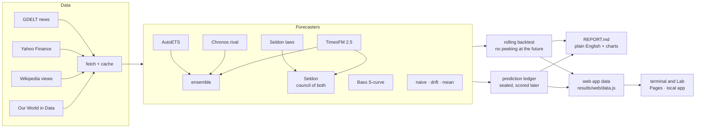

<div align="center">

<picture>
  <source media="(prefers-color-scheme: dark)" srcset="docs/assets/banner-dark.svg">
  
</picture>

**A forecasting terminal that keeps score.**<br>
Google's open-source **TimesFM** against **Seldon**, our own psychohistory forecaster that gives TimesFM a seat in a council of crowd laws, on world news, markets and new technologies.
Every forecast is sealed before the future happens and scored when it arrives. Then it's your turn, in the Lab.

[](https://normansrule.github.io/world-predictor/app/#lab)
[](https://normansrule.github.io/world-predictor/app/#studio)
[](https://normansrule.github.io/world-predictor/app/)
[](https://github.com/Normansrule/world-predictor/releases/latest)
[](results/REPORT.md)

[](https://github.com/Normansrule/world-predictor/actions/workflows/tests.yml)
[](https://github.com/Normansrule/world-predictor/actions/workflows/predict.yml)
[](https://github.com/Normansrule/world-predictor/actions/workflows/pages.yml)
[](LICENSE)

[](https://github.com/google-research/timesfm)
[](src/psychohistory/seldon.py)


[Overview](#overview) ·
[Features](#key-features) ·
[Screenshots](#screenshots) ·
[Results](#latest-results) ·
[Seldon vs TimesFM](#seldon-vs-timesfm) ·
[Setup](#setup-and-usage) ·
[How it works](#how-it-works) ·
[Structure](#project-structure) ·
[Design](#design) ·
[Progress](#roadmap-and-progress) ·
[Credits](#credits)

<sub>Maintained by <a href="https://github.com/Normansrule">@Normansrule</a></sub>

</div>

---

## Overview

In Isaac Asimov's *Foundation*, Hari Seldon can't predict what any one person will do, but his
*psychohistory* can predict what billions of people will do together. World Predictor runs a small,
honest version of that bet: every week it asks [**TimesFM**](https://github.com/google-research/timesfm)
(Time Series Foundation Model, Google Research's open-source forecaster) what happens next in world
news, markets and new technology, seals each forecast with a date, and scores it in public once the
future shows up. Against it runs **Seldon**, this project's own forecaster: a council of simple laws of
crowd behaviour with TimesFM as one more voter, each voter's share earned on forecasts that already came
true. Its laws-only twin, **Seldon laws**, has no neural network at all. All three are scored by the same
code on the same windows, so the question "can psychohistory rules match or beat a 200-million-parameter
foundation model?" gets a real answer. In the
**Lab** you can make your own blind call on a real past window and see whether you'd have beaten them both. It's for anyone curious how far AI (artificial intelligence) forecasting really
reaches: people who follow markets or the news, data-science learners who want a worked, open example
of backtesting and calibration, and forecasting nerds who'd rather see the misses than a highlight reel.
Nothing here is financial advice, and most of the interesting results are about *where prediction fails*.

| Area | What gets forecast | Data |
|---|---|---|
| **World events in the news** | Share of world news coverage about war, elections, inflation, climate, disease outbreaks and protests | [GDELT](https://www.gdeltproject.org/) (Global Database of Events, Language and Tone) |
| **Markets and stores of value** | S&P 500 (Standard & Poor's 500), Nasdaq-100, MSCI World (Morgan Stanley Capital International), Apple, NVIDIA, Tesla, Exxon, **gold**, **silver**, **bonds** (US 10-year Treasury yield, TLT), oil, copper, Bitcoin | Yahoo Finance via [yfinance](https://github.com/ranaroussi/yfinance) |
| **New technologies** | Attention to large language models, AI, quantum computing, CRISPR (clustered regularly interspaced short palindromic repeats) gene editing, electric vehicles, fusion and humanoid robots; adoption of solar, wind and the internet | [Wikimedia Pageviews](https://wikitech.wikimedia.org/wiki/Analytics/AQS/Pageviews), [Our World in Data](https://ourworldindata.org/) |

## Key features

- **The World terminal, the whole world on one screen.** A command line (`GOLD`, `SPX`, `N:WAR`,
  `WATCH`, `BOOK`), and every series in one dense board: last value, the week's move, how unusual it was
  in σ, the sealed forecast and its 80% range, the chance of rising, TimesFM's backtest record and its
  live hit rate, and the newest headlines from the GDELT world wire. Beside it: the week's movers, the
  sealed forecasts that just opened against what happened, a focus panel with the chart, both models'
  forecasts and volatility, and a live scoreboard. [Open it](https://normansrule.github.io/world-predictor/app/#terminal).
- **A year ledger, Jan 1 to Dec 31.** One table per tracked group (gold, silver, bonds, indices, stocks,
  oil and copper, Bitcoin, news, technology), a row for every day: the real value against the most
  likely value of TimesFM, Seldon and the crowd laws, each one's miss in percent, dashes where nothing
  was tracked, and a leaderboard of who is closest. Refreshed every weekday. [Open it](https://normansrule.github.io/world-predictor/app/#year).
- **Event odds for world news and technology.** "The chance election coverage, four weeks from now,
  is at a level it reaches only one day in ten": a spike or a lull, for every news and technology
  series, read off TimesFM's and Seldon's sealed ranges, scored with the Brier score against
  climatology ("10%, as usual") and persistence ("what followed days like this one"), and sealed every
  week so the odds build a record of their own.
- **Your own book of predictions, kept for years.** Seal a call from the terminal on any series and
  date. When its day comes it is settled against the real value and against TimesFM and Seldon, and the
  result is kept in the call itself, so the record outlives the data. Your running skill against
  TimesFM, how often reality lands in your range, and an export/import that checks every seal.
- **The Lab.** A real past window with the ending hidden. Drag your forecast and your range, hold to
  seal it, hold again to break the seal, and watch reality, TimesFM and Seldon draw in. You're scored on
  the same terms they are (average miss, whether reality stayed in your range, direction), and your
  record is kept in your browser.
- **Forecast Studio: ask TimesFM, then go on the record.** Pick any series, date and level and read
  the chance TimesFM and Seldon give it, straight from their newest sealed forecast, with the
  percentiles beside it and a CSV (comma-separated values) download. Then seal your own call on the
  real future: it's fingerprinted, kept in your browser and scored against both models once the real
  value is in the data.
- **A Markets desk, built like an analyst's terminal.** Every market's sealed forecast on one
  screen at the horizon you pick (one day, one week, two weeks, a month): expected move, 80% range,
  chance of rising, TimesFM and Seldon side by side with a flag where they disagree, the volatility each
  forecast implies against what the market has really shown, and which model has had the least error
  on that very asset. Click a market for its fan chart, a price ladder (10th to 90th percentile), an
  odds calculator for any price level, every model's record there and its recent calls. Tick up to four
  to compare them rebased to 100, and export the lot as CSV or JSON. [Open it](https://normansrule.github.io/world-predictor/app/#markets).
- **A forecast desk note for any ticker.** `psychohistory desk MSFT ETH-USD ^FTSE` runs TimesFM and
  Seldon live on any Yahoo Finance symbol (or your own CSV), backtests every model on that asset's own
  past first, and writes a note with the outlook, odds for price levels, forecast against realized
  volatility and whom to trust there, plus the numbers as CSV and JSON.
- **A monitor built to run for years.** Every sealed forecast that comes due is scored against what
  really happened and kept: skill against "no change", 80% coverage, direction and Brier score, month
  by month or week by week, per area, per series and per model, with the running total beside it and
  the backtest's promise drawn as a line. A Diebold-Mariano test says whether TimesFM is *really*
  better than "no change" or just lucky so far, and drift alarms flag any series whose ranges have
  become too narrow or whose edge has gone. Every weekly batch of the ledger carries a SHA-256
  fingerprint, so an edited forecast can't hide. [Open it](https://normansrule.github.io/world-predictor/app/#monitor).
- **Volatility forecasts, where markets really can be forecast.** Prices are close to a random walk,
  but the size of the moves clusters. Every market's volatility over the next week and month is
  forecast by GARCH(1,1), EWMA and the range TimesFM and Seldon sealed, backtested every week against
  last month's volatility with QLIKE and a significance test, then sealed in its own fingerprinted
  ledger and scored as the windows pass. `psychohistory vol`, the Markets desk and the Monitor show it.
- **TimesFM on your own data.** `psychohistory ask` runs TimesFM live on any series in the catalog or on
  your own CSV, prints the middle and the 80% range for every step, puts Seldon's own forecast beside
  it with the votes behind it, answers "what's the chance it ends above X?", and can seal the forecast in the
  ledger to be scored later.
- **A page for every series.** Every past window TimesFM was tested on, drawn over what really
  happened, with a slider and a table that say for each one what the middle guess said, how far reality
  went, how much of it stayed inside the 80% range and whether the direction was right. Below that sit
  the newest sealed forecast and every sealed forecast whose date has already come.
- **Receipts, not just averages.** The Time Vault lists every opened forecast with its range, the
  real value and the verdict. A value that was sealed after its date but before the source published it
  (Wikipedia and GDELT run a day or two behind) is marked as such, not passed off as a forecast of the
  future. `psychohistory record gold` prints the same record in the terminal.
- **Seldon, our own algorithm, against TimesFM.** Four laws of crowd behaviour (inertia, long-run drift,
  fading momentum, reversion to normal) on top of the weekly rhythm of news and attention, each voting
  by how well it predicted the series' own past, with TimesFM in the same council. The laws only get a
  share of the vote in an area (news, markets, technology) once they have beaten TimesFM on that area's
  finished windows. It runs beside TimesFM in the backtest, the weekly sealed forecasts, `ask` and the
  app, and every scoreboard says who won. [How it works](#seldon-vs-timesfm).
- **A landing page that moves like a product launch.** A living field of possible futures behind the
  headline, the headline arriving word by word, a pinned scroll story of one real forecast, the record
  counted up in big numbers, a tape that glides, and light that follows the pointer across panels.
  Every effect is plain CSS and JavaScript (no libraries), uses transform and opacity only, pauses when
  off screen, and turns into a still page under reduced motion.
- **A terminal, not a brochure.** A status bar with the run's vital signs, a ticker of every sealed
  forecast, a command bar (<kbd>/</kbd>) that jumps to any series, and number keys for every view.
  A calm slate theme by default, with a soft light theme one key (<kbd>T</kbd>) away, and each area
  (world news, markets, technology) in its own colour.
- **Forecasts that can't be quietly edited.** Every week's predictions go into
  [`predictions/ledger.csv`](predictions/ledger.csv) *before* the future happens and get scored when it
  arrives. The Time Vault in the app opens them on their due dates.
- **A fair fight.** TimesFM has to beat "tomorrow looks like today", a drift line, a seasonal mean and a
  serious classical model (AutoETS, which fits error, trend and seasonality automatically), in rolling backtests that never let it peek at the future.
  Amazon's Chronos can join as a rival, and an ensemble averages them all.
- **Follow one result.** Pick any forecast and trace it back through all nine pipeline stages, Seldon
  included, to the public record it came from, with links to the exact code and tests behind each stage.
- **One app, two ways.** The same static `site/` folder runs on GitHub Pages with nothing to install,
  or on your own computer with `psychohistory app`. No server, no API (application programming
  interface) keys, no chart library, and it works offline after the first visit.
- **Honest about gaps.** Series that failed to download or forecast stay visible as gaps with the
  reason, demo data is labelled as demo everywhere, and the crowd simulation is marked as a simulation.
- **Runs itself.** A weekly GitHub Actions workflow fetches data, seals new forecasts, scores old ones,
  redraws every chart and republishes the site.

## Screenshots

**One real forecast, sealed and scored as you scroll.** The landing page pins a single real S&P 500
forecast (the newest finished window, not a hand-picked one) and plays it out with the scroll: what
TimesFM could see, the range it sealed, reality arriving day by day, and the score.

<p align="center"></p>

**The Lab.** One S&P 500 round: make the call, seal it, break the seal, see who was closest.

<p align="center"></p>

The landing page, slate and light. The Lab is the first thing you see, already loaded with a real round.

<picture>
  <source media="(prefers-color-scheme: dark)" srcset="docs/assets/landing-dark.png">
  
</picture>

**The Desk.** TimesFM against Seldon against "no change", by area, with the week's sealed forecasts below.

<picture>
  <source media="(prefers-color-scheme: dark)" srcset="docs/assets/app-desk-dark.png">
  
</picture>

**Forecast Studio.** Ask the chance of any level on any date, then seal your own call beside TimesFM's and Seldon's.

<picture>
  <source media="(prefers-color-scheme: dark)" srcset="docs/assets/app-studio-dark.png">
  
</picture>

**A series page.** Gold: twelve past forecasts over what really happened (the chosen one hatched), each scored in the table, then this week's sealed forecast and the ones already opened.

<picture>
  <source media="(prefers-color-scheme: dark)" srcset="docs/assets/app-series-dark.png">
  
</picture>

**Follow one result.** One S&P 500 forecast walking through the pipeline, stage by stage.

<p align="center"></p>

<table>
<tr>
<td width="50%"><b>Outlook</b><br><sub>Every sealed forecast in a list, with TimesFM's range and Seldon's beside it.</sub><br></td>
<td width="50%"><b>Replay</b><br><sub>Press play to watch past forecasts meet what really happened.</sub><br></td>
</tr>
<tr>
<td width="50%"><b>Crowd lab</b><br><sub>Grow a simulated crowd and watch it become predictable.</sub><br></td>
<td width="50%"><b>Time Vault</b><br><sub>Sealed predictions, opened and scored as their dates arrive, with every receipt listed.</sub><br></td>
</tr>
</table>

<sub>Screenshots show the recorded forecast run of 2026-10-22 (TimesFM 2.5 and Seldon's crowd laws, with the full Seldon rebuilt from them by <code>scripts/rebuild_app_data.py</code>). Before a first run the app uses demo data and says so on every screen. Regenerate them with <code>python scripts/make_app_screenshots.py --site build/site</code>.</sub>

---

## Latest results

Everything in this section is redrawn by every forecast run and committed by the weekly GitHub
Action. **Latest full run: 22 October 2026**, TimesFM 2.5 on 29 live series (6 news topics, 12
markets, 11 technologies), each backtested over 12 past windows against what really happened:

| Area | TimesFM vs "tomorrow looks like today" | Its 80% range caught reality | Edge lasts |
|---|---|---|---|
| World news | **8% less error** | 78% of the time | about 28 days |
| Markets (stocks, gold, silver, oil, Bitcoin) | about the same (−2%) | 82% of the time | no steady edge |
| Technology | **45% less error** | 75% of the time | about 28 days |

**The official duel: TimesFM against Seldon.** That run put Seldon's crowd laws on exactly the same
337 windows as TimesFM, from only what was known before each one, and scored them with the same
code. The full Seldon (the laws with TimesFM as one more voter) is rebuilt exactly from the two
recorded forecasts, its share of the vote learned per area from windows that had already finished:

| Area | Series | Crowd laws alone: won / lost | Full Seldon: won / lost / tied | Error vs TimesFM: laws / full Seldon |
|---|---|---|---|---|
| Markets | 12 | **9 / 3** | 0 / 0 / 12 | **−1.7%** / 0.0% |
| World news | 6 | 1 / 5 | 0 / 0 / 6 | +2.4% / 0.0% |
| Technology | 11 | 1 / 10 | 0 / 2 / 9 | +31% / +3.2% |
| **All** | 29 | 11 / 18 | 0 / 2 / 27 | +11.6% / +1.2% |

**The honest verdict: a split decision.** For the first time something here beat TimesFM on most
series in an area: **in markets, the four crowd laws alone had lower error than TimesFM on 9 of 12
series**: gold, silver, oil, copper, Bitcoin and four single stocks (Apple, NVIDIA, Tesla, Exxon),
in the area where TimesFM itself does no better than "no change". TimesFM kept the three big indices
(S&P 500, Nasdaq 100, MSCI World). Technology stays TimesFM's: its trends are what a foundation model
reads best. The full Seldon now mostly stands aside: since November 2026 it learns the laws' share from
the average percentage miss over at least ten finished windows, and in no area did a share beat
TimesFM alone by the 2% it asks for, except on the two yearly adoption series (solar, wind), where the
laws still cost it. The earlier rule (five windows, error against "no change") had won world news 5
to 1 here but, replayed on every recorded daily window, missed by 8.97% on an average day against
TimesFM's 8.83%, so it was replaced; the new rule ties TimesFM on the same replay
(`python scripts/seldon_bakeoff.py`). Read the full Seldon's numbers as a replay: this run recorded TimesFM's and the laws'
forecasts but not their blend, so it was rebuilt from them (`backtest.replay_seldon`); errors, wins
and the 80% range are exact, range skill is close. The next full backtest scores it directly. Every
table is in [results/REPORT.md](results/REPORT.md); rebuild the app's copy with
`python scripts/rebuild_app_data.py`.

On public data neither model was tuned on, the 1,500 held-out daily series of the M4 competition,
Seldon laws had the best range score of the four methods tried (pinball loss 1.144, against 1.146 for a
drift line, 1.167 for "no change" and 1.170 for AutoETS) and beat "no change" on 62% of series
(`python scripts/seldon_m4_check.py`). TimesFM was not run on M4 here.

When it gave 70% or better odds of a rise, the rise happened 87% of the time (53 forecasts).
Big aggregates such as indices beat single stocks (13% vs −3% skill in markets), just as Seldon would
predict. Markets staying close to a random walk is the honest, expected result. Full tables are in
[results/REPORT.md](results/REPORT.md), and the Time Vault fills in as sealed predictions come due.

<picture>
  <source media="(prefers-color-scheme: dark)" srcset="results/plots/scorecard-dark.svg">
  
</picture>

**Reading the scoreboard.** The big number is how much less error the model made than the simple
guess "tomorrow looks like today" (positive is good, zero means no better). *Sees ahead* is how far
into the future that edge lasts. *Right direction* is how often it called up or down correctly; 50% is
a coin flip.

<table>
<tr>
<td width="50%"><b>Did it beat a simple guess?</b><br><sub>Bars above zero mean less error than "tomorrow looks like today".</sub><br></td>
<td width="50%"><b>How far ahead can it see?</b><br><sub>Where each line drops below zero, the model has run out of foresight.</sub><br></td>
</tr>
</table>

**What it expects next.** The newest sealed forecast for six headline series, from stocks, gold and
silver to world news and AI. Each panel says, in words, the chance it ends higher.

<p align="center"></p>

**The Time Vault.** The real test. If the model is honest, the left line settles near 80% and the
right line stays below the coin flip. As of 19 October 2026, the first 32 sealed TimesFM forecasts have
opened, all one to three days ahead: 27 landed inside their 80% range (84%), and 23 of the 31 that leaned
one way called the direction right. 24 of the 32 are Wikipedia attention values that were sealed after their date but before Wikipedia
published them, so the model never saw them, but they aren't forecasts of the future in the strict
sense; the app marks each one. It's an early, small sample, and the Time Vault lists every one.

<p align="center"></p>

---

## Setup and usage

### On the web

Open [normansrule.github.io/world-predictor](https://normansrule.github.io/world-predictor/). That's it.
You can also choose *Install app* from your browser menu to keep it on your desktop.

### The Lab

Open the [Lab](https://normansrule.github.io/world-predictor/app/#lab) (or press <kbd>2</kbd> in the
terminal). Each round is a real backtest window: you see the history up to the cut, the rest is hidden.

1. Drag the violet dot to where you think the series ends, and the ring to set how sure you are (your
   80% range).
2. Press and hold **Seal your call**. A red seal stamps it with the date of the cut.
3. Hold again to **break the seal**. Reality draws in, then TimesFM (periwinkle, hatched range), then Seldon
   (teal, dotted range), and the scores appear.
4. Press <kbd>N</kbd> for the next round, or pick another series or window.

With the keyboard: <kbd>↑</kbd> <kbd>↓</kbd> move your call (<kbd>Shift</kbd> for bigger steps),
<kbd>[</kbd> <kbd>]</kbd> narrow or widen your range, and hold <kbd>Space</kbd> to seal and to break the
seal. Elsewhere in the terminal, <kbd>1</kbd>…<kbd>0</kbd> switch views, <kbd>/</kbd> finds a series and
<kbd>T</kbd> switches between the slate and light themes.

### Forecast Studio

Open the [Forecast Studio](https://normansrule.github.io/world-predictor/app/#studio) (or press
<kbd>3</kbd>). It works on the real future, using the forecasts sealed in this week's run.

1. Pick a series, slide to a date, and type a level (or click a preset such as +2%, or click straight
   on the chart). **The odds** panel shows the chance TimesFM and Seldon give it of ending above that
   level, and **Percentiles** lists their 10th, 50th and 90th percentiles for that date.
2. Set your own value and range under **Seal your own call** and hold the seal button. Your call is
   stored in this browser with a short fingerprint of exactly what you sealed.
3. **Your sealed calls** counts down to each date. Once the weekly run brings in the real value, it
   shows the outcome and who was closest: you, TimesFM or Seldon. **Export** saves your calls as JSON
   (JavaScript Object Notation).
4. **Odds board** ranks every series by the chance of ending above a move you pick (higher, +2%, +5%
   and so on) by its last forecast date, TimesFM beside Seldon. Click a row to open it above.

The odds are read off the 10th, 50th and 90th percentiles by straight-line interpolation, and capped at
5% and 95% outside that range, because the forecast says nothing sharper out there. The command line
uses the same rule.

### Series pages and receipts

Press <kbd>0</kbd> for **All series** and click any name, or type it in the command bar (<kbd>/</kbd>).
Each series page has:

1. **Its numbers**: skill against "no change", right direction, how often reality stayed inside the 80%
   range, the odds score, and how many real sealed forecasts have opened.
2. **Every past forecast against what happened.** All of its backtest windows over the real values.
   Drag the slider (or pick a row) to pick one window; the readout says what its middle guess said,
   where reality went, and whether it called the direction.
3. **Sealed on the real future**: the newest sealed forecast, TimesFM and Seldon.
4. **Opened so far**: every sealed forecast whose date has arrived, with its range, the actual value
   and the verdict.

The [Time Vault](https://normansrule.github.io/world-predictor/app/#vault) lists every opened
forecast across all series, filterable by area. In the terminal:

```bash
psychohistory record gold    # every backtest window and every opened sealed forecast for gold
```

### Ask TimesFM from the command line

The full version runs TimesFM live, on the catalog's series or on your own data:

```bash
psychohistory ask sp500 --above 7800                 # S&P 500, next 21 trading days, chance above 7,800
psychohistory ask gold --horizon 10 --save gold.csv  # every step to a CSV
psychohistory ask --csv my_series.csv --above 120    # your own date,value CSV
psychohistory ask sp500 --seal                       # also seal it in the ledger, scored by `score`
```

It prints the middle and 80% range for every step, Seldon's own forecast beside it, and how
Seldon's laws split their votes for that series.

### The Markets desk, and a desk note for any ticker

<picture>
  <source media="(prefers-color-scheme: dark)" srcset="docs/assets/app-markets-dark.png">
  
</picture>

In the app, press <kbd>M</kbd>. From the command line, the full version does the same for any
market Yahoo Finance lists, live:

```bash
psychohistory desk gold MSFT ETH-USD               # catalog ids or any Yahoo tickers
psychohistory desk ^FTSE --horizon 10 --level 9000 # 10 trading days, chance of closing above 9,000
psychohistory desk --csv my_prices.csv             # your own date,value history
```

Each note (in `results/desk/`, as Markdown, CSV and JSON) has the outlook at 1, 5, 10 and 20 steps,
the chance of ending above round levels around the last price, the volatility the forecast implies
against the last three months', and a backtest of TimesFM, Seldon, its crowd laws, drift and "no
change" on that asset's own past windows, ending with which of them to trust there. Markets are close
to a random walk, so the note says so when nothing has beaten "no change".

### The World terminal and your book

<picture>
  <source media="(prefers-color-scheme: dark)" srcset="docs/assets/app-terminal-dark.png">
  
</picture>

Press <kbd>W</kbd> in the app. Type a code and press Enter: `SPX`, `NDX`, `AAPL`, `XAU`, `WTI`, `BTC`,
`N:WAR`, `N:ELECTION`, `T:AI`, `T:LLM` and so on; `MKT`, `NEWS`, `TECH` and `WORLD` switch the board;
`WATCH` and `UNWATCH` keep a watchlist; `CALL 4200` fills your call; `HELP` lists the rest.

- **σ** says how unusual the latest week was: a market's weekly return against its own usual week, or
  a news or attention series against its previous four weeks. The movers panel lists the largest.
- **Just opened** shows the newest sealed forecasts whose day has come: what TimesFM said, what
  happened, and whether reality landed inside its range.
- **The world wire** carries the newest English-language headlines for every topic, from the GDELT
  Project's article list (`psychohistory wire`, run every week); a button fetches live ones for the
  series in focus. Headlines are context: no model reads them.
- **Your book.** Seal a value and a range for any date the models forecast. The call is fingerprinted
  when sealed and settled against the real value when its day is in the data, then kept with its result
  in this browser. Export the book as JSON to keep it for years and import it on any device; every
  imported call is checked against its seal. The book is shared with the Forecast Studio.

### The long-term monitor: predictions against reality, over years


A backtest says how a model *would* have done. The monitor says how it *is* doing, on forecasts that
were sealed before the outcome existed. In the app, press <kbd>R</kbd>. From the command line:

```bash
psychohistory monitor                          # live record by area and model, the test, the alarms
psychohistory monitor --save results/monitor.csv   # month-by-month table, kept by the weekly run
psychohistory verify                           # check every sealed batch against its fingerprint
```

- **Skill, coverage, direction and Brier over time,** per month (or per week until three months
  exist), for all areas or one, with the cumulative record so a lucky month doesn't read as a trend.
- **Is it really better than "no change"?** A Diebold-Mariano test on the weekly batches' scaled
  errors, with Newey-West variance because a 4-week forecast made each week overlaps the next three,
  and the Harvey-Leybourne-Newbold correction with Student's t, because a few batches are all it has
  (the normal curve would cry wolf on four data points). Until there are enough batches to carry the
  overlap it says "too early" rather than guess.
- **Drift alarms** for forecasts due in the last 13 weeks: a range too narrow or too wide (80%
  coverage tested against 80%), an edge lost (live skill well below the backtest's), or a model worse
  than no change. Every forecaster is tested on every series at once, hundreds of tests, so 5% of
  them would ring by chance alone; an alarm is raised only if it passes a Benjamini-Hochberg
  false-discovery cut. On the 2026-11-01 data that took the list from 67 alarms to 23, grouped by
  kind and series in the app.
- **A tamper-evident ledger.** `predictions/seals.csv` holds a SHA-256 fingerprint of every weekly
  batch. The weekly run refuses to continue if a sealed forecast was edited, and each full backtest
  is kept by date in `results/history/` so the expected skill can be compared over the years too.

Four weekly batches of sealed forecasts have come due so far (2026-11-01), so every verdict still
reads "too early" or "not distinguishable from no change". The point is the years to come: the
record builds itself every Monday.

### Volatility: how far markets swing


A price forecast that beats "no change" is rare; a volatility forecast that beats last month's
volatility is not, because calm follows calm and storms follow storms (Mandelbrot, 1963). So every
market gets four volatility forecasts for the next week and month: GARCH(1,1) (Bollerslev, 1986),
fitted by maximum likelihood with no extra library; RiskMetrics' EWMA; and the volatility TimesFM's
and Seldon's 80% ranges imply. Each is scored against the volatility that followed with QLIKE (Patton,
2011), as skill against last month's volatility carried forward on the same windows.

```bash
psychohistory vol              # the volatility backtest across markets and the sealed record so far
psychohistory vol --backtest   # rerun it from the data and the saved backtest paths (the weekly run does)
```

On the first year of recorded data (origins from November 2025 to October 2026, rebuilt on
2026-11-02), EWMA and GARCH beat last month's volatility by 10% to 13% at both spans; EWMA a week
ahead won in all 12 markets (p 0.04), the only result under 0.05 so far, and with a dozen tests
running, one that low is still within reach of luck. TimesFM's range trailed last month's volatility
at both spans (−12% a week ahead, −21% a month ahead); an earlier cut of the same year had it ahead a
week out (+16%), so that question is open. The weekly run reruns the test on the
full history and seals new volatility forecasts every week in `predictions/vol_ledger.csv`, so the
Monitor's volatility board grows a live record beside the backtest. In the Markets desk, each market
has a volatility outlook with every forecaster's record on that asset.


### Event odds: spikes and lulls in world news and technology

A forecast of "5.8% of world news coverage" is hard to act on. The odds of something unusual are not:
for every news and technology series, the World terminal's **ODDS** pane gives the chance that, on the
forecast's target date four weeks ahead, the series is

- in a **spike**: above the 90th percentile of its last two years, a level it reaches one day in ten;
- in a **lull**: below the 10th percentile, a low it falls to one day in ten.

The thresholds come from the history up to the forecast's last day, so they are sealed with it. Each
model's odds are read off its sealed 10%, 50% and 90% quantiles as a split normal (in logs for positive
series), so the tails, where events live, are not cut off at the 10% and 90% levels. Two baselines keep
them honest: **climatology** says 10% for both, and **persistence** says how often the series was past
the line four weeks after a day in the same state as today. Attention is sticky, so persistence is the
hard one to beat. Every forecaster's odds are scored with the Brier score (Brier, 1950), as skill
against each baseline on the same forecasts, with a Diebold-Mariano test of the edge over climatology.

```bash
psychohistory events             # today's odds, the backtest and the sealed record so far
psychohistory events --backtest  # rerun the backtest from the data and the saved paths (the weekly run does)
```

A first look, from the recorded actuals of the last year (the 14 news and technology series, 10 monthly
origins each after the half-year of history the thresholds need): TimesFM's lull odds beat
climatology by 48% and persistence by 40% (p 0.06), mostly on technology: Wikipedia attention to most
of these technologies kept sliding, a lull came true in 63% of the technology forecasts against the
10% climatology expects, and TimesFM's ranges followed the slide. Its spike odds beat climatology by 11%
(p 0.42, so possibly luck). Seldon's crowd laws alone added nothing on spikes. The full rerun in CI
replaces these numbers, and from the next weekly run every batch of odds is sealed in
`predictions/event_ledger.csv`, fingerprinted in `predictions/event_seals.csv` and scored in the Monitor
as its day passes. Odds, not advice.


### The year ledger: every day of the year, four forecasters against reality

The **Year ledger** ([open it](https://normansrule.github.io/world-predictor/app/#year), key `Y`) is
the books for the year: one table for each tracked part of the world (gold, silver, bonds, the VIX
fear gauge, stock indices, single stocks, oil and copper, Bitcoin, world news, technology), with a row
for every day from 1 January to 31 December. Each row has the real value, the real move since the
forecast was made, and for TimesFM, Radiant, Seldon and Seldon's crowd laws alone the most likely value
(the median), the change it expected and how far off it was in percent. The closest is marked. Days
nobody forecast, and days that have not happened yet, are dashes. Rows can be daily, weekly or monthly,
and a strip above each table colours every day of the year by whoever came closest; click a day to
jump to it.

A forecast for a day comes from the sealed ledger when one was sealed before that day (marked
**sealed**), and otherwise from the rolling-origin backtest, made from the data up to its origin but
replayed afterwards (marked **backtest**). The models are compared only on days where all of them
forecast from the same kind of record (sealed against sealed, backtest against backtest) and the real
value is in, so none is helped by skipping hard days or by a forecast made closer to the day. Bonds and
the VIX are new: their rows stay dashes until the first run fetches them. A weekday refresh at
22:30 UTC, after the US close, fetches the day's real values, rescores and republishes, so the ledger
fills in day by day; new forecasts are still sealed once a week.

The 2026 ledger so far, from the recorded actuals (6,437 like-for-like days over 26 series): Radiant
missed by **9.29%** on an average day, TimesFM by 9.35%, Seldon by 9.35% and the crowd laws by 10.71%.
Radiant was closer than TimesFM on 15 of the 26 series. A **race chart** above the tables draws each
challenger's average miss so far, day by day, as its gap to TimesFM: below the line is beating it.

**Real or luck?** A lead over 200 days can still be luck, so every challenger's gap on every series is
put to a Diebold-Mariano test (Diebold & Mariano, 1995) of its daily misses against TimesFM's. Forecasts
made up to four weeks ahead overlap, so the test's variance allows for errors that run together for up
to a horizon (Newey & West, 1987) and is corrected for short records (Harvey et al., 1997). With 26
series tested at once, the Benjamini-Hochberg cut keeps false calls to about one in twenty (Benjamini &
Hochberg, 1995). Each series card says **real** or **could be luck**, the leaderboard counts the series
where a challenger is clearly better or clearly worse, and each table downloads as a CSV for your own
books. On 2026 so far only one lead passes: Radiant on Exxon (4.93% against 5.03%, p 0.001). Its other
14 leads could be luck. The crowd laws are clearly worse on four technology series.

**The bake-off: can anything here beat TimesFM?** Eighteen forecasters built from TimesFM, the crowd
laws, "no change" and two classical methods were replayed on all 319 daily windows of the official backtest of 3 November 2026,
each learning only from the windows of its area that had finished before its forecast
(`python scripts/seldon_bakeoff.py`; Radiant's rows are the ones that run recorded, not a replay).
Average miss per day of the most likely value:

| Forecaster | All | To March | April on | Markets | News | Tech |
|---|---|---|---|---|---|---|
| **TimesFM** | **8.64%** | 9.23% | **8.28%** | 5.25% | **13.93%** | **11.05%** |
| **Radiant** | **8.64%** | **9.15%** | 8.33% | 5.25% | **13.93%** | **11.05%** |
| **Best of four per area, 3% margin** | **8.64%** | 9.18% | 8.30% | 5.24% | **13.93%** | **11.05%** |
| Seldon, new share rule (now in use) | 8.65% | 9.19% | 8.32% | 5.26% | **13.93%** | **11.05%** |
| Log-space blend | 8.65% | 9.19% | 8.32% | 5.27% | **13.93%** | **11.05%** |
| Exponentiated-gradient mix (TimesFM, laws, no change) | 8.66% | 9.22% | 8.31% | 5.20% | 14.03% | 11.12% |
| TimesFM with its median bias halved | 8.75% | 9.44% | 8.32% | 5.27% | 14.02% | 11.33% |
| Per-series share, shrunk to the area's | 8.82% | 9.59% | 8.33% | 5.24% | 14.26% | 11.44% |
| Shrink TimesFM's predicted move | 8.85% | 9.67% | 8.34% | 5.29% | 14.22% | 11.51% |
| Seldon, old share rule | 8.87% | 9.68% | 8.37% | 5.24% | 14.60% | 11.39% |
| TimesFM and the laws, half each | 8.91% | 9.40% | 8.61% | **5.17%** | 14.31% | 11.89% |
| Median of the three | 9.12% | 9.80% | 8.70% | 5.19% | 15.15% | 11.96% |
| Inverse-MSE weights (no change, TimesFM, laws) | 9.15% | 9.96% | 8.65% | 5.21% | 15.01% | 12.15% |
| Crowd laws alone | 9.71% | 10.20% | 9.41% | 5.20% | 15.62% | 13.72% |
| Theta method | 11.19% | 11.83% | 10.80% | 5.34% | 16.74% | 18.00% |
| Damped trend | 11.29% | 11.75% | 11.00% | 5.31% | 17.23% | 18.04% |
| Radiant's behavioural core alone | 11.64% | 12.69% | 10.99% | 5.42% | 18.07% | 18.49% |
| "No change" | 11.73% | 12.77% | 11.09% | 5.25% | 18.38% | 18.90% |

Nothing beat TimesFM on these daily windows; the best three finished level. That is the "forecast
combination puzzle" seen many times before: weights learned from a short record tend to lose to the
best single forecast or a plain average, because estimating them adds more noise than they remove
(Stock & Watson, 2004; Smith & Wallis, 2009; Timmermann, 2006). The old Seldon rule handed the laws a
share of the news vote too early and lost 0.67 points there, so it was replaced: Seldon now needs ten
finished windows and a 2% lower average miss before the laws get any say. Radiant's lead in the first,
replayed version of this table (8.77% against 8.83%, on 286 windows and a year of history) did not
survive fresh windows, and neither did a further sweep of its mixing rule (four learning rates, and
"fixed share" forgetting; Herbster & Warmuth, 1998), which moved the total by 0.04 points at most.
Two more ideas were tried on 3 November and also failed. An exponentiated-gradient mix (Kivinen &
Warmuth, 1997), which learns the best *blend* of experts rather than the best single one, gained on
markets (5.20% against 5.25%) but only in the first half of the year; from April on it was behind
there too, and it lost on news. And two classical statistical forecasters, the Theta method that won
the M3 competition (Assimakopoulos & Nikolopoulos, 2000; Hyndman & Billah, 2003) and a damped trend
(Gardner & McKenzie, 1985), were far behind on news and technology, where TimesFM reads the weekly
rhythm of attention data that they cannot. The mix is at its ceiling with these experts: to win it
needs one that knows something TimesFM does not. (An earlier version of this table took Seldon's blend for the crowd laws, which hid how far apart
they are; it now uses the laws alone. Research, not investment advice.)


### Radiant: market psychology and statistics against TimesFM

Radiant ([`radiant.py`](src/psychohistory/radiant.py)) is named after the Prime Radiant, the device
in Asimov's *Second Foundation* (1953) that holds the Seldon Plan and shows where it is going wrong.
It has two parts.

**The core (`radiant-core`)** turns five well-documented patterns of crowd behaviour into numbers,
measured from each series' own past:

| Signal | The behaviour | Source |
|---|---|---|
| Momentum | A crowd that has been moving one way keeps moving as late arrivals follow the early ones (herding) | Jegadeesh & Titman (1993); Moskowitz et al. (2012); Bikhchandani et al. (1992) |
| Overreaction | After an extreme run, measured in the series' own volatility, some of it is given back | De Bondt & Thaler (1985) |
| Short-term reversal | Last week's move partly undoes itself | Lehmann (1990) |
| Momentum crashes | When markets turn wild, momentum stops working, so it is scaled by this month's volatility against the year's | Daniel & Moskowitz (2016) |
| Attention spikes | A series far above its recent normal, a burst of news or interest, fades back | Barber & Odean (2008); Da et al. (2011) |

At many earlier dates the core measures the signals and sets them against what followed, and a ridge
regression (Hoerl & Kennard, 1970) shrunk hard toward "no change" turns them into a forecast of the
change. Nothing after the forecast date is used. On its own the core loses, even to "no change", on
the year of history this sandbox has: the signals are real in the literature but weak, and they need
long histories to estimate. In GitHub Actions it sees decades.

**The full Radiant (`radiant`)** mixes TimesFM, the crowd laws, the core, "no change" and, since
3 November 2026, a rival model (Chronos-Bolt; Ansari et al., 2024) decile by decile, with exponential weights (Freund & Schapire, 1997; Cesa-Bianchi & Lugosi, 2006): every
finished forecast window of an area charges each one its miss relative to TimesFM's, and its weight
shrinks by e^(−2 × charge). It starts with 70% of the weight on TimesFM, so a signal only gains a say by
being right on forecasts it never saw while learning. Both are backtested on the same windows as
TimesFM, sealed every week beside it, and scored in the year ledger, the bake-off and the real-or-luck
verdicts. The VIX, the market's own fear gauge (Whaley, 2000), is now tracked too; feeding it to the
core as a signal for other markets is the next step.

**Its first official backtest** (the full CI run of 3 November 2026, 32 series, forecasts made blind
at each origin): Radiant and TimesFM finished level. Average sMAPE was 10.24% for Radiant and 10.23%
for TimesFM, and Radiant was closer on 17 of the 32 series (9 of 15 markets, 4 of 6 news topics,
4 of 11 technology series). Its skill against "no change" was slightly higher (0.185 against 0.177).
The behavioural core alone barely beat "no change" (skill 0.017). The best single model in that run
was Chronos-Bolt (9.45%), which beat both on the slow technology series. So Radiant's small edge on
the replayed year did not turn into a clear win on fresh windows. It is a tie, not a victory.

**So Chronos-Bolt joined the mix.** It was the best model in that run, and it won where TimesFM is
weakest (the slow technology series), so it is the expert most likely to add something TimesFM lacks.
It starts with 10% of the weight and, like every other expert, only gains more by being right on
finished windows. Where Chronos did not run (it is optional, and recorded backtest paths from before
this change lack it), it is neither charged nor credited and drops out of the mix; without it Radiant
is exactly the model it was before (checked on all 7,854 replayed forecasts). Its first scored test is
the next full backtest.

**Where Chronos's lead really was.** Broken down by series, almost all of Chronos-Bolt's technology
lead in that run came from the three yearly adoption series (solar 24.7% against TimesFM's 42.1%, wind
14.5% against 24.9%, internet 1.5% against 3.2%). On the eight daily technology series it was slightly
behind on six, on news it was behind on five of six topics, and on markets it led on 8 of 15. But
Radiant left the yearly series out of its learning and mixed them with the weights the daily
technology series had earned, so Chronos could never have gained weight where it was good. Since this
update the yearly series learn in an area of their own. Run on the per-window scores of that backtest,
the same rule would have handed Chronos 75% of the yearly weight after four finished windows and
over 95% after eight, which would have cut Radiant's yearly misses roughly to Chronos's. That is an
estimate from window scores, not a scored forecast: the next full backtest, which records Chronos's
paths, is the test. Without Chronos the change is neutral (solar better, wind slightly worse).

**Watch it decide.** The Year ledger now shows how Radiant splits its vote in each area: the split in
use now, which this week's sealed Radiant forecasts were mixed with, and how it moved after every
finished window. On the official backtest it has moved most of its markets vote to the crowd laws
(58%, with TimesFM at 25%), kept all of it on TimesFM for news and the daily technology series, and,
on the yearly adoption series, started with the laws and handed the vote back to TimesFM by 2010.
Chronos-Bolt's share appears as soon as a run records its forecasts.


### Quick start

On your own computer (Ubuntu shown, from any folder). No GPU (graphics processing unit) needed:
TimesFM 2.5 has 200 million parameters and runs fine on an ordinary CPU (central processing unit).

```bash
sudo apt update && sudo apt install -y git python3-venv python3-pip
git clone https://github.com/Normansrule/world-predictor.git "$HOME/world-predictor"
cd "$HOME/world-predictor"
python3 -m venv .venv && source .venv/bin/activate
pip install torch --index-url https://download.pytorch.org/whl/cpu   # small CPU-only PyTorch
pip install -e ".[timesfm,rivals,classical,dev]"                   # TimesFM, Chronos, AutoETS

psychohistory app --demo                                 # the app with demo data, in seconds
psychohistory -v run --compare chronos-bolt --ensemble   # real forecasts (downloads TimesFM and data)
psychohistory app                                        # the app with your own results
```

`psychohistory app` serves the app at `http://localhost:8000` and opens your browser.
`world-predictor` works as another name for the `psychohistory` command.

### Step by step

```bash
psychohistory fetch       # download all series into data/ (cached)
psychohistory backtest    # rolling backtest vs baselines -> results/REPORT.md and charts
psychohistory predict     # seal new forecasts in predictions/ledger.csv
psychohistory ask gold    # run TimesFM live on one series (or --csv yours) and print its forecast
psychohistory desk MSFT   # a forecast desk note for any Yahoo ticker, with a track record on it
psychohistory score       # score sealed forecasts whose dates have arrived
psychohistory record gold # one series' track record: past windows and opened sealed forecasts
psychohistory monitor     # the live record over time, the significance test and drift alarms
psychohistory verify      # check no sealed forecast was edited (SHA-256 per weekly batch)
psychohistory vol         # volatility forecasts: GARCH, EWMA and TimesFM's range against last month's
psychohistory events      # event odds: the chance of a spike or a lull in news and tech attention
psychohistory wire        # the newest headlines per topic from GDELT, for the World terminal
psychohistory export      # write the app's data file, results/web/data.js
psychohistory site        # build the static app into build/site (what Pages serves)
psychohistory simulate    # the toy crowd, no downloads
```

| Option | What it does |
|---|---|
| `--compare chronos-bolt` | Score a rival model on exactly the same windows (repeatable) |
| `--ensemble` | Also score the average of all models, a reliable win on forecasting leaderboards |
| `--domain markets` | Only one area (repeatable) |
| `--series gold --series silver` | Only some series |
| `--model timesfm-3` | Use TimesFM 3.0 (non-commercial weights) |
| `--windows 24` | More backtest windows |
| `--skip-backtest` | For `run`: forecast and score only |
| `--port 8080`, `--no-browser` | For `app`: where to serve it, and whether to open a browser |

### Web app or full version?

| | Web app | Full version |
|---|---|---|
| **Open it** | [normansrule.github.io/world-predictor](https://normansrule.github.io/world-predictor/) | `psychohistory app` |
| **Install** | Nothing | Python 3.10+, about 2 GB with PyTorch |
| **Forecasts** | The project's weekly TimesFM run | Your own runs, any series, any model |
| **Data** | Precomputed into one small script file | Downloaded fresh from GDELT, Yahoo, Wikimedia and Our World in Data |
| **Offline** | Yes, after the first visit (service worker) | Yes |

### Models

| Name | Model | Weights licence |
|---|---|---|
| `timesfm-2.5` (default) | [google/timesfm-2.5-200m-pytorch](https://huggingface.co/google/timesfm-2.5-200m-pytorch) | Apache-2.0 |
| `timesfm-3` | [google/timesfm-3.0-pytorch](https://huggingface.co/google/timesfm-3.0-pytorch) | **Non-commercial only** ([licence](https://huggingface.co/google/timesfm-3.0-pytorch/blob/main/LICENSE)) |
| `chronos-bolt`, `chronos-2` | Amazon's rival foundation models, [amazon/chronos-bolt-small](https://huggingface.co/amazon/chronos-bolt-small) and [amazon/chronos-2](https://huggingface.co/amazon/chronos-2) (install the `rivals` extra) | See each model card |
| `seldon` | Our own psychohistory forecaster: the crowd laws below plus the model under test in one council, the laws' share learned per area from finished windows ([`seldon.py`](src/psychohistory/seldon.py)); always run alongside the main model | Apache-2.0 (this repo) |
| `seldon-laws` | The crowd laws alone: four laws and a weekly rhythm, weighted by their record on each series; numpy only, no neural network | Apache-2.0 (this repo) |
| `radiant` | Our attempt to beat TimesFM: TimesFM, the crowd laws, the behavioural core, "no change" and Chronos-Bolt mixed by exponential weights learned per area from finished windows ([`radiant.py`](src/psychohistory/radiant.py)); always run alongside the main model | Apache-2.0 (this repo) |
| `radiant-core` | Market psychology as statistics: momentum, overreaction, short-term reversal, momentum crashes and attention spikes, weighted by a ridge regression on each series' own past | Apache-2.0 (this repo) |
| `ensemble` | Average of TimesFM, its `--compare` rivals and AutoETS (add `--ensemble`) | n/a |
| `bass` | Bass diffusion S-curve (Bass, 1969), run automatically on technology-adoption series | Apache-2.0 (this repo) |
| `auto-ets`, `auto-arima` | Classical baselines (ARIMA is autoregressive integrated moving average) from [statsforecast](https://github.com/Nixtla/statsforecast) (install the `classical` extra) | Apache-2.0 |
| `naive`, `drift`, `mean` | Baselines in `src/psychohistory/models.py` | Apache-2.0 (this repo) |

Backtests always include the simple baselines, plus `auto-ets` when statsforecast is installed, so
TimesFM has to beat a serious classical model and not just a random walk. TimesFM 2.5 is the default
so the whole project stays usable under Apache-2.0.

### Adding your own predictions

Add a `SeriesSpec` to [`src/psychohistory/catalog.py`](src/psychohistory/catalog.py), for example:

```python
_stock("platinum", "PL=F", "Platinum futures")
_news("news_ai_regulation", '"AI regulation"', "Coverage of AI regulation")
_wiki("wiki_solid_state_battery", "Solid-state_battery", "Wikipedia views: Solid-state battery")
```

---

## How it works

**One forecast, taken apart.** Every forecast is built from the same six layers. On the
[website](https://normansrule.github.io/world-predictor/#engine) they come apart and click back
together as you scroll; here they are pulled apart and labelled.

<picture>
  <source media="(prefers-color-scheme: dark)" srcset="docs/assets/engine-dark.svg">
  
</picture>



### The five Seldon tests

| | Question | How it's measured |
|:-:|---|---|
| 1 | **Can the future be predicted at all?** | *Skill*: the share of error removed compared with "tomorrow looks like today". Zero means no better. |
| 2 | **Are crowds easier than individuals?** (Seldon's law) | Series are tagged *aggregate* (an index, a composite, a world total) or *individual* (one company, one topic), and their skill is compared. |
| 3 | **How far ahead can it see?** (the Seldon horizon) | Skill at every step ahead, until it falls to zero. |
| 4 | **Are its odds honest?** | Every forecast gives a chance of ending higher; calibration and the Brier score check it. |
| 5 | **What shocked it?** (Seldon crises) | Windows where reality left the 80% range, listed in every report. |

### Seldon vs TimesFM

TimesFM is a 200-million-parameter neural network pretrained on billions of time points. **Seldon**
([`seldon.py`](src/psychohistory/seldon.py)) starts from the opposite bet, the one Hari Seldon made: a
crowd follows a few simple laws, and the trick is knowing which law rules which crowd. Then, because
the goal is to beat TimesFM rather than to be pure, it lets TimesFM vote too.

| Law | The crowd behaviour | Forecast |
|---|---|---|
| **Inertia** | Tomorrow looks like today | The last value |
| **Drift** | The long arc holds | The whole history's average step, carried on |
| **Momentum** | A move keeps going, then fades | The recent trend, damped 10% per step (Gardner & McKenzie, 1985) |
| **Reversion** | Excitement wears off | A pull back to the recent normal (Ornstein-Uhlenbeck) |
| **Rhythm** | Crowds keep calendars | The weekly pattern, taken out first and laid back on top |

1. **Replay the past.** Before every forecast Seldon stands at 16 earlier dates of the same series,
   lets each law forecast the same number of steps ahead, and checks what really happened.
2. **Vote.** Each law's vote is 1 ÷ (its past error)⁴, a sharpened version of the Bates-Granger
   combination (Bates & Granger, 1969), with a fifth of every vote kept equal so a lucky streak can't
   take over.
3. **Set the range.** The 80% range is the council's own past misses, growing with the steps ahead at
   the rate the replays show, and stretched or narrowed by how volatile the series is right now.
4. **Never peek.** Every replay ends before the forecast date; a test changes a later window and checks
   no earlier Seldon forecast moves. Prices and attention are forecast on a log scale.
5. **Seat TimesFM at the table.** That council is `seldon-laws`. The full `seldon` adds TimesFM as a
   voter: in each area (news, markets, technology) it tries giving the laws 0%, 10%, … 100% of the vote
   on every finished window of every series there, and keeps the best split only if it beat TimesFM
   alone by at least 2% in average percentage miss. Pooling a whole area is Seldon's law of large
   numbers turned on itself: one series' dozen windows are too few to learn from, a whole area's are
   not. With fewer than ten finished windows, TimesFM keeps the whole vote.

Seldon is scored by exactly the same code as TimesFM, on the same windows, sealed in the same ledger,
and the app's scoreboard, the Lab and every outlook show both. It is allowed to lose.

**The honesty rule.** Backtests can flatter a model that was trained on the same history, so the
project also keeps the **prediction ledger**: forecasts written down *before* the future happens and
scored once it arrives, like Seldon's recordings in the Time Vault.

<p align="center">
  <picture>
    <source media="(prefers-color-scheme: dark)" srcset="docs/assets/how-to-read-dark.svg">
    
  </picture>
</p>

A good forecaster isn't one that's always right. It's one whose **80% range catches reality about
8 times in 10**, and whose **"70% chance" calls come true about 70% of the time**.

**Why crowds are predictable (a toy world).** Ten thousand simulated people each have a mood that is a
little shared "tide" plus a lot of personal noise. One person is mostly noise; average a thousand of
them and the noise cancels out, leaving the tide. That's Seldon's bet in one picture, and test 2 checks
whether real indices and composites behave the same way. Try it with `psychohistory simulate`.

<p align="center"></p>

Full methods and limitations: [docs/METHODOLOGY.md](docs/METHODOLOGY.md). Every stage, its code, its
tests and what it does when it fails: [docs/ARCHITECTURE.md](docs/ARCHITECTURE.md).

| Workflow | When | What it does |
|---|---|---|
| [`predict`](.github/workflows/predict.yml) | Every Monday (backtest on the 1st) | Fetches data, seals new TimesFM forecasts, scores old ones, redraws charts and the app data, commits them |
| [`pages`](.github/workflows/pages.yml) | After each forecast run | Publishes the web app to GitHub Pages |
| [`release`](.github/workflows/release.yml) | When a `v*` tag is pushed | Attaches the full project zip and an offline app zip to a GitHub Release |
| [`tests`](.github/workflows/tests.yml) | Every push | Runs the offline test suite on Python 3.10 and 3.12 |

---

## Project structure

```
site/                    the app: one static folder for Pages, the download and local use
  index.html             landing page with the Lab as its hero (assets/site.css, assets/site.js)
  app/                   the terminal (index.html, css/app.css, js/app.js, js/charts.js, js/trace.js)
  app/js/lab.js          the Lab, shared by the terminal and the landing page
  app/js/studio.js       the Forecast Studio: odds for any level, and your own sealed calls
  app/js/series.js       series pages: every past forecast against what happened, and the opened ones
  app/data/              data.js (this run's numbers) and pipeline.js (the stage inventory)
  sw.js                  offline support; manifest.webmanifest makes it installable
src/psychohistory/
  catalog.py             the series to forecast, by area, tagged aggregate or individual
  data/                  loaders: gdelt.py, markets.py, wikipedia.py, owid.py (a CSV, comma-separated values, cache)
  models.py              TimesFM, Chronos, AutoETS, Bass and baseline forecasters, plus the ensemble
  metrics.py             error and calibration scores: MAE, MASE, sMAPE, direction, 80% coverage, Brier
  seldon.py              Seldon: our own forecaster, crowd laws weighted by their record, no neural network
  radiant.py             Radiant: behavioural signals plus an exponential-weights mix of TimesFM, the laws and no change
  backtest.py            rolling-origin backtest, the Seldon summary tables and the TimesFM-vs-Seldon duel
  ledger.py              seal forecasts now, score them later, fingerprint every weekly batch
  monitor.py             `psychohistory monitor`: the live record over time, Diebold-Mariano, drift alarms
  volatility.py          `psychohistory vol`: GARCH(1,1), EWMA and implied volatility, QLIKE, a sealed volatility ledger
  yearbook.py            the year ledger: every day of the year, each model's median against reality, sealed over backtest
  events.py              `psychohistory events`: odds of a spike or a lull, Brier skill vs climatology and persistence, a sealed event ledger
  wire.py                `psychohistory wire`: the newest GDELT headlines per topic, for the World terminal
  ask.py                 `psychohistory ask`: TimesFM live on one series or your own CSV
  desk.py                `psychohistory desk`: a forecast desk note for any ticker, with odds, volatility and a per-asset track record
  story.py               plain-English findings, scoreboard, replay, outlook, Time Vault, `record`
  simulate.py            toy agent-based crowd: why aggregates are predictable
  inventory.py           what each pipeline stage does: feeds the app's explorer and ARCHITECTURE.md
  engine_art.py          the exploded-engine drawing, shared by the landing page and this README
  web.py                 the app's data file (Lab rounds, series windows, opened forecasts), the demo data, and building the site
  progress.py            this README's progress tracker, from docs/progress.json
  report.py              results/REPORT.md and charts
  dashboard.py           results/dashboard.html (Plotly version of the dashboard)
  cli.py                 the `psychohistory` command
tests/                   offline tests (synthetic data, no downloads)
docs/                    METHODOLOGY.md, ARCHITECTURE.md, DESIGN.md, progress.json, artwork in docs/assets/
predictions/             ledger.csv (sealed forecasts) and scored.csv
results/                 REPORT.md, charts, and run_status.json (which series got through each stage)
.github/workflows/       tests, predict (weekly), pages (web app), release (downloads)
scripts/                 make_readme_art.py, make_app_screenshots.py, rebuild_app_data.py, seldon_m4_check.py, publish_to_github.sh
```

The metric names, in full: MAE is mean absolute error, MASE is mean absolute scaled error, and sMAPE is
symmetric mean absolute percentage error. The banner, explainer and progress bars are drawn by
`python scripts/make_readme_art.py`; the screenshots by `python scripts/make_app_screenshots.py --site build/site`
after `psychohistory site`.

---

## Design

**The concept: the Sealed Ledger.** World Predictor's whole idea is a promise: write the forecast down
*before* the future happens, then open it and keep score. So the design is a forecasting terminal built
around that promise, in the spirit of a professional market terminal: dense, fast, keyboard-first, and
honest about what it doesn't know. Its one big moment is the seal itself, in the Lab.

**Colour means something, and only one thing.**

| Colour | Means | Always backed by |
|---|---|---|
| Soft white ink (slate) / near-black ink (light) | What really happened | A solid line |
| Periwinkle | TimesFM, the model under test | A hatched range |
| Teal | Seldon, the challenger | A dotted range |
| Violet | You, in the Lab and the Forecast Studio | Your name on the line |
| Seal red | A forecast sealed before the future | The seal and its date |
| Green / coral red | Better / worse than "no change" | A sign (+ or −) |
| Orange, gold, orchid | World news, markets, technology | The area's name beside it |
| Gold | Warnings and gaps | Hatching and a "!" |

Every text colour passes WCAG (Web Content Accessibility Guidelines) AA contrast, 4.5:1, on every
surface in both themes. Slate (`#262d36`, panels `#2e3640`), a mid-tone that is neither glaring nor
pitch-dark, is the default; the soft light theme uses grey paper (`#dfe4ea`) rather than white.
Spacing is kept tight, terminal-style: 12-pixel gaps between panels and short, one-line introductions.

**Type with jobs.** Newsreader, a newspaper serif, for headlines and the Lab's verdict; IBM Plex Sans
for the interface; IBM Plex Mono only where characters must line up: numbers, dates, tickers and code.
Sizes follow one scale (11, 12, 13, 14, 16, 20, 28, 40, 54) and spacing another (4, 8, 12, 16, 24,
32, 48).

**Motion that carries information.** Things arrive with a strong ease-out in under 300 milliseconds;
buttons press in slightly; reality *draws* in after the seal breaks, followed by TimesFM and then Seldon,
so the order you see them in is the order that matters. Sealing is press-and-hold, so nothing is ever
sealed by accident. With reduced motion turned on, every state change still happens, as a fade.

**Two speeds: a showroom and a workbench.** The landing page is the showroom, in the spirit of
[Apple](https://www.apple.com/), the [AirPods Pro](https://www.apple.com/airpods-pro/) page,
[Igloo](https://www.igloo.inc/), [Rive](https://rive.app/), [1minus1](https://1minus1.com/),
[Bruno Simon](https://bruno-simon.com/) and [Dogstudio](https://dogstudio.co/):

- a canvas of sample paths fanning out of one point behind the headline (possible futures, which is what
  a forecast is);
- two slow colour glows;
- a pinned, scroll-scrubbed story of one real forecast;
- big counted-up numbers;
- a pointer spotlight on panels and buttons that lean slightly towards the pointer.

Every figure in it comes from the data file. The terminal is the workbench: panels settle in when a view
opens and a faint light follows the pointer, but nothing in it moves unless it carries information.

**What was cut from the terminal.** Gradient fills and glows, a wall of identical cards (the Outlook is a
list and a detail panel), emoji used as icons, pinging "live" dots, and monospace used as decoration. On
the landing page, reveals never hide content without JavaScript or under reduced motion.

**Accessible by default.** Every view works from the keyboard, including dragging your call in the Lab
(its handles are sliders to screen readers); focus is always visible; nothing depends on colour alone;
and the layout works from a 390-pixel phone up.

The redesign followed [Impeccable](https://github.com/pbakaus/impeccable),
[taste-skill](https://github.com/Leonxlnx/taste-skill) and
[Emil Kowalski's design-engineering skills](https://github.com/emilkowalski/skills) as checklists, and
was audited against them afterwards (contrast, overflow at three widths, keyboard-only play, reduced
motion). The product idea comes from [World Monitor](https://github.com/koala73/worldmonitor) by Elie
Habib and its fork [Terra Atlas](https://github.com/Normansrule/worldmonitor): one static `site/` folder
served by GitHub Pages and shipped as a download, with no server or API keys. The full design notes,
and the fifty sites and READMEs that shaped earlier versions, are in [**docs/DESIGN.md**](docs/DESIGN.md).
No code was copied from any of them (World Monitor is AGPL-3.0, the GNU Affero General Public License;
World Predictor is Apache-2.0).

---

## Roadmap and progress

<picture>
  <source media="(prefers-color-scheme: dark)" srcset="docs/assets/progress-dark.svg">
  
</picture>

<!-- progress:start -->

**53 of 57 milestones done (93%).** Drawn from [`docs/progress.json`](docs/progress.json); tests check every ticked item against the repository.

<details><summary><b>📰 World news</b> · 14/14</summary>

- [x] GDELT news-attention loader
- [x] Six news topics plus a news composite
- [x] Rolling backtest against naive, drift, mean and AutoETS
- [x] Weekly sealed forecasts in the prediction ledger
- [x] First real TimesFM results published
- [x] Chronos-Bolt joins Radiant's mix as an optional fifth expert that earns its weight
- [x] Yearly adoption series learn Radiant's weights in an area of their own, where Chronos-Bolt led
- [x] The Year ledger shows how Radiant splits its vote per area and how the split moved
- [x] Radiant: behavioural finance signals and an exponential-weights mix, scored against TimesFM in the bake-off, the year ledger and the weekly sealed ledger
- [x] Year ledger verdicts: a Diebold-Mariano test per series against TimesFM, cut with Benjamini-Hochberg, and a CSV of every table
- [x] Bake-off: ten ways of combining TimesFM and the crowd laws replayed without peeking; Seldon's share rule replaced by the one that came closest
- [x] Year ledger: every day of the year, TimesFM, Seldon and the crowd laws against reality, refreshed every weekday
- [x] Event-level odds: spikes and lulls in world news and tech attention, scored against climatology and persistence
- [x] World wire: the newest GDELT headlines for every topic, weekly

</details>

<details><summary><b>📈 Markets, gold and silver</b> · 10/10</summary>

- [x] Yahoo Finance loader (stocks, indices, gold, silver, oil, copper, Bitcoin)
- [x] Chronos rival models and a quantile-averaged ensemble
- [x] Seldon: our own psychohistory forecaster, run head to head with TimesFM
- [x] Official Seldon vs TimesFM duel from a full backtest
- [x] Chance-of-rising odds scored with the Brier score
- [x] Outlook grid for stocks, gold, silver and Bitcoin
- [x] Markets desk: watchlist, odds calculator, who to trust per asset, compare and export
- [x] Forecast desk note for any Yahoo ticker (psychohistory desk)
- [x] First real TimesFM results published
- [x] Volatility forecasts: GARCH(1,1), EWMA and TimesFM's range, sealed weekly and scored with QLIKE

</details>

<details open><summary><b>🚀 New technologies</b> · 4/5</summary>

- [x] Wikipedia attention for LLMs, AI, quantum, CRISPR, EVs, fusion, robots
- [x] Adoption curves from Our World in Data
- [x] Bass diffusion S-curve as a theory-driven rival
- [x] First real TimesFM results published
- [ ] Hype-cycle detection (attention peaks while adoption keeps rising)

</details>

<details open><summary><b>🌐 Web app (GitHub Pages)</b> · 19/20</summary>

- [x] World terminal: command line, world board, movers, just-opened forecasts, focus and scoreboard
- [x] Your book: sealed calls settled for good, running skill against TimesFM, export and import
- [x] Static app: scoreboard, replay, outlook, horizon, odds, Time Vault, crowd lab
- [x] No chart library: hand-written SVG charts, about 45 KB of code once compressed
- [x] Light and dark themes, phone layout, installable, works offline
- [x] Pages deployment after every weekly run
- [x] Landing page that tells the story on scroll, with the exploded forecast engine
- [x] Follow one result: trace any forecast back through the pipeline to its source
- [x] Architecture page and pipeline explorer generated from the code
- [x] The Lab: blind calls on real past windows, scored against TimesFM and Seldon
- [x] Sealed Ledger terminal design: slate and light themes, keyboard-first
- [x] Forecast Studio: odds for any level, an odds board, and your own sealed calls
- [x] `psychohistory ask`: TimesFM live on any series or your own CSV
- [x] Full bibliography in APA style
- [x] A page for every series: every past forecast against what happened
- [x] Time Vault lists every opened forecast, flagged when sealed before the value was published
- [x] Cinematic landing page: a scroll story of one real forecast, sealed then scored
- [ ] Live at normansrule.github.io/world-predictor
- [x] Long-term monitor: live skill, coverage and calibration by month, with drift alarms
- [x] Design audit: WCAG 2.2 contrast in both themes, an 11px type floor, 40px touch targets, keyboard-instant views

</details>

<details open><summary><b>💻 Downloadable full version</b> · 6/8</summary>

- [x] `psychohistory app`: run TimesFM locally and open the same app
- [x] `psychohistory record`: one series' full track record in the terminal
- [x] Release workflow: full project zip and offline app zip
- [ ] First tagged release
- [ ] Desktop installer (Tauri, as World Monitor does)
- [x] psychohistory monitor: is the live record better than no change, with a significance test
- [x] Tamper-evident ledger: a SHA-256 fingerprint per weekly batch (psychohistory verify)
- [x] Small-sample statistics: Student's t, Harvey-Leybourne-Newbold, Benjamini-Hochberg false-discovery cut on alarms

</details>

<!-- progress:end -->
## References

The key sources, in APA style (American Psychological Association, 7th edition). The full
bibliography, with every model, data source, theory and design reference, is in
[REFERENCES.md](REFERENCES.md#bibliography-apa-7th-edition).

- Ansari, A. F., Stella, L., Turkmen, C., Zhang, X., Mercado, P., Shen, H., Shchur, O., Rangapuram, S. S., Pineda Arango, S., Kapoor, S., Zschiegner, J., Maddix, D. C., Wang, H., Mahoney, M. W., Torkkola, K., Wilson, A. G., Bohlke-Schneider, M., & Wang, Y. (2024). Chronos: Learning the language of time series. *Transactions on Machine Learning Research*. https://arxiv.org/abs/2403.07815
- Asimov, I. (1951). *Foundation*. Gnome Press.
- Asimov, I. (1953). *Second Foundation*. Gnome Press.
- Assimakopoulos, V., & Nikolopoulos, K. (2000). The theta model: A decomposition approach to forecasting. *International Journal of Forecasting, 16*(4), 521–530. https://doi.org/10.1016/S0169-2070(00)00066-2
- Barber, B. M., & Odean, T. (2008). All that glitters: The effect of attention and news on the buying behavior of individual and institutional investors. *The Review of Financial Studies, 21*(2), 785–818. https://doi.org/10.1093/rfs/hhm079
- Bates, J. M., & Granger, C. W. J. (1969). The combination of forecasts. *Operational Research Quarterly, 20*(4), 451–468. https://doi.org/10.1057/jors.1969.103
- Benjamini, Y., & Hochberg, Y. (1995). Controlling the false discovery rate: A practical and powerful approach to multiple testing. *Journal of the Royal Statistical Society: Series B (Methodological), 57*(1), 289–300. https://doi.org/10.1111/j.2517-6161.1995.tb02031.x
- Bikhchandani, S., Hirshleifer, D., & Welch, I. (1992). A theory of fads, fashion, custom, and cultural change as informational cascades. *Journal of Political Economy, 100*(5), 992–1026. https://doi.org/10.1086/261849
- BlackRock. (n.d.). *iShares 20+ Year Treasury Bond ETF (TLT)* [Data set]. Retrieved November 2, 2026, from https://www.ishares.com/us/products/239454/
- Bollerslev, T. (1986). Generalized autoregressive conditional heteroskedasticity. *Journal of Econometrics, 31*(3), 307–327. https://doi.org/10.1016/0304-4076(86)90063-1
- Brier, G. W. (1950). Verification of forecasts expressed in terms of probability. *Monthly Weather Review, 78*(1), 1–3. https://doi.org/10.1175/1520-0493(1950)078<0001:VOFEIT>2.0.CO;2
- Cboe Global Markets. (n.d.-a). *Cboe 10-Year U.S. Treasury Note Yield Index (TNX)* [Data set]. Retrieved November 2, 2026, from https://www.cboe.com/
- Cboe Global Markets. (n.d.-b). *Cboe Volatility Index (VIX)* [Data set]. Retrieved November 2, 2026, from https://www.cboe.com/tradable_products/vix/
- Cesa-Bianchi, N., & Lugosi, G. (2006). *Prediction, learning, and games*. Cambridge University Press. https://doi.org/10.1017/CBO9780511546921
- Da, Z., Engelberg, J., & Gao, P. (2011). In search of attention. *The Journal of Finance, 66*(5), 1461–1499. https://doi.org/10.1111/j.1540-6261.2011.01679.x
- Daniel, K., & Moskowitz, T. J. (2016). Momentum crashes. *Journal of Financial Economics, 122*(2), 221–247. https://doi.org/10.1016/j.jfineco.2015.12.002
- Das, A., Kong, W., Sen, R., & Zhou, Y. (2024). A decoder-only foundation model for time-series forecasting. In *Proceedings of the 41st International Conference on Machine Learning* (Proceedings of Machine Learning Research, Vol. 235). PMLR. https://arxiv.org/abs/2310.10688
- De Bondt, W. F. M., & Thaler, R. (1985). Does the stock market overreact? *The Journal of Finance, 40*(3), 793–805. https://doi.org/10.1111/j.1540-6261.1985.tb05004.x
- Diebold, F. X., & Mariano, R. S. (1995). Comparing predictive accuracy. *Journal of Business & Economic Statistics, 13*(3), 253–263. https://doi.org/10.1080/07350015.1995.10524599
- Engle, R. F. (1982). Autoregressive conditional heteroscedasticity with estimates of the variance of United Kingdom inflation. *Econometrica, 50*(4), 987–1007. https://doi.org/10.2307/1912773
- Freund, Y., & Schapire, R. E. (1997). A decision-theoretic generalization of on-line learning and an application to boosting. *Journal of Computer and System Sciences, 55*(1), 119–139. https://doi.org/10.1006/jcss.1997.1504
- Gardner, E. S., Jr., & McKenzie, E. (1985). Forecasting trends in time series. *Management Science, 31*(10), 1237–1246. https://doi.org/10.1287/mnsc.31.10.1237
- Garza, A., Mergenthaler Canseco, M., Challú, C., & Olivares, K. G. (2022). *StatsForecast: Lightning fast forecasting with statistical and econometric models* [Computer software]. GitHub. https://github.com/Nixtla/statsforecast
- Gneiting, T., & Raftery, A. E. (2007). Strictly proper scoring rules, prediction, and estimation. *Journal of the American Statistical Association, 102*(477), 359–378. https://doi.org/10.1198/016214506000001437
- Google Research. (n.d.). *timesfm* [Computer software]. GitHub. https://github.com/google-research/timesfm
- Harvey, D., Leybourne, S., & Newbold, P. (1997). Testing the equality of prediction mean squared errors. *International Journal of Forecasting, 13*(2), 281–291. https://doi.org/10.1016/S0169-2070(96)00719-4
- Herbster, M., & Warmuth, M. K. (1998). Tracking the best expert. *Machine Learning, 32*(2), 151–178. https://doi.org/10.1023/A:1007424614876
- Hoerl, A. E., & Kennard, R. W. (1970). Ridge regression: Biased estimation for nonorthogonal problems. *Technometrics, 12*(1), 55–67. https://doi.org/10.1080/00401706.1970.10488634
- Hyndman, R. J., & Billah, B. (2003). Unmasking the Theta method. *International Journal of Forecasting, 19*(2), 287–290. https://doi.org/10.1016/S0169-2070(01)00143-1
- Hyndman, R. J., & Koehler, A. B. (2006). Another look at measures of forecast accuracy. *International Journal of Forecasting, 22*(4), 679–688. https://doi.org/10.1016/j.ijforecast.2006.03.001
- Jegadeesh, N., & Titman, S. (1993). Returns to buying winners and selling losers: Implications for stock market efficiency. *The Journal of Finance, 48*(1), 65–91. https://doi.org/10.1111/j.1540-6261.1993.tb04702.x
- J.P. Morgan/Reuters. (1996). *RiskMetrics: Technical document* (4th ed.). Morgan Guaranty Trust Company.
- Kivinen, J., & Warmuth, M. K. (1997). Exponentiated gradient versus gradient descent for linear predictors. *Information and Computation, 132*(1), 1–63. https://doi.org/10.1006/inco.1996.2612
- koala73. (n.d.). *worldmonitor* [Computer software]. GitHub. https://github.com/koala73/worldmonitor
- Koenker, R., & Bassett, G., Jr. (1978). Regression quantiles. *Econometrica, 46*(1), 33–50. https://doi.org/10.2307/1913643
- Leetaru, K., & Schrodt, P. A. (2013, April). *GDELT: Global data on events, location, and tone, 1979–2012* [Paper presentation]. International Studies Association Annual Convention, San Francisco, CA, United States.
- Lehmann, B. N. (1990). Fads, martingales, and market efficiency. *The Quarterly Journal of Economics, 105*(1), 1–28. https://doi.org/10.2307/2937816
- Lichtendahl, K. C., Jr., Grushka-Cockayne, Y., & Winkler, R. L. (2013). Is it better to average probabilities or quantiles? *Management Science, 59*(7), 1594–1611. https://doi.org/10.1287/mnsc.1120.1667
- Makridakis, S., Spiliotis, E., & Assimakopoulos, V. (2020). The M4 Competition: 100,000 time series and 61 forecasting methods. *International Journal of Forecasting, 36*(1), 54–74. https://doi.org/10.1016/j.ijforecast.2019.04.014
- Mandelbrot, B. (1963). The variation of certain speculative prices. *The Journal of Business, 36*(4), 394–419. https://doi.org/10.1086/294632
- Moskowitz, T. J., Ooi, Y. H., & Pedersen, L. H. (2012). Time series momentum. *Journal of Financial Economics, 104*(2), 228–250. https://doi.org/10.1016/j.jfineco.2011.11.003
- Newey, W. K., & West, K. D. (1987). A simple, positive semi-definite, heteroskedasticity and autocorrelation consistent covariance matrix. *Econometrica, 55*(3), 703–708. https://doi.org/10.2307/1913610
- Normansrule. (n.d.). *worldmonitor (Terra Atlas)* [Computer software]. GitHub. https://github.com/Normansrule/worldmonitor
- Our World in Data. (n.d.). *Our World in Data* [Data set]. Retrieved October 20, 2026, from https://ourworldindata.org/
- Patton, A. J. (2011). Volatility forecast comparison using imperfect volatility proxies. *Journal of Econometrics, 160*(1), 246–256. https://doi.org/10.1016/j.jeconom.2010.03.034
- Shiller, R. J. (2000). *Irrational exuberance*. Princeton University Press.
- Smith, J., & Wallis, K. F. (2009). A simple explanation of the forecast combination puzzle. *Oxford Bulletin of Economics and Statistics, 71*(3), 331–355. https://doi.org/10.1111/j.1468-0084.2008.00541.x
- Stock, J. H., & Watson, M. W. (2004). Combination forecasts of output growth in a seven-country data set. *Journal of Forecasting, 23*(6), 405–430. https://doi.org/10.1002/for.928
- Student. (1908). The probable error of a mean. *Biometrika, 6*(1), 1–25. https://doi.org/10.1093/biomet/6.1.1
- Tashman, L. J. (2000). Out-of-sample tests of forecasting accuracy: An analysis and review. *International Journal of Forecasting, 16*(4), 437–450. https://doi.org/10.1016/S0169-2070(00)00065-0
- Tetlock, P. E., & Gardner, D. (2015). *Superforecasting: The art and science of prediction*. Crown.
- The GDELT Project. (n.d.). *GDELT DOC 2.0 API* [Data set]. Retrieved October 20, 2026, from https://www.gdeltproject.org/
- Timmermann, A. (2006). Forecast combinations. In G. Elliott, C. W. J. Granger, & A. Timmermann (Eds.), *Handbook of economic forecasting* (Vol. 1, pp. 135–196). Elsevier. https://doi.org/10.1016/S1574-0706(05)01004-9
- Wallis, K. F. (2014). The two-piece normal, binormal, or double Gaussian distribution: Its origin and rediscoveries. *Statistical Science, 29*(1), 106–112. https://doi.org/10.1214/13-STS417
- Whaley, R. E. (2000). The investor fear gauge. *The Journal of Portfolio Management, 26*(3), 12–17. https://doi.org/10.3905/jpm.2000.319728
- Wikimedia Foundation. (n.d.). *Wikimedia REST API: Pageviews* [Data set]. Retrieved October 20, 2026, from https://wikimedia.org/api/rest_v1/
- Yahoo. (n.d.). *Yahoo Finance* [Data set]. Retrieved October 20, 2026, from https://finance.yahoo.com/

World Monitor and its fork Terra Atlas are the basis for shipping one app two ways (ideas only, no
code copied). The design-audit guides (Impeccable, taste-skill and Emil Kowalski's skills) and the
fifty design references are cited in the full bibliography.

## Credits

This project stands on other people's work. Full attribution, licences and terms of use are in
[**CREDITS.md**](CREDITS.md). In short:

- **TimesFM** by Google Research: Das, Kong, Sen, Zhou, *A decoder-only foundation model for
  time-series forecasting*, ICML 2024 (International Conference on Machine Learning,
  [arXiv:2310.10688](https://arxiv.org/abs/2310.10688)).
- **World Monitor** by Elie Habib, and Alek's fork **Terra Atlas**, for the web-app and download design.
- **Impeccable**, **taste-skill** and **Emil Kowalski's skills** for the design audit.
- **Fifty design references** for the look and motion, and **twenty reference projects** for the
  earlier "observatory" design (World Monitor, Metaculus, xyflow, Motion Canvas and others), all listed in
  [docs/DESIGN.md](docs/DESIGN.md).
- **GDELT Project** for world news coverage data.
- **Yahoo Finance** data via the **yfinance** library by Ran Aroussi.
- **Wikimedia Foundation** Pageviews API.
- **Our World in Data** (CC BY 4.0, Creative Commons Attribution).
- **Isaac Asimov**'s *Foundation* for the idea of psychohistory, and the name of the challenger.
- **IBM Plex Sans**, **IBM Plex Mono** and **Newsreader** fonts (SIL Open Font Licence), served by Google Fonts.

If you use World Predictor in your work, please cite it with [CITATION.cff](CITATION.cff) and cite
TimesFM as shown in CREDITS.md.

## Licence

Code: [Apache License 2.0](LICENSE). Data and model weights keep their own licences; see
[CREDITS.md](CREDITS.md). Nothing here is financial advice.
