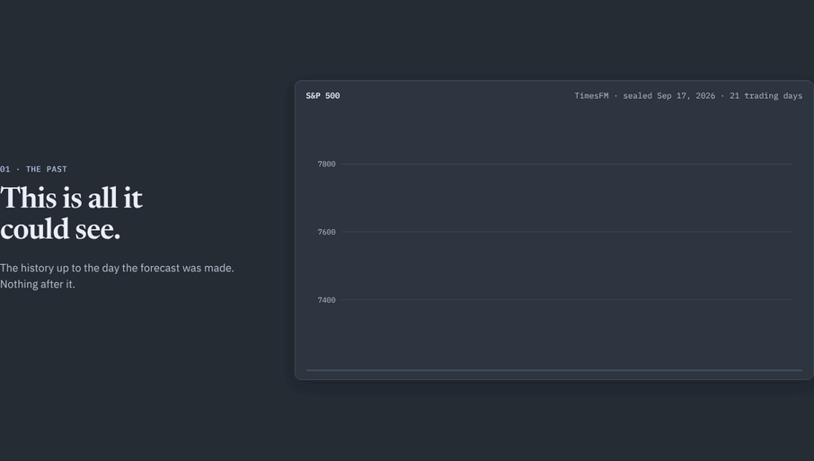
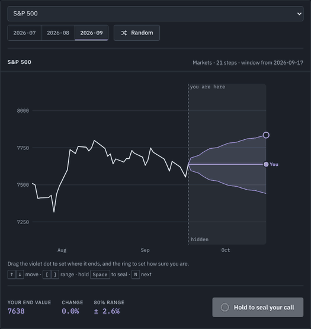
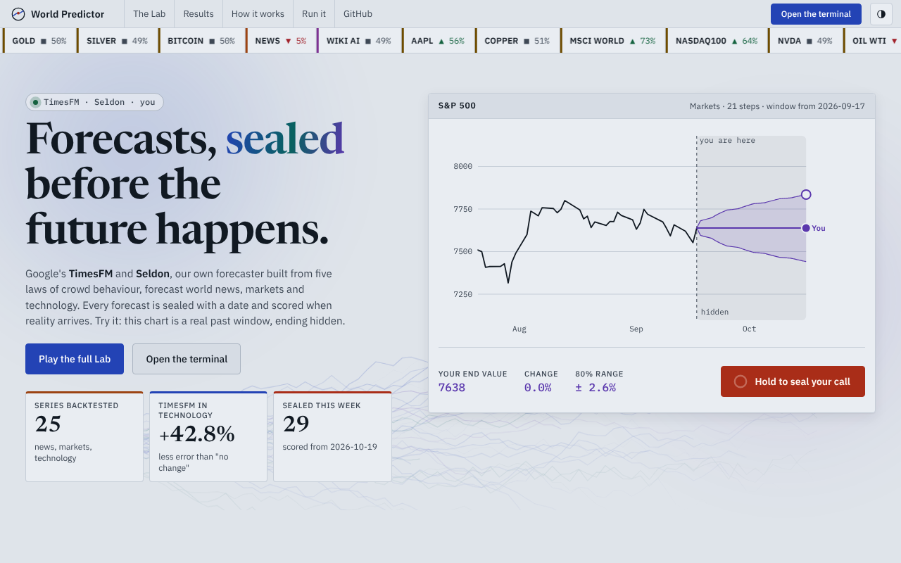
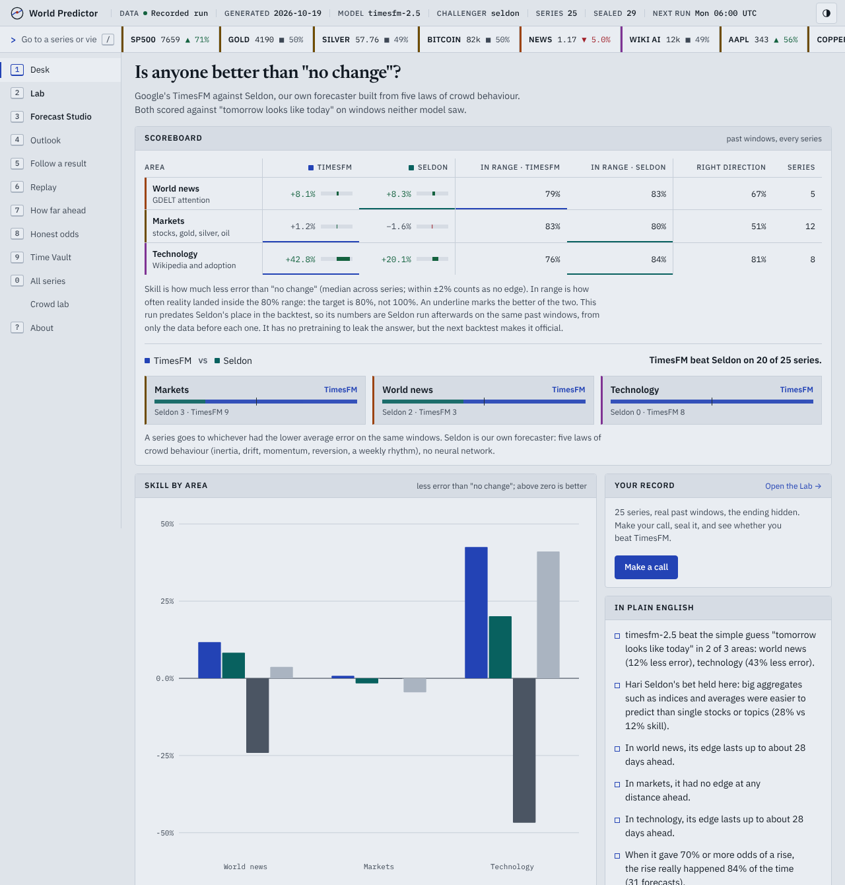
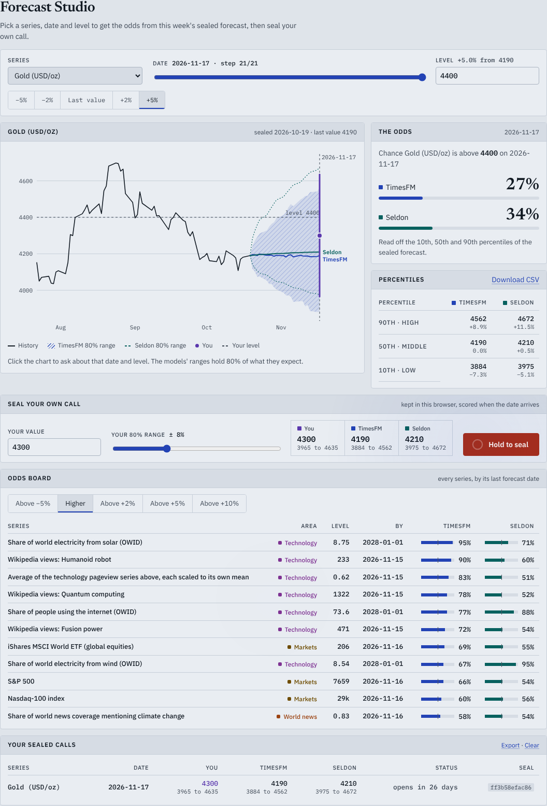
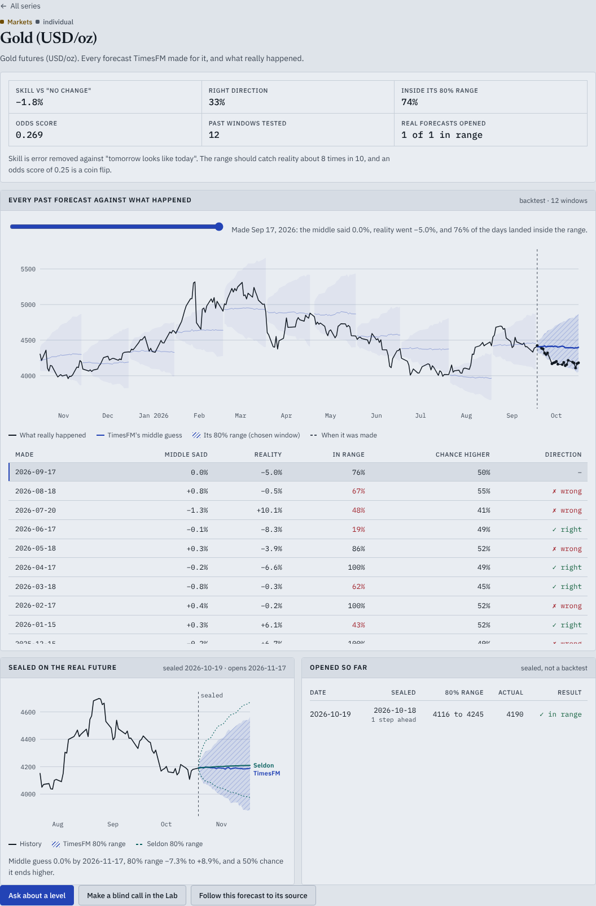
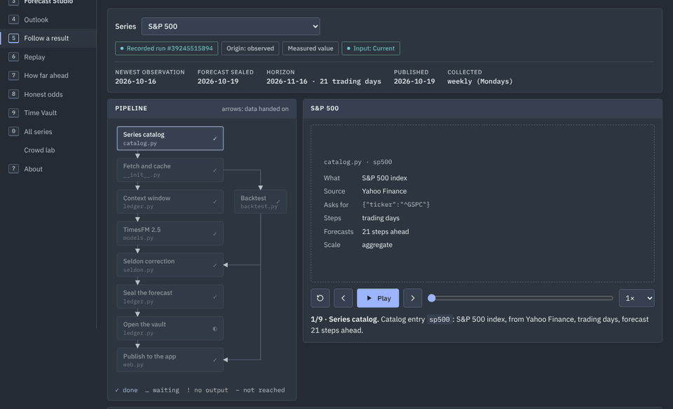
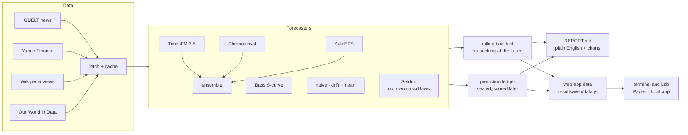

<div align="center">

<picture>
  <source media="(prefers-color-scheme: dark)" srcset="docs/assets/banner-dark.svg">
  
</picture>

**A forecasting terminal that keeps score.**<br>
Google's open-source **TimesFM** against **Seldon**, our own psychohistory forecaster, on world news, markets and new technologies.
Every forecast is sealed before the future happens and scored when it arrives. Then it's your turn, in the Lab.

[](https://normansrule.github.io/world-predictor/app/#lab)
[](https://normansrule.github.io/world-predictor/app/#studio)
[](https://normansrule.github.io/world-predictor/app/)
[](https://github.com/Normansrule/world-predictor/releases/latest)
[](results/REPORT.md)

[](https://github.com/Normansrule/world-predictor/actions/workflows/tests.yml)
[](https://github.com/Normansrule/world-predictor/actions/workflows/predict.yml)
[](https://github.com/Normansrule/world-predictor/actions/workflows/pages.yml)
[](LICENSE)

[](https://github.com/google-research/timesfm)
[](src/psychohistory/seldon.py)


[Overview](#overview) ·
[Features](#key-features) ·
[Screenshots](#screenshots) ·
[Results](#latest-results) ·
[Seldon vs TimesFM](#seldon-vs-timesfm) ·
[Setup](#setup-and-usage) ·
[How it works](#how-it-works) ·
[Structure](#project-structure) ·
[Design](#design) ·
[Progress](#roadmap-and-progress) ·
[Credits](#credits)

<sub>Maintained by <a href="https://github.com/Normansrule">@Normansrule</a></sub>

</div>

---

## Overview

In Isaac Asimov's *Foundation*, Hari Seldon can't predict what any one person will do, but his
*psychohistory* can predict what billions of people will do together. World Predictor runs a small,
honest version of that bet: every week it asks [**TimesFM**](https://github.com/google-research/timesfm)
(Time Series Foundation Model, Google Research's open-source forecaster) what happens next in world
news, markets and new technology, seals each forecast with a date, and scores it in public once the
future shows up. Against it runs **Seldon**, this project's own forecaster: no neural network, just a
few laws of crowd behaviour that vote on every forecast according to how well each has predicted that
series before. Both are scored by the same code on the same windows, so the question "can a handful of
psychohistory rules match a 200-million-parameter foundation model?" gets a real answer. In the
**Lab** you can make your own blind call on a real past window and see whether you'd have beaten them both. It's for anyone curious how far AI (artificial intelligence) forecasting really
reaches: people who follow markets or the news, data-science learners who want a worked, open example
of backtesting and calibration, and forecasting nerds who'd rather see the misses than a highlight reel.
Nothing here is financial advice, and most of the interesting results are about *where prediction fails*.

| Area | What gets forecast | Data |
|---|---|---|
| **World events in the news** | Share of world news coverage about war, elections, inflation, climate, disease outbreaks and protests | [GDELT](https://www.gdeltproject.org/) (Global Database of Events, Language and Tone) |
| **Markets and stores of value** | S&P 500 (Standard & Poor's 500), Nasdaq-100, MSCI World (Morgan Stanley Capital International), Apple, NVIDIA, Tesla, Exxon, **gold**, **silver**, oil, copper, Bitcoin | Yahoo Finance via [yfinance](https://github.com/ranaroussi/yfinance) |
| **New technologies** | Attention to large language models, AI, quantum computing, CRISPR (clustered regularly interspaced short palindromic repeats) gene editing, electric vehicles, fusion and humanoid robots; adoption of solar, wind and the internet | [Wikimedia Pageviews](https://wikitech.wikimedia.org/wiki/Analytics/AQS/Pageviews), [Our World in Data](https://ourworldindata.org/) |

## Key features

- **The Lab.** A real past window with the ending hidden. Drag your forecast and your range, hold to
  seal it, hold again to break the seal, and watch reality, TimesFM and Seldon draw in. You're scored on
  the same terms they are (average miss, whether reality stayed in your range, direction), and your
  record is kept in your browser.
- **Forecast Studio: ask TimesFM, then go on the record.** Pick any series, date and level and read
  the chance TimesFM and Seldon give it, straight from their newest sealed forecast, with the
  percentiles beside it and a CSV (comma-separated values) download. Then seal your own call on the
  real future: it's fingerprinted, kept in your browser and scored against both models once the real
  value is in the data.
- **TimesFM on your own data.** `psychohistory ask` runs TimesFM live on any series in the catalog or on
  your own CSV, prints the middle and the 80% range for every step, puts Seldon's own forecast beside
  it with the votes behind it, answers "what's the chance it ends above X?", and can seal the forecast in the
  ledger to be scored later.
- **A page for every series.** Every past window TimesFM was tested on, drawn over what really
  happened, with a slider and a table that say for each one what the middle guess said, how far reality
  went, how much of it stayed inside the 80% range and whether the direction was right. Below that sit
  the newest sealed forecast and every sealed forecast whose date has already come.
- **Receipts, not just averages.** The Time Vault lists every opened forecast with its range, the
  real value and the verdict. A value that was sealed after its date but before the source published it
  (Wikipedia and GDELT run a day or two behind) is marked as such, not passed off as a forecast of the
  future. `psychohistory record gold` prints the same record in the terminal.
- **Seldon, our own algorithm, against TimesFM.** Four laws of crowd behaviour (inertia, long-run drift,
  fading momentum, reversion to normal) plus the weekly rhythm of news and attention. Before every
  forecast Seldon replays the series' own past, gives each law a vote by how well it did, and sets its
  80% range from its own past misses, scaled by how calm or wild the series is right now. It runs in
  milliseconds on numpy alone, beside TimesFM in the backtest, the weekly sealed forecasts, `ask` and
  the app, and every scoreboard says who won. [How it works](#seldon-vs-timesfm).
- **A landing page that moves like a product launch.** A living field of possible futures behind the
  headline, the headline arriving word by word, a pinned scroll story of one real forecast, the record
  counted up in big numbers, a tape that glides, and light that follows the pointer across panels.
  Every effect is plain CSS and JavaScript (no libraries), uses transform and opacity only, pauses when
  off screen, and turns into a still page under reduced motion.
- **A terminal, not a brochure.** A status bar with the run's vital signs, a ticker of every sealed
  forecast, a command bar (<kbd>/</kbd>) that jumps to any series, and number keys for every view.
  A calm slate theme by default, with a soft light theme one key (<kbd>T</kbd>) away, and each area
  (world news, markets, technology) in its own colour.
- **Forecasts that can't be quietly edited.** Every week's predictions go into
  [`predictions/ledger.csv`](predictions/ledger.csv) *before* the future happens and get scored when it
  arrives. The Time Vault in the app opens them on their due dates.
- **A fair fight.** TimesFM has to beat "tomorrow looks like today", a drift line, a seasonal mean and a
  serious classical model (AutoETS, which fits error, trend and seasonality automatically), in rolling backtests that never let it peek at the future.
  Amazon's Chronos can join as a rival, and an ensemble averages them all.
- **Follow one result.** Pick any forecast and trace it back through all nine pipeline stages, Seldon
  included, to the public record it came from, with links to the exact code and tests behind each stage.
- **One app, two ways.** The same static `site/` folder runs on GitHub Pages with nothing to install,
  or on your own computer with `psychohistory app`. No server, no API (application programming
  interface) keys, no chart library, and it works offline after the first visit.
- **Honest about gaps.** Series that failed to download or forecast stay visible as gaps with the
  reason, demo data is labelled as demo everywhere, and the crowd simulation is marked as a simulation.
- **Runs itself.** A weekly GitHub Actions workflow fetches data, seals new forecasts, scores old ones,
  redraws every chart and republishes the site.

## Screenshots

**One real forecast, sealed and scored as you scroll.** The landing page pins a single real S&P 500
forecast (the newest finished window, not a hand-picked one) and plays it out with the scroll: what
TimesFM could see, the range it sealed, reality arriving day by day, and the score.

<p align="center"></p>

**The Lab.** One S&P 500 round: make the call, seal it, break the seal, see who was closest.

<p align="center"></p>

The landing page, slate and light. The Lab is the first thing you see, already loaded with a real round.

<picture>
  <source media="(prefers-color-scheme: dark)" srcset="docs/assets/landing-dark.png">
  
</picture>

**The Desk.** TimesFM against Seldon against "no change", by area, with the week's sealed forecasts below.

<picture>
  <source media="(prefers-color-scheme: dark)" srcset="docs/assets/app-desk-dark.png">
  
</picture>

**Forecast Studio.** Ask the chance of any level on any date, then seal your own call beside TimesFM's and Seldon's.

<picture>
  <source media="(prefers-color-scheme: dark)" srcset="docs/assets/app-studio-dark.png">
  
</picture>

**A series page.** Gold: twelve past forecasts over what really happened (the chosen one hatched), each scored in the table, then this week's sealed forecast and the ones already opened.

<picture>
  <source media="(prefers-color-scheme: dark)" srcset="docs/assets/app-series-dark.png">
  
</picture>

**Follow one result.** One S&P 500 forecast walking through the pipeline, stage by stage.

<p align="center"></p>

<table>
<tr>
<td width="50%"><b>Outlook</b><br><sub>Every sealed forecast in a list, with TimesFM's range and Seldon's beside it.</sub><br></td>
<td width="50%"><b>Replay</b><br><sub>Press play to watch past forecasts meet what really happened.</sub><br></td>
</tr>
<tr>
<td width="50%"><b>Crowd lab</b><br><sub>Grow a simulated crowd and watch it become predictable.</sub><br></td>
<td width="50%"><b>Time Vault</b><br><sub>Sealed predictions, opened and scored as their dates arrive, with every receipt listed.</sub><br></td>
</tr>
</table>

<sub>Screenshots show the recorded forecast run of 2026-10-19 (TimesFM 2.5), with Seldon run afterwards on the same windows by <code>scripts/seldon_first_look.py</code>. Before a first run the app uses demo data and says so on every screen. Regenerate them with <code>python scripts/make_app_screenshots.py --site build/site</code>.</sub>

---

## Latest results

Everything in this section is redrawn by every forecast run and committed by the weekly GitHub
Action. **First real run: 18 October 2026**, TimesFM 2.5 on 25 live series (5 news topics, 12 markets,
8 technologies), each backtested over past windows against what really happened:

| Area | TimesFM vs "tomorrow looks like today" | Its 80% range caught reality | Edge lasts |
|---|---|---|---|
| World news | **12% less error** | 79% of the time | about 28 days |
| Markets (stocks, gold, silver, oil, Bitcoin) | about the same (+1%) | 83% of the time | no steady edge |
| Technology | **43% less error** | 76% of the time | about 28 days |

**TimesFM against Seldon: the first look.** Seldon, our own forecaster, was run on the same
25 series and the same past windows as TimesFM, each time from only the values before the window.
TimesFM won clearly:

| Area | Series | Seldon won | TimesFM won | Skill: TimesFM / Seldon | In its 80% range: TimesFM / Seldon |
|---|---|---|---|---|---|
| World news | 5 | 2 | 3 | +8.1% / **+8.3%** | 79% / 83% |
| Markets | 12 | 3 | 9 | **+1.2%** / −1.6% | 83% / **80%** |
| Technology | 8 | 0 | 8 | **+42.8%** / +20.1% | **76%** / 84% |
| **All** | 25 | **5** | **20** | **+7.9%** / +7.0% | 80% / 82% |

Seldon tied TimesFM on world news and kept its ranges honest everywhere, but it could not touch
TimesFM on Wikipedia attention, where the foundation model's pattern knowledge is worth twice
Seldon's simple rules, and in markets its laws added noise to what is close to a random walk. Read
this as a first look, not the final word: the run's raw data is not stored, so these windows were
rebuilt from the saved backtest values, which gave Seldon at most the few hundred days before each
window while TimesFM read up to 1,024, and the weekly rhythm step was added to Seldon after an earlier
pass over these same windows showed it missing the weekly pattern in Wikipedia views. The official
head-to-head comes from the next full backtest, which runs both on identical data and adds a
"Seldon vs TimesFM: the duel" table to [results/REPORT.md](results/REPORT.md). Rebuild this table with
`python scripts/seldon_first_look.py`.

On public data neither model was tuned on, the 1,500 held-out daily series of the M4 competition,
Seldon had the best range score of the four methods tried (pinball loss 1.144, against 1.146 for a
drift line, 1.167 for "no change" and 1.170 for AutoETS) and beat "no change" on 62% of series
(`python scripts/seldon_m4_check.py`). TimesFM was not run on M4 here.

When it gave 70% or better odds of a rise, the rise happened 84% of the time (31 forecasts).
Big aggregates such as indices beat single stocks (10% vs −1% skill in markets), just as Seldon would
predict. Markets staying close to a random walk is the honest, expected result. Full tables are in
[results/REPORT.md](results/REPORT.md), and the Time Vault fills in as sealed predictions come due.

<picture>
  <source media="(prefers-color-scheme: dark)" srcset="results/plots/scorecard-dark.svg">
  
</picture>

**Reading the scoreboard.** The big number is how much less error the model made than the simple
guess "tomorrow looks like today" (positive is good, zero means no better). *Sees ahead* is how far
into the future that edge lasts. *Right direction* is how often it called up or down correctly; 50% is
a coin flip.

<table>
<tr>
<td width="50%"><b>Did it beat a simple guess?</b><br><sub>Bars above zero mean less error than "tomorrow looks like today".</sub><br></td>
<td width="50%"><b>How far ahead can it see?</b><br><sub>Where each line drops below zero, the model has run out of foresight.</sub><br></td>
</tr>
</table>

**What it expects next.** The newest sealed forecast for six headline series, from stocks, gold and
silver to world news and AI. Each panel says, in words, the chance it ends higher.

<p align="center"></p>

**The Time Vault.** The real test. If the model is honest, the left line settles near 80% and the
right line stays below the coin flip. As of 19 October 2026, the first 32 sealed TimesFM forecasts have
opened, all one to three days ahead: 27 landed inside their 80% range (84%), and 23 of the 31 that leaned
one way called the direction right. 24 of the 32 are Wikipedia attention values that were sealed after their date but before Wikipedia
published them, so the model never saw them, but they aren't forecasts of the future in the strict
sense; the app marks each one. It's an early, small sample, and the Time Vault lists every one.

<p align="center"></p>

---

## Setup and usage

### On the web

Open [normansrule.github.io/world-predictor](https://normansrule.github.io/world-predictor/). That's it.
You can also choose *Install app* from your browser menu to keep it on your desktop.

### The Lab

Open the [Lab](https://normansrule.github.io/world-predictor/app/#lab) (or press <kbd>2</kbd> in the
terminal). Each round is a real backtest window: you see the history up to the cut, the rest is hidden.

1. Drag the violet dot to where you think the series ends, and the ring to set how sure you are (your
   80% range).
2. Press and hold **Seal your call**. A red seal stamps it with the date of the cut.
3. Hold again to **break the seal**. Reality draws in, then TimesFM (periwinkle, hatched range), then Seldon
   (teal, dotted range), and the scores appear.
4. Press <kbd>N</kbd> for the next round, or pick another series or window.

With the keyboard: <kbd>↑</kbd> <kbd>↓</kbd> move your call (<kbd>Shift</kbd> for bigger steps),
<kbd>[</kbd> <kbd>]</kbd> narrow or widen your range, and hold <kbd>Space</kbd> to seal and to break the
seal. Elsewhere in the terminal, <kbd>1</kbd>…<kbd>0</kbd> switch views, <kbd>/</kbd> finds a series and
<kbd>T</kbd> switches between the slate and light themes.

### Forecast Studio

Open the [Forecast Studio](https://normansrule.github.io/world-predictor/app/#studio) (or press
<kbd>3</kbd>). It works on the real future, using the forecasts sealed in this week's run.

1. Pick a series, slide to a date, and type a level (or click a preset such as +2%, or click straight
   on the chart). **The odds** panel shows the chance TimesFM and Seldon give it of ending above that
   level, and **Percentiles** lists their 10th, 50th and 90th percentiles for that date.
2. Set your own value and range under **Seal your own call** and hold the seal button. Your call is
   stored in this browser with a short fingerprint of exactly what you sealed.
3. **Your sealed calls** counts down to each date. Once the weekly run brings in the real value, it
   shows the outcome and who was closest: you, TimesFM or Seldon. **Export** saves your calls as JSON
   (JavaScript Object Notation).
4. **Odds board** ranks every series by the chance of ending above a move you pick (higher, +2%, +5%
   and so on) by its last forecast date, TimesFM beside Seldon. Click a row to open it above.

The odds are read off the 10th, 50th and 90th percentiles by straight-line interpolation, and capped at
5% and 95% outside that range, because the forecast says nothing sharper out there. The command line
uses the same rule.

### Series pages and receipts

Press <kbd>0</kbd> for **All series** and click any name, or type it in the command bar (<kbd>/</kbd>).
Each series page has:

1. **Its numbers**: skill against "no change", right direction, how often reality stayed inside the 80%
   range, the odds score, and how many real sealed forecasts have opened.
2. **Every past forecast against what happened.** All of its backtest windows over the real values.
   Drag the slider (or pick a row) to pick one window; the readout says what its middle guess said,
   where reality went, and whether it called the direction.
3. **Sealed on the real future**: the newest sealed forecast, TimesFM and Seldon.
4. **Opened so far**: every sealed forecast whose date has arrived, with its range, the actual value
   and the verdict.

The [Time Vault](https://normansrule.github.io/world-predictor/app/#vault) lists every opened
forecast across all series, filterable by area. In the terminal:

```bash
psychohistory record gold    # every backtest window and every opened sealed forecast for gold
```

### Ask TimesFM from the command line

The full version runs TimesFM live, on the catalog's series or on your own data:

```bash
psychohistory ask sp500 --above 7800                 # S&P 500, next 21 trading days, chance above 7,800
psychohistory ask gold --horizon 10 --save gold.csv  # every step to a CSV
psychohistory ask --csv my_series.csv --above 120    # your own date,value CSV
psychohistory ask sp500 --seal                       # also seal it in the ledger, scored by `score`
```

It prints the middle and 80% range for every step, Seldon's own forecast beside it, and how
Seldon's laws split their votes for that series.

### Quick start

On your own computer (Ubuntu shown, from any folder). No GPU (graphics processing unit) needed:
TimesFM 2.5 has 200 million parameters and runs fine on an ordinary CPU (central processing unit).

```bash
sudo apt update && sudo apt install -y git python3-venv python3-pip
git clone https://github.com/Normansrule/world-predictor.git "$HOME/world-predictor"
cd "$HOME/world-predictor"
python3 -m venv .venv && source .venv/bin/activate
pip install torch --index-url https://download.pytorch.org/whl/cpu   # small CPU-only PyTorch
pip install -e ".[timesfm,rivals,classical,dev]"                   # TimesFM, Chronos, AutoETS

psychohistory app --demo                                 # the app with demo data, in seconds
psychohistory -v run --compare chronos-bolt --ensemble   # real forecasts (downloads TimesFM and data)
psychohistory app                                        # the app with your own results
```

`psychohistory app` serves the app at `http://localhost:8000` and opens your browser.
`world-predictor` works as another name for the `psychohistory` command.

### Step by step

```bash
psychohistory fetch       # download all series into data/ (cached)
psychohistory backtest    # rolling backtest vs baselines -> results/REPORT.md and charts
psychohistory predict     # seal new forecasts in predictions/ledger.csv
psychohistory ask gold    # run TimesFM live on one series (or --csv yours) and print its forecast
psychohistory score       # score sealed forecasts whose dates have arrived
psychohistory record gold # one series' track record: past windows and opened sealed forecasts
psychohistory export      # write the app's data file, results/web/data.js
psychohistory site        # build the static app into build/site (what Pages serves)
psychohistory simulate    # the toy crowd, no downloads
```

| Option | What it does |
|---|---|
| `--compare chronos-bolt` | Score a rival model on exactly the same windows (repeatable) |
| `--ensemble` | Also score the average of all models, a reliable win on forecasting leaderboards |
| `--domain markets` | Only one area (repeatable) |
| `--series gold --series silver` | Only some series |
| `--model timesfm-3` | Use TimesFM 3.0 (non-commercial weights) |
| `--windows 24` | More backtest windows |
| `--skip-backtest` | For `run`: forecast and score only |
| `--port 8080`, `--no-browser` | For `app`: where to serve it, and whether to open a browser |

### Web app or full version?

| | Web app | Full version |
|---|---|---|
| **Open it** | [normansrule.github.io/world-predictor](https://normansrule.github.io/world-predictor/) | `psychohistory app` |
| **Install** | Nothing | Python 3.10+, about 2 GB with PyTorch |
| **Forecasts** | The project's weekly TimesFM run | Your own runs, any series, any model |
| **Data** | Precomputed into one small script file | Downloaded fresh from GDELT, Yahoo, Wikimedia and Our World in Data |
| **Offline** | Yes, after the first visit (service worker) | Yes |

### Models

| Name | Model | Weights licence |
|---|---|---|
| `timesfm-2.5` (default) | [google/timesfm-2.5-200m-pytorch](https://huggingface.co/google/timesfm-2.5-200m-pytorch) | Apache-2.0 |
| `timesfm-3` | [google/timesfm-3.0-pytorch](https://huggingface.co/google/timesfm-3.0-pytorch) | **Non-commercial only** ([licence](https://huggingface.co/google/timesfm-3.0-pytorch/blob/main/LICENSE)) |
| `chronos-bolt`, `chronos-2` | Amazon's rival foundation models, [amazon/chronos-bolt-small](https://huggingface.co/amazon/chronos-bolt-small) and [amazon/chronos-2](https://huggingface.co/amazon/chronos-2) (install the `rivals` extra) | See each model card |
| `seldon` | Our own psychohistory forecaster: four crowd laws and a weekly rhythm, weighted by their record on each series ([`seldon.py`](src/psychohistory/seldon.py)); numpy only, always run alongside the main model | Apache-2.0 (this repo) |
| `ensemble` | Average of TimesFM, its `--compare` rivals and AutoETS (add `--ensemble`) | n/a |
| `bass` | Bass diffusion S-curve (Bass, 1969), run automatically on technology-adoption series | Apache-2.0 (this repo) |
| `auto-ets`, `auto-arima` | Classical baselines (ARIMA is autoregressive integrated moving average) from [statsforecast](https://github.com/Nixtla/statsforecast) (install the `classical` extra) | Apache-2.0 |
| `naive`, `drift`, `mean` | Baselines in `src/psychohistory/models.py` | Apache-2.0 (this repo) |

Backtests always include the simple baselines, plus `auto-ets` when statsforecast is installed, so
TimesFM has to beat a serious classical model and not just a random walk. TimesFM 2.5 is the default
so the whole project stays usable under Apache-2.0.

### Adding your own predictions

Add a `SeriesSpec` to [`src/psychohistory/catalog.py`](src/psychohistory/catalog.py), for example:

```python
_stock("platinum", "PL=F", "Platinum futures")
_news("news_ai_regulation", '"AI regulation"', "Coverage of AI regulation")
_wiki("wiki_solid_state_battery", "Solid-state_battery", "Wikipedia views: Solid-state battery")
```

---

## How it works

**One forecast, taken apart.** Every forecast is built from the same six layers. On the
[website](https://normansrule.github.io/world-predictor/#engine) they come apart and click back
together as you scroll; here they are pulled apart and labelled.

<picture>
  <source media="(prefers-color-scheme: dark)" srcset="docs/assets/engine-dark.svg">
  
</picture>



### The five Seldon tests

| | Question | How it's measured |
|:-:|---|---|
| 1 | **Can the future be predicted at all?** | *Skill*: the share of error removed compared with "tomorrow looks like today". Zero means no better. |
| 2 | **Are crowds easier than individuals?** (Seldon's law) | Series are tagged *aggregate* (an index, a composite, a world total) or *individual* (one company, one topic), and their skill is compared. |
| 3 | **How far ahead can it see?** (the Seldon horizon) | Skill at every step ahead, until it falls to zero. |
| 4 | **Are its odds honest?** | Every forecast gives a chance of ending higher; calibration and the Brier score check it. |
| 5 | **What shocked it?** (Seldon crises) | Windows where reality left the 80% range, listed in every report. |

### Seldon vs TimesFM

TimesFM is a 200-million-parameter neural network pretrained on billions of time points. **Seldon**
([`seldon.py`](src/psychohistory/seldon.py)) is the opposite bet, the one Hari Seldon made: a crowd
follows a few simple laws, and the trick is knowing which law rules which crowd.

| Law | The crowd behaviour | Forecast |
|---|---|---|
| **Inertia** | Tomorrow looks like today | The last value |
| **Drift** | The long arc holds | The whole history's average step, carried on |
| **Momentum** | A move keeps going, then fades | The recent trend, damped 10% per step (Gardner & McKenzie, 1985) |
| **Reversion** | Excitement wears off | A pull back to the recent normal (Ornstein-Uhlenbeck) |
| **Rhythm** | Crowds keep calendars | The weekly pattern, taken out first and laid back on top |

1. **Replay the past.** Before every forecast Seldon stands at 16 earlier dates of the same series,
   lets each law forecast the same number of steps ahead, and checks what really happened.
2. **Vote.** Each law's vote is 1 ÷ (its past error)⁴, a sharpened version of the Bates-Granger
   combination (Bates & Granger, 1969), with a fifth of every vote kept equal so a lucky streak can't
   take over.
3. **Set the range.** The 80% range is the council's own past misses, growing with the steps ahead at
   the rate the replays show, and stretched or narrowed by how volatile the series is right now.
4. **Never peek.** Every replay ends before the forecast date; a test changes a later window and checks
   no earlier Seldon forecast moves. Prices and attention are forecast on a log scale.

Seldon is scored by exactly the same code as TimesFM, on the same windows, sealed in the same ledger,
and the app's scoreboard, the Lab and every outlook show both. It is allowed to lose.

**The honesty rule.** Backtests can flatter a model that was trained on the same history, so the
project also keeps the **prediction ledger**: forecasts written down *before* the future happens and
scored once it arrives, like Seldon's recordings in the Time Vault.

<p align="center">
  <picture>
    <source media="(prefers-color-scheme: dark)" srcset="docs/assets/how-to-read-dark.svg">
    
  </picture>
</p>

A good forecaster isn't one that's always right. It's one whose **80% range catches reality about
8 times in 10**, and whose **"70% chance" calls come true about 70% of the time**.

**Why crowds are predictable (a toy world).** Ten thousand simulated people each have a mood that is a
little shared "tide" plus a lot of personal noise. One person is mostly noise; average a thousand of
them and the noise cancels out, leaving the tide. That's Seldon's bet in one picture, and test 2 checks
whether real indices and composites behave the same way. Try it with `psychohistory simulate`.

<p align="center"></p>

Full methods and limitations: [docs/METHODOLOGY.md](docs/METHODOLOGY.md). Every stage, its code, its
tests and what it does when it fails: [docs/ARCHITECTURE.md](docs/ARCHITECTURE.md).

| Workflow | When | What it does |
|---|---|---|
| [`predict`](.github/workflows/predict.yml) | Every Monday (backtest on the 1st) | Fetches data, seals new TimesFM forecasts, scores old ones, redraws charts and the app data, commits them |
| [`pages`](.github/workflows/pages.yml) | After each forecast run | Publishes the web app to GitHub Pages |
| [`release`](.github/workflows/release.yml) | When a `v*` tag is pushed | Attaches the full project zip and an offline app zip to a GitHub Release |
| [`tests`](.github/workflows/tests.yml) | Every push | Runs the offline test suite on Python 3.10 and 3.12 |

---

## Project structure

```
site/                    the app: one static folder for Pages, the download and local use
  index.html             landing page with the Lab as its hero (assets/site.css, assets/site.js)
  app/                   the terminal (index.html, css/app.css, js/app.js, js/charts.js, js/trace.js)
  app/js/lab.js          the Lab, shared by the terminal and the landing page
  app/js/studio.js       the Forecast Studio: odds for any level, and your own sealed calls
  app/js/series.js       series pages: every past forecast against what happened, and the opened ones
  app/data/              data.js (this run's numbers) and pipeline.js (the stage inventory)
  sw.js                  offline support; manifest.webmanifest makes it installable
src/psychohistory/
  catalog.py             the series to forecast, by area, tagged aggregate or individual
  data/                  loaders: gdelt.py, markets.py, wikipedia.py, owid.py (a CSV, comma-separated values, cache)
  models.py              TimesFM, Chronos, AutoETS, Bass and baseline forecasters, plus the ensemble
  metrics.py             error and calibration scores: MAE, MASE, sMAPE, direction, 80% coverage, Brier
  seldon.py              Seldon: our own forecaster, crowd laws weighted by their record, no neural network
  backtest.py            rolling-origin backtest, the Seldon summary tables and the TimesFM-vs-Seldon duel
  ledger.py              seal forecasts now, score them later
  ask.py                 `psychohistory ask`: TimesFM live on one series or your own CSV
  story.py               plain-English findings, scoreboard, replay, outlook, Time Vault, `record`
  simulate.py            toy agent-based crowd: why aggregates are predictable
  inventory.py           what each pipeline stage does: feeds the app's explorer and ARCHITECTURE.md
  engine_art.py          the exploded-engine drawing, shared by the landing page and this README
  web.py                 the app's data file (Lab rounds, series windows, opened forecasts), the demo data, and building the site
  progress.py            this README's progress tracker, from docs/progress.json
  report.py              results/REPORT.md and charts
  dashboard.py           results/dashboard.html (Plotly version of the dashboard)
  cli.py                 the `psychohistory` command
tests/                   offline tests (synthetic data, no downloads)
docs/                    METHODOLOGY.md, ARCHITECTURE.md, DESIGN.md, progress.json, artwork in docs/assets/
predictions/             ledger.csv (sealed forecasts) and scored.csv
results/                 REPORT.md, charts, and run_status.json (which series got through each stage)
.github/workflows/       tests, predict (weekly), pages (web app), release (downloads)
scripts/                 make_readme_art.py, make_app_screenshots.py, seldon_first_look.py, seldon_m4_check.py, publish_to_github.sh
```

The metric names, in full: MAE is mean absolute error, MASE is mean absolute scaled error, and sMAPE is
symmetric mean absolute percentage error. The banner, explainer and progress bars are drawn by
`python scripts/make_readme_art.py`; the screenshots by `python scripts/make_app_screenshots.py --site build/site`
after `psychohistory site`.

---

## Design

**The concept: the Sealed Ledger.** World Predictor's whole idea is a promise: write the forecast down
*before* the future happens, then open it and keep score. So the design is a forecasting terminal built
around that promise, in the spirit of a professional market terminal: dense, fast, keyboard-first, and
honest about what it doesn't know. Its one big moment is the seal itself, in the Lab.

**Colour means something, and only one thing.**

| Colour | Means | Always backed by |
|---|---|---|
| Soft white ink (slate) / near-black ink (light) | What really happened | A solid line |
| Periwinkle | TimesFM, the model under test | A hatched range |
| Teal | Seldon, the challenger | A dotted range |
| Violet | You, in the Lab and the Forecast Studio | Your name on the line |
| Seal red | A forecast sealed before the future | The seal and its date |
| Green / coral red | Better / worse than "no change" | A sign (+ or −) |
| Orange, gold, orchid | World news, markets, technology | The area's name beside it |
| Gold | Warnings and gaps | Hatching and a "!" |

Every text colour passes WCAG (Web Content Accessibility Guidelines) AA contrast, 4.5:1, on every
surface in both themes. Slate (`#262d36`, panels `#2e3640`), a mid-tone that is neither glaring nor
pitch-dark, is the default; the soft light theme uses grey paper (`#dfe4ea`) rather than white.
Spacing is kept tight, terminal-style: 12-pixel gaps between panels and short, one-line introductions.

**Type with jobs.** Newsreader, a newspaper serif, for headlines and the Lab's verdict; IBM Plex Sans
for the interface; IBM Plex Mono only where characters must line up: numbers, dates, tickers and code.
Sizes follow one scale (11, 12, 13, 14, 16, 20, 28, 40, 54) and spacing another (4, 8, 12, 16, 24,
32, 48).

**Motion that carries information.** Things arrive with a strong ease-out in under 300 milliseconds;
buttons press in slightly; reality *draws* in after the seal breaks, followed by TimesFM and then Seldon,
so the order you see them in is the order that matters. Sealing is press-and-hold, so nothing is ever
sealed by accident. With reduced motion turned on, every state change still happens, as a fade.

**Two speeds: a showroom and a workbench.** The landing page is the showroom, in the spirit of
[Apple](https://www.apple.com/), the [AirPods Pro](https://www.apple.com/airpods-pro/) page,
[Igloo](https://www.igloo.inc/), [Rive](https://rive.app/), [1minus1](https://1minus1.com/),
[Bruno Simon](https://bruno-simon.com/) and [Dogstudio](https://dogstudio.co/):

- a canvas of sample paths fanning out of one point behind the headline (possible futures, which is what
  a forecast is);
- two slow colour glows;
- a pinned, scroll-scrubbed story of one real forecast;
- big counted-up numbers;
- a pointer spotlight on panels and buttons that lean slightly towards the pointer.

Every figure in it comes from the data file. The terminal is the workbench: panels settle in when a view
opens and a faint light follows the pointer, but nothing in it moves unless it carries information.

**What was cut from the terminal.** Gradient fills and glows, a wall of identical cards (the Outlook is a
list and a detail panel), emoji used as icons, pinging "live" dots, and monospace used as decoration. On
the landing page, reveals never hide content without JavaScript or under reduced motion.

**Accessible by default.** Every view works from the keyboard, including dragging your call in the Lab
(its handles are sliders to screen readers); focus is always visible; nothing depends on colour alone;
and the layout works from a 390-pixel phone up.

The redesign followed [Impeccable](https://github.com/pbakaus/impeccable),
[taste-skill](https://github.com/Leonxlnx/taste-skill) and
[Emil Kowalski's design-engineering skills](https://github.com/emilkowalski/skills) as checklists, and
was audited against them afterwards (contrast, overflow at three widths, keyboard-only play, reduced
motion). The product idea comes from [World Monitor](https://github.com/koala73/worldmonitor) by Elie
Habib and its fork [Terra Atlas](https://github.com/Normansrule/worldmonitor): one static `site/` folder
served by GitHub Pages and shipped as a download, with no server or API keys. The full design notes,
and the fifty sites and READMEs that shaped earlier versions, are in [**docs/DESIGN.md**](docs/DESIGN.md).
No code was copied from any of them (World Monitor is AGPL-3.0, the GNU Affero General Public License;
World Predictor is Apache-2.0).

---

## Roadmap and progress

<picture>
  <source media="(prefers-color-scheme: dark)" srcset="docs/assets/progress-dark.svg">
  
</picture>

<!-- progress:start -->

**33 of 40 milestones done (82%).** Drawn from [`docs/progress.json`](docs/progress.json); tests check every ticked item against the repository.

<details open><summary><b>📰 World news</b> · 5/6</summary>

- [x] GDELT news-attention loader
- [x] Six news topics plus a news composite
- [x] Rolling backtest against naive, drift, mean and AutoETS
- [x] Weekly sealed forecasts in the prediction ledger
- [x] First real TimesFM results published
- [ ] Event-level odds (for example, escalation of a named conflict)

</details>

<details open><summary><b>📈 Markets, gold and silver</b> · 6/8</summary>

- [x] Yahoo Finance loader (stocks, indices, gold, silver, oil, copper, Bitcoin)
- [x] Chronos rival models and a quantile-averaged ensemble
- [x] Seldon: our own psychohistory forecaster, run head to head with TimesFM
- [ ] Official Seldon vs TimesFM duel from a full backtest
- [x] Chance-of-rising odds scored with the Brier score
- [x] Outlook grid for stocks, gold, silver and Bitcoin
- [x] First real TimesFM results published
- [ ] Volatility forecasts (GARCH from the arch library)

</details>

<details open><summary><b>🚀 New technologies</b> · 4/5</summary>

- [x] Wikipedia attention for LLMs, AI, quantum, CRISPR, EVs, fusion, robots
- [x] Adoption curves from Our World in Data
- [x] Bass diffusion S-curve as a theory-driven rival
- [x] First real TimesFM results published
- [ ] Hype-cycle detection (attention peaks while adoption keeps rising)

</details>

<details open><summary><b>🌐 Web app (GitHub Pages)</b> · 15/16</summary>

- [x] Static app: scoreboard, replay, outlook, horizon, odds, Time Vault, crowd lab
- [x] No chart library: hand-written SVG charts, about 45 KB of code once compressed
- [x] Light and dark themes, phone layout, installable, works offline
- [x] Pages deployment after every weekly run
- [x] Landing page that tells the story on scroll, with the exploded forecast engine
- [x] Follow one result: trace any forecast back through the pipeline to its source
- [x] Architecture page and pipeline explorer generated from the code
- [x] The Lab: blind calls on real past windows, scored against TimesFM and Seldon
- [x] Sealed Ledger terminal design: slate and light themes, keyboard-first
- [x] Forecast Studio: odds for any level, an odds board, and your own sealed calls
- [x] `psychohistory ask`: TimesFM live on any series or your own CSV
- [x] Full bibliography in APA style
- [x] A page for every series: every past forecast against what happened
- [x] Time Vault lists every opened forecast, flagged when sealed before the value was published
- [x] Cinematic landing page: a scroll story of one real forecast, sealed then scored
- [ ] Live at normansrule.github.io/world-predictor

</details>

<details open><summary><b>💻 Downloadable full version</b> · 3/5</summary>

- [x] `psychohistory app`: run TimesFM locally and open the same app
- [x] `psychohistory record`: one series' full track record in the terminal
- [x] Release workflow: full project zip and offline app zip
- [ ] First tagged release
- [ ] Desktop installer (Tauri, as World Monitor does)

</details>

<!-- progress:end -->
## References

The key sources, in APA style (American Psychological Association, 7th edition). The full
bibliography, with every model, data source, theory and design reference, is in
[REFERENCES.md](REFERENCES.md#bibliography-apa-7th-edition).

- Ansari, A. F., Stella, L., Turkmen, C., Zhang, X., Mercado, P., Shen, H., Shchur, O., Rangapuram, S. S., Pineda Arango, S., Kapoor, S., Zschiegner, J., Maddix, D. C., Wang, H., Mahoney, M. W., Torkkola, K., Wilson, A. G., Bohlke-Schneider, M., & Wang, Y. (2024). Chronos: Learning the language of time series. *Transactions on Machine Learning Research*. https://arxiv.org/abs/2403.07815
- Asimov, I. (1951). *Foundation*. Gnome Press.
- Brier, G. W. (1950). Verification of forecasts expressed in terms of probability. *Monthly Weather Review, 78*(1), 1–3. https://doi.org/10.1175/1520-0493(1950)078<0001:VOFEIT>2.0.CO;2
- Das, A., Kong, W., Sen, R., & Zhou, Y. (2024). A decoder-only foundation model for time-series forecasting. In *Proceedings of the 41st International Conference on Machine Learning* (Proceedings of Machine Learning Research, Vol. 235). PMLR. https://arxiv.org/abs/2310.10688
- Garza, A., Mergenthaler Canseco, M., Challú, C., & Olivares, K. G. (2022). *StatsForecast: Lightning fast forecasting with statistical and econometric models* [Computer software]. GitHub. https://github.com/Nixtla/statsforecast
- Gneiting, T., & Raftery, A. E. (2007). Strictly proper scoring rules, prediction, and estimation. *Journal of the American Statistical Association, 102*(477), 359–378. https://doi.org/10.1198/016214506000001437
- Google Research. (n.d.). *timesfm* [Computer software]. GitHub. https://github.com/google-research/timesfm
- Hyndman, R. J., & Koehler, A. B. (2006). Another look at measures of forecast accuracy. *International Journal of Forecasting, 22*(4), 679–688. https://doi.org/10.1016/j.ijforecast.2006.03.001
- koala73. (n.d.). *worldmonitor* [Computer software]. GitHub. https://github.com/koala73/worldmonitor
- Koenker, R., & Bassett, G., Jr. (1978). Regression quantiles. *Econometrica, 46*(1), 33–50. https://doi.org/10.2307/1913643
- Leetaru, K., & Schrodt, P. A. (2013, April). *GDELT: Global data on events, location, and tone, 1979–2012* [Paper presentation]. International Studies Association Annual Convention, San Francisco, CA, United States.
- Normansrule. (n.d.). *worldmonitor (Terra Atlas)* [Computer software]. GitHub. https://github.com/Normansrule/worldmonitor
- Tashman, L. J. (2000). Out-of-sample tests of forecasting accuracy: An analysis and review. *International Journal of Forecasting, 16*(4), 437–450. https://doi.org/10.1016/S0169-2070(00)00065-0
- Tetlock, P. E., & Gardner, D. (2015). *Superforecasting: The art and science of prediction*. Crown.

World Monitor and its fork Terra Atlas are the basis for shipping one app two ways (ideas only, no
code copied). The design-audit guides (Impeccable, taste-skill and Emil Kowalski's skills) and the
fifty design references are cited in the full bibliography.

## Credits

This project stands on other people's work. Full attribution, licences and terms of use are in
[**CREDITS.md**](CREDITS.md). In short:

- **TimesFM** by Google Research: Das, Kong, Sen, Zhou, *A decoder-only foundation model for
  time-series forecasting*, ICML 2024 (International Conference on Machine Learning,
  [arXiv:2310.10688](https://arxiv.org/abs/2310.10688)).
- **World Monitor** by Elie Habib, and Alek's fork **Terra Atlas**, for the web-app and download design.
- **Impeccable**, **taste-skill** and **Emil Kowalski's skills** for the design audit.
- **Fifty design references** for the look and motion, and **twenty reference projects** for the
  earlier "observatory" design (World Monitor, Metaculus, xyflow, Motion Canvas and others), all listed in
  [docs/DESIGN.md](docs/DESIGN.md).
- **GDELT Project** for world news coverage data.
- **Yahoo Finance** data via the **yfinance** library by Ran Aroussi.
- **Wikimedia Foundation** Pageviews API.
- **Our World in Data** (CC BY 4.0, Creative Commons Attribution).
- **Isaac Asimov**'s *Foundation* for the idea of psychohistory, and the name of the challenger.
- **IBM Plex Sans**, **IBM Plex Mono** and **Newsreader** fonts (SIL Open Font Licence), served by Google Fonts.

If you use World Predictor in your work, please cite it with [CITATION.cff](CITATION.cff) and cite
TimesFM as shown in CREDITS.md.

## Licence

Code: [Apache License 2.0](LICENSE). Data and model weights keep their own licences; see
[CREDITS.md](CREDITS.md). Nothing here is financial advice.
