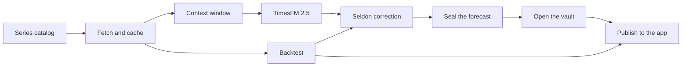

# Architecture

<!-- Generated by scripts/make_readme_art.py from src/psychohistory/inventory.py. Edit that file, not this one. -->

Every forecast World Predictor shows passes through the stages below. The web app's
[Follow one result](https://normansrule.github.io/world-predictor/app/#trace) view walks one real series
through the same stages, with links pinned to the deployed commit.

Arrows show data being handed on, not cause and effect.

## 1. Series catalog

The list of everything World Predictor forecasts, and where each series comes from.

| | |
|---|---|
| **Code** | [`src/psychohistory/catalog.py` · SeriesSpec](https://github.com/Normansrule/world-predictor/blob/main/src/psychohistory/catalog.py#L16) [`src/psychohistory/catalog.py` · CATALOG](https://github.com/Normansrule/world-predictor/blob/main/src/psychohistory/catalog.py#L102) |
| **Takes** | Nothing: edited by hand. |
| **Gives** | SeriesSpec(id, domain, source, params, freq, horizon, scale) |
| **Rule** | One entry per series. Horizons: 28 days (news, Wikipedia), 21 trading days (markets), 3 years (OWID). |
| **When** | Changes only with a commit. |
| **If it fails** | An unknown id raises KeyError; composites must name series that exist. |
| **Runs in** | Python, anywhere |
| **Tests** | [`test_catalog_ids_are_unique_and_composites_resolve`](https://github.com/Normansrule/world-predictor/blob/main/tests/test_pipeline.py#L158) |
| **Status** | Implemented |

## 2. Fetch and cache

Downloads each series from its public source and keeps a dated copy on disk.

| | |
|---|---|
| **Code** | [`src/psychohistory/data/__init__.py` · fetch](https://github.com/Normansrule/world-predictor/blob/main/src/psychohistory/data/__init__.py#L44) [`src/psychohistory/data/http.py` · get](https://github.com/Normansrule/world-predictor/blob/main/src/psychohistory/data/http.py#L12) [`src/psychohistory/data/gdelt.py` · fetch](https://github.com/Normansrule/world-predictor/blob/main/src/psychohistory/data/gdelt.py#L48) [`src/psychohistory/data/markets.py` · fetch](https://github.com/Normansrule/world-predictor/blob/main/src/psychohistory/data/markets.py#L12) [`src/psychohistory/data/wikipedia.py` · fetch](https://github.com/Normansrule/world-predictor/blob/main/src/psychohistory/data/wikipedia.py#L20) [`src/psychohistory/data/owid.py` · fetch](https://github.com/Normansrule/world-predictor/blob/main/src/psychohistory/data/owid.py#L18) [`src/psychohistory/cli.py` · _load](https://github.com/Normansrule/world-predictor/blob/main/src/psychohistory/cli.py#L20) |
| **Takes** | SeriesSpec |
| **Gives** | Date-indexed values, cached as data/<domain>/<id>.csv (not committed: Yahoo's terms) |
| **Rule** | Drop missing values, sort by date, keep the last of any duplicate date. Missing stays missing, never zero. |
| **When** | Every Monday 06:00 UTC (.github/workflows/predict.yml), or on demand |
| **If it fails** | A source that fails is skipped and the run carries on; the reason is written to results/run_status.json. GDELT calls are paced 6 s apart and back off on HTTP 429. A composite needs at least two members. |
| **Runs in** | GitHub Actions (predict workflow) or your computer |
| **Tests** | [`test_gdelt_retries_when_rate_limited`](https://github.com/Normansrule/world-predictor/blob/main/tests/test_pipeline.py#L484), [`test_owid_reads_short_lowercase_columns`](https://github.com/Normansrule/world-predictor/blob/main/tests/test_pipeline.py#L474), [`test_composite_survives_a_missing_member`](https://github.com/Normansrule/world-predictor/blob/main/tests/test_pipeline.py#L495), [`test_composite_scales_members_to_their_mean`](https://github.com/Normansrule/world-predictor/blob/main/tests/test_pipeline.py#L126), [`test_skipped_series_are_recorded`](https://github.com/Normansrule/world-predictor/blob/main/tests/test_pipeline.py#L531) |
| **Status** | Implemented |

## 3. Context window

Cuts the history down to the part the model is allowed to read: the past only.

| | |
|---|---|
| **Code** | [`src/psychohistory/ledger.py` · predict](https://github.com/Normansrule/world-predictor/blob/main/src/psychohistory/ledger.py#L39) [`src/psychohistory/backtest.py` · MAX_CONTEXT](https://github.com/Normansrule/world-predictor/blob/main/src/psychohistory/backtest.py#L23) |
| **Takes** | The full cached series |
| **Gives** | The last 1,024 values or fewer |
| **Rule** | Live forecasts read everything up to the newest value; backtests read only up to each past origin. |
| **When** | Every forecast |
| **If it fails** | Too-short series are not backtested (logged as a warning). |
| **Runs in** | Python |
| **Tests** | [`test_backtest_never_sees_the_future`](https://github.com/Normansrule/world-predictor/blob/main/tests/test_pipeline.py#L73) |
| **Status** | Implemented |

## 4. TimesFM 2.5

Google Research's pretrained forecasting model reads the context and returns a range for every step ahead.

| | |
|---|---|
| **Code** | [`src/psychohistory/models.py` · TimesFM25Forecaster](https://github.com/Normansrule/world-predictor/blob/main/src/psychohistory/models.py#L112) [`src/psychohistory/models.py` · load_model](https://github.com/Normansrule/world-predictor/blob/main/src/psychohistory/models.py#L341) |
| **Takes** | Context arrays and a horizon |
| **Gives** | Forecast: a middle path and nine deciles (10%..90%) per step |
| **Rule** | Zero-shot: checkpoint google/timesfm-2.5-200m-pytorch, never trained on this project's data. |
| **When** | Every forecast |
| **If it fails** | Stops with an install hint if TimesFM is missing. Nothing is shown about its internal reasoning: only inputs and outputs. |
| **Runs in** | GitHub Actions on CPU, or your computer |
| **Tests** | [`test_timesfm25_wrapper_maps_deciles`](https://github.com/Normansrule/world-predictor/blob/main/tests/test_pipeline.py#L206), [`test_load_model_is_cached`](https://github.com/Normansrule/world-predictor/blob/main/tests/test_pipeline.py#L120) |
| **Status** | Implemented |

## 5. Seldon correction

A second, sealed forecast: TimesFM corrected by what its own past windows got wrong.

| | |
|---|---|
| **Code** | [`src/psychohistory/seldon.py` · learn](https://github.com/Normansrule/world-predictor/blob/main/src/psychohistory/seldon.py#L62) [`src/psychohistory/seldon.py` · apply](https://github.com/Normansrule/world-predictor/blob/main/src/psychohistory/seldon.py#L96) [`src/psychohistory/seldon.py` · online](https://github.com/Normansrule/world-predictor/blob/main/src/psychohistory/seldon.py#L112) [`src/psychohistory/seldon.py` · correction_for](https://github.com/Normansrule/world-predictor/blob/main/src/psychohistory/seldon.py#L142) |
| **Takes** | The TimesFM forecast and TimesFM's finished backtest windows for the same series |
| **Gives** | Forecast rows with model = seldon, next to the TimesFM rows |
| **Rule** | Keep only the share of TimesFM's move that paid off before (used only if it cut past error by 3%), then stretch the range until it would have caught reality 8 times in 10. Learns from finished windows only. |
| **When** | Every Monday 06:00 UTC (.github/workflows/predict.yml), or on demand |
| **If it fails** | With fewer than two finished windows Seldon returns TimesFM unchanged, so it never invents a correction. |
| **Runs in** | Python, right after TimesFM |
| **Tests** | [`test_seldon_needs_finished_windows_before_it_changes_anything`](https://github.com/Normansrule/world-predictor/blob/main/tests/test_pipeline.py#L581), [`test_seldon_shrinks_moves_that_never_paid_off_and_widens_narrow_bands`](https://github.com/Normansrule/world-predictor/blob/main/tests/test_pipeline.py#L589), [`test_seldon_keeps_a_model_that_was_right`](https://github.com/Normansrule/world-predictor/blob/main/tests/test_pipeline.py#L603), [`test_seldon_in_the_backtest_only_learns_from_the_past`](https://github.com/Normansrule/world-predictor/blob/main/tests/test_pipeline.py#L611) |
| **Status** | Implemented |

## 6. Seal the forecast

Writes the forecast down with today's date before the future happens.

| | |
|---|---|
| **Code** | [`src/psychohistory/ledger.py` · predict](https://github.com/Normansrule/world-predictor/blob/main/src/psychohistory/ledger.py#L39) [`src/psychohistory/ledger.py` · append](https://github.com/Normansrule/world-predictor/blob/main/src/psychohistory/ledger.py#L95) [`src/psychohistory/metrics.py` · prob_above](https://github.com/Normansrule/world-predictor/blob/main/src/psychohistory/metrics.py#L23) |
| **Takes** | Forecast and the newest observed value |
| **Gives** | Rows in predictions/ledger.csv: made_on, last_date, last_value, step, target_date, q10, q50, q90, p_up |
| **Rule** | The chance of ending higher is read off the deciles by interpolation, capped at 5% and 95%. |
| **When** | Every Monday 06:00 UTC (.github/workflows/predict.yml), or on demand |
| **If it fails** | Rows are only appended, never edited, so a sealed forecast cannot be changed after the fact. |
| **Runs in** | GitHub Actions; the ledger is committed to the repository |
| **Tests** | [`test_ledger_predict_then_score`](https://github.com/Normansrule/world-predictor/blob/main/tests/test_pipeline.py#L134), [`test_prob_above_reads_the_deciles`](https://github.com/Normansrule/world-predictor/blob/main/tests/test_pipeline.py#L43), [`test_latest_picks_newest_run_and_final_step`](https://github.com/Normansrule/world-predictor/blob/main/tests/test_pipeline.py#L147) |
| **Status** | Implemented |

## 7. Open the vault

When a target date arrives, puts what really happened next to what was sealed.

| | |
|---|---|
| **Code** | [`src/psychohistory/ledger.py` · score](https://github.com/Normansrule/world-predictor/blob/main/src/psychohistory/ledger.py#L106) [`src/psychohistory/story.py` · track_record](https://github.com/Normansrule/world-predictor/blob/main/src/psychohistory/story.py#L307) [`src/psychohistory/web.py` · opened_payload](https://github.com/Normansrule/world-predictor/blob/main/src/psychohistory/web.py#L282) |
| **Takes** | Ledger rows and the newest data |
| **Gives** | predictions/scored.csv: actual, abs_error, in_band80, direction_correct, brier |
| **Rule** | A row is scored only once its target date is in the data. Brier compares the chance it gave with what happened. |
| **When** | Every Monday 06:00 UTC (.github/workflows/predict.yml), or on demand |
| **If it fails** | Rows whose date has not arrived, or whose value is missing, wait unscored. |
| **Runs in** | GitHub Actions |
| **Tests** | [`test_ledger_predict_then_score`](https://github.com/Normansrule/world-predictor/blob/main/tests/test_pipeline.py#L134), [`test_time_vault_track_record`](https://github.com/Normansrule/world-predictor/blob/main/tests/test_pipeline.py#L361), [`test_opened_forecasts_flag_values_sealed_before_release`](https://github.com/Normansrule/world-predictor/blob/main/tests/test_pipeline.py#L660) |
| **Status** | Implemented |

## 8. Backtest

Replays the past: forecasts from old dates, scored against what followed, next to simple guesses.

| | |
|---|---|
| **Code** | [`src/psychohistory/backtest.py` · backtest_series](https://github.com/Normansrule/world-predictor/blob/main/src/psychohistory/backtest.py#L33) [`src/psychohistory/backtest.py` · origins](https://github.com/Normansrule/world-predictor/blob/main/src/psychohistory/backtest.py#L26) [`src/psychohistory/backtest.py` · summarize](https://github.com/Normansrule/world-predictor/blob/main/src/psychohistory/backtest.py#L105) [`src/psychohistory/metrics.py` · score](https://github.com/Normansrule/world-predictor/blob/main/src/psychohistory/metrics.py#L37) |
| **Takes** | Cached series and the models |
| **Gives** | results/backtest_windows.csv, backtest_summary.csv, skill_by_step.csv, backtest_paths.csv |
| **Rule** | 12 origins spaced one horizon apart. Skill = 1 - MAE(model) / MAE(naive). Under 2% either way counts as no edge. |
| **When** | 1st of each month 07:00 UTC, or on demand with the backtest box ticked |
| **If it fails** | Series too short for the windows are left out, and a test checks no window sees its own future. |
| **Runs in** | GitHub Actions or your computer |
| **Tests** | [`test_backtest_never_sees_the_future`](https://github.com/Normansrule/world-predictor/blob/main/tests/test_pipeline.py#L73), [`test_drift_beats_naive_on_a_trend`](https://github.com/Normansrule/world-predictor/blob/main/tests/test_pipeline.py#L84), [`test_skill_by_step_shows_drift_advantage_growing_with_horizon`](https://github.com/Normansrule/world-predictor/blob/main/tests/test_pipeline.py#L93), [`test_perfect_forecast_scores_zero_error`](https://github.com/Normansrule/world-predictor/blob/main/tests/test_pipeline.py#L35), [`test_brier_rewards_confident_correct_calls`](https://github.com/Normansrule/world-predictor/blob/main/tests/test_pipeline.py#L53) |
| **Status** | Implemented |

## 9. Publish to the app

Packs the results into one file the web app reads, and GitHub Pages serves it.

| | |
|---|---|
| **Code** | [`src/psychohistory/web.py` · build_payload](https://github.com/Normansrule/world-predictor/blob/main/src/psychohistory/web.py#L66) [`src/psychohistory/web.py` · track_payload](https://github.com/Normansrule/world-predictor/blob/main/src/psychohistory/web.py#L248) [`src/psychohistory/web.py` · write_data_js](https://github.com/Normansrule/world-predictor/blob/main/src/psychohistory/web.py#L327) [`src/psychohistory/story.py` · EDGE](https://github.com/Normansrule/world-predictor/blob/main/src/psychohistory/story.py#L88) [`.github/workflows/pages.yml`](https://github.com/Normansrule/world-predictor/blob/main/.github/workflows/pages.yml) |
| **Takes** | Results, ledger, scores and run status |
| **Gives** | results/web/data.js (window.WP_DATA), copied to app/data/data.js on Pages |
| **Rule** | Only numbers produced by a run are shown; demo data is marked as demo everywhere it appears. |
| **When** | After every predict run, and on every push to main |
| **If it fails** | With no results yet the app shows labelled demo data instead. |
| **Runs in** | GitHub Actions, then GitHub Pages |
| **Tests** | [`test_web_app_data_and_site`](https://github.com/Normansrule/world-predictor/blob/main/tests/test_pipeline.py#L380), [`test_demo_payload_is_marked_and_complete`](https://github.com/Normansrule/world-predictor/blob/main/tests/test_pipeline.py#L422), [`test_scorecard_shows_numbers_or_placeholders`](https://github.com/Normansrule/world-predictor/blob/main/tests/test_pipeline.py#L349) |
| **Status** | Implemented |

## Not built

These ideas from the design brief have no engine behind them yet, so the app does not pretend to run them:
scenario comparisons ("what if"), maps (no series here is tied to a place), and agent simulations beyond the
labelled toy crowd in the Crowd lab.
