# World Predictor: Seldon scorecard

_Generated 2026-11-14 with model `timesfm-2.5`. Skill = 1 - MAE(model) / MAE(naive random walk); positive is better than naive. Coverage80 should be close to 0.80 for an honest forecaster. Brier scores the probability of going up (0.25 = coin flip, lower is better). See docs/METHODOLOGY.md._

## In plain English

- timesfm-2.5 beat the simple guess "tomorrow looks like today" in 4 of 5 areas: world news (13% less error), politics (11% less error), technology (41% less error), the weather (18% less error).
- Seldon, our own forecaster (crowd laws with timesfm-2.5 as one voter), won 1 of 5 areas (markets) against timesfm-2.5, with lower error on 18 of 53 series and higher on 35.
- Hari Seldon's bet held here: big aggregates such as indices and averages were easier to predict than single stocks or topics (12% vs 12% skill).
- In world news, its edge lasts up to about 28 days ahead.
- In politics, its edge lasts up to about 28 days ahead.
- In markets, it had no edge at any distance ahead.
- In technology, its edge lasts up to about 28 days ahead.
- In the weather, its edge lasts up to about 14 days ahead.
- When it gave 70% or more odds of a rise, the rise really happened 83% of the time (122 forecasts).

_Each frame is a forecast made in the past: the orange band is what the model expected, the dark dots are what really happened._

## Seldon vs timesfm-2.5: the duel

Seldon is this project's own forecaster (`src/psychohistory/seldon.py`): four laws of crowd behaviour (inertia, drift, momentum, reversion, on top of the weekly rhythm), a behavioural core, "no change" and Chronos-Bolt, each voter's weight learned per area from finished windows only. Since November 2026 TimesFM is not one of its voters, so Seldon is a second opinion, not a copy. It forecasts the same windows as TimesFM and is scored by the same code. A series is won by whichever had the lower average error there; an exact tie is a tie. Skill is against "no change" (positive is better); range skill scores the whole 80% range (pinball loss).

**The full Seldon** (crowd laws and TimesFM in one council)

| Area | Series | Seldon won | TimesFM won | Seldon's error vs TimesFM | Skill: TimesFM / Seldon | Range skill: TimesFM / Seldon | In 80% range: TimesFM / Seldon | Winner |
|---|---|---|---|---|---|---|---|---|
| Stock and value markets | 15 | 8 | 7 | -1% | -2% / -0% | +2% / +1% | 83% / 76% | Seldon |
| World events in the news | 6 | 1 | 5 | +3% | +13% / +8% | +13% / +10% | 78% / 78% | timesfm-2.5 |
| Political events | 7 | 2 | 5 | +3% | +11% / +11% | +15% / +12% | 80% / 80% | timesfm-2.5 |
| New technologies | 16 | 5 | 11 | +1% | +41% / +35% | +40% / +38% | 72% / 75% | timesfm-2.5 |
| Weather and the planet | 9 | 2 | 7 | +20% | +18% / +17% | +18% / +17% | 80% / 78% | timesfm-2.5 |
| **All areas** | 53 | 18 | 35 | +4% | +12% / +9% | +15% / +11% | 78% / 77% | timesfm-2.5 |

**The crowd laws alone** (`seldon-laws`, no TimesFM vote)

| Area | Series | Laws won | TimesFM won | Laws' error vs TimesFM | Skill: TimesFM / Laws | Range skill: TimesFM / Laws | In 80% range: TimesFM / Laws | Winner |
|---|---|---|---|---|---|---|---|---|
| Stock and value markets | 15 | 5 | 10 | +1% | -2% / -2% | +2% / -1% | 83% / 82% | timesfm-2.5 |
| World events in the news | 6 | 2 | 4 | +4% | +13% / +7% | +13% / +7% | 78% / 78% | timesfm-2.5 |
| Political events | 7 | 0 | 7 | +7% | +11% / +8% | +15% / +11% | 80% / 81% | timesfm-2.5 |
| New technologies | 16 | 2 | 14 | +24% | +41% / +23% | +40% / +25% | 72% / 70% | timesfm-2.5 |
| Weather and the planet | 9 | 1 | 8 | +59% | +18% / +8% | +18% / +6% | 80% / 74% | timesfm-2.5 |
| **All areas** | 53 | 10 | 43 | +19% | +12% / +7% | +15% / +9% | 78% / 76% | timesfm-2.5 |

## 1. Can the future be predicted?

- **World events in the news**: timesfm-2.5 beats the naive baseline (13% less error).
- **Political events**: timesfm-2.5 beats the naive baseline (11% less error).
- **Stock and value markets**: timesfm-2.5 about the same as the naive baseline.
- **New technologies**: timesfm-2.5 beats the naive baseline (41% less error).
- **Weather and the planet**: timesfm-2.5 beats the naive baseline (18% less error).

| domain   | model        |   series |   median_skill |   median_mase |   direction |   coverage80 |   brier |
|:---------|:-------------|---------:|---------------:|--------------:|------------:|-------------:|--------:|
| markets  | auto-ets     |       15 |         -0.007 |         3.813 |       0.465 |        0.835 |   0.256 |
| markets  | chronos-bolt |       15 |         -0.062 |         3.904 |       0.526 |        0.811 |   0.261 |
| markets  | drift        |       15 |         -0.014 |         3.643 |       0.526 |        0.697 |   0.265 |
| markets  | ensemble     |       15 |         -0.013 |         3.553 |       0.537 |        0.844 |   0.247 |
| markets  | mean         |       15 |         -1.017 |         7.704 |       0.508 |        0.511 |   0.360 |
| markets  | naive        |       15 |          0.000 |         3.786 |     nan     |        0.702 |   0.250 |
| markets  | radiant      |       15 |         -0.008 |         3.801 |       0.446 |        0.782 |   0.251 |
| markets  | radiant-core |       15 |         -0.003 |         3.791 |       0.474 |        0.846 |   0.251 |
| markets  | seldon       |       15 |         -0.003 |         3.798 |       0.407 |        0.763 |   0.251 |
| markets  | seldon-laws  |       15 |         -0.016 |         3.795 |       0.537 |        0.820 |   0.250 |
| markets  | timesfm-2.5  |       15 |         -0.016 |         3.692 |       0.518 |        0.830 |   0.245 |
| news     | auto-ets     |        6 |         -0.059 |         1.444 |       0.472 |        0.911 |   0.272 |
| news     | chronos-bolt |        6 |          0.082 |         1.269 |       0.653 |        0.739 |   0.224 |
| news     | drift        |        6 |         -0.007 |         1.382 |       0.528 |        0.860 |   0.255 |
| news     | ensemble     |        6 |          0.117 |         1.262 |       0.583 |        0.855 |   0.245 |
| news     | mean         |        6 |         -0.103 |         1.546 |       0.597 |        0.655 |   0.243 |
| news     | naive        |        6 |          0.000 |         1.371 |     nan     |        0.865 |   0.250 |
| news     | radiant      |        6 |          0.142 |         1.291 |       0.667 |        0.792 |   0.218 |
| news     | radiant-core |        6 |          0.029 |         1.346 |       0.611 |        0.792 |   0.245 |
| news     | seldon       |        6 |          0.084 |         1.302 |       0.611 |        0.782 |   0.231 |
| news     | seldon-laws  |        6 |          0.067 |         1.321 |       0.597 |        0.777 |   0.231 |
| news     | timesfm-2.5  |        6 |          0.130 |         1.286 |       0.653 |        0.778 |   0.217 |
| politics | auto-ets     |        7 |         -0.220 |         1.758 |       0.476 |        0.961 |   0.257 |
| politics | chronos-bolt |        7 |          0.096 |         1.390 |       0.619 |        0.780 |   0.220 |
| politics | drift        |        7 |         -0.009 |         1.691 |       0.405 |        0.818 |   0.259 |
| politics | ensemble     |        7 |          0.093 |         1.460 |       0.571 |        0.921 |   0.231 |
| politics | mean         |        7 |          0.043 |         1.567 |       0.619 |        0.700 |   0.244 |
| politics | naive        |        7 |          0.000 |         1.676 |     nan     |        0.820 |   0.250 |
| politics | radiant      |        7 |          0.121 |         1.333 |       0.631 |        0.804 |   0.206 |
| politics | radiant-core |        7 |          0.021 |         1.626 |       0.607 |        0.831 |   0.241 |
| politics | seldon       |        7 |          0.111 |         1.486 |       0.607 |        0.802 |   0.237 |
| politics | seldon-laws  |        7 |          0.082 |         1.540 |       0.655 |        0.810 |   0.231 |
| politics | timesfm-2.5  |        7 |          0.114 |         1.315 |       0.643 |        0.795 |   0.202 |
| tech     | auto-ets     |       16 |         -0.447 |         2.379 |       0.620 |        0.853 |   0.219 |
| tech     | bass         |        4 |         -1.038 |        60.712 |       0.333 |        0.104 |   0.566 |
| tech     | chronos-bolt |       16 |          0.353 |         0.910 |       0.698 |        0.736 |   0.192 |
| tech     | drift        |       16 |          0.022 |         1.184 |       0.609 |        0.709 |   0.204 |
| tech     | ensemble     |       16 |          0.203 |         1.218 |       0.677 |        0.871 |   0.204 |
| tech     | mean         |       16 |          0.033 |         1.256 |       0.583 |        0.564 |   0.339 |
| tech     | naive        |       16 |          0.000 |         1.318 |     nan     |        0.707 |   0.282 |
| tech     | radiant      |       16 |          0.402 |         0.869 |       0.708 |        0.784 |   0.184 |
| tech     | radiant-core |       16 |          0.016 |         1.304 |       0.581 |        0.629 |   0.240 |
| tech     | seldon       |       16 |          0.350 |         0.907 |       0.693 |        0.749 |   0.195 |
| tech     | seldon-laws  |       16 |          0.226 |         1.003 |       0.708 |        0.699 |   0.197 |
| tech     | timesfm-2.5  |       16 |          0.414 |         0.866 |       0.677 |        0.724 |   0.194 |
| weather  | auto-ets     |        9 |          0.026 |         2.287 |       0.676 |        0.866 |   0.209 |
| weather  | chronos-bolt |        9 |          0.180 |         1.594 |       0.741 |        0.774 |   0.152 |
| weather  | drift        |        9 |         -0.008 |         2.365 |       0.315 |        0.772 |   0.258 |
| weather  | ensemble     |        9 |          0.201 |         1.706 |       0.787 |        0.892 |   0.153 |
| weather  | mean         |        9 |         -0.504 |         2.725 |       0.454 |        0.524 |   0.413 |
| weather  | naive        |        9 |          0.000 |         2.346 |     nan     |        0.788 |   0.250 |
| weather  | radiant      |        9 |          0.178 |         1.597 |       0.769 |        0.796 |   0.133 |
| weather  | radiant-core |        9 |          0.052 |         2.312 |       0.731 |        0.842 |   0.225 |
| weather  | seldon       |        9 |          0.174 |         1.747 |       0.741 |        0.784 |   0.154 |
| weather  | seldon-laws  |        9 |          0.078 |         2.143 |       0.630 |        0.737 |   0.228 |
| weather  | timesfm-2.5  |        9 |          0.178 |         1.559 |       0.769 |        0.796 |   0.136 |

## 2. Seldon's law of large numbers: aggregates vs individuals

Psychohistory only claims to work for very large populations. If that holds here, aggregate series (indices, composites, world totals) should show higher skill and lower MASE than individual ones.

| domain   | scale      | model       |   series |   median_skill |   median_mase |
|:---------|:-----------|:------------|---------:|---------------:|--------------:|
| markets  | aggregate  | timesfm-2.5 |        5 |         -0.025 |         2.707 |
| markets  | individual | timesfm-2.5 |       10 |         -0.003 |         4.192 |
| news     | aggregate  | timesfm-2.5 |        1 |          0.121 |         1.447 |
| news     | individual | timesfm-2.5 |        5 |          0.138 |         1.270 |
| politics | aggregate  | timesfm-2.5 |        1 |          0.076 |         1.315 |
| politics | individual | timesfm-2.5 |        6 |          0.121 |         1.420 |
| tech     | aggregate  | timesfm-2.5 |        5 |          0.460 |         8.692 |
| tech     | individual | timesfm-2.5 |       11 |          0.371 |         0.805 |
| weather  | aggregate  | timesfm-2.5 |        4 |          0.379 |         1.781 |
| weather  | individual | timesfm-2.5 |        5 |          0.053 |         1.559 |

## 3. Seldon crises: what the model did not see coming

Backtest windows where most actual values fell outside the model's 80% band.

| series_id      | domain   | origin     |   coverage80 |    mase |
|:---------------|:---------|:-----------|-------------:|--------:|
| adoption_solar | tech     | 2010-01-01 |        0.000 | 155.972 |
| adoption_solar | tech     | 2007-01-01 |        0.000 | 150.231 |
| adoption_solar | tech     | 1989-01-01 |        0.000 | 108.537 |
| adoption_wind  | tech     | 1989-01-01 |        0.000 |  87.285 |
| adoption_solar | tech     | 2013-01-01 |        0.000 |  82.032 |
| adoption_solar | tech     | 2004-01-01 |        0.000 |  70.178 |
| space_launches | tech     | 2019-01-01 |        0.000 |  56.721 |
| space_launches | tech     | 2016-01-01 |        0.000 |  16.455 |
| bitcoin        | markets  | 2026-08-18 |        0.000 |   9.848 |
| sp500          | markets  | 2026-04-13 |        0.000 |   7.544 |
| space_launches | tech     | 2013-01-01 |        0.000 |   3.874 |
| nasdaq100      | markets  | 2026-04-13 |        0.048 |  11.327 |
| xom            | markets  | 2026-01-09 |        0.095 |  12.057 |
| news_pandemic  | news     | 2026-05-01 |        0.143 |   4.976 |
| wiki_quantum   | tech     | 2025-12-09 |        0.143 |   0.983 |

## 4. Prediction ledger (true out-of-sample test)

_Predictions are sealed with a date before the future happens and opened when it arrives. The left line should settle near 80%; the right line should sit below the coin-flip line._

| domain   | model        |   series |   predictions |   median_skill |   direction |   coverage80 |   brier |
|:---------|:-------------|---------:|--------------:|---------------:|------------:|-------------:|--------:|
| markets  | auto-ets     |       15 |          1553 |         -0.001 |       0.456 |        0.734 |   0.260 |
| markets  | chronos-bolt |       15 |          1553 |         -0.070 |       0.475 |        0.711 |   0.264 |
| markets  | ensemble     |       15 |          1553 |         -0.052 |       0.446 |        0.719 |   0.257 |
| markets  | radiant      |       15 |           450 |         -0.009 |       0.553 |        0.591 |   0.246 |
| markets  | radiant-core |       15 |           450 |          0.003 |       0.647 |        0.649 |   0.248 |
| markets  | seldon       |       15 |           450 |         -0.029 |       0.504 |        0.642 |   0.245 |
| markets  | seldon-laws  |       15 |          1066 |         -0.043 |       0.464 |        0.648 |   0.257 |
| markets  | timesfm-2.5  |       15 |          1553 |         -0.044 |       0.460 |        0.707 |   0.262 |
| news     | auto-ets     |        6 |           614 |         -0.049 |       0.489 |        0.795 |   0.264 |
| news     | chronos-bolt |        6 |           614 |          0.263 |       0.752 |        0.688 |   0.179 |
| news     | ensemble     |        6 |           614 |          0.246 |       0.733 |        0.770 |   0.187 |
| news     | radiant      |        6 |           173 |          0.393 |       0.798 |        0.670 |   0.149 |
| news     | radiant-core |        6 |           173 |          0.041 |       0.688 |        0.537 |   0.235 |
| news     | seldon       |        6 |           173 |          0.389 |       0.792 |        0.670 |   0.151 |
| news     | seldon-laws  |        6 |           449 |          0.143 |       0.712 |        0.515 |   0.190 |
| news     | timesfm-2.5  |        6 |           614 |          0.226 |       0.732 |        0.685 |   0.187 |
| politics | auto-ets     |        7 |            48 |         -0.124 |       0.427 |        0.739 |   0.287 |
| politics | chronos-bolt |        7 |            48 |          0.243 |       0.728 |        0.704 |   0.205 |
| politics | ensemble     |        7 |            48 |          0.183 |       0.699 |        0.652 |   0.222 |
| politics | radiant      |        7 |            48 |          0.201 |       0.671 |        0.588 |   0.223 |
| politics | radiant-core |        7 |            48 |          0.015 |       0.774 |        0.608 |   0.245 |
| politics | seldon       |        7 |            48 |          0.185 |       0.671 |        0.656 |   0.217 |
| politics | seldon-laws  |        7 |            48 |          0.104 |       0.623 |        0.560 |   0.250 |
| politics | timesfm-2.5  |        7 |            48 |          0.185 |       0.671 |        0.656 |   0.217 |
| tech     | auto-ets     |       12 |          1258 |          0.013 |       0.595 |        0.933 |   0.230 |
| tech     | chronos-bolt |       12 |          1258 |          0.334 |       0.773 |        0.725 |   0.157 |
| tech     | ensemble     |       12 |          1258 |          0.224 |       0.723 |        0.916 |   0.163 |
| tech     | radiant      |       12 |           330 |          0.387 |       0.773 |        0.751 |   0.153 |
| tech     | radiant-core |       12 |           330 |          0.020 |       0.708 |        0.696 |   0.241 |
| tech     | seldon       |       12 |           330 |          0.396 |       0.798 |        0.757 |   0.150 |
| tech     | seldon-laws  |       12 |           834 |          0.245 |       0.753 |        0.749 |   0.168 |
| tech     | timesfm-2.5  |       12 |          1258 |          0.313 |       0.774 |        0.670 |   0.155 |
| weather  | auto-ets     |        9 |           141 |          0.245 |       0.745 |        0.849 |   0.165 |
| weather  | chronos-bolt |        9 |           141 |          0.279 |       0.770 |        0.757 |   0.149 |
| weather  | ensemble     |        9 |           141 |          0.412 |       0.777 |        0.924 |   0.146 |
| weather  | radiant      |        9 |           141 |          0.353 |       0.770 |        0.875 |   0.151 |
| weather  | radiant-core |        9 |           141 |          0.032 |       0.691 |        0.759 |   0.225 |
| weather  | seldon       |        9 |           141 |          0.361 |       0.761 |        0.833 |   0.152 |
| weather  | seldon-laws  |        9 |           141 |          0.148 |       0.732 |        0.748 |   0.216 |
| weather  | timesfm-2.5  |        9 |           141 |          0.360 |       0.761 |        0.840 |   0.153 |

## 5. How far ahead can it see?

Median skill versus the naive baseline by how many steps ahead the forecast is (days for news and tech attention, trading days for markets; yearly adoption series are too short for this and are left out). Where skill drops to zero is the limit of the model's foresight in that domain.

| domain   |   1 step |    2-5 |   6-10 |   11-20 |     21+ |
|:---------|---------:|-------:|-------:|--------:|--------:|
| markets  |   -0.010 | -0.003 |  0.015 |  -0.015 |  -0.012 |
| news     |    0.179 | -0.024 |  0.132 |   0.075 |   0.135 |
| politics |    0.154 |  0.208 |  0.120 |   0.174 |   0.082 |
| tech     |   -0.005 |  0.361 |  0.210 |   0.343 |   0.287 |
| weather  |    0.164 |  0.142 |  0.192 |   0.296 | nan     |

## 6. Are its odds honest?

Backtest forecasts grouped by the chance they gave of the series ending higher. `said` is the average probability given, `happened` is how often it really went up. When the two match, the odds can be taken at face value.

| domain   | odds given   |   forecasts |   said |   happened |
|:---------|:-------------|------------:|-------:|-----------:|
| markets  | 20%-40%      |          13 |  0.360 |      0.615 |
| markets  | 40%-60%      |         134 |  0.491 |      0.463 |
| markets  | 60%-80%      |          33 |  0.657 |      0.758 |
| news     | 0%-20%       |          11 |  0.129 |      0.364 |
| news     | 20%-40%      |          19 |  0.339 |      0.263 |
| news     | 40%-60%      |          20 |  0.487 |      0.450 |
| news     | 60%-80%      |          17 |  0.699 |      0.765 |
| news     | 80%-100%     |           5 |  0.838 |      0.800 |
| politics | 0%-20%       |          11 |  0.121 |      0.091 |
| politics | 20%-40%      |          21 |  0.325 |      0.381 |
| politics | 40%-60%      |          25 |  0.505 |      0.400 |
| politics | 60%-80%      |          21 |  0.698 |      0.762 |
| politics | 80%-100%     |           6 |  0.860 |      0.833 |
| tech     | 0%-20%       |          22 |  0.124 |      0.318 |
| tech     | 20%-40%      |          36 |  0.308 |      0.194 |
| tech     | 40%-60%      |          41 |  0.498 |      0.463 |
| tech     | 60%-80%      |          50 |  0.697 |      0.640 |
| tech     | 80%-100%     |          32 |  0.888 |      0.875 |
| weather  | 0%-20%       |          38 |  0.096 |      0.053 |
| weather  | 20%-40%      |          15 |  0.288 |      0.267 |
| weather  | 40%-60%      |          19 |  0.503 |      0.632 |
| weather  | 60%-80%      |          17 |  0.689 |      0.706 |
| weather  | 80%-100%     |          19 |  0.908 |      0.895 |

## 7. Every series

| series_id            | domain   | scale      | model       |      mae |   mase |   smape |   direction |   coverage80 |   pinball |   brier |   skill |   prob_skill |
|:---------------------|:---------|:-----------|:------------|---------:|-------:|--------:|------------:|-------------:|----------:|--------:|--------:|-------------:|
| aapl                 | markets  | individual | timesfm-2.5 |    8.705 |  3.692 |   0.030 |       0.500 |        0.849 |     1.449 |   0.250 |   0.025 |        0.022 |
| adoption_internet    | tech     | aggregate  | timesfm-2.5 |    2.341 |  0.774 |   0.032 |       1.000 |        1.000 |     0.260 |   0.002 |   0.460 |        0.526 |
| adoption_solar       | tech     | aggregate  | timesfm-2.5 |    0.254 | 64.139 |   0.421 |       0.750 |        0.417 |    27.337 |   0.197 |   0.441 |        0.282 |
| adoption_wind        | tech     | aggregate  | timesfm-2.5 |    0.165 | 31.187 |   0.249 |       0.833 |        0.694 |    12.482 |   0.124 |   0.646 |        0.416 |
| bitcoin              | markets  | individual | timesfm-2.5 | 5639.103 |  4.417 |   0.076 |       0.417 |        0.815 |     1.696 |   0.251 |  -0.016 |        0.015 |
| copper               | markets  | individual | timesfm-2.5 |    0.179 |  3.317 |   0.030 |       0.583 |        0.889 |     1.351 |   0.246 |   0.048 |       -0.009 |
| gold                 | markets  | individual | timesfm-2.5 |  167.546 |  7.290 |   0.037 |       0.333 |        0.821 |     2.911 |   0.258 |   0.017 |        0.087 |
| msci_world           | markets  | aggregate  | timesfm-2.5 |    2.643 |  2.707 |   0.014 |       0.750 |        0.798 |     1.049 |   0.179 |   0.012 |        0.024 |
| nasdaq100            | markets  | aggregate  | timesfm-2.5 |  765.631 |  4.237 |   0.028 |       0.667 |        0.750 |     1.708 |   0.207 |  -0.025 |        0.014 |
| news_climate         | news     | individual | timesfm-2.5 |    0.128 |  0.972 |   0.156 |       0.750 |        0.780 |     0.383 |   0.152 |   0.184 |        0.174 |
| news_composite       | news     | aggregate  | timesfm-2.5 |    0.117 |  1.447 |   0.139 |       0.750 |        0.786 |     0.577 |   0.174 |   0.121 |        0.118 |
| news_election        | news     | individual | timesfm-2.5 |    0.641 |  1.302 |   0.133 |       0.667 |        0.812 |     0.540 |   0.226 |   0.138 |        0.140 |
| news_inflation       | news     | individual | timesfm-2.5 |    0.308 |  1.009 |   0.156 |       0.500 |        0.783 |     0.390 |   0.324 |   0.182 |        0.199 |
| news_pandemic        | news     | individual | timesfm-2.5 |    0.234 |  1.270 |   0.116 |       0.583 |        0.741 |     0.520 |   0.250 |  -0.084 |       -0.062 |
| news_protest         | news     | individual | timesfm-2.5 |    0.475 |  1.612 |   0.200 |       0.667 |        0.765 |     0.654 |   0.174 |   0.066 |        0.076 |
| nvda                 | markets  | individual | timesfm-2.5 |    8.059 |  3.982 |   0.040 |       0.500 |        0.869 |     1.631 |   0.259 |   0.009 |       -0.006 |
| oil_wti              | markets  | individual | timesfm-2.5 |    6.286 |  4.409 |   0.075 |       0.500 |        0.806 |     1.690 |   0.227 |  -0.025 |        0.050 |
| politics_ceasefire   | politics | individual | timesfm-2.5 |    0.384 |  1.943 |   0.382 |       0.583 |        0.786 |     0.828 |   0.194 |   0.039 |        0.053 |
| politics_composite   | politics | aggregate  | timesfm-2.5 |    0.143 |  1.315 |   0.178 |       0.750 |        0.812 |     0.517 |   0.160 |   0.076 |        0.098 |
| politics_coup        | politics | individual | timesfm-2.5 |    0.085 |  0.819 |   0.218 |       0.417 |        0.777 |     0.330 |   0.296 |   0.131 |        0.179 |
| politics_impeachment | politics | individual | timesfm-2.5 |    0.073 |  0.924 |   0.261 |       0.750 |        0.839 |     0.389 |   0.166 |   0.114 |        0.149 |
| politics_referendum  | politics | individual | timesfm-2.5 |    0.119 |  1.531 |   0.296 |       0.583 |        0.783 |     0.626 |   0.202 |   0.087 |        0.118 |
| politics_sanctions   | politics | individual | timesfm-2.5 |    0.267 |  1.615 |   0.212 |       0.667 |        0.789 |     0.628 |   0.183 |   0.127 |        0.146 |
| politics_tariffs     | politics | individual | timesfm-2.5 |    0.302 |  1.309 |   0.211 |       0.750 |        0.780 |     0.546 |   0.212 |   0.317 |        0.284 |
| quakes_m45           | weather  | aggregate  | timesfm-2.5 |    7.724 |  0.953 |   0.313 |       0.750 |        0.750 |     0.386 |   0.142 |   0.178 |        0.181 |
| silver               | markets  | individual | timesfm-2.5 |    6.228 | 10.918 |   0.087 |       0.583 |        0.786 |     4.325 |   0.245 |   0.010 |        0.141 |
| sp500                | markets  | aggregate  | timesfm-2.5 |  107.505 |  2.841 |   0.015 |       0.583 |        0.798 |     1.129 |   0.223 |   0.036 |        0.035 |
| space_launches       | tech     | aggregate  | timesfm-2.5 |  218.395 |  8.692 |   0.333 |       0.250 |        0.556 |     3.938 |   0.353 |   0.026 |        0.045 |
| tech_composite       | tech     | aggregate  | timesfm-2.5 |    0.066 |  0.642 |   0.081 |       0.667 |        0.753 |     0.259 |   0.165 |   0.467 |        0.447 |
| tlt                  | markets  | individual | timesfm-2.5 |    0.921 |  1.387 |   0.011 |       0.417 |        0.885 |     0.553 |   0.266 |  -0.016 |        0.172 |
| tsla                 | markets  | individual | timesfm-2.5 |   23.710 |  3.161 |   0.062 |       0.750 |        0.865 |     1.257 |   0.246 |  -0.016 |       -0.039 |
| us10y                | markets  | aggregate  | timesfm-2.5 |    0.093 |  1.887 |   0.020 |       0.273 |        0.845 |     0.731 |   0.285 |  -0.106 |        0.051 |
| vix                  | markets  | aggregate  | timesfm-2.5 |    1.906 |  1.829 |   0.101 |       0.583 |        0.865 |     0.729 |   0.242 |  -0.072 |       -0.005 |
| weather_arctic_ice   | weather  | aggregate  | timesfm-2.5 |    0.106 |  1.521 |   0.016 |       1.000 |        0.863 |     0.601 |   0.006 |   0.793 |        0.764 |
| weather_london       | weather  | individual | timesfm-2.5 |    2.976 |  1.559 |   0.137 |       0.833 |        0.774 |     0.592 |   0.112 |   0.410 |        0.439 |
| weather_los_angeles  | weather  | individual | timesfm-2.5 |    2.750 |  1.580 |   0.091 |       0.583 |        0.762 |     0.624 |   0.180 |   0.053 |        0.045 |
| weather_new_delhi    | weather  | individual | timesfm-2.5 |    2.035 |  1.669 |   0.061 |       0.583 |        0.833 |     0.664 |   0.240 |   0.286 |        0.281 |
| weather_sydney       | weather  | individual | timesfm-2.5 |    2.338 |  1.019 |   0.111 |       0.750 |        0.804 |     0.392 |   0.159 |   0.022 |        0.106 |
| weather_tokyo        | weather  | individual | timesfm-2.5 |    3.372 |  1.492 |   0.127 |       0.833 |        0.637 |     0.573 |   0.143 |   0.052 |        0.060 |
| weather_world_air    | weather  | aggregate  | timesfm-2.5 |    0.082 |  2.042 |   0.005 |       0.917 |        0.869 |     0.774 |   0.087 |   0.581 |        0.573 |
| weather_world_sea    | weather  | aggregate  | timesfm-2.5 |    0.021 |  3.078 |   0.001 |       0.667 |        0.869 |     1.141 |   0.154 |   0.108 |        0.161 |
| wiki_ai              | tech     | individual | timesfm-2.5 | 1460.623 |  1.079 |   0.111 |       0.833 |        0.765 |     0.443 |   0.124 |   0.263 |        0.256 |
| wiki_battery         | tech     | individual | timesfm-2.5 |  153.006 |  1.060 |   0.200 |       0.917 |        0.798 |     0.418 |   0.163 |   0.413 |        0.479 |
| wiki_crispr          | tech     | individual | timesfm-2.5 |   89.381 |  0.594 |   0.116 |       0.583 |        0.732 |     0.238 |   0.221 |   0.324 |        0.348 |
| wiki_ev              | tech     | individual | timesfm-2.5 |   46.749 |  0.516 |   0.108 |       0.750 |        0.765 |     0.202 |   0.215 |   0.341 |        0.361 |
| wiki_fusion          | tech     | individual | timesfm-2.5 |   93.887 |  0.805 |   0.123 |       0.583 |        0.717 |     0.333 |   0.190 |   0.318 |        0.265 |
| wiki_gene_therapy    | tech     | individual | timesfm-2.5 |   27.974 |  0.491 |   0.153 |       0.667 |        0.723 |     0.197 |   0.149 |   0.371 |        0.386 |
| wiki_humanoid        | tech     | individual | timesfm-2.5 |   57.987 |  0.983 |   0.163 |       0.667 |        0.723 |     0.401 |   0.181 |   0.447 |        0.465 |
| wiki_llm             | tech     | individual | timesfm-2.5 |  307.917 |  0.567 |   0.091 |       0.833 |        0.756 |     0.232 |   0.142 |   0.513 |        0.502 |
| wiki_quantum         | tech     | individual | timesfm-2.5 |  365.001 |  0.928 |   0.135 |       0.583 |        0.750 |     0.403 |   0.241 |   0.501 |        0.486 |
| wiki_self_driving    | tech     | individual | timesfm-2.5 |   57.541 |  0.545 |   0.117 |       0.250 |        0.696 |     0.216 |   0.396 |   0.414 |        0.428 |
| wiki_starship        | tech     | individual | timesfm-2.5 |  880.775 |  0.933 |   0.281 |       0.667 |        0.738 |     0.409 |   0.247 |   0.152 |        0.130 |
| xom                  | markets  | individual | timesfm-2.5 |    5.497 |  4.403 |   0.038 |       0.333 |        0.806 |     1.794 |   0.288 |  -0.052 |       -0.043 |

## 8. What the model expects next

Latest forecasts recorded in the ledger (made with data up to each series' last date). Changes are relative to the last observed value; the range is the 10%-90% band; "chance higher" is the model's probability that the value on the target date is above today's (scored later with the Brier score: 0 is perfect, 0.25 is a coin flip).

### World events in the news

| series         |   last | target date   | median   | chance higher   | range (10%-90%)   |
|:---------------|-------:|:--------------|:---------|:----------------|:------------------|
| news_climate   |  0.944 | 2026-12-09    | -6.3%    | 40%             | -32.0% to +33.1%  |
| news_composite |  0.813 | 2026-12-09    | -7.6%    | 33%             | -24.9% to +22.2%  |
| news_election  |  8.084 | 2026-12-09    | -32.1%   | 14%             | -50.6% to +7.7%   |
| news_inflation |  3.331 | 2026-12-09    | -31.6%   | 5%              | -46.4% to -9.2%   |
| news_pandemic  |  1.61  | 2026-12-07    | -1.2%    | 46%             | -17.2% to +19.9%  |
| news_protest   |  1.901 | 2026-12-09    | -12.3%   | 31%             | -32.3% to +33.5%  |

### Political events

| series               |   last | target date   | median   | chance higher   | range (10%-90%)   |
|:---------------------|-------:|:--------------|:---------|:----------------|:------------------|
| politics_ceasefire   |  0.361 | 2026-12-07    | +21.6%   | 65%             | -39.7% to +156.5% |
| politics_composite   |  3.058 | 2026-12-09    | -68.6%   | 5%              | -77.5% to -46.4%  |
| politics_coup        |  0.33  | 2026-12-07    | -10.3%   | 36%             | -32.5% to +44.7%  |
| politics_impeachment |  0.856 | 2026-12-07    | -70.4%   | 5%              | -82.5% to -38.7%  |
| politics_referendum  |  0.326 | 2026-12-09    | -6.9%    | 43%             | -42.4% to +82.2%  |
| politics_sanctions   |  1.089 | 2026-12-09    | +5.2%    | 58%             | -22.9% to +55.5%  |
| politics_tariffs     |  0.911 | 2026-12-07    | +1.0%    | 52%             | -27.4% to +70.6%  |

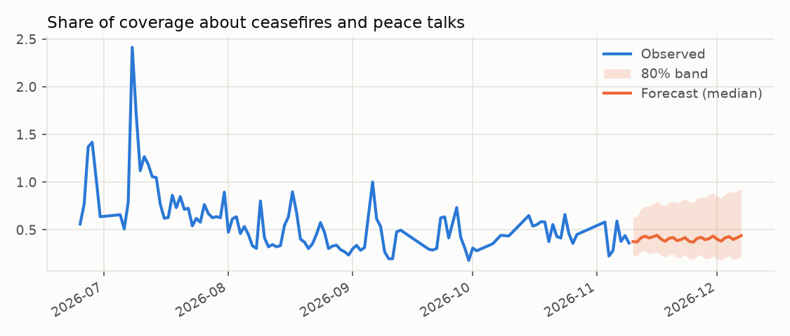
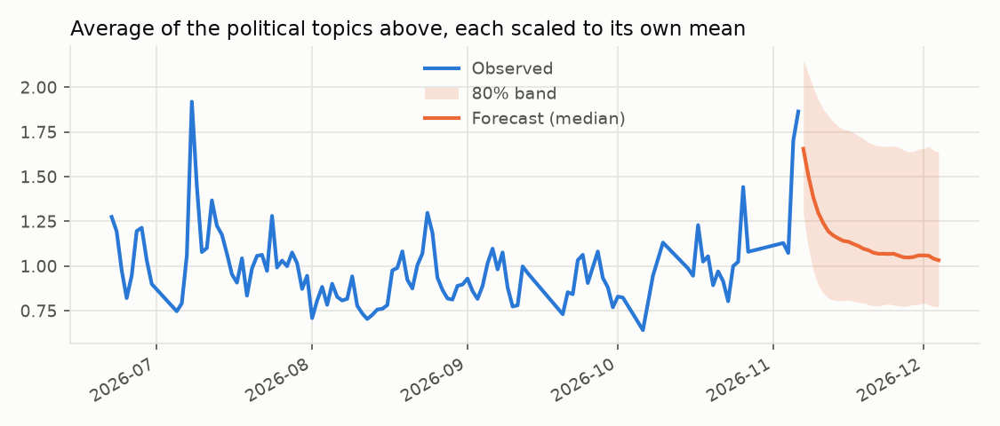
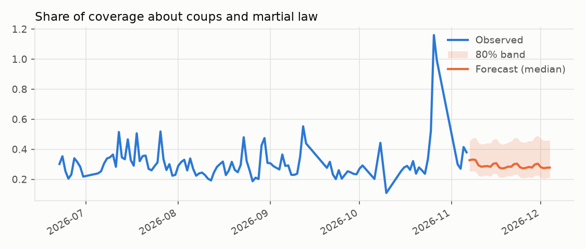
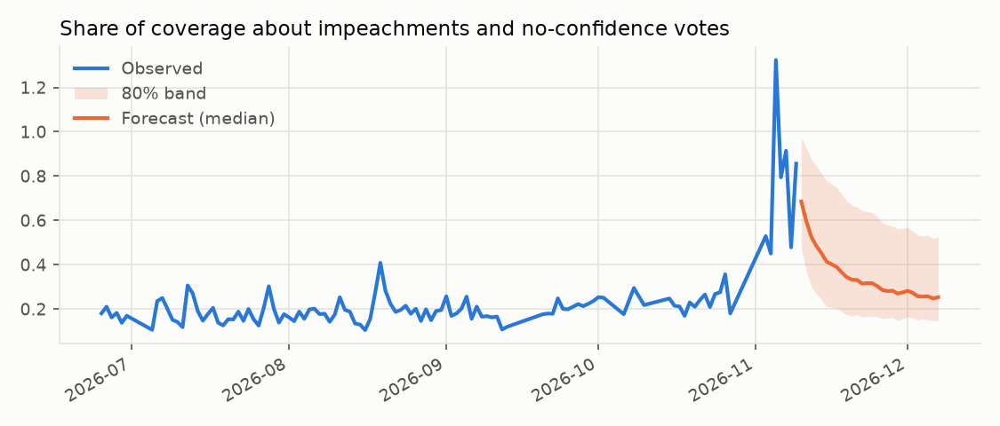
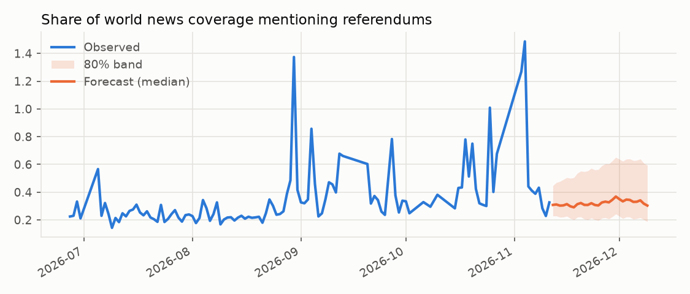
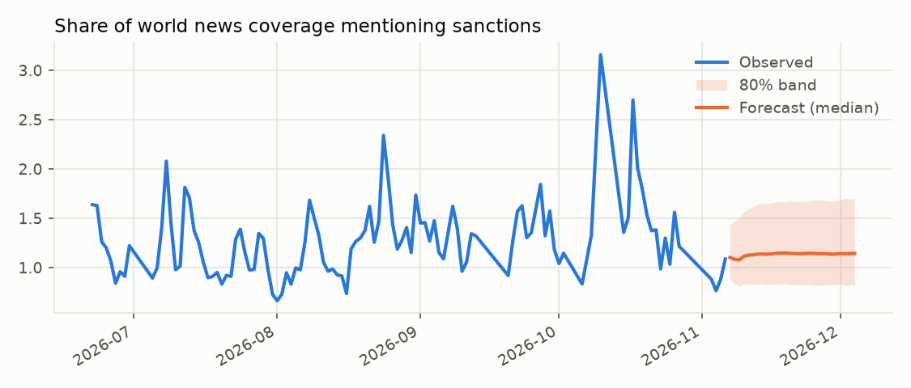
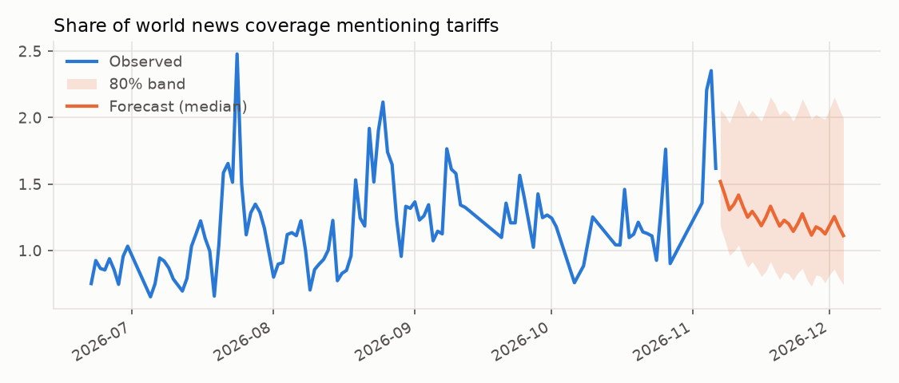

### Stock and value markets

| series     |      last | target date   | median   | chance higher   | range (10%-90%)   |
|:-----------|----------:|:--------------|:---------|:----------------|:------------------|
| aapl       |   348.51  | 2026-12-09    | +0.6%    | 55%             | -6.4% to +5.7%    |
| bitcoin    | 73776.2   | 2026-12-09    | -1.8%    | 44%             | -17.3% to +15.5%  |
| copper     |     6.328 | 2026-12-10    | -0.9%    | 40%             | -9.2% to +5.0%    |
| gold       |  4063.3   | 2026-12-10    | +0.5%    | 54%             | -6.5% to +9.6%    |
| msci_world |   203.86  | 2026-12-09    | +2.3%    | 78%             | -1.6% to +5.3%    |
| nasdaq100  | 27740.8   | 2026-12-09    | +3.1%    | 68%             | -5.3% to +10.4%   |
| nvda       |   168.89  | 2026-12-09    | +1.0%    | 52%             | -22.9% to +22.6%  |
| oil_wti    |    86.39  | 2026-12-10    | -1.3%    | 46%             | -16.1% to +14.9%  |
| silver     |    52.73  | 2026-12-10    | -0.9%    | 47%             | -13.0% to +15.2%  |
| sp500      |  7520.93  | 2026-12-09    | +2.1%    | 73%             | -2.6% to +5.5%    |
| tlt        |    80.88  | 2026-12-09    | +1.6%    | 76%             | -1.3% to +4.2%    |
| tsla       |   379.78  | 2026-12-09    | +0.1%    | 50%             | -16.3% to +16.5%  |
| us10y      |     4.983 | 2026-12-09    | -0.9%    | 41%             | -6.1% to +4.7%    |
| vix        |    19.46  | 2026-12-09    | -9.8%    | 30%             | -26.0% to +19.9%  |
| xom        |   164.47  | 2026-12-09    | -0.3%    | 48%             | -11.0% to +11.1%  |

### New technologies

| series            |      last | target date   | median   | chance higher   | range (10%-90%)   |
|:------------------|----------:|:--------------|:---------|:----------------|:------------------|
| adoption_ev       |    25     | 2028-01-01    | +11.9%   | 71%             | -20.4% to +38.9%  |
| adoption_internet |    73.6   | 2028-01-01    | +5.8%    | 79%             | -2.9% to +19.5%   |
| adoption_solar    |     8.745 | 2028-01-01    | +49.5%   | 95%             | +15.3% to +94.2%  |
| adoption_wind     |     8.539 | 2028-01-01    | +6.9%    | 73%             | -9.3% to +22.4%   |
| space_launches    |  4510     | 2028-01-01    | -37.8%   | 11%             | -68.1% to +1.7%   |
| tech_composite    |     0.715 | 2026-12-08    | +1.0%    | 54%             | -11.1% to +17.2%  |
| wiki_ai           | 14924     | 2026-12-08    | -8.4%    | 28%             | -25.6% to +14.4%  |
| wiki_battery      |   308     | 2026-12-08    | +7.2%    | 62%             | -20.7% to +58.9%  |
| wiki_crispr       |   615     | 2026-12-08    | +9.4%    | 73%             | -10.5% to +34.3%  |
| wiki_ev           |   369     | 2026-12-08    | -1.8%    | 44%             | -19.0% to +21.3%  |
| wiki_fusion       |   615     | 2026-12-08    | +0.2%    | 51%             | -17.9% to +31.0%  |
| wiki_gene_therapy |   145     | 2026-12-08    | +9.1%    | 68%             | -13.2% to +40.6%  |
| wiki_humanoid     |   270     | 2026-12-08    | +2.1%    | 55%             | -16.6% to +33.6%  |
| wiki_llm          |  3577     | 2026-12-08    | -11.6%   | 14%             | -22.8% to +2.0%   |
| wiki_quantum      |  1524     | 2026-12-08    | +8.1%    | 70%             | -10.6% to +40.0%  |
| wiki_self_driving |   393     | 2026-12-08    | +6.3%    | 66%             | -13.6% to +33.2%  |
| wiki_starship     |  1669     | 2026-12-08    | -5.0%    | 41%             | -27.1% to +72.3%  |

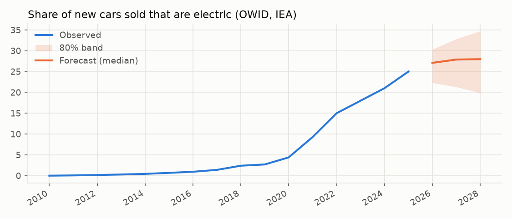

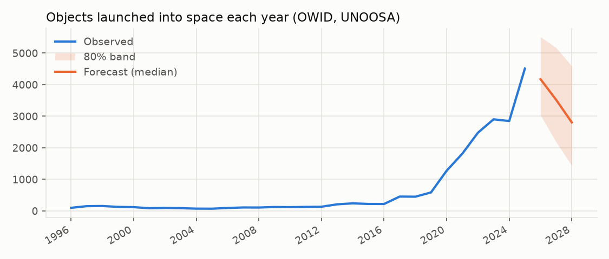

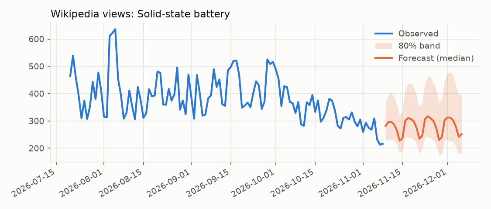

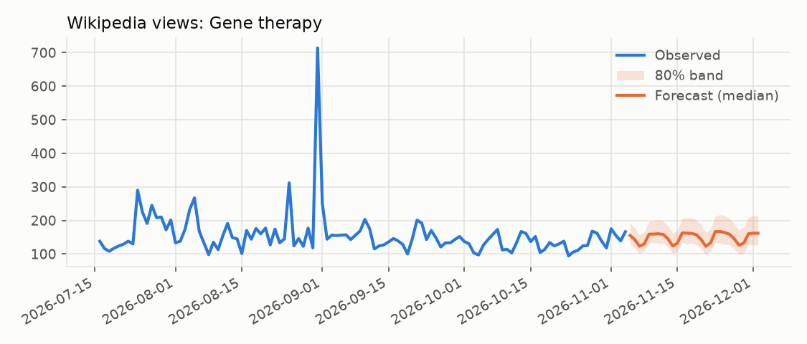

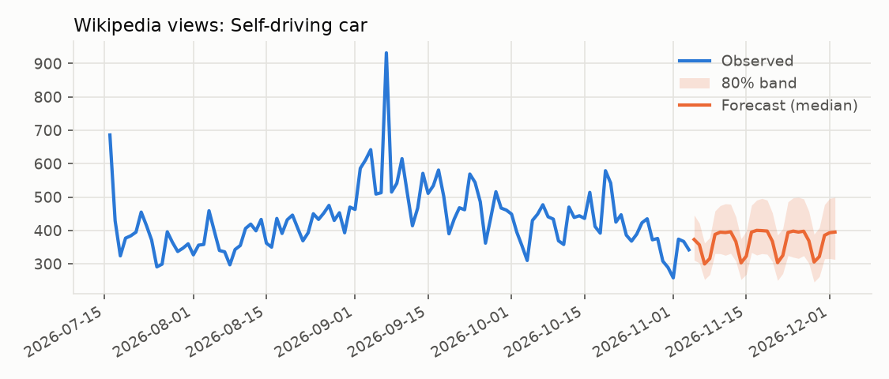
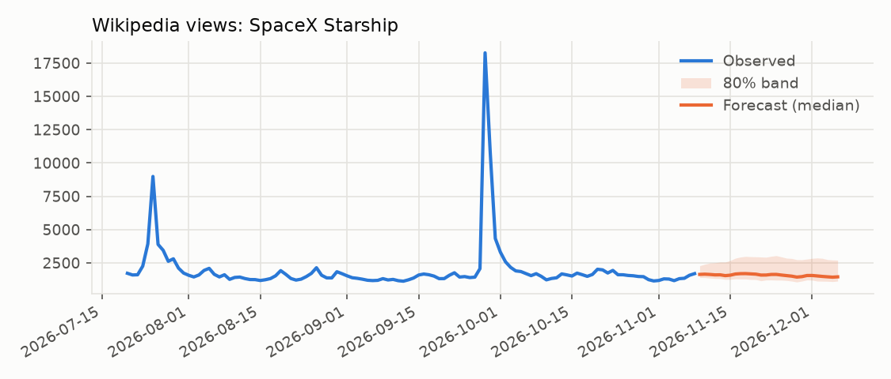

### Weather and the planet

| series              |   last | target date   | median   | chance higher   | range (10%-90%)   |
|:--------------------|-------:|:--------------|:---------|:----------------|:------------------|
| quakes_m45          | 18     | 2026-11-24    | -8.0%    | 42%             | -44.4% to +57.7%  |
| weather_arctic_ice  |  8.658 | 2026-11-23    | +13.2%   | 95%             | +9.9% to +16.5%   |
| weather_london      |  9.6   | 2026-11-24    | +6.0%    | 58%             | -29.1% to +48.3%  |
| weather_los_angeles | 29.8   | 2026-11-24    | -22.6%   | 5%              | -38.9% to -4.3%   |
| weather_new_delhi   | 28.3   | 2026-11-24    | -12.6%   | 5%              | -23.9% to -4.3%   |
| weather_sydney      | 22.8   | 2026-11-24    | +11.7%   | 73%             | -11.4% to +45.8%  |
| weather_tokyo       | 10.5   | 2026-11-24    | +31.1%   | 80%             | -15.3% to +78.1%  |
| weather_world_air   | 14.827 | 2026-11-19    | -4.0%    | 5%              | -5.9% to -2.6%    |
| weather_world_sea   | 21.021 | 2026-11-08    | -0.2%    | 5%              | -0.5% to -0.0%    |

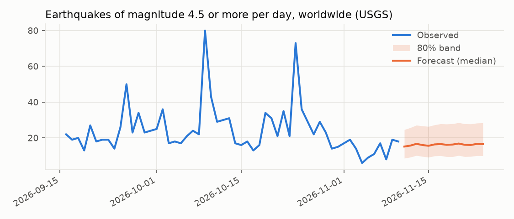
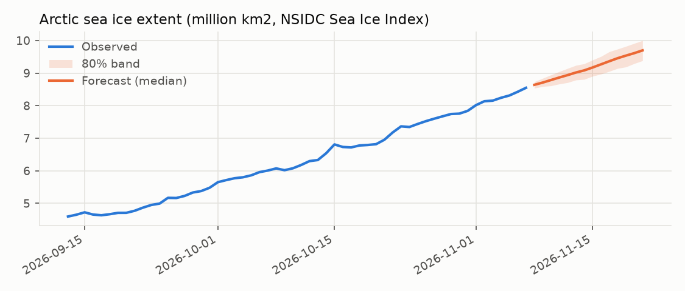
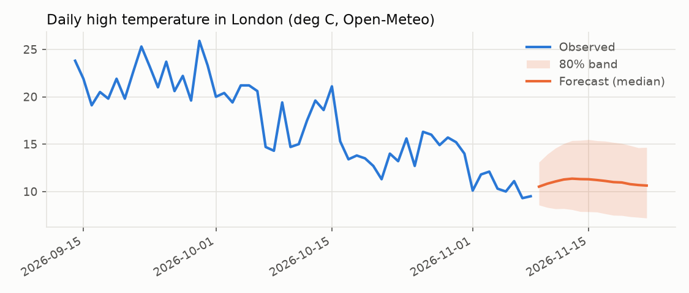
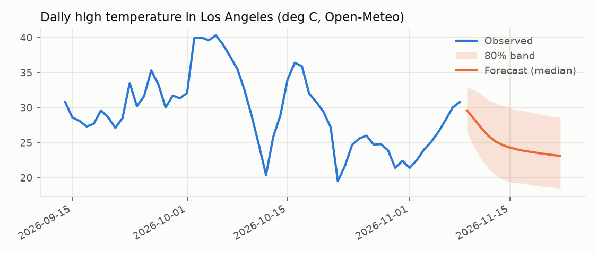
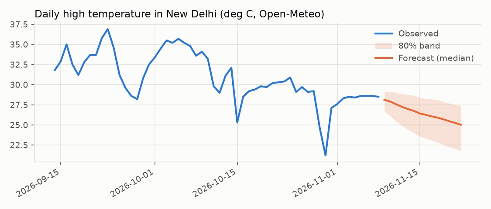
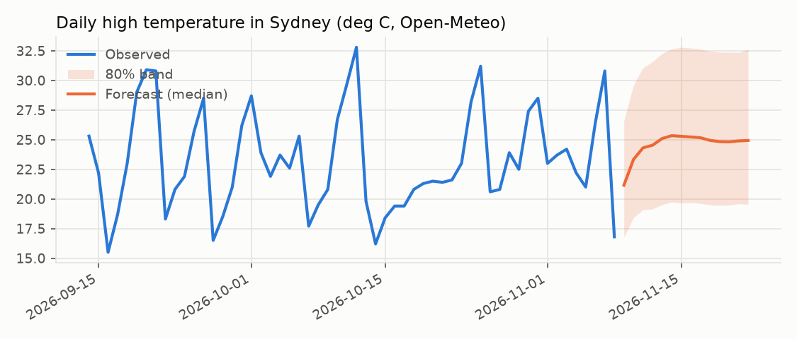
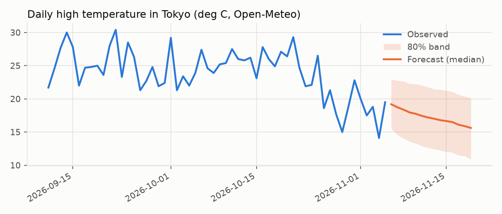
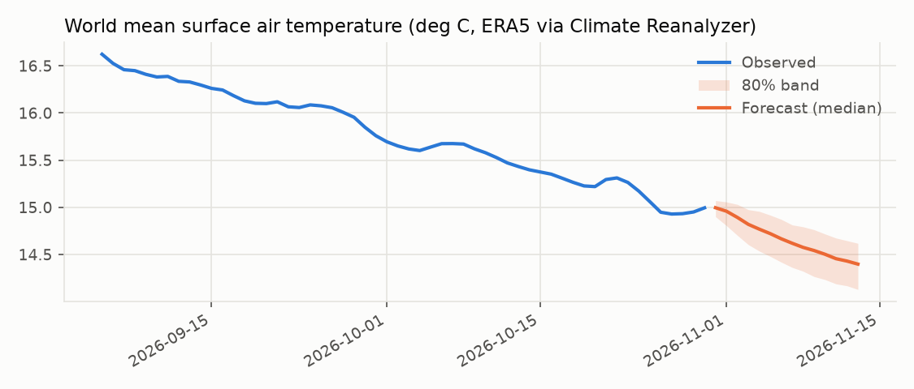
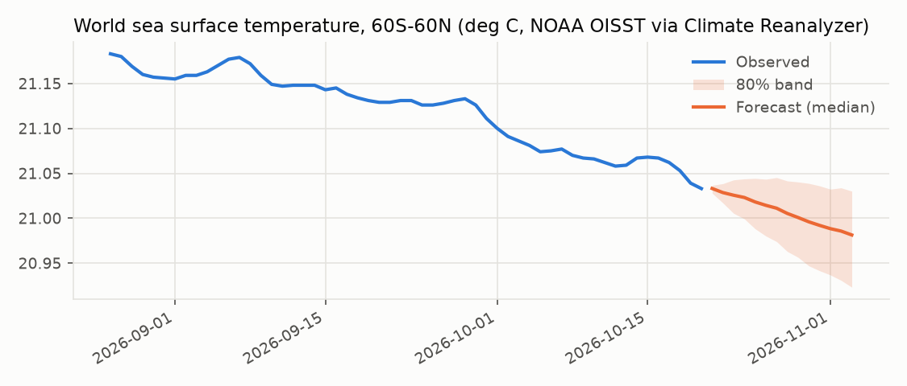

## 9. The long-term monitor

Every sealed forecast that has come due, scored against what really happened. Unlike the backtest, none of these could have been fitted to the outcome. Run `psychohistory monitor` for the same in the terminal; the app's Monitor view draws it month by month.

| Model | Forecasts | Weekly batches | Skill vs "no change" | In 80% range | Right direction | Brier |
|---|---|---|---|---|---|---|
| auto-ets | 3614 | 11 | -0.0% | 82% | 51% | 0.249 |
| chronos-bolt | 3614 | 11 | +19.2% | 69% | 63% | 0.210 |
| ensemble | 3614 | 11 | +14.1% | 81% | 59% | 0.209 |
| radiant | 1142 | 5 | +16.2% | 68% | 69% | 0.191 |
| radiant-core | 1142 | 5 | +1.5% | 65% | 68% | 0.241 |
| seldon | 1142 | 5 | +21.2% | 70% | 67% | 0.190 |
| seldon-laws | 2538 | 9 | +7.3% | 66% | 61% | 0.208 |
| timesfm-2.5 | 3614 | 11 | +16.2% | 68% | 63% | 0.208 |

**Is timesfm-2.5 really better than "no change"?** A Diebold-Mariano test on the weekly batches (Newey-West variance, as the batches' horizons overlap, with the Harvey-Leybourne-Newbold small-sample correction and Student's t):

- All areas: better than no change (p = 0.00)
- Stock and value markets: not distinguishable from no change (p = 0.66)
- World events in the news: better than no change (p = 0.03)
- Political events: too early: 2 of 4 weekly batches
- New technologies: better than no change (p = 0.00)
- Weather and the planet: too early: 3 of 4 weekly batches

**Drift alarms** (forecasts due in the last 13 weeks): 36 raised. Every forecaster is tested on every series at once, so alarms must pass a Benjamini-Hochberg false-discovery cut of 5%.
- auto-ets on news_composite: edge lost
- auto-ets on news_inflation: edge lost
- chronos-bolt on wiki_ev: edge lost
- ensemble on wiki_humanoid: edge lost
- radiant on wiki_crispr: edge lost
- seldon on wiki_crispr: edge lost
- timesfm-2.5 on copper: edge lost
- timesfm-2.5 on sp500: edge lost
- timesfm-2.5 on wiki_ev: edge lost
- auto-ets on news_inflation: range too wide
- auto-ets on news_protest: range too wide
- auto-ets on nvda: range too narrow
- auto-ets on nvda: worse than no change
- auto-ets on tech_composite: range too wide
- auto-ets on wiki_crispr: range too wide
- auto-ets on wiki_fusion: range too wide
- auto-ets on wiki_humanoid: range too wide
- auto-ets on wiki_quantum: range too wide
- chronos-bolt on gold: worse than no change
- chronos-bolt on news_climate: range too narrow
- chronos-bolt on news_pandemic: range too narrow
- chronos-bolt on nvda: range too narrow
- chronos-bolt on wiki_llm: range too narrow
- chronos-bolt on xom: worse than no change
- ensemble on news_protest: range too wide
- ensemble on nvda: range too narrow
- ensemble on tech_composite: range too wide
- ensemble on wiki_crispr: range too wide
- ensemble on wiki_fusion: range too wide
- ensemble on wiki_humanoid: range too wide
- ensemble on xom: worse than no change
- seldon-laws on nvda: range too narrow
- timesfm-2.5 on news_pandemic: range too narrow
- timesfm-2.5 on wiki_crispr: range too narrow
- timesfm-2.5 on wiki_llm: range too narrow
- timesfm-2.5 on xom: worse than no change

## 10. Volatility forecasts

Each market's volatility over the next week and month, forecast at every weekly origin from 2005-12-29 to 2026-11-04 and scored with QLIKE against the volatility that followed. Skill is against last month's volatility carried forward, on the same windows; p is a Diebold-Mariano test.

| Forecaster | Ahead | Windows | Skill | Beat it in | Typical miss | p |
|---|---|---|---|---|---|---|
| garch | 1 week | 13960 | +17.3% | 14 of 14 markets | 32% | 0.000 |
| ewma | 1 week | 13960 | +11.3% | 14 of 14 markets | 31% | 0.000 |
| timesfm-2.5 | 1 week | 168 | +10.3% | 7 of 14 markets | 23% | 0.170 |
| last-month | 1 week | 13960 | baseline |  | 31% |  |
| chronos-bolt | 1 week | 168 | -6.7% | 6 of 14 markets | 25% | 0.448 |
| seldon-laws | 1 week | 168 | -7.7% | 5 of 14 markets | 32% | 0.354 |
| radiant-core | 1 week | 168 | -40.4% | 3 of 14 markets | 39% | 0.717 |
| radiant | 1 week | 168 | -49.5% | 6 of 14 markets | 28% | 0.950 |
| seldon | 1 week | 168 | -105.5% | 4 of 14 markets | 35% | 0.371 |
| garch | 1 month | 13914 | +30.0% | 13 of 14 markets | 24% | 0.000 |
| ewma | 1 month | 13914 | +17.5% | 14 of 14 markets | 22% | 0.000 |
| last-month | 1 month | 13914 | baseline |  | 23% |  |
| seldon-laws | 1 month | 168 | -54.5% | 3 of 14 markets | 23% | 0.394 |
| timesfm-2.5 | 1 month | 168 | -61.8% | 7 of 14 markets | 25% | 0.109 |
| radiant-core | 1 month | 168 | -81.5% | 7 of 14 markets | 28% | 0.291 |
| chronos-bolt | 1 month | 168 | -88.4% | 9 of 14 markets | 19% | 0.022 |
| radiant | 1 month | 168 | -94.1% | 3 of 14 markets | 26% | 0.072 |
| seldon | 1 month | 168 | -197.1% | 4 of 14 markets | 32% | 0.032 |

Sealed volatility forecasts are in `predictions/vol_ledger.csv`, fingerprinted in `predictions/vol_seals.csv` and scored in `predictions/vol_scored.csv`.

## 11. Event odds

The chance that a news or technology series reaches, four weeks ahead, a level it reaches only one day in ten (a spike: above the 90th percentile of its last two years) or falls to a low it sees one day in ten (a lull). Odds are scored with the Brier score; skill is against climatology (10%) and against persistence (what followed days like the origin), on the same forecasts. p is a Diebold-Mariano test of the edge over climatology.

| Event | Forecaster | Forecasts | Happened | Said | Brier | vs climatology | vs persistence | p |
|---|---|---|---|---|---|---|---|---|
| lull | radiant | 300 | 19% | 19% | 0.1305 | +19.5% | +12.5% | 0.018 |
| lull | timesfm-2.5 | 300 | 19% | 19% | 0.1308 | +19.3% | +12.3% | 0.017 |
| lull | seldon-laws | 300 | 19% | 23% | 0.1342 | +17.2% | +9.9% | 0.076 |
| lull | seldon | 300 | 19% | 19% | 0.1403 | +13.5% | +5.9% | 0.072 |
| lull | chronos-bolt | 300 | 19% | 16% | 0.1413 | +12.8% | +5.2% | 0.053 |
| lull | radiant-core | 300 | 19% | 26% | 0.1478 | +8.8% | +0.8% | 0.432 |
| lull | persistence | 300 | 19% | 12% | 0.1491 | +8.1% | baseline | 0.154 |
| lull | climatology | 300 | 19% | 10% | 0.1621 | baseline | -8.8% |  |
| spike | timesfm-2.5 | 300 | 9% | 6% | 0.0686 | +13.6% | +7.1% | 0.016 |
| spike | radiant | 300 | 9% | 6% | 0.0700 | +11.8% | +5.2% | 0.047 |
| spike | chronos-bolt | 300 | 9% | 6% | 0.0700 | +11.8% | +5.2% | 0.038 |
| spike | seldon | 300 | 9% | 8% | 0.0729 | +8.1% | +1.2% | 0.374 |
| spike | persistence | 300 | 9% | 9% | 0.0738 | +7.0% | baseline | 0.014 |
| spike | climatology | 300 | 9% | 10% | 0.0793 | baseline | -7.5% |  |
| spike | seldon-laws | 300 | 9% | 11% | 0.0807 | -1.7% | -9.3% | 0.844 |
| spike | radiant-core | 300 | 9% | 11% | 0.0841 | -6.0% | -13.9% | 0.631 |

Sealed event odds are in `predictions/event_ledger.csv`, fingerprinted in `predictions/event_seals.csv` and scored in `predictions/event_scored.csv`.
